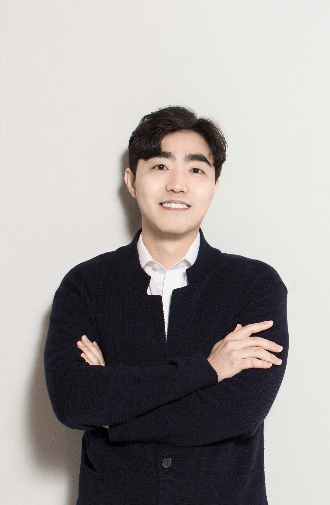

<!-- Shared styling is intentionally page-level. Keep _quarto.yml unchanged. -->

::::: {#cj-home .cj-page}

<header class="cj-hero cj-hero--home">

Computational social science · Human–AI interaction

<h1>Changjun Lee이창준</h1>

데이터로 인간과 사회를 이해하고, 더 나은 기술 경험을 연구합니다.

I study how people experience technology—and how those experiences shape society. At Sungkyunkwan University, I lead <a href="https://axislabskku.com/">AXIS Lab</a>, connecting data, human experience, and creative practice.

Associate Professor · Sungkyunkwan University 성균관대학교 부교수 · AXIS Lab

<a href="about.qmd">About me →</a><a href="https://axislabskku.com/">AXIS Lab ↗</a><a href="mailto:changjunlee@skku.edu">Email ↗</a>

<figure class="cj-portrait">

<figcaption>Researcher. Educator. Curious human.</figcaption>
</figure>
</header>

<nav class="cj-focus" aria-label="Research areas">
<a href="about.qmd#research">01 Human–AI interaction</a>
<a href="about.qmd#research">02 Media &amp; platforms</a>
<a href="about.qmd#research">03 Knowledge &amp; innovation</a>
</nav>

<h2 id="latest">Recently최근 소식</h2><a class="cj-text-link" href="about.qmd#highlights">More updates →</a>

<article class="cj-news-row">
2026.09

<h3>WEM 〈성북서림〉 · 서울 플레이업 AI 게임 챌린지 최우수상</h3>
AXIS Lab이 개발에 협력한 학생팀의 수상 소식입니다. 작품은 DDP에서 열린 GES 2026에서 발표·전시됐습니다. <a href="https://www.spressnews.com/news/articleView.html?idxno=139123">기사 ↗</a>

</article>
<article class="cj-news-row">
2026.09

<h3>지능정보사회 이용자 패널조사 논문공모전 우수논문 선정</h3>
김수연 박사과정 학생이 주저자로, 이창준 교수가 교신저자로 참여한 논문이 우수논문으로 선정되었습니다. <a href="about.qmd#achievements">수상 내역 →</a>

</article>
<article class="cj-news-row">
2026.09.19

<h3>AI와 함께 만드는 우리 가족 이야기</h3>
서울유아독서축제에서 포동(Phodong)으로 유아·보호자 약 200명과 만났습니다. <a href="https://www.spressnews.com/news/articleView.html?idxno=139091">기사 ↗</a>

</article>
<article class="cj-news-row">
2026.09

<h3>From the classroom to Ars Electronica</h3>
린츠예술대학교와의 WAVE 공동수업을 Ars Electronica 2026 국제 전시로 연결했습니다. <a href="https://www.spressnews.com/news/articleView.html?idxno=139065">기사 ↗</a>

</article>

<section>
Teaching
<h2>Learning through questions.</h2>
사람과 사회에 대한 질문을 데이터 분석과 창작으로 연결하는 수업을 만듭니다.
<a class="cj-text-link" href="teaching/index.qmd">Explore courses →</a></section>
<section>
Research
<h2>Ideas, evidence, connections.</h2>
개인의 경험에서 플랫폼과 사회의 변화까지, 데이터와 실험으로 연결을 살펴봅니다.
<a class="cj-text-link" href="about.qmd#publications">Publications →</a></section>

<aside class="cj-personal-note" aria-label="Beyond research">
Beyond the desk

Data scientist by training, humanist at heart. Grounded in faith and curiosity, I’m usually exploring new ideas, discovering new places, or enjoying a good cup of coffee.
</aside>

<footer class="cj-footer">
<a href="https://scholar.google.com/citations?user=aUHA25kAAAAJ&amp;hl=en">Google Scholar ↗</a><a href="https://www.linkedin.com/in/cjlee8312/">LinkedIn ↗</a><a href="https://www.instagram.com/lee_changjun_/">Instagram ↗</a><a href="mailto:changjunlee@skku.edu">Email ↗</a>

Changjun Lee · AXIS Lab · Seoul, Republic of Korea
</footer>

:::::
