[Weekly content](https://changjunlee.com/teaching/grad_stat/weekly_2/)

<br>

## 4주차 학습목표

::: {.callout-note}
이번 주 학습을 마치면 다음을 할 수 있어야 합니다.

1. `tidyverse`의 핵심 철학과 주요 패키지의 역할을 설명한다.
2. 네이티브 파이프 `|>`를 사용해 읽기 쉬운 데이터 변환 과정을 작성한다.
3. `filter()`, `select()`, `arrange()`, `mutate()`, `summarise()`를 연구질문에 맞게 사용한다.
4. `count()`, `distinct()`, `slice_*()`, `across()`를 사용해 자료를 점검하고 요약한다.
5. 패널 데이터를 **long format**으로 구성하고 `pivot_longer()`와 `pivot_wider()`로 형태를 바꾼다.
6. 조인 전에 key의 고유성과 매칭 관계를 점검하고, `join_by()`와 `relationship`을 사용해 안전하게 표를 결합한다.
7. 변환 전후의 행 수, 참여자 수, 결측, 중복을 감사하여 데이터 손실이나 행 증식을 발견한다.
8. ChatGPT와 같은 GenAI를 코드 생성기보다 **설계 검토자·디버깅 튜터·데이터 감사자**로 활용한다.
:::

### 오늘의 핵심 질문

> **같은 사람을 여러 해 추적한 자료에서, 누가 무엇을 바꾸었는지 어떻게 확인할까?**

- 2017년 KT 이용자는 2018년과 2019년에 어떤 통신사를 이용했는가?
- 2017년 삼성 스마트폰 이용자는 이후에도 같은 브랜드를 사용했는가?
- 데이터 변환 과정에서 일부 참여자가 사라지거나 같은 사람이 여러 번 복제되지는 않았는가?
- 코드가 실행되었다는 사실만으로 결합과 요약이 정확하다고 말할 수 있는가?

```{mermaid}
flowchart LR
    A["Research Question<br>무엇이 변했는가?"] --> B["Tidy Data<br>관측단위와 key 확인"]
    B --> C["Transform<br>행·열·값·형태 변환"]
    C --> D["Audit<br>중복·결측·행 수 점검"]
    D --> E["Evidence<br>표와 시각화"]
    E --> F["Claim<br>가능한 주장과 한계"]
```

::: {.callout-important}
이번 주의 핵심은 함수를 많이 외우는 것이 아닙니다. 각 변환 뒤에 다음 세 질문을 반복하는 것입니다.

1. **무엇이 한 행인가?**
2. **행 수와 참여자 수가 왜 이렇게 되었는가?**
3. **이 결과로 어떤 주장을 할 수 있고, 무엇은 아직 말할 수 없는가?**
:::

------------------------------------------------------------------------

## 이번 주의 GenAI 활용 방식

3주차의 원칙을 이어갑니다.

> **Attempt → Ask → Test → Audit → Explain**

| 단계 | 학생이 먼저 할 일 | GenAI에 맡길 수 있는 일 |
|---|---|---|
| **Attempt** | 관측단위, key, 예상 행 수를 적고 첫 코드를 작성 | 아직 사용하지 않음 |
| **Ask** | 문제와 제약을 구체적으로 설명 | 대안 코드, 점검 항목, 오류 원인 후보 제안 |
| **Test** | 모든 제안 코드를 R에서 직접 실행 | 실행 결과를 대신 만들어 달라고 하지 않음 |
| **Audit** | 행 수, 고유 ID, 결측, 중복, join 불일치를 확인 | 놓친 검증 절차를 reviewer처럼 지적 |
| **Explain** | 채택·수정·기각 이유를 자신의 말로 설명 | 설명의 모호함이나 과도한 주장 비판 |

### 좋은 질문의 기본 구조

```text
나는 대학원 HCI 연구방법 수업에서 tidyverse를 배우고 있다.
자료는 동일한 참여자를 2017~2019년에 반복 측정한 패널 자료다.
한 행은 한 참여자의 한 연도 기록이며, key는 participant_id + year이다.

아래에 내가 작성한 코드와 실행 전후의 nrow(), n_distinct(), count() 결과를 제공하겠다.

1. 코드를 다시 쓰기 전에 변환 목적을 한 문장으로 요약하라.
2. 행이 사라지거나 증식할 수 있는 지점을 지적하라.
3. 확인할 R 코드를 최대 3개만 제안하라.
4. 자료에 없는 인과관계는 추론하지 말라.
5. 마지막에 내가 직접 설명해야 할 질문 하나를 제시하라.
```

::: {.callout-warning title="민감한 연구자료를 입력하지 않기"}
실제 IRB 자료, 개인 식별자, 비공개 로그, API key를 공개형 GenAI에 입력하지 않습니다. 다음과 같은 최소 정보만으로도 대부분의 코드 상담이 가능합니다.

- 비식별·합성 예시 자료
- `glimpse()` 또는 `str()` 출력
- 변수명과 코드북 일부
- `count()`, `summary()`, 결측 개수
- 최소 재현 코드와 실제 오류 메시지
:::

------------------------------------------------------------------------

## Korea Media Panel: List에서 패널 데이터로

- [한국미디어패널조사](https://stat.kisdi.re.kr/kor/contents/ContentsList.html)는 동일한 개인과 가구를 반복 조사하여 미디어 기기, 통신서비스, 지출, 이용행태 등의 변화를 추적합니다.
- 이번 수업에서는 구조를 이해하기 쉽도록 만든 작은 toy dataset을 사용합니다.

<br>

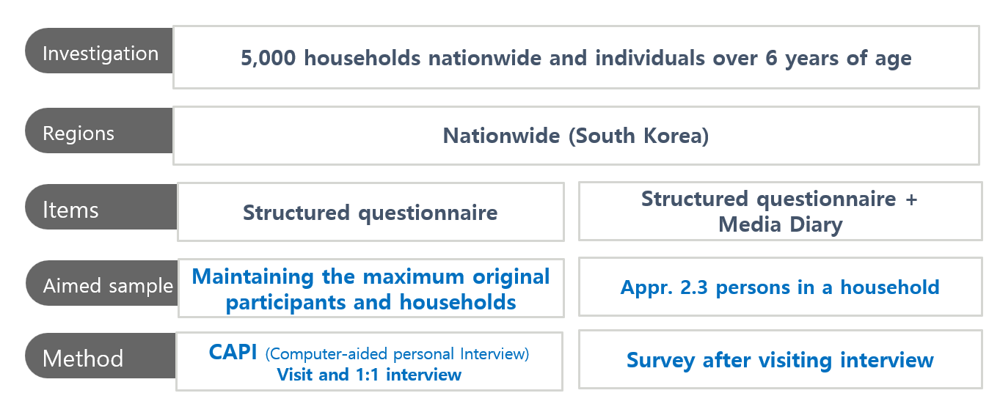

<br>

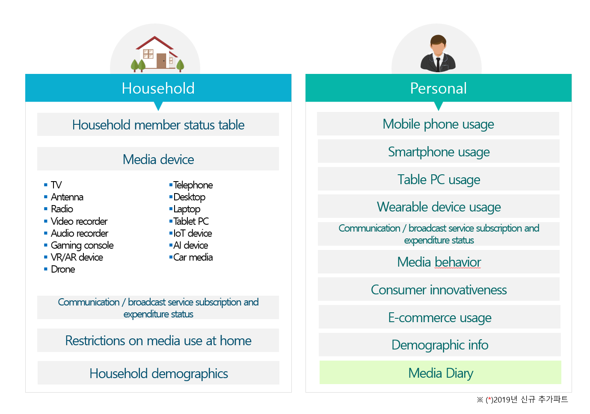

<br>

- 수업용 데이터: [List_KMP.RData](data/List_KMP.RData)
- 프로젝트 안의 `data/` 폴더에 파일이 있는지 먼저 확인합니다.

### 패키지 준비

```{r}
#| label: setup
#| message: false
#| warning: false

library(tidyverse)
```

```{r}
packageVersion("dplyr")
packageVersion("tidyr")
```

::: {.callout-tip}
`install.packages("tidyverse")`는 컴퓨터에 패키지를 **한 번 설치**할 때 사용합니다. `library(tidyverse)`는 현재 R 세션에서 패키지를 **불러올 때마다** 사용합니다.
:::

### `.RData` 파일을 불러올 때 확인할 것

`load()`는 파일 안의 객체를 현재 환경에 직접 생성합니다. 따라서 반환되는 객체 이름을 확인하는 습관이 중요합니다.

```{r}
loaded_objects <- load("data/List_KMP.RData")
loaded_objects
```

```{r}
str(List.KMP, max.level = 1)
```

::: {.callout-note title="RData와 RDS의 차이"}
- `load()`는 하나 이상의 객체를 현재 환경에 생성합니다.
- `readRDS()`는 한 객체를 반환하므로 `x <- readRDS("file.rds")`처럼 이름을 명시할 수 있습니다.
- 이번에는 제공된 파일 형식을 유지하여 `load()`를 사용하지만, 새 연구 프로젝트에서는 한 객체씩 저장하는 `.rds`가 더 명시적인 경우가 많습니다.
:::

### List의 각 요소에 이름 붙이기

```{r}
names(List.KMP)
```

```{r}
names(List.KMP) <- c("p17", "p18", "p19", "d19")
names(List.KMP)
```

각 요소의 크기와 클래스를 한 번에 확인해 봅시다.

```{r}
kmp_inventory <- tibble(
  table = names(List.KMP),
  class = map_chr(List.KMP, ~ class(.x)[1]),
  rows = map_int(List.KMP, nrow),
  columns = map_int(List.KMP, ncol)
)

kmp_inventory
```

### `[ ]`, `[[ ]]`, `$`의 차이

| 표현 | 반환 결과 | 언제 사용하는가 |
|---|---|---|
| `List.KMP["p17"]` | 길이 1의 **list** | 원래 list 구조를 유지하고 싶을 때 |
| `List.KMP[["p17"]]` | list 안의 **data frame** | 요소 자체를 꺼낼 때 |
| `List.KMP$p17` | 이름으로 꺼낸 **data frame** | 이름이 고정되어 있고 대화형 분석을 할 때 |

```{r}
class(List.KMP["p17"])
class(List.KMP[["p17"]])
```

```{r}
p17_raw <- List.KMP[["p17"]]
p18_raw <- List.KMP[["p18"]]
p19_raw <- List.KMP[["p19"]]
d19_raw <- List.KMP[["d19"]]

glimpse(p17_raw)
```

### List는 서로 다른 연구 객체를 묶는 container

기존처럼 임의의 숫자와 행렬을 추가하기보다, 실제 연구 프로젝트의 bundle을 만들어 봅시다.

```{r}
kmp_bundle <- list(
  person_waves = List.KMP[c("p17", "p18", "p19")],
  diary_2019 = List.KMP[["d19"]],
  metadata = list(
    source = "Korea Media Panel toy data",
    person_unit = "one participant in one year",
    diary_unit = "one participant in 2019"
  )
)

str(kmp_bundle, max.level = 2)
```

```{r}
kmp_bundle$metadata$person_unit
kmp_bundle[["person_waves"]][["p17"]] |> head(3)
```

::: {.callout-tip title="GenAI Checkpoint 1 — 자료구조를 먼저 설명하게 하기"}
원자료 대신 `str(kmp_bundle, max.level = 2)` 출력만 제공하고 다음처럼 질문합니다.

```text
이 출력에서 확인되는 객체의 계층을 설명하라.
각 data frame의 관측단위와 가능한 key를 추정하되,
출력만으로 확정할 수 없는 부분은 반드시 질문으로 남겨라.
코드는 작성하지 말라.
```

AI가 관측단위를 단정한다면, 코드북과 실제 수집 절차로 다시 확인합니다.
:::

------------------------------------------------------------------------

## 변수명을 정리하고 세 개 연도를 쌓기

현재 변수명은 원자료의 형식을 반영하지만, 분석 코드에서는 뜻이 분명한 `snake_case` 이름이 더 읽기 쉽습니다.

### 정리 함수를 한 번 정의하기

```{r}
clean_kmp_person <- function(df) {
  df |>
    as_tibble() |>
    rename(
      participant_id = pid,
      mobile_level = Mobile.lv,
      telecom = Telecom,
      smartphone_brand = Smartphone.brand,
      spend_mobile = sp.mobile,
      spend_device = sp.device,
      spend_online_content = sp.online.content,
      spend_offline_content = sp.offline.contet
    ) |>
    mutate(
      participant_id = as.character(participant_id),
      across(
        c(gender, mobile_level, telecom, smartphone_brand),
        as.character
      ),
      year = as.integer(year)
    )
}
```

::: {.callout-note}
함수는 같은 규칙을 여러 표에 반복 적용할 때 유용합니다. 세 연도에 서로 다른 정리 코드를 복사해 붙이면, 한 연도에만 수정이 빠지는 문제가 생기기 쉽습니다.
:::

```{r}
p17 <- clean_kmp_person(p17_raw)
p18 <- clean_kmp_person(p18_raw)
p19 <- clean_kmp_person(p19_raw)

glimpse(p17)
```

### 세 연도를 long-format panel로 결합하기

```{r}
kmp_person <- List.KMP[c("p17", "p18", "p19")] |>
  map(clean_kmp_person) |>
  bind_rows(.id = "wave")

kmp_person |> glimpse()
```

현재 `kmp_person`의 관측단위는 다음과 같습니다.

> **한 행 = 한 참여자의 한 연도 기록**

따라서 후보 key는 `participant_id + year`입니다.

### Key를 감사하기

```{r}
key_audit <- kmp_person |>
  count(participant_id, year, name = "rows_per_key")

key_audit |>
  filter(rows_per_key != 1)
```

결과가 0행이라면 이 toy dataset에서는 각 `participant_id + year` 조합이 한 번씩만 나타납니다.

```{r}
kmp_person |>
  summarise(
    rows = n(),
    participants = n_distinct(participant_id),
    years = n_distinct(year),
    duplicate_keys = sum(duplicated(pick(participant_id, year)))
  )
```

### 2019 diary 자료도 정리하기

원자료의 `Smarphone.time`에는 철자 오류가 있으므로 분석 초기에 고칩니다.

```{r}
kmp_diary <- d19_raw |>
  as_tibble() |>
  rename(
    participant_id = pid,
    smartphone_time = Smarphone.time,
    sns_time = SNS.time
  ) |>
  mutate(
    participant_id = as.character(participant_id),
    year = as.integer(year)
  )

kmp_diary |> glimpse()
```

::: {.callout-important}
변수명을 바꾸는 것은 값의 의미를 바꾸는 일이 아닙니다. `smartphone_time`이 분인지, 하루 평균인지, 특정 조사일의 기록인지는 반드시 코드북에서 확인해야 합니다.
:::

------------------------------------------------------------------------

## Introduction to the tidyverse

`tidyverse`는 같은 데이터 표현과 일관된 함수 설계를 공유하는 R 패키지 모음입니다. Base R을 대체하는 별도의 언어가 아니라, 데이터 분석의 반복 작업을 일관된 문법으로 표현하도록 돕습니다.

| 패키지 | 주요 역할 | 이번 주 사용 |
|---|---|---|
| `tibble` | 현대적인 표 형태의 객체 | `as_tibble()`, 출력과 구조 확인 |
| `dplyr` | 행·열·값·그룹·표의 변환 | `filter()`, `mutate()`, `summarise()`, joins |
| `tidyr` | tidy data와 자료 형태 변환 | `pivot_longer()`, `pivot_wider()` |
| `readr` | CSV 등 직사각형 자료 불러오기 | 이후 실제 자료 import |
| `purrr` | list와 함수 반복 적용 | `map()`, `map_int()`, `map_chr()` |
| `ggplot2` | 문법 기반 시각화 | 이번 주에는 결과 점검용으로만 사용 |
| `stringr` | 문자열 처리 | 이후 텍스트 정리 |
| `forcats` | factor 처리 | 이후 범주 순서와 레이블 정리 |
| `lubridate` | 날짜와 시간 처리 | 이후 로그와 시계열 자료 |

- [Tidyverse 공식 홈페이지](https://www.tidyverse.org/)
- [R for Data Science, 2nd edition](https://r4ds.hadley.nz/)
- [Posit cheatsheets](https://posit.co/resources/cheatsheets/)

### 핵심 정신: 동사로 데이터에 질문하기

| 질문 | 함수 |
|---|---|
| 어떤 행을 남길까? | `filter()`, `slice_*()`, `distinct()` |
| 어떤 열을 사용할까? | `select()`, `pull()`, `relocate()` |
| 순서를 어떻게 바꿀까? | `arrange()` |
| 어떤 변수를 새로 만들까? | `mutate()`, `case_when()` |
| 여러 행을 어떻게 요약할까? | `summarise()`, `count()` |
| 그룹별로 같은 계산을 할까? | `.by`, `group_by()` |
| wide와 long을 어떻게 오갈까? | `pivot_longer()`, `pivot_wider()` |
| 다른 표와 어떻게 연결할까? | `*_join()` |

------------------------------------------------------------------------

## Pipe: 분석 과정을 왼쪽에서 오른쪽으로 읽기

현재 tidyverse 교육에서는 R의 네이티브 파이프 `|>`를 기본으로 사용합니다.

```{r}
kmp_person |>
  filter(year == 2017, telecom == "KT") |>
  select(participant_id, telecom, smartphone_brand, spend_mobile)
```

위 코드는 다음처럼 읽습니다.

> `kmp_person`에서 → 2017년 KT 이용자를 남기고 → 필요한 변수만 선택한다.

### 중첩 코드와 파이프 비교

```{r}
# 중첩된 형태
select(
  filter(kmp_person, year == 2017, telecom == "KT"),
  participant_id,
  telecom,
  smartphone_brand
)
```

```{r}
# 파이프 형태
kmp_person |>
  filter(year == 2017, telecom == "KT") |>
  select(participant_id, telecom, smartphone_brand)
```

::: {.callout-note title="왜 `%>%` 대신 `|>`를 사용하는가?"}
오래된 교재와 코드에서는 `%>%`를 자주 볼 수 있습니다. 두 파이프는 단순한 경우 비슷하게 작동하지만, `|>`는 R 자체에 포함되어 어떤 패키지의 함수에도 사용할 수 있습니다. 이 수업에서는 새 코드에 `|>`를 사용하고, `%>%`는 기존 코드를 읽을 수 있는 수준으로 이해합니다.
:::

### 파이프를 쓰지 않는 편이 나은 경우

- 두 개 이상의 주요 객체를 동시에 조작할 때
- 중간 결과가 연구적으로 중요한 의미를 가지며 이름을 붙여 보존해야 할 때
- 한 줄짜리 간단한 계산이 오히려 더 복잡해질 때

예를 들어 baseline cohort와 follow-up table은 각각 이름을 붙인 뒤 join하는 편이 더 명확합니다.

------------------------------------------------------------------------

## Tidy data: 코드보다 먼저 관측단위를 정하기

Tidy data의 기본 원칙은 다음과 같습니다.

1. 각 변수는 하나의 열이다.
2. 각 관측은 하나의 행이다.
3. 각 값은 하나의 셀이다.

그러나 가장 중요한 질문은 **무엇을 하나의 관측으로 정의할 것인가**입니다.

| 자료 | 한 행의 의미 | 후보 key |
|---|---|---|
| `p17`, `p18`, `p19` | 한 참여자의 한 연도 개인자료 | `participant_id` (각 연도 안에서) |
| `kmp_person` | 한 참여자의 한 연도 개인자료 | `participant_id + year` |
| `kmp_diary` | 한 참여자의 2019년 미디어 다이어리 | `participant_id + year` |
| 반복 과업 로그 | 한 참여자의 한 조건·한 과업 시행 | `participant_id + condition + task + trial` |

::: {.callout-warning}
행 수는 표본 수와 같지 않을 수 있습니다. `kmp_person`에는 30행이 있지만 독립적인 참여자는 10명입니다. 반복측정 자료에서 `nrow()`만 보고 표본 크기를 말하면 안 됩니다.
:::

```{r}
kmp_person |>
  summarise(
    rows = n(),
    unique_participants = n_distinct(participant_id),
    participant_years = n_distinct(interaction(participant_id, year))
  )
```

------------------------------------------------------------------------

## 1. 행을 다루는 동사

### `filter()`: 조건을 만족하는 행 남기기

```{r}
# 2017년 KT 이용자
kmp_person |>
  filter(year == 2017, telecom == "KT")
```

```{r}
# 2019년 Samsung 또는 Apple 이용자
kmp_person |>
  filter(
    year == 2019,
    smartphone_brand %in% c("Samsung", "Apple")
  )
```

```{r}
# 성인이면서 이동통신 지출이 50 이상인 관측
kmp_person |>
  filter(age >= 18, spend_mobile >= 50)
```

여러 조건을 쉼표로 나열하면 모두 만족해야 하므로 `&`와 같은 의미입니다.

```{r}
kmp_person |>
  filter(year == 2019, telecom == "KT")
```

```{r}
kmp_person |>
  filter(year == 2019 & telecom == "KT")
```

### 결측값은 별도로 다루기

```{r}
kmp_person |>
  filter(is.na(spend_mobile))
```

```{r}
kmp_person |>
  filter(!is.na(spend_mobile))
```

::: {.callout-warning}
`x == NA`는 결측 여부를 검사하지 못합니다. `is.na(x)`를 사용합니다. 또한 `filter()`는 조건 결과가 `NA`인 행을 남기지 않으므로, 결측을 보존해야 한다면 조건을 명시적으로 작성해야 합니다.
:::

### `distinct()`: 고유한 값과 중복 확인

```{r}
kmp_person |>
  distinct(telecom)
```

```{r}
kmp_person |>
  distinct(participant_id, year) |>
  count(year)
```

중복 key를 지우기 전에 먼저 원인을 확인합니다.

```{r}
kmp_person |>
  count(participant_id, year) |>
  filter(n > 1)
```

> `distinct()`는 중복 문제를 해결하는 마법의 함수가 아닙니다. 왜 중복이 생겼는지 모른 채 행을 제거하면 실제 반복관측을 잃을 수 있습니다.

### `slice_*()`: 위치, 표본, 상위·하위 행 선택

```{r}
kmp_person |>
  slice_head(n = 5)
```

```{r}
set.seed(2026)

kmp_person |>
  slice_sample(n = 5)
```

```{r}
kmp_person |>
  filter(year == 2019) |>
  slice_max(
    order_by = spend_mobile,
    n = 3,
    with_ties = FALSE
  )
```

::: {.callout-note title="기존 코드 읽기"}
- `sample_n()`과 `sample_frac()` 대신 `slice_sample()`을 사용합니다.
- `top_n()` 대신 `slice_max()` 또는 `slice_min()`을 사용합니다.
- 무작위 표본을 재현하려면 `set.seed()`를 기록합니다.
:::

### `arrange()`: 행의 순서 바꾸기

```{r}
kmp_person |>
  arrange(year, desc(spend_mobile)) |>
  select(participant_id, year, spend_mobile) |>
  slice_head(n = 10)
```

행의 순서를 바꾸는 것은 자료의 값이나 표본을 바꾸지 않습니다. 다만 `first()`나 `lag()`처럼 순서에 의존하는 함수 전에는 어떤 기준으로 정렬했는지 명시해야 합니다.

------------------------------------------------------------------------

## 2. 열을 다루는 동사

### `select()`: data frame으로 열 선택

```{r}
kmp_person |>
  select(participant_id, year, telecom, smartphone_brand)
```

```{r}
kmp_person |>
  select(participant_id, year, starts_with("spend_"))
```

유용한 tidy-select helper:

- `starts_with("spend_")`
- `ends_with("_time")`
- `contains("brand")`
- `where(is.numeric)`
- `all_of(variable_names)`
- `everything()`

### `pull()`: 한 열을 vector로 꺼내기

```{r}
kmp_person |>
  pull(spend_mobile) |>
  class()
```

```{r}
kmp_person |>
  select(spend_mobile) |>
  class()
```

- `pull()`은 vector를 반환합니다.
- `select()`는 열이 하나여도 tibble을 반환합니다.

### `rename()`과 `relocate()`

```{r}
kmp_person |>
  rename(mobile_spending = spend_mobile) |>
  relocate(wave, year, participant_id)
```

변수명을 바꾸거나 위치를 옮겨도 값 자체는 변하지 않습니다. 그래도 분석 전후에 `glimpse()`로 결과를 확인합니다.

------------------------------------------------------------------------

## 3. 값을 만들고 변환하는 동사

### `mutate()`: 새 변수 만들기

```{r}
kmp_enriched <- kmp_person |>
  mutate(
    any_spending_missing = if_any(
      c(
        spend_mobile,
        spend_device,
        spend_online_content,
        spend_offline_content
      ),
      is.na
    ),
    spend_total =
      spend_mobile +
      spend_device +
      spend_online_content +
      spend_offline_content
  ) |>
  relocate(spend_total, any_spending_missing, .after = spend_offline_content)

kmp_enriched |>
  select(participant_id, year, starts_with("spend_"), any_spending_missing) |>
  head()
```

::: {.callout-warning}
`spend_total`을 만들기 전에 네 지출 변수가 서로 중복되지 않는 항목인지 코드북에서 확인해야 합니다. 계산이 가능하다는 사실과 개념적으로 합산해도 된다는 사실은 다릅니다.
:::

### `case_when()`: 여러 조건으로 범주 만들기

```{r}
kmp_enriched <- kmp_enriched |>
  mutate(
    age_group = case_when(
      is.na(age) ~ NA_character_,
      age < 18 ~ "minor",
      age < 65 ~ "adult",
      TRUE ~ "older_adult"
    )
  )

kmp_enriched |>
  count(year, age_group)
```

연령 기준은 자연적으로 주어진 사실이 아니라 분석 목적에 따라 정한 규칙입니다. 논문에서는 범주 기준과 근거를 기록합니다.

### `across()`: 여러 열에 같은 변환 적용하기

```{r}
kmp_enriched |>
  summarise(
    across(
      starts_with("spend_"),
      ~ sum(is.na(.x)),
      .names = "missing_{.col}"
    )
  )
```

여러 수치 변수의 평균과 표준편차를 한 번에 계산할 수도 있습니다.

```{r}
kmp_enriched |>
  summarise(
    across(
      starts_with("spend_"),
      list(
        mean = ~ mean(.x, na.rm = TRUE),
        sd = ~ sd(.x, na.rm = TRUE)
      ),
      .names = "{.col}_{.fn}"
    )
  )
```

::: {.callout-note title="기존 코드 읽기"}
`summarise_all()`, `summarise_at()`, `summarise_if()`와 같은 scoped verb는 현재 `across()`로 대체하여 작성합니다.
:::

::: {.callout-tip title="GenAI Checkpoint 2 — 변환 코드 감사받기"}
먼저 `spend_total`과 `age_group`을 직접 만든 뒤 다음처럼 요청합니다.

```text
아래 mutate() 코드를 데이터 감사자의 관점에서 검토하라.
문법을 다시 쓰기 전에 다음을 표로 정리하라.

1. 새 변수의 개념적 가정
2. 결측값이 있을 때의 동작
3. 경계값에서의 동작
4. 확인해야 할 최소 테스트
5. 잘못된 결과가 조용히 생성될 가능성
```

AI가 제안한 검사를 R에서 실행하고, 채택하거나 기각한 이유를 기록합니다.
:::

------------------------------------------------------------------------

## 4. 요약과 그룹

### 전체 자료 요약

```{r}
kmp_enriched |>
  summarise(
    observations = n(),
    participants = n_distinct(participant_id),
    mean_mobile_spending = mean(spend_mobile, na.rm = TRUE),
    median_mobile_spending = median(spend_mobile, na.rm = TRUE),
    missing_mobile_spending = sum(is.na(spend_mobile))
  )
```

### `count()`: 범주별 행 수

```{r}
kmp_enriched |>
  count(year, telecom, sort = TRUE)
```

```{r}
kmp_enriched |>
  filter(year == 2017) |>
  count(smartphone_brand, sort = TRUE)
```

### `.by`: 한 번의 연산에만 적용하는 그룹

```{r}
kmp_enriched |>
  summarise(
    observations = n(),
    participants = n_distinct(participant_id),
    mean_mobile_spending = mean(spend_mobile, na.rm = TRUE),
    sd_mobile_spending = sd(spend_mobile, na.rm = TRUE),
    .by = year
  )
```

`.by`의 결과는 다시 ungrouped data가 됩니다. 한 번의 요약에는 간결하지만, 여러 단계에서 같은 그룹을 계속 사용할 때는 `group_by()`가 더 자연스러울 수 있습니다.

```{r}
kmp_enriched |>
  group_by(year) |>
  summarise(
    across(
      starts_with("spend_"),
      ~ mean(.x, na.rm = TRUE),
      .names = "mean_{.col}"
    ),
    .groups = "drop"
  )
```

### `n()`과 `n_distinct()`를 함께 보기

```{r}
kmp_enriched |>
  summarise(
    rows = n(),
    participants = n_distinct(participant_id),
    .by = year
  )
```

반복측정이나 로그 자료에서는 두 값이 다를 수 있습니다. 분석 보고 시 무엇을 `N`으로 제시하는지 분명히 해야 합니다.

------------------------------------------------------------------------

## 5. Wide와 long 사이를 이동하기

### 지출 변수를 long format으로 바꾸기

```{r}
kmp_spending_long <- kmp_enriched |>
  select(
    participant_id,
    year,
    telecom,
    smartphone_brand,
    spend_mobile:spend_offline_content,
    spend_total
  ) |>
  pivot_longer(
    cols = c(spend_mobile:spend_offline_content, spend_total),
    names_to = "spending_type",
    names_prefix = "spend_",
    values_to = "amount"
  )

kmp_spending_long |>
  glimpse()
```

long format에서는 지출 유형이 열 이름에 흩어져 있지 않고 `spending_type`이라는 하나의 변수로 표현됩니다.

```{r}
kmp_spending_long |>
  summarise(
    n = sum(!is.na(amount)),
    mean_amount = mean(amount, na.rm = TRUE),
    median_amount = median(amount, na.rm = TRUE),
    .by = c(year, spending_type)
  )
```

### 통신사를 연도별 열로 넓히기

```{r}
telecom_wide <- kmp_person |>
  select(participant_id, year, telecom) |>
  pivot_wider(
    names_from = year,
    values_from = telecom,
    names_prefix = "telecom_"
  )

telecom_wide
```

```{r}
telecom_wide |>
  mutate(
    changed_by_2018 = telecom_2018 != telecom_2017,
    changed_by_2019 = telecom_2019 != telecom_2017
  )
```

::: {.callout-note}
- **long format**은 반복측정 분석, 그룹 요약, `ggplot2`에 유리합니다.
- **wide format**은 개인별 변화 경로를 한 행에서 비교할 때 편리합니다.
- 어느 형태가 “진짜” 데이터인 것이 아니라, 현재 분석 질문에 맞는 표현이 다릅니다.
:::

### `pivot_wider()`가 list-column을 만든다면?

같은 `participant_id + year`에 값이 여러 개 있다는 뜻일 수 있습니다. 무조건 `values_fn = first`로 덮기 전에 key 중복을 확인합니다.

```{r}
kmp_person |>
  count(participant_id, year) |>
  filter(n > 1)
```

::: {.callout-tip title="GenAI Checkpoint 3 — wide/long 설계 비교"}

```text
다음 연구질문을 long format과 wide format에서 각각 어떻게 표현할지 비교하라.

질문: 2017년 KT 이용자가 2018년과 2019년에 통신사를 바꾸었는가?

각 형식에 대해 다음만 제시하라.
1. 한 행의 관측단위
2. key
3. 필요한 열
4. 장점과 위험
5. 변환 후 반드시 확인할 진단

R 코드는 내가 형식을 선택한 뒤에만 제안하라.
```
:::

------------------------------------------------------------------------

## 6. Joins: 표를 합치기 전에 관계를 확인하기

조인은 단순히 열을 옆에 붙이는 작업이 아닙니다. 두 표의 **관측단위와 key 관계**를 선언하는 작업입니다.

### 먼저 2019 개인자료와 다이어리 자료의 key 확인

```{r}
p19_person <- kmp_person |>
  filter(year == 2019) |>
  select(-wave)
```

```{r}
p19_person |>
  count(participant_id, year) |>
  filter(n > 1)
```

```{r}
kmp_diary |>
  count(participant_id, year) |>
  filter(n > 1)
```

### 매칭되지 않는 행을 먼저 찾기

```{r}
p19_person |>
  anti_join(
    kmp_diary,
    by = join_by(participant_id, year)
  )
```

```{r}
kmp_diary |>
  anti_join(
    p19_person,
    by = join_by(participant_id, year)
  )
```

양쪽 모두 0행이면 모든 key가 상호 매칭됩니다.

### `left_join()`으로 2019 표 결합하기

```{r}
kmp_2019 <- p19_person |>
  left_join(
    kmp_diary,
    by = join_by(participant_id, year),
    relationship = "one-to-one"
  )

kmp_2019 |> glimpse()
```

`relationship = "one-to-one"`은 양쪽 key가 고유할 것이라는 분석자의 기대를 코드에 기록합니다. 기대가 깨지면 조용히 행을 증식시키는 대신 오류를 통해 문제를 드러냅니다.

### 결합 전후 행 수 확인

```{r}
tibble(
  before_rows = nrow(p19_person),
  after_rows = nrow(kmp_2019),
  before_participants = n_distinct(p19_person$participant_id),
  after_participants = n_distinct(kmp_2019$participant_id)
)
```

::: {.callout-important}
조인 후에는 최소한 다음을 확인합니다.

- 행 수가 예상과 같은가?
- 고유 참여자 수가 유지되었는가?
- 새롭게 생긴 `NA`가 있는가?
- key 중복 때문에 행이 증식하지 않았는가?
- 동일한 이름의 변수에 `.x`, `.y` suffix가 생기지는 않았는가?
:::

### 주요 join의 의미

| 함수 | 남기는 행 | 대표적 용도 |
|---|---|---|
| `left_join(x, y)` | `x`의 모든 행 | 기준 cohort를 유지하며 정보를 추가 |
| `inner_join(x, y)` | 양쪽에서 매칭되는 행 | 완전한 matched sample이 필요할 때 |
| `full_join(x, y)` | 양쪽의 모든 행 | 두 자료의 coverage 비교 |
| `semi_join(x, y)` | `y`에 match가 있는 `x`의 행 | 포함될 표본 미리 확인 |
| `anti_join(x, y)` | `y`에 match가 없는 `x`의 행 | 탈락·불일치 진단 |

<br>


<br>

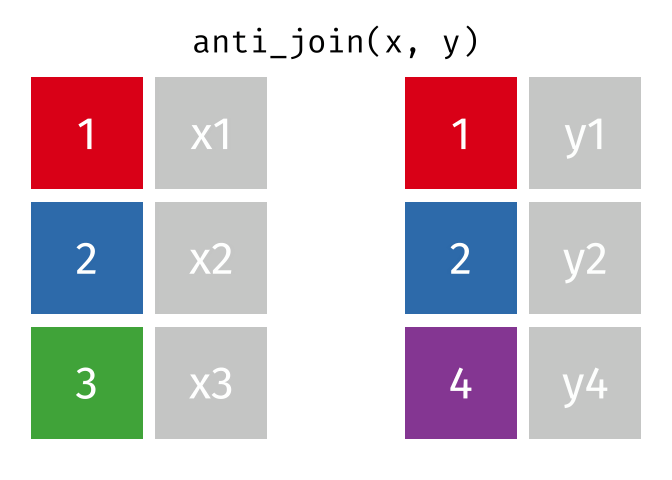

### 왜 `right_join()`은 거의 필요하지 않을까?

두 표의 순서를 바꾼 `left_join()`으로 같은 의미를 더 자연스럽게 표현할 수 있는 경우가 많습니다. 중요한 것은 함수의 방향을 외우는 것이 아니라 **어느 표를 기준 모집단으로 유지할지** 정하는 것입니다.

------------------------------------------------------------------------

## 패널 질문 해결하기: 2017년 KT 이용자의 이동

### 1단계: baseline cohort 정의

```{r}
kt_2017 <- kmp_person |>
  filter(year == 2017, telecom == "KT") |>
  select(participant_id, telecom_2017 = telecom)

kt_2017
```

### 2단계: 각 연도의 통신사 표 만들기

```{r}
telecom_2018 <- kmp_person |>
  filter(year == 2018) |>
  select(participant_id, telecom_2018 = telecom)

telecom_2019 <- kmp_person |>
  filter(year == 2019) |>
  select(participant_id, telecom_2019 = telecom)
```

### 3단계: follow-up 누락 확인

```{r}
kt_2017 |>
  anti_join(telecom_2018, by = join_by(participant_id))
```

```{r}
kt_2017 |>
  anti_join(telecom_2019, by = join_by(participant_id))
```

### 4단계: baseline cohort를 유지하며 결합

```{r}
kt_followup <- kt_2017 |>
  left_join(
    telecom_2018,
    by = join_by(participant_id),
    relationship = "one-to-one"
  ) |>
  left_join(
    telecom_2019,
    by = join_by(participant_id),
    relationship = "one-to-one"
  ) |>
  mutate(
    changed_2018 = telecom_2018 != telecom_2017,
    changed_2019 = telecom_2019 != telecom_2017
  )

kt_followup
```

### 5단계: 변화 경로 요약

```{r}
kt_followup |>
  count(
    telecom_2017,
    telecom_2018,
    telecom_2019,
    name = "participants"
  )
```

```{r}
kt_followup |>
  summarise(
    baseline_n = n(),
    observed_2018 = sum(!is.na(telecom_2018)),
    observed_2019 = sum(!is.na(telecom_2019)),
    changed_by_2018 = sum(changed_2018, na.rm = TRUE),
    changed_by_2019 = sum(changed_2019, na.rm = TRUE)
  )
```

::: {.callout-warning}
`changed_by_2019`는 “언제 바꾸었는가”를 완전히 알려주지 않습니다. 2018년에 바꾸었다가 2019년에 다시 KT로 돌아온 경우처럼 중간 경로를 별도로 살펴봐야 합니다.
:::

### 같은 구조로 스마트폰 브랜드 분석하기

> **2017년 Samsung 이용자는 2018년과 2019년에 어떤 브랜드로 이동했는가?**

직접 다음 단계를 수행합니다.

1. 2017년 Samsung 이용자를 baseline cohort로 정의한다.
2. 2018년과 2019년 브랜드 표를 만든다.
3. 각 표에서 `participant_id`가 고유한지 확인한다.
4. `anti_join()`으로 follow-up 누락을 점검한다.
5. `left_join()`과 `relationship = "one-to-one"`으로 결합한다.
6. 변화 경로와 참여자 수를 요약한다.

::: {.callout-tip title="GenAI Checkpoint 4 — Join reviewer"}
자신의 코드를 먼저 작성하고, 코드와 진단 출력만 제공한 뒤 다음처럼 요청합니다.

```text
당신은 longitudinal-data join reviewer다.
아래 코드의 결과를 대신 계산하지 말고 다음을 점검하라.

1. 각 표의 관측단위
2. join key
3. 예상 관계(one-to-one, one-to-many 등)
4. join 전후 예상 행 수
5. 탈락과 행 증식을 탐지할 검사
6. left_join을 선택한 연구설계상의 이유

문제가 보이면 완성 코드를 주기 전에 확인 질문을 하라.
```
:::

------------------------------------------------------------------------

## Base R 코드를 현대적인 tidyverse로 읽기

Base R은 여전히 유효하고 강력합니다. 다만 새 분석에서는 일관성과 가독성을 위해 다음처럼 표현할 수 있습니다.

| 목적 | 기존 표현 | 현대적 tidyverse 표현 |
|---|---|---|
| 행 필터 | `df[df$age < 30, ]` | `df |> filter(age < 30)` |
| 열 선택 | `df[, c("pid", "age")]` | `df |> select(pid, age)` |
| 조건부 행·열 | `df[df$Telecom == "KT", c("pid", "Telecom")]` | `df |> filter(Telecom == "KT") |> select(pid, Telecom)` |
| 표 결합 | `merge(x, y, by = "pid")` | `left_join(x, y, by = join_by(pid))` 등 |
| 그룹 평균 | `tapply(x, group, mean)` | `summarise(mean_x = mean(x), .by = group)` |
| 여러 열 요약 | `apply(df, 2, mean)` | `summarise(across(where(is.numeric), mean))` |
| 임의 표본 | `sample()` 조합 | `slice_sample()` |
| 상위 행 | `top_n()` | `slice_max()` |

::: {.callout-note}
두 문법 중 하나를 “정답”으로 외우기보다, 기존 코드를 읽고 같은 분석 의도를 명시적으로 재현할 수 있어야 합니다.
:::

### 이번 자료에서 교체한 오래된 문법

| 기존 함수·습관 | 현재 권장 표현 |
|---|---|
| `%>%` | 새 코드에서는 `|>` |
| `sample_n()`, `sample_frac()` | `slice_sample()` |
| `top_n()` | `slice_max()` / `slice_min()` |
| `summarise_all()`, `summarise_at()` | `summarise(across(...))` |
| `T`, `F` | `TRUE`, `FALSE` |
| `na.rm = T` | `na.rm = TRUE` |
| `merge()`만으로 결합 | 목적에 맞는 join + 명시적 key + 관계 감사 |
| row names에 식별자 저장 | 실제 열로 보존 |

------------------------------------------------------------------------

## Checkpoint Quiz: `airquality`를 tidyverse로 탐색하기

`airquality`는 1973년 5월부터 9월까지의 일별 대기질과 기상 자료입니다.

```{r}
airquality_tbl <- airquality |>
  as_tibble()

airquality_tbl |> glimpse()
```

### Human first

GenAI를 열기 전에 다음 문제를 직접 해결합니다.

1. 이 자료에서 한 행은 무엇을 의미하는가?
2. 열 이름과 자료형을 확인하라.
3. 첫 10행을 추출하라.
4. 행 수를 확인하라.
5. 각 열의 결측값 개수를 long-format 표로 만들어라.
6. `Ozone`의 결측 개수, 평균, 중앙값을 한 표에 제시하라.
7. `Ozone > 31`이면서 `Temp > 90`인 행을 추출하라.
8. 모든 수치 변수의 평균과 표준편차를 계산하라.
9. 월별 `Ozone`의 관측 수, 결측 수, 평균, 표준편차를 계산하라.
10. `Ozone` 값이 가장 높은 5일을 선택하라.
11. 재현 가능한 무작위 표본 5행을 추출하라.
12. 결과 중 하나를 설명하고, 현재 자료만으로 말할 수 없는 내용을 한 문장으로 적어라.

<details>
<summary><strong>예시 코드 보기</strong></summary>

```{r}
# 2. 열 이름과 자료형
names(airquality_tbl)
glimpse(airquality_tbl)

# 3. 첫 10행
airquality_tbl |>
  slice_head(n = 10)

# 4. 행 수
nrow(airquality_tbl)

# 5. 열별 결측값
airquality_tbl |>
  summarise(
    across(everything(), ~ sum(is.na(.x)))
  ) |>
  pivot_longer(
    everything(),
    names_to = "variable",
    values_to = "n_missing"
  ) |>
  arrange(desc(n_missing))

# 6. Ozone 요약
airquality_tbl |>
  summarise(
    n = n(),
    n_missing = sum(is.na(Ozone)),
    mean_ozone = mean(Ozone, na.rm = TRUE),
    median_ozone = median(Ozone, na.rm = TRUE)
  )

# 7. 조건 필터
airquality_tbl |>
  filter(Ozone > 31, Temp > 90)

# 8. 모든 수치 변수의 평균과 표준편차
airquality_tbl |>
  summarise(
    across(
      where(is.numeric),
      list(
        mean = ~ mean(.x, na.rm = TRUE),
        sd = ~ sd(.x, na.rm = TRUE)
      ),
      .names = "{.col}_{.fn}"
    )
  )

# 9. 월별 Ozone 요약
airquality_tbl |>
  summarise(
    observations = n(),
    observed_ozone = sum(!is.na(Ozone)),
    missing_ozone = sum(is.na(Ozone)),
    mean_ozone = mean(Ozone, na.rm = TRUE),
    sd_ozone = sd(Ozone, na.rm = TRUE),
    .by = Month
  )

# 10. Ozone 상위 5일
airquality_tbl |>
  slice_max(
    order_by = Ozone,
    n = 5,
    with_ties = FALSE,
    na_rm = TRUE
  )

# 11. 재현 가능한 무작위 표본
set.seed(2026)

airquality_tbl |>
  slice_sample(n = 5)
```

</details>

::: {.callout-tip title="GenAI Checkpoint 5 — 정답보다 진단 질문 받기"}

```text
나는 airquality 문제를 먼저 직접 풀었다.
아래에 문제 번호, 내 코드, 실제 출력을 제공하겠다.

완성 답을 바로 제시하지 말고,
1. 내 코드가 질문에 답하는지,
2. 결측 처리가 적절한지,
3. 출력의 행과 열이 예상과 같은지,
4. 해석이 자료를 넘어서는지
확인하는 질문을 순서대로 제시하라.
```
:::

------------------------------------------------------------------------

## Activity: Panel Data Detective

### 연구 미션

다음 중 하나를 선택합니다.

1. **Telecom transition:** 2017년 특정 통신사 이용자의 2018·2019년 이동 경로
2. **Smartphone brand transition:** 2017년 특정 브랜드 이용자의 2018·2019년 이동 경로
3. **Spending change:** 같은 참여자의 이동통신 지출이 세 연도에 걸쳐 어떻게 변했는가?
4. **Media behavior integration:** 2019년 개인자료와 다이어리를 결합했을 때 스마트폰 이용시간과 다른 특성은 어떻게 함께 나타나는가?

### Round 1. Human first

AI 없이 다음을 먼저 작성합니다.

- 연구질문 한 문장
- 한 행의 관측단위
- 분석에 필요한 key
- baseline cohort
- 예상하는 중간 표의 행 수
- 첫 tidyverse pipeline

### Round 2. Build and audit

다음을 반드시 포함합니다.

1. `glimpse()`로 자료구조 확인
2. key 중복 검사
3. `filter()`와 `select()`로 analytic sample 구성
4. `mutate()` 또는 `summarise()`를 이용한 파생·요약
5. 필요하면 `pivot_longer()` 또는 `pivot_wider()`
6. 결합 전 `anti_join()`
7. join 시 명시적 `join_by()`
8. join 전후 행 수와 고유 참여자 수 비교

### Round 3. AI extension

GenAI에게 다음 중 하나만 요청합니다.

- 놓친 데이터 품질 검사
- 같은 질문에 답하는 대안 pipeline
- join 관계와 예상 행 수 검토
- 변수명과 코드 가독성 검토
- 결과 해석의 과도한 주장 비판

AI의 제안을 모두 따르지 말고 하나 이상을 **기각하거나 수정**한 이유를 기록합니다.

### Round 4. Claim Card

| 항목 | 작성 내용 |
|---|---|
| **Question** | 어떤 변화 또는 차이를 묻는가? |
| **Analytic sample** | 누구를 포함했고 누구를 제외했는가? |
| **Observation unit** | 한 행은 무엇인가? |
| **Evidence** | 어떤 표·수치·시각화가 뒷받침하는가? |
| **Interpretation** | 가장 타당한 설명은 무엇인가? |
| **Alternative explanation** | 다른 설명은 무엇인가? |
| **Boundary** | 현재 자료로 말할 수 없는 것은 무엇인가? |
| **Next data** | 더 확실한 답을 위해 무엇이 필요한가? |

### 제출물

1. 재현 가능한 `.qmd` 또는 `.R` 코드
2. 최종 결과표 1개
3. 간단한 시각화 1개
4. Join audit 표 또는 key audit 출력
5. Claim Card
6. AI Collaboration Log

### AI Collaboration Log

| 항목 | 기록할 내용 |
|---|---|
| 목적 | 설명, 디버깅, join audit, reviewer 등 |
| 내가 먼저 한 시도 | AI 사용 전 작성한 코드와 예상 결과 |
| 프롬프트 | 실제 요청의 핵심 |
| AI 제안 | 제안 내용 요약 |
| 검증 | 실행한 R 코드와 확인한 출력 |
| 결정 | 채택·수정·기각과 이유 |
| 최종 변화 | 코드나 해석이 어떻게 달라졌는가? |

::: {.callout-important title="AI 사용 공개문 예시"}
본 분석에서는 GenAI를 join key와 데이터 품질 검사 항목을 검토하는 데 사용했다. 분석자는 먼저 pipeline을 작성한 뒤 AI가 제안한 진단 코드를 R에서 실행하였다. AI가 제안한 inner join은 baseline cohort를 탈락시킬 수 있어 기각하고 left join을 유지했다. 최종 코드, 분석 선택, 해석의 책임은 작성자에게 있다.
:::

------------------------------------------------------------------------

## 오늘의 Takeaways

1. Tidyverse의 핵심은 함수 목록이 아니라 **관측단위를 보존하며 변환을 연결하는 문법**이다.
2. `|>`는 분석의 순서를 읽기 쉽게 만들지만, 의미 있는 중간 결과에는 이름을 붙이는 것이 좋다.
3. `filter()`, `select()`, `mutate()`, `summarise()`는 각각 행·열·값·요약을 다룬다.
4. 반복측정 자료에서는 행 수와 독립 참여자 수를 구분한다.
5. `pivot_longer()`와 `pivot_wider()`는 데이터를 바꾸는 것이 아니라 같은 정보를 다른 구조로 표현한다.
6. Join 전에 key의 고유성, 매칭되지 않는 행, 예상 관계를 확인한다.
7. `relationship`을 명시하면 잘못된 join이 조용히 행을 증식시키는 것을 막을 수 있다.
8. GenAI는 코드를 대신 제출하는 도구가 아니라, 분석자가 놓친 가정과 검사를 드러내는 reviewer로 활용한다.

### 수업이 끝난 뒤 AI 없이 설명할 수 있어야 하는 것

- `filter()`와 `select()`의 차이
- `select()`와 `pull()`의 차이
- `mutate()`와 `summarise()`가 행 수에 미치는 차이
- `n()`과 `n_distinct()`의 차이
- long과 wide format의 관측단위
- `left_join()`을 선택한 이유
- many-to-many join이 위험한 이유
- 자신의 pipeline에서 행 수가 변한 정확한 단계


<!-- ## Practice: Data Frame & List -->

<!-- -   Korea Media Panel Data\ -->
<!--     <https://stat.kisdi.re.kr/kor/contents/ContentsList.html> -->

<!--     -   Since 2010 KISDI has surveyed the same people annually about people’s media behavior (Smartphone brand, telecom company, spending related to media, SNS usage, and so on) -->

<!-- <br> -->

<!--  -->

<!-- <br> -->

<!-- -   Korea Media Panel data is used in news articles based on media statistics, such as the article below. -->

<!-- 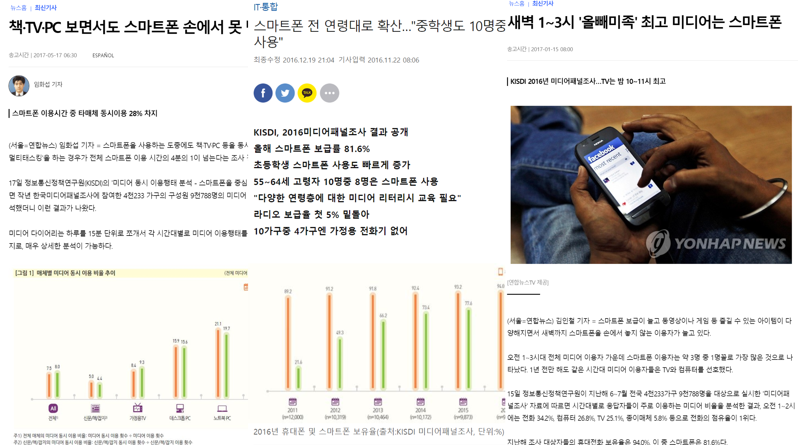 -->

<!-- <br> -->

<!-- -   Consists of -->

<!--  -->

<!-- <br> -->

<!-- I made a toy data set with the KMP like below. -->

<!-- -   Please download R data set here: [List_KMP.RData](data/List_KMP.RData) -->

<!-- -   Place it in your working directory -->

<!-- <br> -->

<!-- 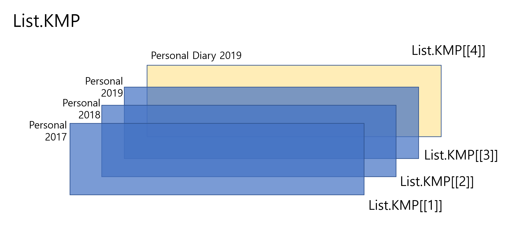 -->

<!-- <br> -->

<!-- ```{r} -->
<!-- load("data/List_KMP.RData") -->

<!-- str(List.KMP) -->

<!-- ``` -->

<!-- 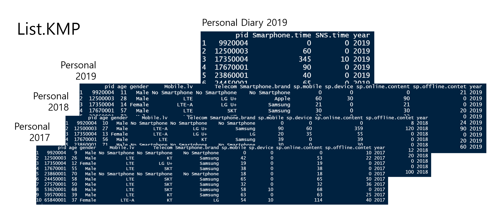 -->

<!-- <br> -->

<!-- **Personal Data 2017** -->

<!-- ```{r} -->
<!-- List.KMP[[1]] -->
<!-- ``` -->

<!-- **Personal Data 2018** -->

<!-- ```{r} -->
<!-- List.KMP[[2]] -->
<!-- ``` -->

<!-- **Personal Data 2019** -->

<!-- ```{r} -->
<!-- List.KMP[[3]] -->
<!-- ``` -->

<!-- **Personal Media Diary 2019** -->

<!-- ```{r} -->
<!-- List.KMP[[4]] -->
<!-- ``` -->

<!-- <br> -->

<!-- Let's name the list elements -->

<!-- ```{r} -->
<!-- # Check the existing names -->
<!-- names(List.KMP) -->

<!-- ``` -->

<!-- ```{r} -->
<!-- # Give names to each element of the list -->
<!-- names(List.KMP) <- c("p17", "p18", "p19", "d19") -->
<!-- ``` -->

<!-- <br> -->

<!-- How can we extract the first element of the list? -->

<!-- ```{r} -->
<!-- # one way -->
<!-- List.KMP[[1]] -->
<!-- ``` -->

<!-- ```{r} -->
<!-- # the other way -->
<!-- List.KMP[['p17']] -->
<!-- ``` -->

<!-- ### Lists of a list -->

<!-- 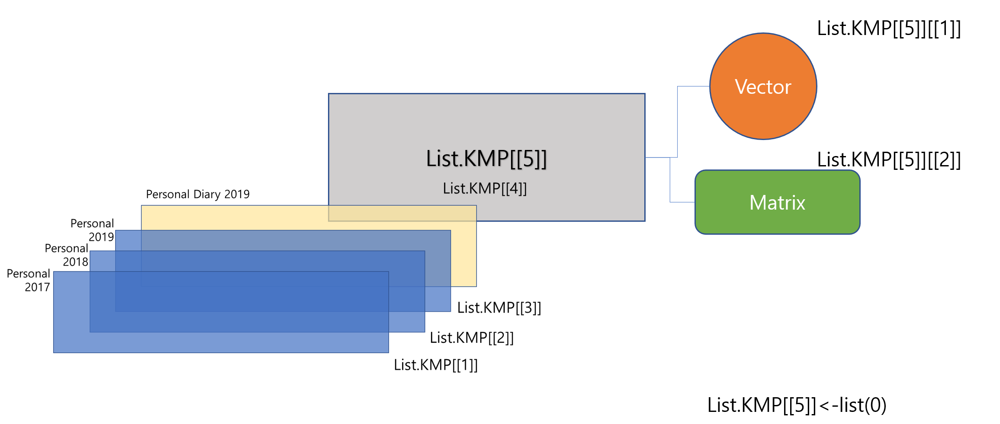 -->

<!-- <br> -->

<!-- ```{r} -->
<!-- # Create an empty list  -->
<!-- List.KMP[[5]] <- list(0) -->
<!-- ``` -->

<!-- ```{r} -->
<!-- # See the structure -->
<!-- str(List.KMP) -->
<!-- ``` -->

<!-- ```{r} -->
<!-- # The first element of the fifth element -->
<!-- List.KMP[[5]][[1]]<-c(1:10) -->

<!-- # The second element of the fifth element -->
<!-- List.KMP[[5]][[2]]<-matrix(c(1:12), nrow=4) -->

<!-- ``` -->

<!-- ```{r} -->
<!-- List.KMP[[5]] -->

<!-- ``` -->

<!-- 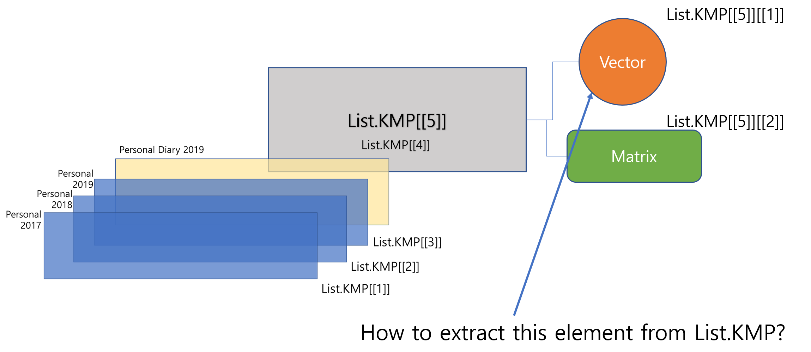 -->

<!-- Extract the '`p17`' element -->

<!-- ```{r} -->
<!-- p17_df <- List.KMP[["p17"]] -->
<!-- p17_df -->
<!-- ``` -->

<!-- ```{r} -->
<!-- # Summary Statistics -->
<!-- summary(p17_df) -->
<!-- ``` -->

<!-- <br> -->

<!-- -   Among 10 people, How many people did use Samsung phone at 2017? -->

<!-- -   How much did people spend for the mobile communication on average? -->

<!-- <br> -->

<!-- **Do the same thing to 2019 data set and answer the questions below.** -->

<!-- 1.  In 2019, how many people did use Samsung phone? -->

<!-- 2.  Draw boxplot of people’s spending on the mobile communication\ -->
<!--     \*Hint: use `boxplot()` -->

<!-- <br> -->

<!-- ### Filter -->

<!-- ```{r} -->
<!-- # 02 Conditional statements and loop statements for data purification # -->

<!-- test = c(15, 20, 30, NA, 45) # If it is a vector -->
<!-- test[test<40] # extract elements with value less than 40 -->

<!-- test[test%%3!= 0] # Extract elements whose value is not divisible by 3 -->


<!-- test[is.na(test)] # Extract elements that are NA -->


<!-- test[!is.na(test)] # Extract non-NA elements -->

<!-- test[test%%2==0 & !is.na(test)] # Extract elements that are multiples of 2 but are not NA -->

<!-- characters = data.frame(name = c("Gil-dong", "Chunhyang", "Cheolsu"), -->
<!--                          age = c(30, 16, 21), -->
<!--                          gender = factor(c("M", "F","M"))) -->
<!-- # In case of data frame -->

<!-- characters -->


<!-- characters[characters$gender =="F",1] # Extract rows where gender is female -->
<!-- library(dplyr) -->

<!-- characters %>% filter(gender=="F") %>% select(name) -->

<!-- characters[characters$age<30 & characters$gender =="M",] -->
<!-- # Extract rows of men under 30 years old -->
<!-- characters %>% filter(age<30 & gender=="M") -->
<!-- ``` -->

<!-- ------------------------------------------------------------------------ -->

<!-- <br> -->

<!-- Let's use the List.KMP again -->

<!-- ```{r} -->
<!-- load("data/List_KMP.RData") -->
<!-- names(List.KMP) <- c("p17", "p18", "p19", "d19") -->
<!-- ``` -->

<!-- See the structure -->

<!-- ```{r} -->
<!-- str(List.KMP) -->
<!-- ``` -->

<!-- <br> -->

<!-- 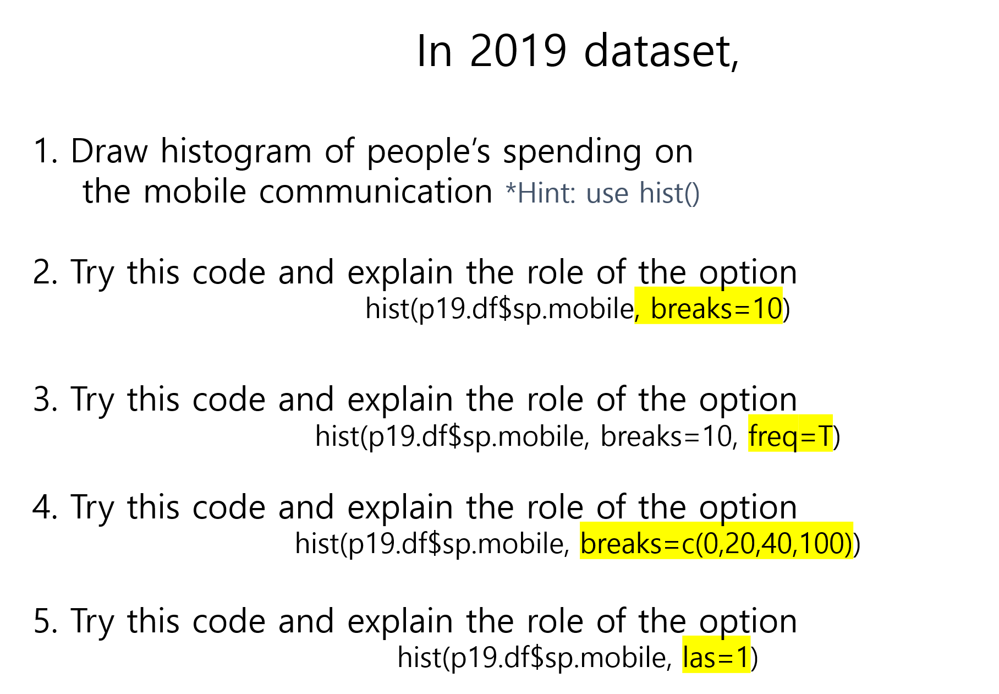 -->

<!-- 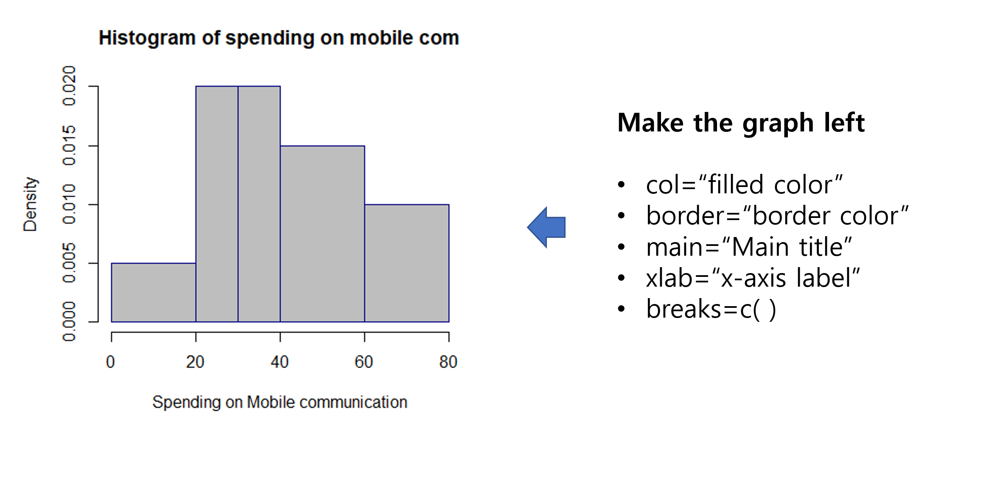 -->

<!-- <br> -->

<!-- 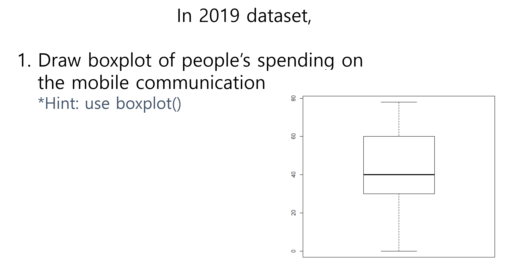 -->

<!-- <br> -->

<!-- #### Did ‘KT’ users in 2017 change their telecom companies in 2018 and 2019? -->

<!-- 1.  Extract data.frames from the List -->
<!-- 2.  Find the pid(personal ID) whose telecom company was “KT” -->
<!-- 3.  Try the code below and explain how it works -->
<!-- 4.  Merge the two data.frames above by the key variable “pid”, and change the second and the third column names to “y2018” and “y2019” -->

<!-- ------------------------------------------------------------------------ -->

<!-- 1.  Extract data.frames from the List -->

<!--     ```{r} -->
<!--     p17_df <- List.KMP[["p17"]] -->
<!--     p18_df <- List.KMP[["p18"]] -->
<!--     p19_df <- List.KMP[["p19"]] -->
<!--     ``` -->

<!-- 2.  Find the pid(personal ID) whose telecom company was “KT” -->

<!--     ```{r} -->
<!--     pid_kt_user <- p17_df[p17_df$Telecom=="KT", "pid"] -->
<!--     pid_kt_user -->
<!--     ``` -->

<!-- 3.  Try the code below and explain how it works -->

<!--     ```{r} -->
<!--     kt_user_18 <- p18_df[p18_df$pid %in% pid_kt_user, c("pid", "Telecom")] -->
<!--     kt_user_19 <- p19_df[p19_df$pid %in% pid_kt_user, c("pid", "Telecom")] -->
<!--     kt_user_18 -->
<!--     kt_user_19 -->
<!--     ``` -->

<!-- 4.  Merge the two data.frames above by the key variable “pid”, and change the second and the third column names to “y2018” and “y2019” -->

<!--     ```{r} -->
<!--     DF3 <- merge(kt_user_18, kt_user_19, by="pid") -->
<!--     names(DF3)[c(2,3)]<-c("y2018", "y2019") -->
<!--     DF3 -->
<!--     ``` -->

<!-- <br> -->

<!-- What kinds of studies we can do with the analysis above? Let's think about it. -->

<!-- Download and use this data for you study -->

<!-- 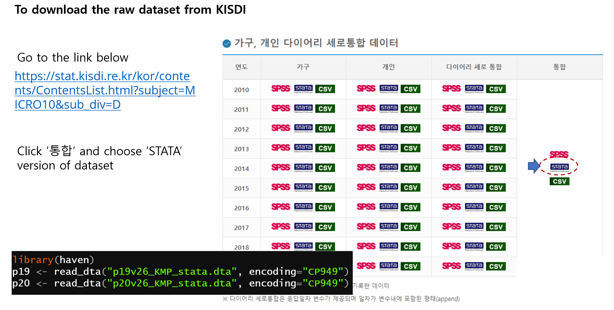 -->

<!-- You can also download the original questionnaires, codebooks, and user guides documents -->

<!-- 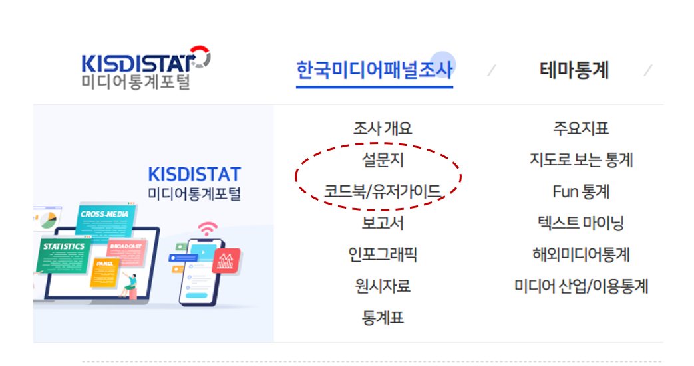 -->

<!-- <br> -->

<!-- #### Did ‘Samsung’ users in 2017 change their phone brand in 2018 and 2019? -->

<!-- Let's analyse this using the code we learnt -->

<!-- <br> -->

<!-- ## Practice & QZ (more) -->

<!-- Let's use 'airquality' data stored in base R -->

<!-- ```{r} -->
<!-- airquality -->
<!-- ``` -->

<!-- ### **Format** -->

<!-- A data frame with 153 observations on 6 variables. -->

<!-- |            |               |         |                         | -->
<!-- |------------|---------------|---------|-------------------------| -->
<!-- | **`[,1]`** | **`Ozone`**   | numeric | Ozone (ppb)             | -->
<!-- | **`[,2]`** | **`Solar.R`** | numeric | Solar R (lang)          | -->
<!-- | **`[,3]`** | **`Wind`**    | numeric | Wind (mph)              | -->
<!-- | **`[,4]`** | **`Temp`**    | numeric | Temperature (degrees F) | -->
<!-- | **`[,5]`** | **`Month`**   | numeric | Month (1--12)           | -->

<!-- ### **Details** -->

<!-- Daily readings of the following air quality values for May 1, 1973 (a Tuesday) to September 30, 1973. -->

<!-- -   **`Ozone`**: Mean ozone in parts per billion from 1300 to 1500 hours at Roosevelt Island -->

<!-- -   **`Solar.R`**: Solar radiation in Langleys in the frequency band 4000--7700 Angstroms from 0800 to 1200 hours at Central Park -->

<!-- -   **`Wind`**: Average wind speed in miles per hour at 0700 and 1000 hours at LaGuardia Airport -->

<!-- -   **`Temp`**: Maximum daily temperature in degrees Fahrenheit at La Guardia Airport. -->

<!-- ```{r} -->
<!-- pairs(airquality, panel = panel.smooth, main = "airquality data") -->
<!-- ``` -->

<!-- 1.  What are the column names of the data frame? -->

<!--     \*Hint: `names()` -->

<!--     <br> -->

<!-- 2.  What are the row names of the data frame? -->

<!--     \*Hint: `rownames()` -->

<!--     <br> -->

<!-- 3.  Extract the first 10 rows in 'airquality' -->

<!--     \*Hint: One way: by using `[]` / Alternative way: by using `head()` -->

<!--     <br> -->

<!-- 4.  Check the number of rows (observations) in the dataset -->

<!--     \*Hint: `length()` or `nrow()` -->

<!--     <br> -->

<!-- 5.  How many missing values are in the 'Ozone' column ? -->

<!--     \*Hint: `is.na()` and `sum()` -->

<!--     <br> -->

<!-- 6.  What is the mean value of the 'Ozone' column? (Exclude missing values (coded as NA) from this calculation) -->

<!--     \*Hint: Use `mean()` with an option `na.rm = T` -->

<!--     <br> -->

<!-- 7.  Extract the subset where Ozone values are above 31 and Temp values are above 90. -->

<!--     \*Hint: Use `subset()` -->

<!--     <br> -->

<!-- 8.  Use the apply function to calculate the standard deviation of each column in the data frame -->

<!--     \*Hint: Use `apply()` with an option `na.rm = T` / Use `sd()` function -->

<!--     <br> -->

<!-- 9.  Calculate the mean value of 'Ozone' for each Month in the data frame and create a vector containing the monthly means (exclude all missing values) -->

<!--     \*Hint: Use `tapply()` with an option `na.rm = T` -->

<!--     <br> -->

<!-- 10. Draw a random sample of 5 rows from the data frame -->

<!--     \*Hint: Use `sample()`, `nrow()`, `airquality[]` -->

<!--     <br> -->

<!-- ------------------------------------------------------------------------ -->

<!-- ## Introduction to `Tidyverse` -->

<!-- The tidyverse is a powerful collection  of  R  packages  that are actually  data tools for transforming and visualizing data. All packages of the tidyverse share an underlying philosophy and common APls. -->

<!-- The core packages are:  -->

<!-- -   `ggplot2`, which implements the grammar of graphics. You can use it to visualize your data. -->

<!-- -   `dplyr` is a grammar of data You can use it to solve the most common data manipulation challenges. -->

<!-- -   `tidyr` helps you to create tidy data or data where each variable is in a column, each observation is a row end each value is a column, each observation is a row end each value is a cell.  -->

<!-- -   `readr` is a fast and friendly way to read rectangular -->

<!-- -   `purrr` enhances R's functional programming (FP)toolkit by providing a complete and consistent set of tools for working with functions and vectors.  -->

<!-- -   `tibble` is a modern re-imaginging of the data -->

<!-- -   `stringr` provides a cohesive set of functions designed to make working with strings as easy as possible -->

<!-- -   `forcats` provide a suite of useful  tools that solve common problems with factors.   -->

<!-- <br> -->

<!-- \ -->
<!-- The introduction of the **`tidyverse`** package in R has significantly influenced the way data science is performed using R, impacting coding practices, data analysis methodologies, and the overall approach to data manipulation and visualization. -->

<!-- ### **Before Tidyverse** -->

<!-- Before the tidyverse, R programming was largely centered around base R functions and packages. This included using base R functions for data manipulation (like **`subset`**, **`merge`**, and **`apply`** functions) and visualization (such as plotting with **`plot`** and **`hist`**). The syntax and methods varied widely across different packages, which often led to inconsistent coding practices and a steeper learning curve for beginners. Each task could be approached in multiple ways without a clear 'best' method, leading to fragmented and less readable code. -->

<!-- ### **After Tidyverse** -->

<!-- The tidyverse, developed by Hadley Wickham and others, brought a suite of packages designed to work harmoniously together using a consistent syntax and underlying philosophy. Key features and impacts include: -->

<!-- 1.  **Consistent Syntax**: The tidyverse introduced a consistent and readable syntax that leverages chaining operations using the **`%>%`** operator from the **`magrittr`** package. This has made code more readable and easier to write and understand, especially for newcomers. -->

<!-- 2.  **Data Manipulation**: With **`dplyr`**, data manipulation became more intuitive and less verbose. Functions like **`filter()`**, **`arrange()`**, **`select()`**, **`mutate()`**, and **`summarise()`** allow for straightforward data operations that are both faster and easier to code compared to base R functions. -->

<!-- 3.  **Data Importing and Tidying**: **`readr`** for reading data and **`tidyr`** for tidying data introduced more efficient data reading and transforming capabilities, making it simpler to convert data into a tidy format. Tidy data, where each column is a variable and each row is an observation, has become a standard for data analysis, facilitating easier manipulation and analysis. -->

<!-- 4.  **Visualization**: **`ggplot2`** transformed data visualization in R by allowing for the layering of plots intuitively and flexibly, using a system based on the grammar of graphics. This has enabled users to create complex, publication-quality graphs more easily than was possible with base R plotting functions. -->

<!-- 5.  **Community and Accessibility**: The tidyverse has fostered a strong community and has contributed significantly to teaching materials that are user-friendly and accessible to beginners. This has democratized data analysis in R, making it more accessible to non-programmers. -->

<!-- 6.  **Impact on Package Development**: The tidyverse’s philosophy and popularity have influenced the development of other packages, even those not part of the tidyverse, to adopt tidy principles and interoperate smoothly with tidyverse packages. -->

<!-- > The tidyverse has not only changed the syntax and functionality of R coding but also its philosophy towards data analysis. It promotes a workflow that is coherent, transparent, and efficient, which has been widely adopted in academia, industry, and teaching. While some veteran R users prefer the flexibility and control of base R, the tidyverse's approachable syntax and powerful capabilities have made it a pivotal tool in modern R programming, particularly for data science. -->

<!-- <br> -->

<!-- Please check out the homepage of tidyverse: <https://www.tidyverse.org/> -->

<!--  -->

<!-- <br> -->

<!-- **You can install the complete tidyverse with:** -->

<!-- \> install.packages("tidyverse") -->

<!-- **Then, load the core tidyverse and make it available in your current R session by running:** -->

<!-- \> library(tidyverse) -->

<!-- Please see this cheat sheet: -->

<!-- <https://www.rstudio.com/wp-content/uploads/2015/02/data-wrangling-cheatsheet.pdf> -->

<!-- 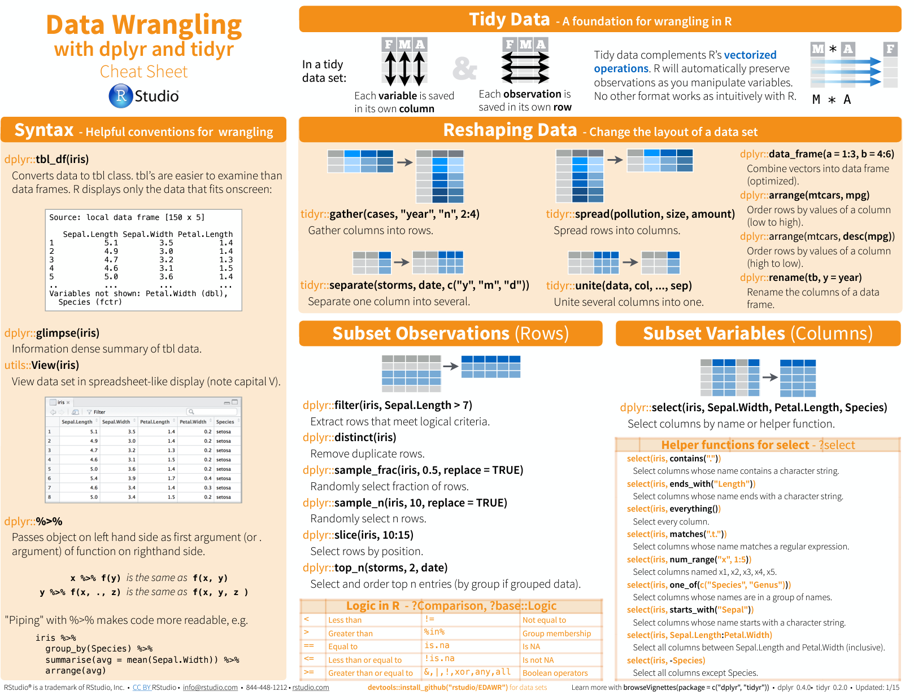 -->

<!-- 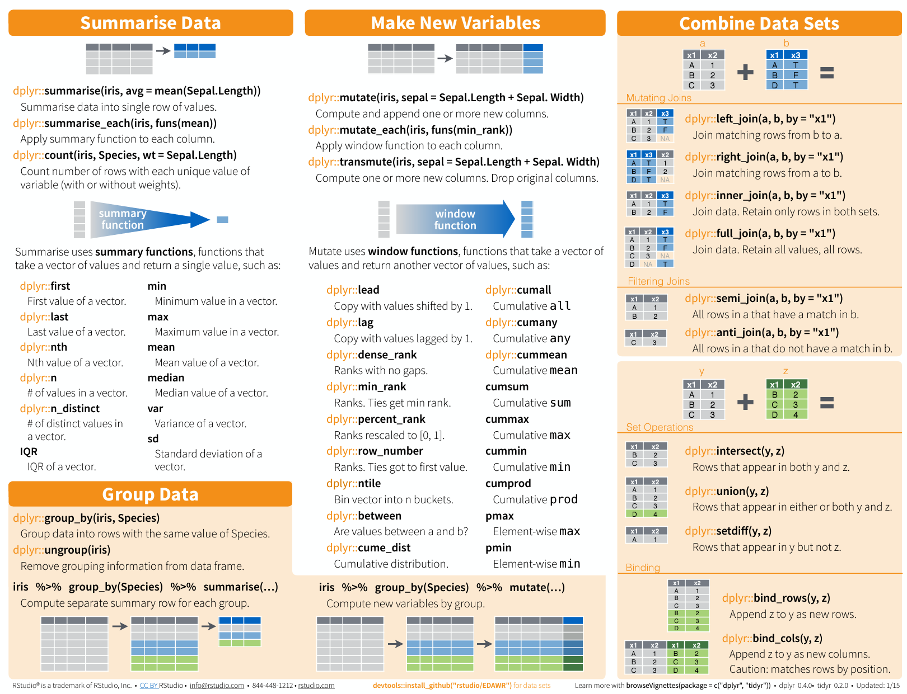 -->

<!-- ### Pipe -->

<!-- 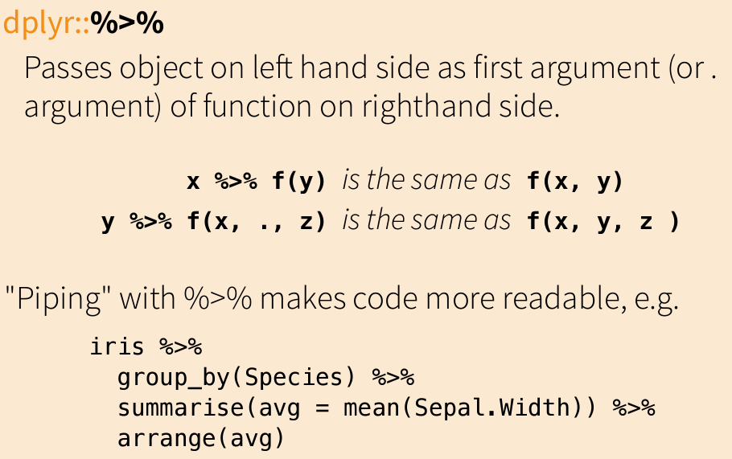 -->

<!-- ### **Subset Observations** -->

<!-- ```{r} -->
<!-- # filter -->
<!-- iris %>% filter(Sepal.Length > 7) -->

<!-- levels(iris$Species) -->
<!-- iris %>% filter(Species == "setosa") -->

<!-- iris %>% filter(Species == "setosa") %>% plot -->
<!-- iris %>% filter(Species == "setosa") %>% summary -->

<!-- # distinct: remove duplication (take only unique values) -->
<!-- iris %>% distinct(Species) -->

<!-- # random sampling -->
<!-- iris %>% nrow -->
<!-- iris %>% sample_frac(0.5, replace=T) -->
<!-- iris %>% sample_frac(0.5, replace=T) %>% nrow -->

<!-- iris %>% sample_n(10, replace=T)  -->
<!-- iris %>% sample_n(10, replace=T) %>% nrow  -->

<!-- # slice  -->
<!-- iris %>% slice(10:15) -->

<!-- # Top n in X -->
<!-- iris %>% top_n(5, Sepal.Length) -->
<!-- iris %>% top_n(5, Sepal.Width) -->
<!-- ``` -->

<!-- ### **Subset Variables** -->

<!-- ```{r} -->
<!-- # pull & select -->
<!-- iris %>% pull(Petal.Width) -->
<!-- iris %>% select(Petal.Width) -->

<!-- iris %>% pull(Petal.Width) %>% str -->
<!-- iris %>% select(Petal.Width) %>% str -->

<!-- iris %>% select(Petal.Length, Petal.Width) %>% head -->
<!-- # useful helpers: starts_with(), contains() -->
<!-- iris %>% select(starts_with("Peta")) %>% head -->
<!-- iris %>% select(contains("tal")) %>% head -->

<!-- ``` -->

<!-- ### **Reshaping & Arrange data** -->

<!-- ```{r} -->

<!-- # let's use mtcars dataset -->
<!-- mtcars -->

<!-- # About mtcars dataset -->
<!-- # help(mtcars) -->

<!-- # arrange -->
<!-- mtcars %>% arrange(mpg) %>% head -->
<!-- mtcars %>% add_rownames %>% head -->
<!-- mtcars %>% add_rownames %>% arrange(mpg) %>%  -->
<!-- head -->
<!-- mtcars %>% add_rownames %>% arrange(desc(mpg)) %>% select(rowname) -->

<!-- ``` -->

<!-- ### **Summarise data** -->

<!-- ```{r} -->
<!-- # Summarise -->

<!-- iris %>% summarise(avg.PL=mean(Petal.Length)) -->
<!-- iris %>% summarise(sd.PL=sd(Petal.Length)) -->

<!-- iris %>% summarise(avg.PL=mean(Petal.Length), -->
<!--                    sd.PL=sd(Petal.Length), -->
<!--                    min.PL=min(Petal.Length)) -->

<!-- iris %>% count(Species) -->
<!-- iris %>% sample_frac(0.3) %>% count(Species) -->

<!-- iris %>% summarise_all(mean) -->
<!-- iris %>% summarise_at("Petal.Length", sum) -->
<!-- iris %>% summarise_at(c("Petal.Length", "Petal.Width"), mean) -->

<!-- ``` -->

<!-- ### **Group and Summarise data** -->

<!-- ```{r} -->
<!-- # Group -->
<!-- iris %>% group_by(Species) -->

<!-- iris %>% group_by(Species) %>%  -->
<!--   summarise_all(mean) -->

<!-- iris %>% group_by(Species) %>%  -->
<!--   select(starts_with("Sep")) %>%  -->
<!--   summarise_all(mean) -->

<!-- mtcars %>% group_by(am) %>%  -->
<!--   summarise(hp.avg=mean(hp), -->
<!--             hp.sd=sd(hp)) -->
<!-- ``` -->

<!-- ### **Make New Variables** -->

<!-- ```{r} -->
<!-- # mutate -->
<!-- # mpg to kml -->
<!-- mtcars %>% mutate(kml=0.425144*mpg) -->
<!-- mtcars %>% mutate(kml=round(0.425144*mpg, 1)) -->
<!-- mtcars %>% mutate(kml=round(0.425144*mpg, 1)) %>%  -->
<!--   select(mpg, kml) %>%  -->
<!--   top_n(5, mpg) -->

<!-- # transmute -->
<!-- mtcars %>% transmute(hp/wt) -->

<!-- # rename -->
<!-- mtcars %>% names -->
<!-- mtcars %>% mutate(new=1) %>% head -->
<!-- mtcars %>% mutate(new=1) %>%  -->
<!-- rename(change.name=new) %>% head -->

<!-- ``` -->

<!-- <br> -->

<!-- 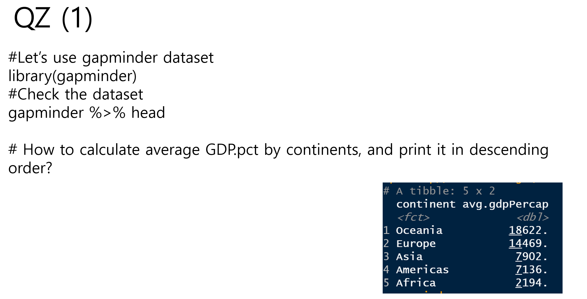 -->

<!-- <br> -->

<!-- 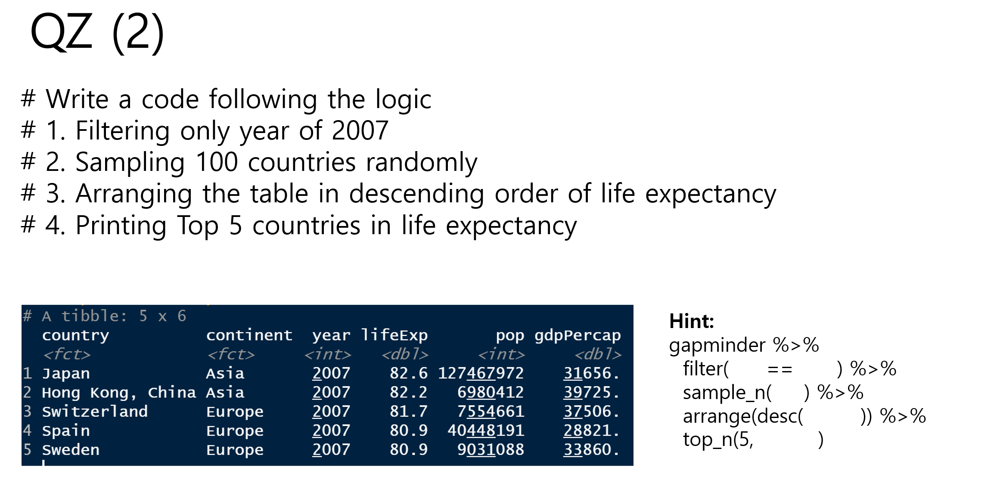 -->

<!-- <br> -->

<!-- ### Joins! (Combine Datasets) -->

<!-- Thanks to Garrick Aden-Buie ([garrickadenbuie.com](https://www.garrickadenbuie.com)), we can teach joins very easily with his fantastic diagrams. -->

<!-- <br> -->

<!-- Let's use some example datasets that come pre-loaded in R to demonstrate how joins work using **`dplyr`**. We will use the **`mtcars`** dataset, splitting it into two separate data frames to illustrate how the different types of joins operate. -->

<!-- First, let's set up our example data frames from the **`mtcars`** dataset: -->

<!-- ```{r} -->
<!-- # Create two data frames from mtcars -->
<!-- df1 <- mtcars[1:10, c("mpg", "cyl", "disp")]  # first 10 rows, select specific columns -->
<!-- df2 <- mtcars[5:15, c("disp", "hp", "drat")]  # rows 5 to 15, select specific columns -->

<!-- # Make sure there's a common key for joining; here, we'll use 'disp' -->
<!-- # Print out the data frames to see what they contain -->
<!-- print(df1) -->
<!-- print(df2) -->
<!-- ``` -->

<!-- #### Inner Join -->

<!-- > All rows from `x` where there are matching values in `y`, and all columns from `x` and `y`. -->

<!--  -->

<!-- ```{r} -->
<!-- inner_join_result <- inner_join(df1, df2, by = "disp") -->
<!-- print(inner_join_result) -->
<!-- ``` -->

<!-- #### Left Join -->

<!-- > All rows from `x`, and all columns from `x` and `y`. Rows in `x` with no match in `y` will have `NA` values in the new columns. -->

<!--  -->

<!-- ```{r} -->
<!-- left_join_result <- left_join(df1, df2, by = "disp") -->
<!-- print(left_join_result) -->
<!-- ``` -->

<!-- #### Left Join (Extra Rows in y) -->

<!-- > ... If there are multiple matches between `x` and `y`, all combinations of the matches are returned. -->

<!-- 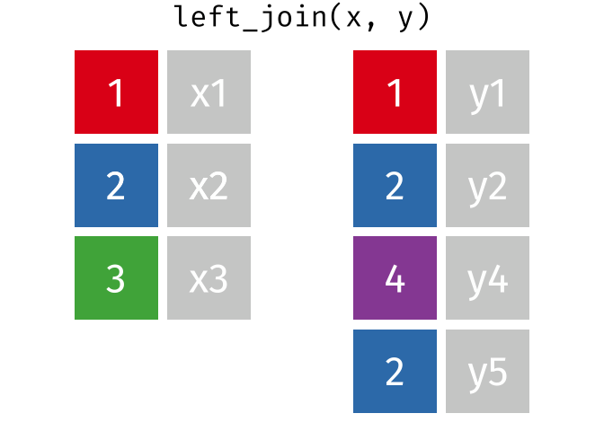 -->

<!-- #### Right Join -->

<!-- > All rows from y, and all columns from `x` and `y`. Rows in `y` with no match in `x` will have `NA` values in the new columns. -->

<!--  -->

<!-- ```{r} -->
<!-- right_join_result <- right_join(df1, df2, by = "disp") -->
<!-- print(right_join_result) -->
<!-- ``` -->

<!-- #### Full Join -->

<!-- > All rows and all columns from both `x` and `y`. Where there are not matching values, returns `NA` for the one missing. -->

<!-- 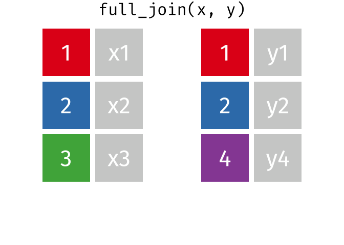 -->

<!-- ```{r} -->
<!-- full_join_result <- full_join(df1, df2, by = "disp") -->
<!-- print(full_join_result) -->
<!-- ``` -->

<!-- **Filtering Joins** -->

<!-- > Filtering joins match observations in the same way as mutating joins, but affect the observations, not the variables. ... Semi-joins are useful for matching filtered summary tables back to the original rows. ... Anti-joins are useful for diagnosing join mismatches.\ -->
<!-- > [R for Data Science: Filtering Joins](http://r4ds.had.co.nz/relational-data.html#filtering-joins) -->

<!-- #### Semi Join -->

<!-- > All rows from `x` where there are matching values in `y`, keeping just columns from `x`. -->

<!--  -->

<!-- ```{r} -->
<!-- semi_join_result <- semi_join(df1, df2, by = "disp") -->
<!-- print(semi_join_result) -->
<!-- ``` -->

<!-- #### Anti Join -->

<!-- > All rows from `x` where there are not matching values in `y`, keeping just column -->

<!--  -->

<!-- ```{r} -->
<!-- # Assuming df1 and df2 from the previous example -->
<!-- anti_join_result <- anti_join(df1, df2, by = "disp") -->
<!-- print(anti_join_result) -->
<!-- ``` -->

