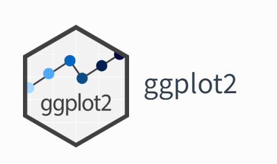

[Weekly content](https://changjunlee.com/teaching/grad_stat/weekly_2/)

<br>



<br>



<br>

## 5주차 학습목표

::: {.callout-note}
이번 주 학습을 마치면 다음을 할 수 있어야 합니다.

1. 데이터 시각화를 장식이 아니라 **연구 질문에 대한 시각적 증거**로 설명한다.
2. `ggplot2`의 문법을 data, mapping, geom, stat, position, scale, coordinate, facet, theme의 조합으로 이해한다.
3. 변수 유형과 질문에 맞춰 분포, 관계, 비교, 구성, 시간 변화 그래프를 선택한다.
4. `aes()` 안의 **mapping**과 밖의 **setting**을 구분한다.
5. 겹침, 표본 수, 분모, 축 범위, 변환, 불확실성을 점검하여 오해를 줄인다.
6. 색상·라벨·범례·대체텍스트를 사용해 읽기 쉽고 접근 가능한 그래프를 만든다.
7. 그래프를 Quarto에 재현 가능하게 포함하고 `ggsave()`로 명시적으로 저장한다.
8. ChatGPT와 같은 GenAI를 그래프 생성기보다 **차트 설계 검토자와 시각적 주장 비평가**로 활용한다.
:::

### 오늘의 핵심 질문

> **이 그래프는 무엇을 보여 주며, 그 패턴을 믿기 위해 무엇을 함께 확인해야 할까?**

```{mermaid}
flowchart LR
    A["Research Question<br>무엇을 비교할까?"] --> B["Data Structure<br>관측단위와 변수 유형"]
    B --> C["Visual Encoding<br>위치·색·크기·형태"]
    C --> D["Audit<br>표본·결측·축·분모"]
    D --> E["Interpretation<br>관찰과 설명 구분"]
    E --> F["Claim<br>가능한 주장과 한계"]
```

::: {.callout-important}
좋은 그래프는 단순히 예쁜 그래프가 아닙니다. 독자가 다음을 알아볼 수 있어야 합니다.

- 무엇이 한 점, 한 막대, 한 선인가?
- 어떤 값이 비교되고 있는가?
- 표본 수와 분모는 무엇인가?
- 원자료의 분포와 불확실성이 얼마나 남아 있는가?
- 그래프가 보여 주는 것과 연구자가 덧붙인 해석은 어디서 갈리는가?
:::

------------------------------------------------------------------------

## 이번 주의 GenAI 활용 방식

이번 주에도 다음 순서를 유지합니다.

> **Attempt → Ask → Test → Audit → Explain**

| 단계 | 학생이 먼저 할 일 | GenAI에 맡길 수 있는 일 |
|---|---|---|
| **Attempt** | 질문, 관측단위, 변수 유형, 예상 패턴을 적는다. | 아직 사용하지 않는다. |
| **Ask** | 현재 그래프와 설계 의도를 함께 제공한다. | 대안 시각화, 누락된 점검 항목, 모호한 라벨을 제안한다. |
| **Test** | 제안된 코드를 직접 실행하고 원자료와 대조한다. | 실행 결과를 만들어 달라고 하지 않는다. |
| **Audit** | 분모, 표본 수, 축, 결측, 과도한 인코딩을 점검한다. | reviewer처럼 오해 가능성을 지적하게 한다. |
| **Explain** | 최종 그래프 선택과 기각한 대안을 설명한다. | 설명의 과장이나 인과적 비약을 비판하게 한다. |

### 그래프를 부탁하는 대신 그래프 설계를 검토받기

```text
나는 HCI 대학원 수업에서 ggplot2를 사용하고 있다.
연구질문은 “voice와 text 인터페이스의 과업완료시간 분포가 어떻게 다른가?”이다.
한 행은 한 참여자의 한 과업 시행이며, 동일 참여자가 두 인터페이스를 모두 경험했다.

내가 선택한 그래프와 R 코드를 아래에 제공하겠다.
1. 먼저 이 그래프가 질문에 답하기에 적절한지 평가하라.
2. 표본 수, 반복측정, 겹침, 결측, 축 범위에서 확인할 점을 제시하라.
3. 대안 그래프를 두 개만 제안하고 각각 무엇을 더 잘/덜 보여 주는지 설명하라.
4. 코드를 다시 작성하기 전에 내가 답해야 할 질문을 먼저 제시하라.
5. 인과관계는 추론하지 말라.
```

::: {.callout-warning title="민감한 자료를 입력하지 않기"}
실제 IRB 자료, 사용자 식별자, 비공개 로그를 공개형 GenAI에 업로드하지 않습니다. 다음만으로도 시각화 상담이 가능합니다.

- 비식별·합성 자료 10–20행
- `glimpse()`와 `summary()` 출력
- 변수 설명과 관측단위
- 현재 그래프 코드
- 그래프에서 발견한 패턴을 자신의 말로 적은 문장
:::

------------------------------------------------------------------------

## 준비: 이번 주의 공통 데이터

### 패키지

```{r}
#| label: setup
#| message: false
#| warning: false

library(tidyverse)

theme_set(theme_minimal(base_size = 12))
```

::: {.callout-tip}
`install.packages("tidyverse")`는 패키지가 컴퓨터에 없을 때 한 번 실행합니다. 강의자료를 렌더링하는 코드 청크에서는 설치보다 `library(tidyverse)`로 명시적으로 불러오는 편이 재현 가능성이 높습니다.
:::

### HCI 반복측정 예제 만들기

이번 주에는 가상의 인터페이스 과업 자료를 공통 예제로 사용합니다.

- 72명의 참여자
- 두 인터페이스: `text`, `voice`
- 두 과업: `search`, `booking`
- 결과: 과업완료시간, 오류 수, 신뢰, 성공 여부
- 한 행: **한 참여자의 한 인터페이스 × 과업 시행**

```{r}
#| label: make-hci-data
#| include: false

set.seed(2026)

participants <- tibble(
  participant_id = sprintf("P%03d", 1:72),
  digital_literacy = pmin(
    pmax(round(rnorm(72, mean = 4.5, sd = 1.3), 1), 1),
    7
  ),
  speed_random_effect = rnorm(72, mean = 0, sd = 6),
  trust_random_effect = rnorm(72, mean = 0, sd = 0.6)
)

hci_trials <- participants |>
  crossing(
    interface = factor(c("text", "voice"), levels = c("text", "voice")),
    task = factor(c("search", "booking"), levels = c("search", "booking"))
  ) |>
  mutate(
    completion_time =
      50 + speed_random_effect -
      5 * (interface == "voice") +
      9 * (task == "booking") -
      1.5 * digital_literacy +
      rnorm(n(), mean = 0, sd = 6),
    errors = rpois(
      n(),
      lambda = pmax(
        0.1,
        0.7 + 0.45 * (task == "booking") - 0.15 * (interface == "voice")
      )
    ),
    trust =
      4.5 + trust_random_effect +
      0.55 * (interface == "voice") -
      0.25 * (task == "booking") +
      rnorm(n(), mean = 0, sd = 0.7),
    completion_time = round(pmax(completion_time, 12), 1),
    trust = round(pmin(pmax(trust, 1), 7), 1),
    success = factor(
      if_else(completion_time < 65 & errors <= 2, "success", "failure"),
      levels = c("failure", "success")
    )
  ) |>
  select(
    participant_id,
    digital_literacy,
    interface,
    task,
    completion_time,
    errors,
    trust,
    success
  )
```

```{r}
glimpse(hci_trials)
```

```{r}
hci_trials |>
  summarise(
    rows = n(),
    participants = n_distinct(participant_id),
    interfaces = n_distinct(interface),
    tasks = n_distinct(task)
  )
```

::: {.callout-important}
288개의 행이 있다고 해서 표본이 288명인 것은 아닙니다. 독립 참여자는 72명이고, 각 참여자가 네 번 관찰되었습니다. 그래프의 점은 시행(trial)을 나타낼 수 있지만, 통계적 추론의 단위는 연구설계에 맞게 별도로 판단해야 합니다.
:::

------------------------------------------------------------------------

## 시각화는 “그림 그리기”가 아니라 “인코딩 선택”이다

데이터 시각화는 값을 다음과 같은 시각적 속성으로 변환하는 일입니다.

- **Position:** x·y 위치
- **Length:** 막대 길이
- **Colour / fill:** 색 또는 면색
- **Shape:** 점 모양
- **Size:** 점 크기
- **Alpha:** 투명도
- **Facet:** 작은 다중 그래프

일반적으로 정확한 비교에는 **위치와 길이**가 강하고, 색·형태·크기는 보조적인 구분에 더 적합합니다. 한 그래프에 너무 많은 속성을 동시에 매핑하면 정보량보다 해석 비용이 커질 수 있습니다.

### 그래프를 만들기 전 다섯 문장

1. **Question:** 무엇을 알고 싶은가?
2. **Unit:** 한 행과 한 점은 무엇인가?
3. **Variables:** 변수는 연속형, 범주형, 시간형 중 무엇인가?
4. **Comparison:** 분포, 관계, 집단 차이, 구성, 변화 중 무엇을 비교하는가?
5. **Claim:** 이 그래프로 말할 수 있는 가장 좁은 주장은 무엇인가?

------------------------------------------------------------------------

## Grammar of Graphics

`ggplot2`는 그래프를 하나의 완성된 명령이 아니라 여러 구성요소의 조합으로 만듭니다.

```{mermaid}
flowchart LR
    A["Data"] --> B["Aesthetic mapping"]
    B --> C["Geom + Stat"]
    C --> D["Position"]
    D --> E["Scale"]
    E --> F["Coordinate"]
    F --> G["Facet + Theme + Labels"]
```

| 구성요소 | 핵심 질문 | 예시 |
|---|---|---|
| **Data** | 어떤 관측을 그리는가? | `hci_trials` |
| **Mapping** | 변수를 어떤 시각 속성에 연결하는가? | `aes(x = completion_time, colour = interface)` |
| **Geom** | 어떤 기하 객체로 나타내는가? | `geom_point()`, `geom_histogram()` |
| **Stat** | 그리기 전에 무엇을 계산하는가? | count, bin, smooth |
| **Position** | 겹치는 객체를 어떻게 배치하는가? | stack, dodge, jitter, fill |
| **Scale** | 데이터 값을 화면 값으로 어떻게 변환하는가? | log, percent, viridis |
| **Coordinate** | 화면의 좌표 범위를 어떻게 보여 주는가? | Cartesian zoom |
| **Facet** | 집단별 작은 그래프로 나눌 것인가? | `facet_wrap()` |
| **Theme / labels** | 정보 위계를 어떻게 정리하는가? | `theme_minimal()`, `labs()` |

### 가장 작은 ggplot

```{r}
ggplot(data = hci_trials)
```

데이터만 지정했기 때문에 빈 좌표계가 나타납니다.

```{r}
ggplot(
  data = hci_trials,
  mapping = aes(x = completion_time, y = trust)
)
```

변수와 축의 관계는 생겼지만, 아직 어떤 기하 객체로 그릴지 정하지 않았습니다.

```{r}
ggplot(
  data = hci_trials,
  mapping = aes(x = completion_time, y = trust)
) +
  geom_point()
```

### Mapping과 setting을 구분하기

`aes()` 안은 **데이터 변수와 시각 속성의 연결(mapping)**입니다.

```{r}
ggplot(hci_trials, aes(completion_time, trust)) +
  geom_point(aes(colour = interface))
```

고정된 모양이나 색은 `aes()` 밖에서 **설정(setting)**합니다.

```{r}
ggplot(hci_trials, aes(completion_time, trust)) +
  geom_point(colour = "steelblue", alpha = 0.6)
```

아래 코드는 문자열 `"steelblue"`을 하나의 범주로 매핑하므로 원하지 않는 범례가 생깁니다.

```{r}
ggplot(hci_trials, aes(completion_time, trust)) +
  geom_point(aes(colour = "steelblue"))
```

::: {.callout-tip title="스스로 설명해 보기"}
다음 두 문장을 구분할 수 있어야 합니다.

- “인터페이스에 따라 점의 색이 달라진다.” → mapping
- “모든 점을 파란색으로 그린다.” → setting
:::

### 그래프 객체를 저장하고 층을 추가하기

```{r}
base_scatter <- ggplot(
  hci_trials,
  aes(x = completion_time, y = trust)
)

base_scatter + geom_point()
```

```{r}
base_scatter +
  geom_point(aes(colour = interface), alpha = 0.55) +
  geom_smooth(
    method = "lm",
    formula = y ~ x,
    se = TRUE,
    colour = "black",
    linewidth = 0.8
  )
```

`geom_smooth()`의 선은 관계를 요약하지만, 인과관계를 보여 주지는 않습니다. 회귀선은 관측된 패턴에 대한 시각적 요약입니다.

------------------------------------------------------------------------

## 질문과 변수 유형에 따라 그래프 선택하기

| 질문 | 변수 구조 | 출발점이 되는 그래프 | 반드시 확인할 것 |
|---|---|---|---|
| 값은 어떻게 분포하는가? | 연속형 1개 | histogram, density, ECDF | binwidth, 표본 수, 결측, 극단값 |
| 범주별 관측은 몇 개인가? | 범주형 1개 | bar chart | count인지 proportion인지 |
| 두 수치가 함께 변하는가? | 연속형 2개 | scatterplot | 겹침, 비선형성, 영향점 |
| 집단별 분포가 다른가? | 범주형 + 연속형 | raw points + box/violin | 집단별 n, 분포, 반복측정 |
| 두 범주가 관련되어 보이는가? | 범주형 2개 | count/proportion bar, heatmap | 분모와 조건부 비율 |
| 시간에 따라 어떻게 변하는가? | 시간 + 연속형 | line chart | 정렬, 간격, 집계 단위 |
| 세 번째 변수가 패턴을 바꾸는가? | 3개 이상 | colour, shape, facet | 과도한 인코딩, 작은 집단 |

::: {.callout-warning}
그래프 유형은 변수 유형만으로 자동 결정되지 않습니다. 같은 자료라도 질문이 “개수”인지 “비율”인지, “원자료 분포”인지 “평균 변화”인지에 따라 적절한 그래프가 달라집니다.
:::

------------------------------------------------------------------------

## 한 변수: 분포를 본다는 것

### 연속형 변수: histogram의 binwidth는 분석 선택이다

```{r}
#| label: fig-binwidth
#| layout-ncol: 2
#| fig-cap:
#|   - "과업완료시간: 3초 간격의 histogram"
#|   - "과업완료시간: 12초 간격의 histogram"
#| fig-alt:
#|   - "과업완료시간을 3초 폭으로 나눈 세밀한 히스토그램"
#|   - "같은 과업완료시간을 12초 폭으로 나눈 거친 히스토그램"

p_bin_3 <- ggplot(hci_trials, aes(completion_time)) +
  geom_histogram(binwidth = 3, boundary = 0) +
  labs(x = "Completion time (seconds)", y = "Trials")

p_bin_12 <- ggplot(hci_trials, aes(completion_time)) +
  geom_histogram(binwidth = 12, boundary = 0) +
  labs(x = "Completion time (seconds)", y = "Trials")

p_bin_3
p_bin_12
```

같은 데이터라도 binwidth에 따라 봉우리와 꼬리의 인상이 달라집니다. 하나의 값만 사용하기보다 몇 가지 합리적 간격에서 패턴이 유지되는지 확인합니다.

### histogram과 density를 겹칠 때

```{r}
ggplot(hci_trials, aes(completion_time)) +
  geom_histogram(
    aes(y = after_stat(density)),
    binwidth = 4,
    boundary = 0,
    alpha = 0.45
  ) +
  geom_density(linewidth = 0.9) +
  labs(
    x = "Completion time (seconds)",
    y = "Density",
    title = "과업완료시간의 분포"
  )
```

`after_stat(density)`는 histogram의 빈도를 밀도 척도로 변환하여 density curve와 같은 y축에서 비교하게 합니다.

### ECDF: bin을 정하지 않고 누적 분포 보기

```{r}
ggplot(hci_trials, aes(completion_time, colour = interface)) +
  stat_ecdf(linewidth = 0.9) +
  scale_colour_viridis_d(end = 0.85) +
  labs(
    x = "Completion time (seconds)",
    y = "Cumulative proportion",
    colour = "Interface",
    title = "인터페이스별 과업완료시간의 누적 분포"
  )
```

특정 시간 안에 완료한 시행의 비율을 읽고 싶다면 ECDF가 유용합니다.

### 범주형 변수: `geom_bar()`와 `geom_col()`

`geom_bar()`는 원자료에서 범주별 **관측 수를 직접 계산**합니다.

```{r}
ggplot(hci_trials, aes(task)) +
  geom_bar() +
  labs(x = "Task", y = "Trials")
```

이미 요약한 값을 그릴 때는 `geom_col()`을 사용합니다.

```{r}
task_counts <- hci_trials |>
  count(task, name = "trials")

ggplot(task_counts, aes(x = task, y = trials)) +
  geom_col() +
  labs(x = "Task", y = "Trials")
```

::: {.callout-note}
- `geom_bar()` → 각 x 범주의 행을 센다.
- `geom_col()` → 데이터에 이미 존재하는 y값을 막대 높이로 사용한다.
:::

### Count와 proportion을 구분하기

```{r}
success_by_interface <- hci_trials |>
  count(interface, success) |>
  mutate(proportion = n / sum(n), .by = interface)

success_by_interface
```

```{r}
#| layout-ncol: 2

p_success_count <- ggplot(
  success_by_interface,
  aes(x = interface, y = n, fill = success)
) +
  geom_col() +
  labs(x = "Interface", y = "Trials", fill = "Outcome")

p_success_prop <- ggplot(
  success_by_interface,
  aes(x = interface, y = proportion, fill = success)
) +
  geom_col() +
  scale_y_continuous(labels = scales::label_percent()) +
  labs(x = "Interface", y = "Within-interface proportion", fill = "Outcome")

p_success_count
p_success_prop
```

두 그래프는 서로 다른 질문에 답합니다. 비율 그래프에는 **분모가 인터페이스별 시행 수**라는 사실이 라벨이나 본문에서 드러나야 합니다.

------------------------------------------------------------------------

## 두 변수: 관계와 집단 비교

### 연속형 × 연속형: scatterplot

```{r}
ggplot(hci_trials, aes(completion_time, trust)) +
  geom_point(alpha = 0.45) +
  geom_smooth(
    method = "lm",
    formula = y ~ x,
    se = TRUE,
    linewidth = 0.8
  ) +
  labs(
    x = "Completion time (seconds)",
    y = "Trust (1–7)",
    title = "과업완료시간과 신뢰의 관계"
  )
```

**관찰:** 완료시간이 긴 시행에서 신뢰가 낮아지는 경향이 보이는가?  
**아직 말할 수 없는 것:** 완료시간이 신뢰를 낮춘다고 단정할 수 있는가?

### 겹침(overplotting)을 다루기

점이 많이 겹치면 빈도가 숨겨질 수 있습니다.

```{r}
ggplot(hci_trials, aes(errors, trust)) +
  geom_jitter(width = 0.15, height = 0.08, alpha = 0.35) +
  labs(
    x = "Number of errors",
    y = "Trust (1–7)",
    title = "이산형 값의 겹침을 jitter로 드러내기"
  )
```

`jitter`는 원래 데이터 값을 바꾸지 않고 화면 위치만 조금 이동합니다. 정확한 좌표보다 겹친 관측의 밀도를 보여 주는 것이 목적입니다.

### 범주형 × 연속형: 평균 막대보다 분포를 먼저 보기

```{r}
ggplot(hci_trials, aes(x = interface, y = completion_time)) +
  geom_boxplot(width = 0.22, outlier.shape = NA) +
  geom_jitter(width = 0.08, alpha = 0.25) +
  labs(
    x = "Interface",
    y = "Completion time (seconds)",
    title = "인터페이스별 과업완료시간의 분포"
  )
```

- 점: 개별 시행
- 상자 중앙선: median
- 상자: 중간 50% 범위
- whisker 밖의 점: 자동 삭제 대상이 아니라 추가 확인 대상

### 범주의 순서를 질문에 맞게 바꾸기

```{r}
hci_trials |>
  mutate(task = fct_reorder(task, completion_time, .fun = median)) |>
  ggplot(aes(x = completion_time, y = task)) +
  geom_boxplot(outlier.shape = NA) +
  geom_jitter(height = 0.08, alpha = 0.25) +
  labs(
    x = "Completion time (seconds)",
    y = "Task ordered by median time"
  )
```

수평 막대나 상자그림이 필요할 때는 가능한 경우 x와 y를 바꾸어 표현합니다.

### 범주형 × 범주형: 분모가 핵심이다

```{r}
success_table <- hci_trials |>
  count(interface, task, success) |>
  mutate(
    rate = n / sum(n),
    .by = c(interface, task)
  )

success_table
```

```{r}
ggplot(success_table, aes(x = task, y = rate, fill = success)) +
  geom_col() +
  facet_wrap(vars(interface)) +
  scale_y_continuous(labels = scales::label_percent()) +
  scale_fill_viridis_d(end = 0.85) +
  labs(
    x = "Task",
    y = "Proportion within interface × task",
    fill = "Outcome",
    title = "인터페이스와 과업별 성공 구성"
  )
```

::: {.callout-warning}
`position = "fill"`은 각 막대를 100%로 정규화합니다. 시각적으로 비율을 비교하기는 쉽지만 집단별 관측 수가 숨겨집니다. 본문이나 표에서 각 집단의 `n`을 함께 확인합니다.
:::

------------------------------------------------------------------------

## 세 변수 이상: 색보다 facet을 먼저 고려하기

### 색으로 세 번째 변수 추가하기

```{r}
ggplot(
  hci_trials,
  aes(completion_time, trust, colour = interface)
) +
  geom_point(alpha = 0.45) +
  scale_colour_viridis_d(end = 0.85) +
  labs(
    x = "Completion time (seconds)",
    y = "Trust (1–7)",
    colour = "Interface"
  )
```

### 작은 다중 그래프(small multiples)

```{r}
ggplot(
  hci_trials,
  aes(completion_time, trust, colour = interface)
) +
  geom_point(alpha = 0.45) +
  geom_smooth(
    method = "lm",
    formula = y ~ x,
    se = FALSE,
    linewidth = 0.7
  ) +
  facet_wrap(vars(task)) +
  scale_colour_viridis_d(end = 0.85) +
  labs(
    x = "Completion time (seconds)",
    y = "Trust (1–7)",
    colour = "Interface",
    title = "과업별로 나누어 관계 비교하기"
  )
```

facet은 같은 축과 같은 문법으로 하위 집단을 비교하게 합니다. 다만 각 패널의 표본 수가 매우 작으면 패턴이 과장될 수 있습니다.

### 색과 형태를 함께 사용하기

색만으로 집단을 구분하기 어려운 독자를 위해 형태를 함께 사용할 수 있습니다.

```{r}
ggplot(
  hci_trials,
  aes(
    completion_time,
    trust,
    colour = interface,
    shape = interface
  )
) +
  geom_point(alpha = 0.55, size = 2) +
  scale_colour_viridis_d(end = 0.85) +
  labs(
    x = "Completion time (seconds)",
    y = "Trust (1–7)",
    colour = "Interface",
    shape = "Interface"
  )
```

::: {.callout-tip}
색, 모양, 크기, 투명도를 모두 변수에 매핑하지 않습니다. 중요한 비교 한두 개를 위치·facet에 맡기고, 색과 형태는 보조적으로 사용합니다.
:::

------------------------------------------------------------------------

## 시간 변화와 선 그래프

선은 **순서가 있는 x축**에서 관측을 연결합니다. 순서가 없는 범주를 선으로 연결하면 존재하지 않는 연속성을 암시할 수 있습니다.

```{r}
weekly_usage <- tibble(
  week = 1:12,
  text = c(420, 438, 451, 449, 465, 470, 482, 491, 496, 508, 517, 529),
  voice = c(180, 193, 207, 225, 241, 260, 278, 301, 326, 348, 371, 399)
) |>
  pivot_longer(
    cols = c(text, voice),
    names_to = "interface",
    values_to = "active_sessions"
  )
```

```{r}
ggplot(
  weekly_usage,
  aes(week, active_sessions, colour = interface)
) +
  geom_line(linewidth = 0.9) +
  geom_point(size = 2) +
  scale_colour_viridis_d(end = 0.85) +
  scale_x_continuous(breaks = 1:12) +
  labs(
    x = "Week",
    y = "Active sessions",
    colour = "Interface",
    title = "주별 활성 세션 변화"
  )
```

**점검할 질문**

- 주별 값은 사용자 수인가, 세션 수인가?
- 동일 사용자가 여러 번 포함될 수 있는가?
- 주별 관찰 간격은 동일한가?
- 선의 변화가 제품 변경 때문인지 계절성 때문인지 이 그래프만으로 알 수 있는가?

------------------------------------------------------------------------

## Scale과 coordinate: 값의 변환과 화면의 확대는 다르다

### 로그 변환은 질문의 척도를 바꾼다

`diamonds`의 가격과 carat은 오른쪽으로 긴 분포를 가집니다.

```{r}
ggplot(diamonds, aes(carat, price)) +
  geom_point(alpha = 0.08) +
  scale_x_log10() +
  scale_y_log10(labels = scales::label_dollar()) +
  labs(
    x = "Carat (log10 scale)",
    y = "Price (log10 scale)",
    title = "로그 척도에서 본 carat과 price"
  )
```

로그 축에서는 같은 거리의 차이가 원래 척도의 같은 **배수 변화**를 뜻합니다. 단순히 보기 좋게 만드는 장식이 아니라 해석의 척도를 바꾸는 결정입니다.

### `coord_cartesian()`은 데이터를 버리지 않고 화면만 확대한다

```{r}
zoom_base <- ggplot(hci_trials, aes(completion_time, trust)) +
  geom_point(alpha = 0.4) +
  geom_smooth(
    method = "lm",
    formula = y ~ x,
    se = FALSE,
    linewidth = 0.8
  )

zoom_base + coord_cartesian(xlim = c(30, 65))
```

반면 `scale_x_continuous(limits = ...)`, `xlim()`, `ylim()`은 범위 밖 값을 통계 계산에서 제거할 수 있습니다. 단순 확대가 목적이라면 `coord_cartesian()`을 사용합니다.

### 축을 자를 때의 윤리

막대그래프는 길이 자체가 값을 나타내므로 y축을 중간에서 시작하면 차이를 과장할 수 있습니다. 축을 제한했다면 그 이유와 범위를 분명하게 드러냅니다.

::: {.callout-tip title="GenAI Checkpoint — 축과 변환 감사"}

```text
아래 ggplot2 코드에서 축 제한과 변환이 데이터 또는 통계 계산을 바꾸는지 검토하라.
1. 화면 확대인지 데이터 제거인지 구분하라.
2. 독자가 차이를 과대평가할 위험을 설명하라.
3. 더 정직한 대안을 코드가 아닌 원칙으로 먼저 제시하라.
```
:::

------------------------------------------------------------------------

## 원자료와 요약통계를 함께 보여 주기

평균만 있는 막대는 분포, 표본 수, 극단값을 숨길 수 있습니다. 먼저 참여자별 인터페이스 평균을 계산합니다.

```{r}
participant_time <- hci_trials |>
  summarise(
    mean_time = mean(completion_time),
    .by = c(participant_id, interface)
  )
```

```{r}
time_summary <- participant_time |>
  summarise(
    n_participants = n(),
    mean_time = mean(mean_time),
    sd_time = sd(mean_time),
    se_time = sd_time / sqrt(n_participants),
    critical_t = qt(0.975, df = n_participants - 1),
    lower = mean_time - critical_t * se_time,
    upper = mean_time + critical_t * se_time,
    .by = interface
  )

time_summary
```

```{r}
ggplot(participant_time, aes(interface, mean_time)) +
  geom_jitter(width = 0.07, alpha = 0.3) +
  geom_pointrange(
    data = time_summary,
    aes(y = mean_time, ymin = lower, ymax = upper),
    linewidth = 0.7
  ) +
  labs(
    x = "Interface",
    y = "Participant-level mean completion time",
    title = "원자료 요약과 95% t interval을 함께 보기"
  )
```

::: {.callout-warning}
이 interval은 참여자별 평균의 불확실성을 기술적으로 요약한 것입니다. 동일 참여자가 두 조건을 모두 경험한 paired design의 공식 가설검정이나 혼합모형을 대신하지 않습니다. 그래프의 불확실성 표시와 최종 통계모형은 연구설계에 맞게 선택해야 합니다.
:::

------------------------------------------------------------------------

## Labels, annotation, caption

좋은 제목은 그래프 종류가 아니라 **질문 또는 핵심 패턴**을 알려 줍니다.

```{r}
trust_plot <- hci_trials |>
  summarise(
    mean_trust = mean(trust),
    .by = c(interface, task)
  ) |>
  ggplot(aes(task, mean_trust, colour = interface, group = interface)) +
  geom_line(linewidth = 0.9) +
  geom_point(size = 2.5) +
  scale_colour_viridis_d(end = 0.85) +
  coord_cartesian(ylim = c(3.5, 6)) +
  labs(
    title = "평균 신뢰는 과업과 인터페이스에 따라 달라 보인다",
    subtitle = "기술적 평균이며 반복측정 구조를 반영한 추론 결과는 아님",
    x = "Task",
    y = "Mean trust (1–7)",
    colour = "Interface",
    caption = "Synthetic HCI data generated for teaching"
  )

trust_plot
```

### 필요한 곳만 주석 달기

```{r}
trust_plot +
  annotate(
    "text",
    x = 2,
    y = 5.8,
    label = "booking에서 두 조건 모두 신뢰가 낮아짐",
    hjust = 1,
    size = 3.5
  )
```

주석은 그래프가 이미 보여 주는 모든 값을 반복하지 않고, 독자가 놓치기 쉬운 비교를 제한적으로 안내합니다.

------------------------------------------------------------------------

## Quarto에서 그래프를 연구 산출물로 만들기

그래프 코드 청크에는 의미 있는 label, caption, alt text를 붙일 수 있습니다.

````markdown
```{r}
#| label: fig-interface-time
#| fig-cap: "인터페이스별 과업완료시간 분포"
#| fig-alt: "text와 voice 조건의 완료시간을 점과 상자그림으로 비교한 그래프"
#| fig-width: 7
#| fig-height: 4.5

ggplot(hci_trials, aes(interface, completion_time)) +
  geom_boxplot()
```
````

- `fig-cap`: 그림 아래에 표시되는 설명
- `fig-alt`: 화면 낭독기 사용자를 위한 대체텍스트
- `label`: 안정적인 파일명과 교차참조에 활용
- `fig-width`, `fig-height`: 출력 크기 조정

[Quarto figure options](https://quarto.org/docs/computations/execution-options.html#figure-options)

### Alt text는 그래프 해석을 대신하지 않는다

좋은 alt text는 다음을 포함합니다.

1. 그래프 유형
2. 축과 비교 집단
3. 가장 중요한 시각적 패턴
4. 이해에 필요한 핵심 예외

```text
Scatterplot of completion time against trust for text and voice interfaces.
Trust generally decreases as completion time increases, with substantial overlap
between interfaces and several slow trials above 70 seconds.
```

::: {.callout-tip title="GenAI Checkpoint — 접근성 검토"}
그래프 코드와 자신이 작성한 alt text를 함께 제공하고 다음을 요청합니다.

```text
이 alt text가 그래프 유형, 축, 집단, 핵심 패턴을 포함하는지 평가하라.
색 이름만으로 집단을 설명하지 말고, 데이터에 없는 결론을 추가하지 말라.
100단어 이내의 수정안을 제안하라.
```
:::

------------------------------------------------------------------------

## 그래프 저장하기

마지막으로 생성된 그래프에 의존하기보다 저장할 객체를 명시합니다.

```{r}
final_plot <- ggplot(
  hci_trials,
  aes(completion_time, trust, colour = interface)
) +
  geom_point(alpha = 0.45) +
  facet_wrap(vars(task)) +
  scale_colour_viridis_d(end = 0.85) +
  labs(
    x = "Completion time (seconds)",
    y = "Trust (1–7)",
    colour = "Interface"
  )

final_plot
```

```{r}
#| eval: false

dir.create("figures", showWarnings = FALSE)

ggsave(
  filename = "figures/hci-completion-trust.png",
  plot = final_plot,
  width = 7,
  height = 4.5,
  units = "in",
  dpi = 300,
  bg = "white"
)
```

저장할 때 확인합니다.

- 화면과 논문에서 필요한 가로세로 비율
- 글자 크기와 범례 크기
- raster(`.png`)와 vector(`.pdf`, `.svg`) 형식의 목적
- 파일명에 그래프의 내용을 알 수 있는 표현 사용
- 결과를 재생성할 수 있는 코드 보존

------------------------------------------------------------------------

## Visual integrity audit

최종 그래프를 내보내기 전에 다음을 점검합니다.

### Data

- [ ] 관측단위와 표본 수를 알고 있다.
- [ ] 결측값이 얼마나 제외되었는지 확인했다.
- [ ] 반복측정이나 군집 구조를 독립 관측처럼 설명하지 않는다.
- [ ] 요약값을 그릴 때 원자료 또는 분포를 확인했다.

### Encoding

- [ ] 질문에 맞는 그래프 유형을 선택했다.
- [ ] count와 proportion의 분모가 명확하다.
- [ ] 색·모양·크기를 과도하게 사용하지 않았다.
- [ ] 축 변환과 제한이 해석을 왜곡하지 않는다.
- [ ] 단순 확대에는 `coord_cartesian()`을 사용했다.

### Communication

- [ ] 축에 변수명과 단위가 있다.
- [ ] 제목이 질문 또는 관찰된 패턴을 설명한다.
- [ ] 범례 이름이 변수명을 그대로 반복하지 않고 의미를 전달한다.
- [ ] 색만으로 정보를 구분하지 않는다.
- [ ] caption과 alt text가 있다.
- [ ] 관찰, 해석, 인과 주장을 구분한다.

### GenAI

- [ ] 내가 먼저 그래프와 해석을 만들었다.
- [ ] AI가 제안한 코드를 직접 실행했다.
- [ ] AI가 읽지 못한 데이터 값을 만들어 내지 않았는지 확인했다.
- [ ] 채택·수정·기각한 제안을 기록했다.

------------------------------------------------------------------------

## GenAI Red Team: 그래프를 공격하게 하기

```text
당신은 데이터 시각화 reviewer다.
아래 그래프 코드, 변수 설명, 내가 작성한 해석을 검토하라.

다음 관점에서 가장 중요한 문제만 최대 5개 제시하라.
- 관측단위와 반복측정
- count와 proportion의 분모
- 축 범위와 변환
- 겹침과 숨겨진 분포
- 색상 접근성
- 표본 수가 작은 하위집단
- 상관관계를 인과관계로 표현한 문장

각 문제에 대해 “왜 문제인지 → 확인할 증거 → 가능한 수정” 순서로 답하라.
그래프를 직접 보지 못했다면 보았다고 주장하지 말고 코드에서 판단 가능한 범위만 말하라.
```

::: {.callout-important}
AI의 비판을 모두 받아들이는 것이 목표가 아닙니다. 자신의 연구질문과 자료구조에 비추어 **채택·수정·기각 이유를 설명하는 것**이 목표입니다.
:::

------------------------------------------------------------------------

## Activity: Visual Evidence Lab

### 연구질문 선택

아래 중 하나를 선택하거나 자신의 HCI 질문을 사용합니다.

1. voice와 text 인터페이스의 완료시간 분포는 어떻게 다른가?
2. 오류 수와 신뢰 사이에는 어떤 패턴이 있는가?
3. 과업에 따라 인터페이스별 성공률이 다르게 보이는가?
4. 디지털 리터러시와 완료시간의 관계가 인터페이스별로 다른가?

### Round 1 — Human first

AI 없이 다음을 작성합니다.

- 연구질문
- 한 행과 한 점의 관측단위
- 변수 유형
- 선택할 그래프와 이유
- 예상되는 패턴
- 가장 먼저 확인할 위험 한 가지

### Round 2 — Build incrementally

최소 세 단계의 버전을 저장합니다.

1. data + mapping + geom
2. 겹침·분포·분모를 보완한 버전
3. labels·scale·facet·접근성을 보완한 최종 버전

### Round 3 — AI audit

GenAI에게 완성 그래프를 다시 그려 달라고 하기보다 다음을 검토하게 합니다.

- 질문과 그래프의 일치
- 누락된 표본 수 또는 분모
- 축과 색상의 오해 가능성
- 대안 그래프 한 가지
- 과도한 해석 문장

### 제출물

1. 최종 그래프 2개
2. 각 그래프의 research question
3. caption과 alt text
4. **Visual Claim Card**
5. **AI Collaboration Log**

### Visual Claim Card

| 항목 | 작성할 내용 |
|---|---|
| Question | 그래프가 답하려는 질문 |
| Unit | 한 행과 한 점의 의미 |
| Visual evidence | 실제로 보이는 패턴 |
| Numerical check | 패턴을 확인한 수치 요약 |
| Interpretation | 가능한 설명 |
| Alternative | 다른 설명 또는 교란 가능성 |
| Boundary | 그래프로 말할 수 없는 것 |
| Next step | 추가 자료 또는 분석 |

### AI Collaboration Log

| 항목 | 기록할 내용 |
|---|---|
| 목적 | 차트 선택, 코드 디버깅, 접근성, reviewer 등 |
| 내가 먼저 한 시도 | AI 사용 전 그래프와 예상 |
| 프롬프트 | 실제 요청의 핵심 |
| AI 제안 | 제안 요약 |
| 검증 | 실행한 코드와 확인한 결과 |
| 결정 | 채택·수정·기각과 이유 |
| 최종 변화 | 그래프 또는 해석의 변화 |

------------------------------------------------------------------------

## 마무리

오늘 익혀야 할 것은 geom의 긴 목록이 아니라 다음의 반복 가능한 사고 과정입니다.

> **질문을 정한다 → 관측단위와 변수 유형을 확인한다 → 가장 단순한 그래프를 만든다 → 분포·표본·분모·축을 감사한다 → 필요한 층만 추가한다 → 관찰과 해석의 경계를 설명한다**

다음 주에는 그래프에서 발견한 패턴을 평균, 중앙값, 표준편차, IQR, 비율과 같은 **기술통계**로 요약하고, 체계적인 EDA workflow로 확장합니다.


<!-- ## Data Visualization -->

<!-- > Data visualization is an essential skill in data science, helping to turn complex results into comprehensible insights. In R, one of the most powerful tools for creating professional and visually appealing graphs is `ggplot2`. This package, built on the principles of the **Grammar of Graphics** by *Leland Wilkinson*, allows users to create graphs that are both informative and attractive. Let’s delve into the concepts and practical applications of `ggplot2` to enhance your data visualization skills. -->

<!-- <br> -->

<!-- #### **Grammar of Graphics** -->

<!-- {width="254"} -->

<!-- `ggplot2` is a system for declaratively creating graphics, based on [The Grammar of Graphics](https://www.amazon.com/Grammar-Graphics-Statistics-Computing/dp/0387245448/ref=as_li_ss_tl). You provide the data, tell ggplot2 how to map variables to aesthetics, what graphical primitives to use, and it takes care of the details. -->

<!-- See the official home of ggplot2: <https://ggplot2.tidyverse.org/> -->

<!-- <br> -->

<!-- ### **Understanding ggplot2's Grammar of Graphics** -->

<!-- #### **Components of the Grammar** -->

<!-- At its core, ggplot2 operates on a coherent set of principles known as the "Grammar of Graphics." This framework allows you to specify graphs in terms of their underlying components: -->

<!--  -->

<!-- -   **Aesthetics (`aes`)**: These define how data is mapped to visual properties like size, shape, and color. -->

<!-- -   **Geoms (geometric objects)**: These are the actual visual elements that represent data—points, lines, bars, etc. -->

<!-- -   **Stats (statistical transformations)**: Some plots require transformations, such as calculating means or fitting a regression line, which are handled by stats. -->

<!-- -   **Scales**: These control how data values are mapped to visual properties. -->

<!-- -   **Coordinate systems**: These define how plots are oriented, with Cartesian coordinates being the most common, but others like polar coordinates are available for specific needs. -->

<!-- -   **Facets**: Faceting allows you to generate multiple plots based on a grouping variable, creating a matrix of panels. -->

<!-- <br> -->

<!-- ### **Setting Up Your Environment** -->

<!-- Before diving into creating plots, you need to install and load ggplot2 in your R environment: -->

<!-- ```{r} -->
<!-- # ggplot2 is a package belongs to tidyverse -->
<!-- library(tidyverse) -->
<!-- ``` -->

<!-- <br> -->

<!-- Test if it works. -->

<!-- ```{r} -->
<!--  ggplot(mpg, aes(displ, hwy, colour = class)) + geom_point() -->
<!-- ``` -->

<!-- <br> -->

<!-- ### **Practical Examples** -->

<!-- #### **Basic Plots** -->

<!-- Let's start with a basic scatter plot to examine the relationship between two variables in the **`mtcars`** dataset: -->

<!-- ```{r} -->
<!-- ggplot(data = mtcars, aes(x = wt, y = mpg)) + geom_point() -->
<!-- ``` -->

<!-- This code plots the miles per gallon (**`mpg`**) against the weight (**`wt`**) of various cars. The **`aes`** function maps the aesthetics to the respective variables. -->

<!-- Let me explain with the official introduction of ggplot2: <https://ggplot2.tidyverse.org/articles/ggplot2.html> -->

<!-- ```{r} -->
<!-- library(tidyverse) -->

<!-- mpg %>% select(hwy, cty, cyl) -->

<!-- ``` -->

<!-- ```{r} -->

<!-- ggplot(mpg, aes(hwy, cty)) + -->
<!--   geom_point(aes(color = as.factor(cyl))) -->

<!-- ``` -->

<!-- ```{r} -->

<!-- ggplot(mpg, aes(hwy, cty)) + -->
<!--   geom_point(aes(color = as.factor(cyl))) + -->
<!--   geom_smooth(method ="lm") -->
<!-- ``` -->

<!-- ```{r} -->

<!-- ggplot(mpg, aes(hwy, cty)) + -->
<!--   geom_point(aes(color = as.factor(cyl))) + -->
<!--   geom_smooth(method ="glm") -->
<!-- ``` -->

<!-- ```{r} -->

<!-- ggplot(mpg, aes(hwy, cty)) + -->
<!--   geom_point(aes(color = cyl)) + -->
<!--   geom_smooth(method ="lm") + -->
<!--   # coord_cartesian() + -->
<!--   # scale_color_gradient() + -->
<!--   theme_bw() -->
<!-- ``` -->

<!-- ```{r} -->

<!-- # Returns the last plot -->
<!-- last_plot() -->
<!-- ``` -->

<!-- ```{r} -->

<!-- # Saves last plot as 5’ x 5’ file named "plot.png" in -->
<!-- # working directory. Matches file type to file extension. -->
<!-- # ggsave("plot.png", width = 5, height = 5) -->
<!-- ``` -->

<!-- #### One variable -->

<!-- ```{r} -->

<!-- # Continuous -->
<!-- a <- ggplot(mpg, aes(hwy)) -->
<!-- a -->

<!-- ``` -->

<!-- ```{r} -->

<!-- a + geom_area(stat = "bin") -->
<!-- a + geom_density(kernel = "gaussian") -->
<!-- a + geom_dotplot() -->
<!-- a + geom_freqpoly() -->
<!-- a + geom_histogram(binwidth = 4) -->

<!-- ``` -->

<!-- ```{r} -->
<!-- mpg %>% ggplot()+ -->
<!--   geom_area(aes(hwy), stat="bin") -->
<!-- ``` -->

<!-- ```{r} -->

<!-- # Discrete -->
<!-- b <- ggplot(mpg, aes(fl)) -->
<!-- b + geom_bar() -->

<!-- ``` -->

<!-- #### Two variables -->

<!-- -   Continuous X & Countinuous Y -->

<!-- ```{r} -->

<!-- # Two variables -->
<!-- # Continuous X & Countinuous Y -->
<!-- f <- ggplot(mpg, aes(cty, hwy)) -->
<!-- f + geom_blank() -->
<!-- f + geom_jitter() -->
<!-- f + geom_point() -->

<!-- ``` -->

<!-- ```{r} -->
<!-- # install.packages("quantreg") -->
<!-- library(quantreg) -->
<!-- f + geom_quantile() + geom_jitter() -->
<!-- f + geom_rug(sides = "bl") + geom_jitter() -->
<!-- f + geom_rug(sides = "bl") + geom_point() -->
<!-- f + geom_smooth(model = lm) +  geom_point() -->
<!-- f + geom_text(aes(label = cty)) +  -->
<!--   geom_jitter() -->

<!-- f + geom_text(aes(label = fl)) -->
<!-- ``` -->

<!-- ```{r} -->
<!-- mpg %>%  -->
<!--   ggplot(aes(cty, hwy, label = fl,  -->
<!--              alpha=0.1, col='red')) + -->
<!--   geom_text()+ -->
<!--   geom_jitter() -->
<!-- ``` -->

<!-- ```{r} -->
<!-- # install.packages("ggimage") -->
<!-- library(ggimage) -->

<!-- img <- list.files(system.file("extdata",  -->
<!--                               package="ggimage"), -->
<!--                   pattern="png", full.names=TRUE) -->

<!-- img[2] -->
<!-- ``` -->

<!-- ```{r} -->
<!-- f + geom_image(aes(image=img[2])) -->
<!-- ``` -->

<!-- -   Discrete X & Countinuous Y -->

<!-- ```{r} -->

<!-- # Discrete X & Countinuous Y -->
<!-- g <- ggplot(mpg, aes(class, hwy)) -->
<!-- levels(as.factor(mpg$class)) -->
<!-- str(mpg$class) -->
<!-- levels(as.factor(mpg$class)) -->
<!-- unique(mpg$class) -->
<!-- ``` -->

<!-- ```{r} -->
<!-- mpg %>% count(class) -->
<!-- ``` -->

<!-- ```{r} -->
<!-- mpg %>% select(manufacturer, class, hwy) %>%  -->
<!--   group_by(class) %>%  -->
<!--   arrange(desc(hwy)) %>% head(10) -> dkdk -->
<!-- ``` -->

<!-- ```{r} -->
<!-- mpg %>% count(class) -->
<!-- ``` -->

<!-- ```{r} -->
<!-- g -->
<!-- g + geom_bar(stat = "identity") -->
<!-- g + geom_boxplot() -->
<!-- ``` -->

<!-- ```{r} -->

<!-- g + geom_dotplot(binaxis = "y", -->
<!--                  stackdir = "center") -->
<!-- g + geom_violin(scale = "area") -->
<!-- ``` -->

<!-- -   Discrete X & Discrete Y -->

<!-- ```{r} -->
<!-- # Discrete X & Discrete Y -->
<!-- diamonds -->
<!-- h <- ggplot(diamonds, aes(cut, color)) -->
<!-- h + geom_jitter() -->
<!-- ``` -->

<!-- -   Continuous Bivariate Distribution -->

<!-- ```{r} -->
<!-- # Continuous Bivariate Distribution -->
<!-- # install.packages("ggplot2movies") -->
<!-- library(ggplot2movies) -->

<!-- movies %>% glimpse -->
<!-- ``` -->

<!-- ```{r} -->
<!-- i <- ggplot(movies, aes(year, rating)) -->
<!-- i + geom_bin2d(binwidth = c(5, 0.5)) -->
<!-- i + geom_density2d() -->
<!-- ``` -->

<!-- ```{r} -->
<!-- # install.packages("hexbin") -->
<!-- library(hexbin) -->
<!-- i + geom_hex() -->
<!-- ``` -->

<!-- ```{r} -->
<!-- # Continuous Function -->
<!-- j <- ggplot(economics, aes(date, unemploy)) -->
<!-- j + geom_area() -->
<!-- j + geom_line() -->
<!-- j + geom_step(direction = "hv") -->
<!-- ``` -->

<!-- ```{r} -->
<!-- # Visualizing error -->
<!-- df <- data.frame(grp = c("A", "B"), fit = 4:5, se = 1:2) -->
<!-- k <- ggplot(df,  -->
<!--             aes(grp, fit,  -->
<!--                 ymin = fit-se,  -->
<!--                 ymax = fit+se)) -->

<!-- k + geom_crossbar(fatten = 2) -->

<!-- k + geom_errorbar(col="grey") + -->
<!--   geom_point(aes(col="red"))  -->

<!-- k + geom_linerange() -->
<!-- k + geom_pointrange() -->
<!-- ``` -->

<!-- #### Three variables -->

<!-- ```{r} -->
<!-- # Three variables -->
<!-- ?seals -->
<!-- seals$z <- with(seals, sqrt(delta_long^2 + delta_lat^2)) -->
<!-- m <- ggplot(seals, aes(long, lat)) -->

<!-- m + geom_tile(aes(fill = z)) -->
<!-- m + geom_contour(aes(z = z)) -->
<!-- m + geom_raster(aes(fill = z), hjust=0.5, -->
<!--                 vjust=0.5, interpolate=FALSE) -->
<!-- ``` -->

<!-- ```{r} -->

<!-- # Scales -->
<!-- n <- b + geom_bar(aes(fill = fl)) -->
<!-- n -->
<!-- n + scale_fill_manual( -->
<!--   values = c("skyblue", "royalblue", "blue", "navy"), -->
<!--   limits = c("d", "e", "p", "r"), breaks =c("d", "e", "p", "r"), -->
<!--   name = "Fuel", labels = c("D", "E", "P", "R")) -->
<!-- ``` -->

<!-- ```{r} -->
<!-- # Color and fill scales -->
<!-- n <- b + geom_bar(aes(fill = fl)) -->
<!-- o <- a + geom_dotplot(aes(fill = ..x..)) -->
<!-- ``` -->

<!-- ```{r} -->
<!-- # install.packages("RColorBrewer") -->
<!-- library(RColorBrewer) -->

<!-- n + scale_fill_brewer(palette = "Blues") -->
<!-- ``` -->

<!-- ```{r} -->
<!-- display.brewer.all() -->
<!-- n + scale_fill_grey( -->
<!--   start = 0.2, end = 0.8, -->
<!--   na.value = "red") -->
<!-- ``` -->

<!-- ```{r} -->
<!-- o + scale_fill_gradient( -->
<!--   low = "red", -->
<!--   high = "yellow") -->

<!-- o + scale_fill_gradientn( -->
<!--   colours = terrain.colors(5)) -->


<!-- # Also: rainbow(), heat.colors(), -->
<!-- # topo.colors(), cm.colors(), -->
<!-- # RColorBrewer::brewer.pal() -->
<!-- ``` -->

<!-- ```{r} -->
<!-- # Shape scales -->
<!-- f -->
<!-- p <- f + geom_point(aes(shape = fl)) -->
<!-- p -->
<!-- ``` -->

<!-- ```{r} -->
<!-- p + scale_shape(solid = FALSE) -->

<!-- p + scale_shape_manual(values = c(3:7)) -->
<!-- ``` -->

<!-- ```{r} -->

<!-- # Coordinate Systems -->
<!-- r <- b+geom_bar() -->
<!-- r + coord_cartesian(xlim = c(0, 5)) -->
<!-- r + coord_fixed(ratio = 1/2) -->
<!-- r + coord_fixed(ratio = 1/10) -->
<!-- r + coord_fixed(ratio = 1/100) -->
<!-- r + coord_flip() -->
<!-- r + coord_polar(theta = "x", direction=1 ) -->
<!-- ``` -->

<!-- ```{r} -->
<!-- # Position Adjustments -->

<!-- s <- ggplot(mpg, aes(fl, fill = drv)) -->

<!-- s + geom_bar(position = "dodge") -->
<!-- # Arrange elements side by side -->
<!-- s + geom_bar(position = "fill") -->
<!-- # Stack elements on top of one another, normalize height -->
<!-- s + geom_bar(position = "stack") -->
<!-- # Stack elements on top of one another -->
<!-- f + geom_point(position = "jitter") -->
<!-- # Add random noise to X and Y position of each element to avoid overplotting -->
<!-- ``` -->

<!-- ```{r} -->
<!-- # Theme -->
<!-- r + theme_bw() -->
<!-- r + theme_classic() -->
<!-- r + theme_grey() -->
<!-- r + theme_minimal() -->
<!-- ``` -->

<!-- ```{r} -->
<!-- # Faceting -->

<!-- t <- ggplot(mpg, aes(cty, hwy)) + geom_point() -->
<!-- t + facet_grid(. ~ fl) -->
<!-- t + facet_grid(fl ~ .) -->
<!-- # facet into columns based on fl -->
<!-- t + facet_grid(year ~ .) -->
<!-- # facet into rows based on year -->
<!-- t + facet_grid(year ~ fl) -->
<!-- # facet into both rows and columns -->
<!-- t + facet_wrap(~ fl) -->
<!-- # wrap facets into a rectangular layout -->
<!-- ``` -->

<!-- ```{r} -->
<!-- # Labels -->
<!-- t + ggtitle("New Plot Title ") -->
<!-- # Add a main title above the plot -->
<!-- t + xlab("New X label") -->
<!-- # Change the label on the X axis -->
<!-- t + ylab("New Y label") -->
<!-- # Change the label on the Y axis -->
<!-- t + labs(title =" New title", x = "New x", y = "New y") -->
<!-- ``` -->

<!-- <br> -->

<!-- 아래와 같은 그래프를 위한 R 코딩: 제조사별 평균 연비 -->

<!-- ```{r, echo=FALSE} -->
<!-- # All of the above -->

<!-- mpg %>%  -->
<!--   group_by(manufacturer) %>%  -->
<!--   summarise(avg_hwy=mean(hwy)) %>%  -->
<!--   arrange(desc(avg_hwy)) %>%  -->
<!--   ggplot(aes(x=reorder(manufacturer, avg_hwy), -->
<!--              y=avg_hwy, -->
<!--              fill=avg_hwy))+ -->
<!--   scale_fill_gradient( -->
<!--     low = "red", -->
<!--     high = "green")+ -->
<!--   coord_flip()+ -->
<!--   geom_bar(stat='identity')+ -->
<!--   xlab("")+ -->
<!--   ggtitle("제조사별 평균 연비") -->


<!-- ``` -->

<!-- <br> -->

<!-- #### **Enhancing Visualizations** -->

<!-- To enhance this plot, we might want to add a linear regression line to summarize the relationship between weight and fuel efficiency: -->

<!-- ```{r} -->
<!-- ggplot(data = mtcars, aes(x = wt, y = mpg)) + -->
<!--   geom_point() + -->
<!--   geom_smooth(method = "lm") + -->
<!--   theme_minimal() + -->
<!--   labs(title = "Fuel Efficiency vs. Weight", x = "Weight (1000 lbs)", y = "Miles per Gallon") -->

<!-- ``` -->

<!-- This code not only adds the regression line but also improves the aesthetics with a minimal theme and labels that clarify what each axis represents. -->

<!-- Practice once more with `palmer penguins` dataset. -->

<!-- ```{r} -->
<!-- library(palmerpenguins) -->
<!-- glimpse(penguins) -->
<!-- ``` -->

<!-- Drop missing variables -->

<!-- ```{r} -->
<!-- penguins %>%  -->
<!--   drop_na() -->
<!-- ``` -->

<!-- ```{r} -->
<!-- ggplot(penguins) + -->
<!--   aes(x = bill_length_mm, -->
<!--       y = bill_depth_mm, -->
<!--       colour = species) + -->
<!--   geom_point(shape = "circle", size = 1.5) + -->
<!--   scale_color_manual( -->
<!--     values = c(Adelie = "#F8766D", -->
<!--     Chinstrap = "#00C19F", -->
<!--     Gentoo = "#FF61C3") -->
<!--   ) + -->
<!--   ggthemes::theme_fivethirtyeight() + -->
<!--   theme(legend.position = "bottom") -->
<!-- ``` -->

<!-- -   Layers in use above -->

<!--     -   Layer connecting the X-axis and Y-axis -->

<!--         -   `aes(x = bill_length_mm, y = bill_depth_mm, colour = species)` -->

<!--     -   A layer that sets the elements of the graph -->

<!--         -   `geom_point(shape = "circle", size = 1.5)` -->

<!--     -   A layer that sets the color of the graph -->

<!--         -   `scale_color_manual( values = c(Adelie = "#F8766D", Chinstrap = "#00C19F", Gentoo = "#FF61C3") )` -->

<!--     -   A layer that sets the theme of the graph -->

<!--         -   `ggthemes::theme_fivethirtyeight()` -->

<!--     -   Layer to set the position of the legend -->

<!--         -   `theme(legend.position = "bottom")` -->

<!-- <br> -->

<!-- ### **Advanced ggplot2 Features** -->

<!-- #### **Faceting for Comparative Analysis** -->

<!-- To compare how the relationship between weight and fuel efficiency varies by the number of cylinders in the engine, we can use faceting: -->

<!-- ```{r} -->
<!-- ggplot(data = mtcars, aes(x = wt, y = mpg)) + -->
<!--   geom_point() + -->
<!--   facet_wrap(~cyl) -->

<!-- ``` -->

<!-- This will create a separate plot for each number of cylinders, making it easy to see differences across categories. -->

<!-- -   facet: a particular aspect of feature of something -->

<!-- ```{r} -->
<!-- ggplot(penguins) + -->
<!--   aes(x = bill_length_mm, -->
<!--       y = bill_depth_mm, -->
<!--       colour = species) + -->
<!--   geom_point(shape = "circle", size = 1.5) + -->
<!--   scale_color_manual( -->
<!--     values = c(Adelie = "#F8766D", -->
<!--     Chinstrap = "#00C19F", -->
<!--     Gentoo = "#FF61C3") -->
<!--   ) + -->
<!--   ggthemes::theme_fivethirtyeight() + -->
<!--   theme(legend.position = "bottom") + -->
<!--   facet_wrap(~island) -->
<!-- ``` -->

<!-- ```{r} -->
<!-- penguins %>% drop_na %>%  -->
<!-- ggplot() + -->
<!--   aes(x = bill_length_mm, -->
<!--       y = bill_depth_mm, -->
<!--       colour = species) + -->
<!--   geom_point(shape = "circle", size = 1.5) + -->
<!--   scale_color_manual( -->
<!--     values = c(Adelie = "#F8766D", -->
<!--     Chinstrap = "#00C19F", -->
<!--     Gentoo = "#FF61C3") -->
<!--   ) + -->
<!--   ggthemes::theme_fivethirtyeight() + -->
<!--   theme(legend.position = "bottom") + -->
<!--   facet_wrap(sex ~ island) -->
<!-- ``` -->

<!-- #### **Customization and Extensions** -->

<!-- Check out extentions of ggplot2: <https://exts.ggplot2.tidyverse.org/gallery/> -->

<!-- `ggplot2` is highly customizable, allowing extensive control over nearly every visual aspect of a plot. For users interested in making interactive plots, `ggplot2` can be integrated with the **`plotly`** library, transforming static charts into interactive visualizations. -->

<!-- The power and flexibility of ggplot2 make it an indispensable tool for data visualization in R. Whether you are a beginner or an experienced user, there is always more to explore and learn with ggplot2. Practice regularly, and don't hesitate to experiment with different components to discover the best ways to convey your insights visually. -->

<!-- <br> -->

<!-- To master ggplot2, see the videos below: -->

<!-- **ggplot2 workshop part 1** by Thomas Lin Pedersen -->

<!-- <https://www.youtube.com/watch?v=h29g21z0a68> -->

<!-- **ggplot2 workshop part 2** by Thomas Lin Pedersen -->

<!-- <https://www.youtube.com/watch?v=0m4yywqNPVY> -->

<!-- <br> -->

<!-- ### Practice more with gapminder dataset -->

<!-- ```{r} -->
<!-- library(gapminder) -->
<!-- library(dplyr) -->

<!-- y <- gapminder %>% group_by(year, continent) %>% summarize(c_pop = sum(pop)) -->
<!-- head(y, 20) -->

<!-- plot(y$year, y$c_pop) -->
<!-- plot(y$year, y$c_pop, col = y$continent) -->
<!-- plot(y$year, y$c_pop, col = y$continent, pch = c(1:5)) -->
<!-- plot(y$year, y$c_pop, col = y$continent, pch = c(1:length(levels(y$continent)))) -->

<!-- # Specify the number of legends as a number -->
<!-- legend("topright", legend = levels((y$continent)), pch = c(1:5), col = c(1:5)) -->

<!-- # Specify the number of legends to match the number of data -->
<!-- legend("bottomleft", legend = levels((y$continent)), pch = c(1:length(levels(y$continent))), col = c(1:length(levels(y$continent))) ) -->


<!-- ``` -->

<!-- ```{r} -->

<!-- # 02 Basic features of visualization # -->
<!-- plot(gapminder$gdpPercap, gapminder$lifeExp, col = gapminder$continent) -->
<!-- legend("bottomright",  -->
<!--        legend = levels((gapminder$continent)), -->
<!--         pch = c(1:length(levels(gapminder$continent))), -->
<!--         col = c(1:length(levels(y$continent)))) -->

<!-- plot(log10(gapminder$gdpPercap), gapminder$lifeExp, col = gapminder$continent) -->
<!-- legend("bottomright", legend = levels((gapminder$continent)), pch = c(1:length(levels(gapminder$continent))), col = c(1:length(levels(y$continent))) ) -->


<!-- ``` -->

<!-- ```{r} -->
<!-- # install.packages("ggplot2") -->
<!-- library(ggplot2) -->
<!-- gapminder %>% ggplot(,aes()) -->

<!-- ggplot(gapminder, aes(x = gdpPercap, y = lifeExp, col = continent)) + -->
<!--    geom_point() + -->
<!--    scale_x_log10() -->

<!-- ggplot(gapminder, aes(x = gdpPercap, y = lifeExp, col = continent, size = pop)) + -->
<!--    geom_point() + -->
<!--    scale_x_log10() -->

<!-- ggplot(gapminder, aes(x = gdpPercap, y = lifeExp, col = continent, size = pop)) + -->
<!--    geom_point(alpha = 0.5) + -->
<!--    scale_x_log10() -->

<!-- ``` -->

<!-- ```{r} -->


<!-- table(gapminder$year) -->

<!-- gapminder %>% filter(year==1977) %>% -->
<!--    ggplot(., aes(x=gdpPercap, y=lifeExp, col=continent, size=pop)) + -->
<!--    geom_point(alpha=0.5) + -->
<!--    scale_x_log10() -->


<!-- gapminder %>% filter(year==2007) %>% -->
<!--    ggplot(., aes(x=gdpPercap, y=lifeExp, col=continent, size=pop)) + -->
<!--    geom_point(alpha=0.5) + -->
<!--    scale_x_log10() -->

<!-- ggplot(gapminder, aes(x=gdpPercap, y=lifeExp, col=continent, size=pop)) + -->
<!--    geom_point(alpha=0.5) + -->
<!--    scale_x_log10() + -->
<!--    facet_wrap(~year) -->


<!-- ``` -->

<!-- ```{r} -->

<!-- gapminder %>% -->
<!--    filter(year == 1952 & continent =="Asia") %>% -->
<!--    ggplot(aes(reorder(country, pop), pop)) + -->
<!--    geom_bar(stat = "identity") + -->
<!--    coord_flip() -->

<!-- gapminder %>%  -->
<!--   filter(year==1952 & continent== "Asia") %>%  -->
<!--   ggplot(aes(reorder(country, pop), pop)) +  -->
<!--   geom_bar(stat = "identity") +  -->
<!--   scale_y_log10() +  -->
<!--   coord_flip () -->


<!-- ``` -->

<!-- ```{r} -->

<!-- gapminder %>% -->
<!--    filter(country == "Korea, Rep.") %>% -->
<!--    ggplot(aes(year, lifeExp, col = country)) + -->
<!--    geom_point() + -->
<!--    geom_line() -->

<!-- gapminder %>% -->
<!--    filter(country == "Korea, Rep.") %>% -->
<!--    ggplot(aes(year, lifeExp, col = country)) + -->
<!--    # geom_point() + -->
<!--    geom_line() -->

<!-- gapminder %>% -->
<!--    ggplot(aes(x = year, y = lifeExp, col = continent)) + -->
<!--    geom_point(alpha = 0.2) + -->
<!--    geom_smooth() -->
<!-- ``` -->

