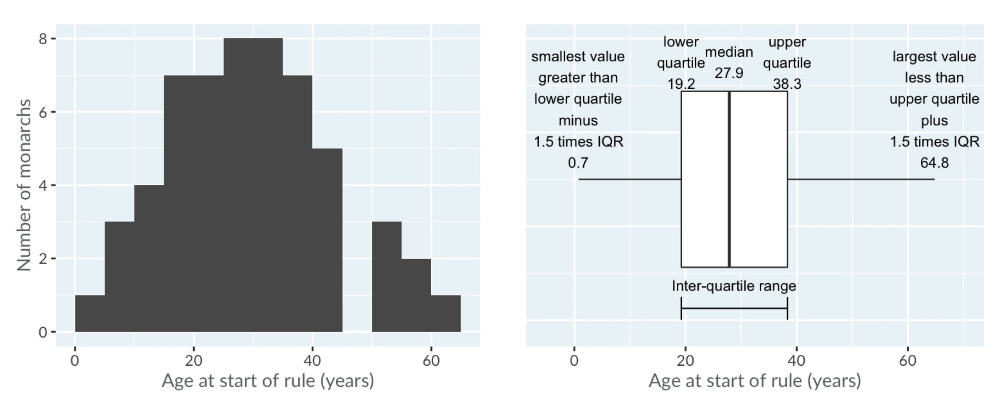
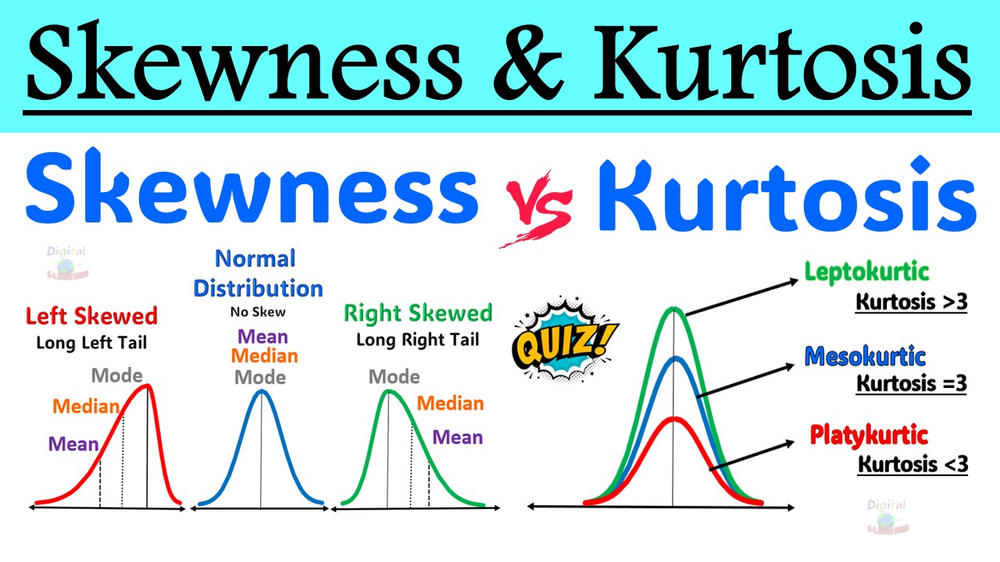

[Weekly content](https://changjunlee.com/teaching/grad_stat/weekly_2/)

<br>

## 6주차 학습목표

::: {.callout-note}
이번 주 학습을 마치면 다음을 할 수 있어야 합니다.

1. 기술통계와 추론통계의 역할을 구분한다.
2. 변수의 유형과 분포에 맞춰 평균, 중앙값, 비율, 표준편차, IQR 등의 요약값을 선택한다.
3. 평균과 표준편차만으로는 드러나지 않는 분포의 비대칭성, 꼬리, 이상값을 그래프로 확인한다.
4. EDA를 **관측단위와 key 확인 → 데이터 품질 감사 → 단변량 → 이변량·다변량 → 민감도 점검 → 주장 범위 설정**의 과정으로 수행한다.
5. 결측값과 이상값을 무조건 제거·대체하지 않고 그 의미와 생성과정을 먼저 질문한다.
6. 범주별 count와 proportion의 분모를 명시하고, 반복측정이나 군집 구조를 독립 표본처럼 보고하지 않는다.
7. EDA 결과에서 관찰, 해석, 대안 설명, 다음 분석을 구분한다.
8. ChatGPT와 같은 GenAI를 자동 분석기보다 **EDA 계획 비평가, 코드 감사자, 주장 검토자**로 활용한다.
:::

### 오늘의 핵심 질문

> **이 요약값과 그래프는 데이터의 어떤 측면을 드러내고, 무엇을 숨기고 있을까?**

```{mermaid}
flowchart LR
    A["Question<br>무엇을 알고 싶은가?"] --> B["Unit and Key<br>한 행과 식별자"]
    B --> C["Data Quality<br>결측·중복·범위"]
    C --> D["Describe<br>중심·산포·형태"]
    D --> E["Explore<br>관계·집단·맥락"]
    E --> F["Sensitivity<br>선택에 따른 변화"]
    F --> G["Claim<br>근거·한계·다음 단계"]
```

::: {.callout-important}
EDA는 “흥미로운 그래프를 많이 그리는 일”이 아닙니다. 데이터가 어떻게 만들어졌는지 이해하고, 분석에 들어가기 전에 오류·편향·예외·대안 설명을 발견하는 **반복적 진단 과정**입니다.
:::

------------------------------------------------------------------------

## 지난주와 연결하기

지난주에는 연구질문을 `ggplot2`로 시각적 증거로 바꾸었습니다. 이번 주에는 그래프에서 보이는 패턴을 수치로 요약하고, 두 증거가 서로 일치하는지 확인합니다.

| 시각적 질문 | 함께 확인할 기술통계 |
|---|---|
| 분포의 중심은 어디인가? | 평균, 중앙값, 최빈 범주 |
| 값들이 얼마나 퍼져 있는가? | 표준편차, IQR, MAD, 범위 |
| 분포가 한쪽으로 치우쳤는가? | 평균–중앙값 차이, 분위수, 왜도 |
| 집단 간 차이가 보이는가? | 집단별 `n`, 중심, 산포, 비율 |
| 일부 값이 패턴을 지배하는가? | 최대·최소, 상위 분위수, 이상값 감사 |
| 결측 때문에 결과가 달라지는가? | 결측 수·비율, 완전사례와 민감도 비교 |

> **숫자는 그래프를 대체하지 않고, 그래프도 숫자를 대체하지 않습니다.** 둘은 서로 다른 방식으로 같은 주장을 감사합니다.

------------------------------------------------------------------------

## 이번 주의 GenAI 활용 방식

이번 주에도 다음 순서를 유지합니다.

> **Attempt → Ask → Test → Audit → Explain**

| 단계 | 학생이 먼저 할 일 | GenAI에 맡길 수 있는 일 |
|---|---|---|
| **Attempt** | 관측단위, key, 질문, 예상 위험을 적는다. | 아직 사용하지 않는다. |
| **Ask** | 변수 설명과 자신의 EDA 계획을 제공한다. | 빠진 품질 점검이나 대안 요약값을 제안한다. |
| **Test** | 제안된 코드를 직접 실행하고 원자료와 대조한다. | 실제로 보지 못한 출력값을 추측하지 않게 한다. |
| **Audit** | 결측·이상값·분모·집단 크기·민감도를 확인한다. | reviewer처럼 과도한 결정과 해석을 공격하게 한다. |
| **Explain** | 채택·수정·기각 이유와 주장 범위를 기록한다. | 문장의 인과적 비약과 누락된 대안 설명을 지적하게 한다. |

### EDA 계획을 먼저 검토받는 프롬프트

```text
당신은 HCI 데이터 분석 수업의 EDA reviewer다.
아래에는 연구질문, 관측단위, 변수 설명, 내가 세운 EDA 계획이 있다.

완성 코드를 작성하지 말고 다음을 검토하라.
1. 관측단위와 분석단위가 혼동되어 있는가?
2. 확인하지 않은 key, 중복, 결측, 허용 범위가 있는가?
3. 변수 유형에 맞지 않는 요약통계를 사용했는가?
4. 단변량 → 이변량 → 다변량 탐색의 순서에서 빠진 단계가 있는가?
5. 현재 EDA로 가능한 주장과 불가능한 주장을 구분하라.

내가 먼저 답해야 할 질문을 최대 5개 제시하라.
출력값이나 분석 결과를 보지 못했다면 추측하지 말라.
```

::: {.callout-warning title="연구자료를 그대로 업로드하지 않기"}
실제 IRB 자료, 참여자 ID, 대화 로그, 위치·건강·생체 정보, 비공개 기업 자료를 공개형 GenAI에 입력하지 않습니다. 다음으로도 충분히 도움을 받을 수 있습니다.

- 비식별·합성 예시 행
- `glimpse()`와 `summary()` 출력
- 변수 사전과 허용 범위
- 결측 개수와 집단별 표본 수
- 최소 재현 코드와 오류 메시지
- 자신이 먼저 작성한 해석 문장
:::

------------------------------------------------------------------------

## 준비

```{r}
#| label: setup
#| message: false
#| warning: false

library(tidyverse)

theme_set(theme_minimal(base_size = 12))
```

::: {.callout-tip}
이번 자료의 Titanic 실습은 `titanic` 패키지를 사용합니다. 패키지가 없다면 **Console에서 한 번만** 다음을 실행합니다.

```{r}
#| eval: false
install.packages("titanic")
```

강의자료 코드 청크 안에서 매번 패키지를 설치하지 않습니다.
:::

------------------------------------------------------------------------

# Part I. 기술통계: 분포를 압축하되 지워 버리지 않기

## 기술통계와 추론통계

- **기술통계(descriptive statistics)**: 현재 관측한 데이터의 중심, 산포, 형태, 빈도를 요약합니다.
- **추론통계(inferential statistics)**: 표본에서 모집단이나 데이터 생성과정에 대해 불확실성을 포함한 결론을 내립니다.

기술통계만으로도 중요한 질문에 답할 수 있지만, 다음은 자동으로 보장되지 않습니다.

- 표본 밖 모집단에서도 같은 패턴이 나타나는가?
- 두 집단의 차이가 우연보다 큰가?
- 한 변수가 다른 변수의 원인인가?
- 결측·표집·측정오차를 고려해도 결과가 유지되는가?

::: {.callout-important}
“평균이 다르다”는 현재 표본의 기술입니다. “모집단에서도 효과가 있다”는 추론이며, “X가 Y를 변화시켰다”는 인과 주장입니다. 세 문장을 구분해야 합니다.
:::

------------------------------------------------------------------------

## 같은 중심, 다른 분포

평균이 비슷한 세 분포를 만들어 보겠습니다.

```{r}
#| label: simulate-distributions

set.seed(2026)

n_demo <- 1000

distribution_demo <- bind_rows(
  tibble(
    distribution = "Approximately normal",
    value = rnorm(n_demo, mean = 50, sd = 10)
  ),
  tibble(
    distribution = "Right-skewed",
    value = 40 + rexp(n_demo, rate = 0.1)
  ),
  tibble(
    distribution = "Heavy-tailed",
    value = 50 + rt(n_demo, df = 3) * (10 / sqrt(3))
  )
) |>
  mutate(
    distribution = factor(
      distribution,
      levels = c("Approximately normal", "Right-skewed", "Heavy-tailed")
    )
  )
```

```{r}
#| label: plot-distributions
#| fig-cap: "평균이 비슷하더라도 비대칭성과 꼬리의 형태는 크게 다를 수 있다."
#| fig-alt: "정규형, 오른쪽 치우침, 두꺼운 꼬리 분포를 나란히 보여 주는 세 개의 히스토그램."

 distribution_demo |>
  ggplot(aes(x = value)) +
  geom_histogram(binwidth = 2.5, boundary = 0) +
  facet_wrap(vars(distribution), ncol = 1, scales = "free_y") +
  labs(
    x = "Value",
    y = "Count"
  )
```

```{r}
distribution_demo |>
  summarise(
    n = n(),
    mean = mean(value),
    median = median(value),
    sd = sd(value),
    iqr = IQR(value),
    minimum = min(value),
    maximum = max(value),
    .by = distribution
  ) |>
  mutate(across(where(is.numeric), ~ round(.x, 2)))
```

**확인할 질문**

1. 평균이 비슷하면 세 분포가 비슷하다고 말할 수 있는가?
2. 어느 분포에서 평균과 중앙값의 차이가 큰가?
3. 표준편차와 IQR이 서로 다른 이야기를 하는 분포는 무엇인가?
4. 최대값 하나가 분포 설명에 얼마나 큰 영향을 주는가?

------------------------------------------------------------------------

## 중심경향: “대표값”은 질문에 따라 달라진다

### Mean

$$
\bar{x}=\frac{1}{n}\sum_{i=1}^{n}x_i
$$

- 모든 값을 사용합니다.
- 더하고 나누는 것이 의미 있는 수치형 변수에 적합합니다.
- 극단값과 비대칭 분포의 영향을 크게 받을 수 있습니다.

### Median

- 정렬했을 때 가운데에 있는 값입니다.
- 순서가 의미 있는 자료에 사용할 수 있습니다.
- 극단값에 상대적으로 강건합니다.
- “전형적인 관측”을 설명할 때 평균보다 적절할 수 있습니다.

### Trimmed mean

양쪽 꼬리의 일정 비율을 제외한 뒤 계산한 평균입니다. 평균의 해석 가능성과 극단값에 대한 강건성을 절충합니다.

```{r}
distribution_demo |>
  summarise(
    mean = mean(value),
    trimmed_mean_10pct = mean(value, trim = 0.10),
    median = median(value),
    .by = distribution
  ) |>
  mutate(across(where(is.numeric), ~ round(.x, 2)))
```

### Mode

최빈값은 가장 자주 나타나는 값입니다. 특히 범주형 변수에서 유용합니다.

```{r}
statistical_mode <- function(x) {
  x <- x[!is.na(x)]
  counts <- table(x)
  names(counts)[counts == max(counts)]
}

interface_choices <- c(
  "voice", "text", "voice", "voice",
  "text", "touch", "voice", NA
)

statistical_mode(interface_choices)
```

::: {.callout-warning}
R의 `mode()` 함수는 통계적 최빈값이 아니라 객체의 저장 방식과 관련된 정보를 반환합니다. 또한 연속형 자료에서는 정확히 같은 값이 반복되지 않을 수 있으므로 “표본에서 가장 자주 나온 실수값”은 대개 안정적인 요약이 아닙니다. 히스토그램의 봉우리와 통계적 mode도 같은 개념이 아닐 수 있습니다.
:::

### 어떤 중심을 보고할까?

| 자료와 목적 | 우선 고려할 요약 |
|---|---|
| 대칭적인 연속형 자료 | mean과 SD |
| 강하게 치우친 시간·비용 자료 | median과 IQR, 필요하면 mean도 병기 |
| 순서형 단일 문항 | 빈도·비율, median과 분위수 |
| 명목형 범주 | count, proportion, mode |
| 여러 문항의 합성척도 | 척도 구성 근거를 확인한 뒤 mean·SD 또는 median·IQR |
| 극단값이 중요한 안전 자료 | 중심만이 아니라 최대값·상위 분위수·개별 사례도 확인 |

------------------------------------------------------------------------

## 산포: 같은 평균 안에 얼마나 다른 관측이 있는가

### Range

$$
\text{Range}=\max(x)-\min(x)
$$

직관적이지만 두 개의 값에만 의존하므로 극단값에 매우 민감합니다.

### Sample variance와 standard deviation

R의 `var()`와 `sd()`는 기본적으로 표본분산과 표본표준편차를 계산합니다.

$$
s^2=\frac{1}{n-1}\sum_{i=1}^{n}(x_i-\bar{x})^2
$$

$$
s=\sqrt{s^2}
$$

- 분산은 편차를 제곱하므로 원래 단위의 제곱입니다.
- 표준편차는 원래 변수와 같은 단위라 해석하기 쉽습니다.
- 두 값 모두 평균과 마찬가지로 극단값의 영향을 받습니다.

### IQR과 MAD

$$
IQR=Q_{0.75}-Q_{0.25}
$$

- **IQR**은 가운데 50%가 차지하는 범위입니다.
- **MAD**는 중앙값으로부터의 절대편차를 활용하는 강건한 산포 측도입니다.

```{r}
distribution_demo |>
  summarise(
    range = diff(range(value)),
    variance = var(value),
    sd = sd(value),
    iqr = IQR(value),
    mad = mad(value),
    .by = distribution
  ) |>
  mutate(across(where(is.numeric), ~ round(.x, 2)))
```

### 분위수는 분포의 위치를 직접 보여 준다

```{r}
distribution_demo |>
  reframe(
    probability = c(0, .10, .25, .50, .75, .90, 1),
    quantile = quantile(
      value,
      probs = c(0, .10, .25, .50, .75, .90, 1)
    ),
    .by = distribution
  ) |>
  mutate(quantile = round(quantile, 2))
```

------------------------------------------------------------------------

## 이상값 하나가 요약값을 바꾸는 방식

```{r}
regular_values <- c(42, 45, 47, 49, 50, 52, 54, 55, 57, 59)
with_extreme <- c(regular_values, 250)

compare_outlier <- tibble(
  version = c("Without extreme value", "With extreme value"),
  values = list(regular_values, with_extreme)
) |>
  mutate(
    mean = map_dbl(values, mean),
    median = map_dbl(values, median),
    sd = map_dbl(values, sd),
    iqr = map_dbl(values, IQR)
  ) |>
  select(-values)

compare_outlier
```

::: {.callout-important}
이상값은 자동 삭제 대상이 아닙니다. 다음 중 무엇인지 먼저 판단합니다.

1. 입력·측정 오류
2. 단위 또는 코딩 불일치
3. 다른 모집단에서 온 관측
4. 드물지만 실제로 가능한 사례
5. 연구 질문에서 가장 중요한 안전·실패 사례

삭제·winsorizing·변환을 선택했다면 원자료 결과와 함께 민감도 분석을 보고하는 것이 좋습니다.
:::

------------------------------------------------------------------------

## 분포의 형태: 왜도와 첨도

### Skewness

왜도는 분포의 비대칭성을 요약합니다.

- 양의 왜도: 오른쪽 꼬리가 상대적으로 김
- 음의 왜도: 왼쪽 꼬리가 상대적으로 김
- 0 근처: 대칭에 가깝지만 반드시 정규분포라는 뜻은 아님

### Excess kurtosis

초과첨도는 정규분포를 기준으로 꼬리와 극단값의 정도를 요약하는 한 방식입니다.

- 양수: 정규분포보다 두꺼운 꼬리가 나타날 수 있음
- 음수: 정규분포보다 가벼운 꼬리가 나타날 수 있음
- 0 근처: 정규분포와 같은 첨도 기준이지만, 전체 모양이 정규분포라는 보장은 없음

패키지마다 보정과 “kurtosis” 대 “excess kurtosis” 정의가 다를 수 있으므로 사용한 정의를 명시해야 합니다.

```{r}
sample_skewness <- function(x) {
  x <- x[is.finite(x)]
  n <- length(x)

  if (n < 3 || sd(x) == 0) {
    return(NA_real_)
  }

  z <- (x - mean(x)) / sd(x)
  n / ((n - 1) * (n - 2)) * sum(z^3)
}

sample_excess_kurtosis <- function(x) {
  x <- x[is.finite(x)]
  n <- length(x)

  if (n < 4 || sd(x) == 0) {
    return(NA_real_)
  }

  z <- (x - mean(x)) / sd(x)

  n * (n + 1) / ((n - 1) * (n - 2) * (n - 3)) * sum(z^4) -
    3 * (n - 1)^2 / ((n - 2) * (n - 3))
}
```

```{r}
distribution_demo |>
  summarise(
    skewness = sample_skewness(value),
    excess_kurtosis = sample_excess_kurtosis(value),
    .by = distribution
  ) |>
  mutate(across(where(is.numeric), ~ round(.x, 2)))
```

::: {.callout-warning}
왜도와 첨도를 하나의 임계값으로 판정해 “정규성 통과/실패”라고 결론 내리지 않습니다. 표본 크기, 히스토그램, ECDF, Q–Q plot, 측정범위, 분석모형의 잔차를 함께 봐야 합니다. 원자료의 비정규성과 모형 잔차의 비정규성도 구분합니다.
:::

------------------------------------------------------------------------

## 한 번에 요약하되, 변수의 의미는 잃지 않기

### 수치형 열 전체를 빠르게 감사하기

```{r}
distribution_demo |>
  summarise(
    across(
      where(is.numeric),
      list(
        n = ~ sum(!is.na(.x)),
        missing = ~ sum(is.na(.x)),
        mean = ~ mean(.x, na.rm = TRUE),
        median = ~ median(.x, na.rm = TRUE),
        sd = ~ sd(.x, na.rm = TRUE),
        iqr = ~ IQR(.x, na.rm = TRUE)
      )
    )
  )
```

이 방식은 빠른 감사에는 유용하지만, 모든 수치형 열에 같은 요약이 개념적으로 적절한 것은 아닙니다. 숫자로 저장된 참여자 ID, 실험조건 코드, Likert 단일문항에 평균과 SD를 자동 적용해서는 안 됩니다.

### 긴 형태의 재사용 가능한 요약표

```{r}
summary_long <- distribution_demo |>
  summarise(
    n = sum(!is.na(value)),
    missing = sum(is.na(value)),
    mean = mean(value, na.rm = TRUE),
    median = median(value, na.rm = TRUE),
    sd = sd(value, na.rm = TRUE),
    iqr = IQR(value, na.rm = TRUE),
    q10 = quantile(value, .10, na.rm = TRUE),
    q90 = quantile(value, .90, na.rm = TRUE),
    .by = distribution
  ) |>
  pivot_longer(
    cols = -distribution,
    names_to = "statistic",
    values_to = "value"
  )

summary_long
```

------------------------------------------------------------------------

## HCI 자료에서는 행 수와 참여자 수를 구분한다

로그와 반복측정 자료에서는 참여자마다 관측 횟수가 다를 수 있습니다.

```{r}
hci_unbalanced <- tribble(
  ~participant_id, ~condition, ~trust,
  "P01", "voice", 2,
  "P01", "voice", 3,
  "P01", "voice", 2,
  "P01", "voice", 3,
  "P01", "voice", 2,
  "P02", "voice", 6,
  "P03", "voice", 7
)

hci_unbalanced |>
  summarise(
    rows = n(),
    participants = n_distinct(participant_id)
  )
```

시행을 같은 가중치로 평균하면 관측이 많은 참여자가 더 큰 영향을 줍니다.

```{r}
trial_weighted_mean <- hci_unbalanced |>
  summarise(mean_trust = mean(trust))

participant_weighted_mean <- hci_unbalanced |>
  summarise(
    participant_mean = mean(trust),
    .by = participant_id
  ) |>
  summarise(mean_trust = mean(participant_mean))

bind_rows(
  `Each trial weighted equally` = trial_weighted_mean,
  `Each participant weighted equally` = participant_weighted_mean,
  .id = "estimand"
)
```

::: {.callout-important}
두 평균 중 하나가 항상 옳은 것은 아닙니다.

- **평균적인 시행 경험**을 기술하려면 시행 단위 요약이 관심 대상일 수 있습니다.
- **평균적인 참여자 경험**을 기술하려면 먼저 참여자별로 요약해야 할 수 있습니다.
- 어느 경우든 동일 참여자 안의 관측 의존성은 추론모형에서 별도로 고려해야 합니다.

따라서 `nrow(data)`를 곧바로 표본 수라고 부르기 전에 **estimand와 분석단위**를 먼저 정합니다.
:::

------------------------------------------------------------------------

# Part II. EDA: 분석 전에 데이터와 협상하기

## EDA의 여섯 단계

1. **Question:** 어떤 현상을 설명하거나 비교하려는가?
2. **Unit and key:** 한 행은 무엇이며, 무엇이 관측을 식별하는가?
3. **Data quality:** 결측, 중복, 자료형, 허용 범위, 논리적 모순은 없는가?
4. **Describe and visualize:** 각 변수와 관계의 중심·산포·형태는 어떠한가?
5. **Sensitivity:** binwidth, 변환, 결측 처리, 이상값 규칙에 따라 결론이 달라지는가?
6. **Claim boundary:** 현재 자료로 무엇을 말할 수 있고 무엇을 말할 수 없는가?

::: {.callout-tip}
EDA는 선형 체크리스트라기보다 반복되는 루프입니다. 그래프에서 이상한 패턴을 발견하면 다시 변수사전과 원자료로 돌아갑니다. 파생변수를 만들었다면 다시 분포와 결측을 확인합니다.
:::

------------------------------------------------------------------------

## Case Study: Titanic passenger data

원자료의 큰 구조는 유지하되, 이번 주에는 머신러닝 경쟁이 아니라 **EDA의 판단과 감사 과정**에 집중합니다.

::: {.callout-note title="데이터 맥락을 잊지 않기"}
이 자료는 역사적 참사를 단순화해 정리한 교육용 데이터입니다. 모든 승객·승무원과 당시의 사회적 맥락을 완전하게 재현하지 않습니다. 관찰된 성별·계급 차이는 기술적 패턴이며, 개인의 본질적 특성이나 단일 원인으로 해석해서는 안 됩니다.
:::

### 데이터 불러오기

```{r}
#| label: load-titanic

if (!requireNamespace("titanic", quietly = TRUE)) {
  stop("Install the titanic package once with install.packages('titanic').")
}

titanic_raw <- titanic::titanic_train |>
  as_tibble()

glimpse(titanic_raw)
```

### 분석용 이름과 자료형 정리

```{r}
#| label: clean-titanic

titanic <- titanic_raw |>
  transmute(
    passenger_id = as.character(PassengerId),
    survived = factor(
      Survived,
      levels = c(0, 1),
      labels = c("Did not survive", "Survived")
    ),
    passenger_class = factor(
      Pclass,
      levels = c(1, 2, 3),
      labels = c("1st", "2nd", "3rd"),
      ordered = TRUE
    ),
    name = Name,
    sex = factor(Sex, levels = c("female", "male")),
    age = Age,
    siblings_spouses = SibSp,
    parents_children = Parch,
    ticket = Ticket,
    fare = Fare,
    cabin = na_if(str_squish(Cabin), ""),
    embarked = na_if(str_squish(Embarked), "")
  )

glimpse(titanic)
```

::: {.callout-important}
자료형 변환은 미관을 위한 작업이 아닙니다. `passenger_class = 1, 2, 3`은 숫자로 저장되어도 연속형 양이 아니라 순서가 있는 범주입니다. `passenger_id` 역시 산술 연산의 대상이 아니라 식별자입니다.
:::

### 최소 데이터 사전

| 변수 | 역할과 의미 | 자료형 | 주의할 점 |
|---|---|---|---|
| `passenger_id` | 승객 식별자 후보 | character | 고유성 검사 필요 |
| `survived` | 기록된 생존 여부 | factor | 이 자료의 결과변수 |
| `passenger_class` | 객실 등급 | ordered factor | 사회경제적 지위의 완전한 측정은 아님 |
| `sex` | 자료에 기록된 성별 범주 | factor | 역사적 기록의 제한이 있음 |
| `age` | 연령 | numeric | 결측, 영아의 소수값 가능 |
| `siblings_spouses` | 동반 형제자매·배우자 수 | integer | 가족 전체를 완전히 식별하지 않음 |
| `parents_children` | 동반 부모·자녀 수 | integer | 가족 전체를 완전히 식별하지 않음 |
| `ticket` | 티켓 코드 | character | 여러 승객이 공유할 수 있음 |
| `fare` | 기록된 운임 | numeric | 개인별 지불액과 동일하지 않을 수 있음 |
| `cabin` | 객실 코드 | character | 매우 많은 결측 |
| `embarked` | 승선항 코드 | character | 코드북 확인 필요 |

------------------------------------------------------------------------

## Step 1. 관측단위와 key 감사

### 한 행은 무엇인가?

> 한 행은 Titanic 자료에 기록된 **한 승객**입니다.

```{r}
titanic |>
  summarise(
    rows = n(),
    unique_passenger_ids = n_distinct(passenger_id),
    duplicate_id_rows = n() - n_distinct(passenger_id)
  )
```

### 중복 key 찾기

```{r}
titanic |>
  count(passenger_id, name = "rows_per_id") |>
  filter(rows_per_id > 1)
```

빈 결과는 이 파일에서 `passenger_id`가 고유하다는 근거입니다. 하지만 “고유해 보인다”와 “연구 설계상 진짜 key다”는 구분해야 합니다.

### 같은 이름이나 티켓은 중복 관측인가?

```{r}
titanic |>
  count(name, sort = TRUE) |>
  filter(n > 1)
```

```{r}
titanic |>
  count(ticket, sort = TRUE) |>
  slice_head(n = 10)
```

같은 티켓을 공유한 승객은 중복 행이 아니라 가족·일행일 수 있습니다. 데이터 품질 감사에서 “값의 반복”과 “관측의 중복”을 혼동하지 않습니다.

::: {.callout-tip title="GenAI checkpoint: key reviewer"}
다음 정보를 AI에 제공합니다.

- 한 행의 정의
- 후보 key
- `count()` 결과
- 동일한 티켓이 반복되는 맥락

그 뒤 “어떤 반복은 오류이고 어떤 반복은 자료 구조인가?”를 질문하게 하십시오. AI가 티켓 중복을 곧바로 삭제하라고 하면 기각해야 합니다.
:::

------------------------------------------------------------------------

## Step 2. 결측값 감사

### 변수별 결측 수와 비율

```{r}
missing_summary <- tibble(
  variable = names(titanic),
  n_missing = map_int(titanic, ~ sum(is.na(.x))),
  pct_missing = map_dbl(titanic, ~ mean(is.na(.x)))
) |>
  arrange(desc(pct_missing))

missing_summary
```

```{r}
#| label: plot-missingness
#| fig-cap: "Titanic 교육용 자료의 변수별 결측 비율."
#| fig-alt: "객실, 연령, 승선항 순으로 결측 비율을 보여 주는 가로 막대그래프."

missing_summary |>
  filter(n_missing > 0) |>
  ggplot(aes(x = pct_missing, y = reorder(variable, pct_missing))) +
  geom_col() +
  scale_x_continuous(labels = scales::label_percent()) +
  labs(
    x = "Missing proportion",
    y = NULL
  )
```

### 결측은 모두 같은 의미인가?

- `age = NA`: 연령 정보가 기록되지 않았을 수 있습니다.
- `cabin = NA`: 객실이 없었다기보다 객실 코드가 자료에 남지 않았을 수 있습니다.
- `embarked = NA`: 승선항 기록이 누락되었습니다.

**0, 빈 문자열, “unknown”, NA는 자동으로 같은 값이 아닙니다.** 코드북과 수집과정을 확인해야 합니다.

### 집단에 따라 결측률이 다른가?

```{r}
titanic |>
  summarise(
    n = n(),
    age_missing = mean(is.na(age)),
    cabin_missing = mean(is.na(cabin)),
    .by = passenger_class
  ) |>
  mutate(
    across(
      c(age_missing, cabin_missing),
      scales::label_percent(accuracy = 0.1)
    )
  )
```

```{r}
titanic |>
  summarise(
    n = n(),
    age_missing = mean(is.na(age)),
    cabin_missing = mean(is.na(cabin)),
    .by = sex
  )
```

집단별 결측 차이는 결측 메커니즘에 대한 단서지만, 이 표만으로 MCAR·MAR·MNAR을 확정할 수는 없습니다.

::: {.callout-warning title="결측을 즉시 평균이나 0으로 채우지 않기"}
전역 평균으로 연령을 대체하면 평균은 유지되지만 분산과 변수 간 관계가 인위적으로 줄어듭니다. 운임의 결측을 0으로 바꾸면 “무료 탑승”이라는 관측을 새로 만들어낼 수 있습니다. 대체가 필요하다면 목적, 가정, 사용한 정보, 불확실성 처리, 민감도 분석을 함께 설명해야 합니다.
:::

### GenAI missingness reviewer

```text
아래에는 변수사전과 집단별 결측률 표가 있다.
결측값을 대체하는 코드를 쓰지 말고 다음을 검토하라.

1. 각 결측이 가질 수 있는 서로 다른 의미를 제시하라.
2. 구조적 결측과 기록 누락을 구분하기 위해 필요한 메타데이터를 묻는다.
3. 결측 처리 전에 확인할 집단별 패턴을 제안하라.
4. complete-case 분석, missing indicator, imputation 각각의 가정을 비교하라.
5. 현재 정보만으로 확정할 수 없는 결측 메커니즘을 명시하라.
```

------------------------------------------------------------------------

## Step 3. 허용 범위와 논리적 모순 감사

```{r}
titanic |>
  summarise(
    age_min = min(age, na.rm = TRUE),
    age_max = max(age, na.rm = TRUE),
    negative_age = sum(age < 0, na.rm = TRUE),
    fare_min = min(fare, na.rm = TRUE),
    fare_max = max(fare, na.rm = TRUE),
    negative_fare = sum(fare < 0, na.rm = TRUE),
    zero_fare = sum(fare == 0, na.rm = TRUE),
    max_siblings_spouses = max(siblings_spouses, na.rm = TRUE),
    max_parents_children = max(parents_children, na.rm = TRUE)
  )
```

### 범위를 확인할 때 묻는 질문

- `age = 0.42`는 오류인가, 영아의 연령 표현인가?
- `fare = 0`은 결측 대체값인가, 실제 기록인가?
- 높은 운임은 개인 단위인가, 일행 단위인가?
- 가족 수가 큰 사례는 입력 오류인가, 실제 대가족인가?
- 변수의 단위와 측정시점은 무엇인가?

```{r}
titanic |>
  filter(fare == 0 | age < 1) |>
  select(passenger_id, name, passenger_class, age, fare, ticket) |>
  arrange(age, fare)
```

::: {.callout-important}
도메인 규칙은 데이터에서 자동으로 배울 수 없습니다. 통계적으로 드물다는 이유만으로 값이 잘못된 것은 아니며, 흔하다는 이유만으로 올바른 것도 아닙니다.
:::

------------------------------------------------------------------------

## Step 4. 단변량 EDA

### 연령: 중심, 산포, 형태, 결측을 함께 보기

```{r}
age_summary <- titanic |>
  summarise(
    n_total = n(),
    n_observed = sum(!is.na(age)),
    n_missing = sum(is.na(age)),
    mean = mean(age, na.rm = TRUE),
    median = median(age, na.rm = TRUE),
    sd = sd(age, na.rm = TRUE),
    iqr = IQR(age, na.rm = TRUE),
    q10 = quantile(age, .10, na.rm = TRUE),
    q90 = quantile(age, .90, na.rm = TRUE)
  )

age_summary
```

```{r}
#| label: age-distribution
#| fig-cap: "관측된 승객 연령의 분포. 결측 연령은 히스토그램에 포함되지 않는다."
#| fig-alt: "0세 부근부터 80세까지의 승객 연령 빈도를 보여 주는 히스토그램."

titanic |>
  ggplot(aes(x = age)) +
  geom_histogram(binwidth = 5, boundary = 0, na.rm = TRUE) +
  labs(
    x = "Age (years)",
    y = "Passenger count",
    caption = paste(
      "Missing age records:",
      sum(is.na(titanic$age))
    )
  )
```

`na.rm = TRUE`는 경고를 줄이는 옵션이지 결측 문제를 해결하는 방법이 아닙니다. 제외된 관측 수를 caption이나 본문에 남깁니다.

### 운임: 평균 하나보다 분포와 변환을 함께 보기

```{r}
titanic |>
  summarise(
    n = sum(!is.na(fare)),
    mean = mean(fare, na.rm = TRUE),
    trimmed_mean = mean(fare, trim = .10, na.rm = TRUE),
    median = median(fare, na.rm = TRUE),
    sd = sd(fare, na.rm = TRUE),
    iqr = IQR(fare, na.rm = TRUE),
    q90 = quantile(fare, .90, na.rm = TRUE),
    q99 = quantile(fare, .99, na.rm = TRUE),
    maximum = max(fare, na.rm = TRUE)
  ) |>
  pivot_longer(everything(), names_to = "statistic", values_to = "value")
```

```{r}
#| label: fare-raw-log
#| fig-cap: "원척도와 log1p 변환 척도에서 본 운임 분포."
#| fig-alt: "오른쪽으로 긴 원래 운임 분포와 로그 변환 후 압축된 분포를 나란히 보여 주는 히스토그램."

fare_long <- titanic |>
  transmute(
    raw_fare = fare,
    log1p_fare = log1p(fare)
  ) |>
  pivot_longer(
    everything(),
    names_to = "scale",
    values_to = "value"
  )

fare_long |>
  ggplot(aes(x = value)) +
  geom_histogram(bins = 30, na.rm = TRUE) +
  facet_wrap(vars(scale), scales = "free_x") +
  labs(x = "Value", y = "Count")
```

로그 변환은 데이터 오류를 고치는 것이 아니라 큰 값 사이의 간격을 압축해 **비율 차이**를 보기 쉽게 하는 분석 선택입니다. 0을 포함하기 때문에 `log1p(x) = log(1 + x)`를 사용했습니다.

### 범주형 변수: count와 proportion

```{r}
titanic |>
  count(passenger_class, name = "n") |>
  mutate(proportion = n / sum(n))
```

```{r}
titanic |>
  count(embarked, .drop = FALSE, name = "n") |>
  mutate(proportion = n / sum(n))
```

`NA`가 있으면 제외하지 않고 별도 범주로 확인한 뒤 처리 방식을 결정합니다.

------------------------------------------------------------------------

## Step 5. 이변량 EDA

### 전체 생존 count와 proportion

```{r}
overall_survival <- titanic |>
  count(survived, name = "n") |>
  mutate(proportion = n / sum(n))

overall_survival
```

### 성별로 기록된 범주와 생존

```{r}
survival_by_sex <- titanic |>
  count(sex, survived, name = "n") |>
  mutate(
    denominator = sum(n),
    proportion = n / denominator,
    .by = sex
  )

survival_by_sex
```

```{r}
#| label: survival-sex
#| fig-cap: "자료에 기록된 성별 범주 안에서 계산한 생존 구성비. 각 막대의 분모는 해당 성별 승객 수다."
#| fig-alt: "여성과 남성 범주별로 생존과 비생존 비율을 누적한 100퍼센트 막대그래프."

survival_by_sex |>
  ggplot(aes(x = sex, y = proportion, fill = survived)) +
  geom_col() +
  scale_y_continuous(labels = scales::label_percent()) +
  labs(
    x = "Sex recorded in the dataset",
    y = "Within-group proportion",
    fill = "Outcome"
  )
```

이 그래프는 표본 안의 연관성을 기술합니다. 성별이 생존을 “원인”으로 만들었다고 단정하지 않습니다. 객실 위치, 등급, 당시의 대피 규범 등 다른 설명이 함께 작동했을 수 있습니다.

### 객실 등급과 생존

```{r}
survival_by_class <- titanic |>
  count(passenger_class, survived, name = "n") |>
  mutate(
    denominator = sum(n),
    proportion = n / denominator,
    .by = passenger_class
  )

survival_by_class
```

```{r}
survival_by_class |>
  ggplot(aes(x = passenger_class, y = proportion, fill = survived)) +
  geom_col() +
  scale_y_continuous(labels = scales::label_percent()) +
  labs(
    x = "Passenger class",
    y = "Within-class proportion",
    fill = "Outcome"
  )
```

### 연령과 생존: 분포를 숨기지 않기

```{r}
titanic |>
  filter(!is.na(age)) |>
  ggplot(aes(x = survived, y = age)) +
  geom_boxplot(outlier.shape = NA, width = .45) +
  geom_jitter(width = .12, alpha = .25, size = 1) +
  labs(
    x = "Outcome",
    y = "Age (years)"
  )
```

```{r}
titanic |>
  summarise(
    n = sum(!is.na(age)),
    missing_age = sum(is.na(age)),
    mean_age = mean(age, na.rm = TRUE),
    median_age = median(age, na.rm = TRUE),
    sd_age = sd(age, na.rm = TRUE),
    iqr_age = IQR(age, na.rm = TRUE),
    .by = survived
  )
```

------------------------------------------------------------------------

## Step 6. 다변량 EDA: 한 변수의 패턴이 맥락에 따라 달라지는가?

### 성별 범주 × 객실 등급 × 생존

```{r}
survival_by_sex_class <- titanic |>
  count(sex, passenger_class, survived, name = "n") |>
  mutate(
    denominator = sum(n),
    proportion = n / denominator,
    .by = c(sex, passenger_class)
  )

survival_by_sex_class
```

```{r}
#| label: survival-sex-class
#| fig-cap: "성별 범주와 객실 등급 조합 안에서 계산한 생존 구성비."
#| fig-alt: "객실 등급별 패널 안에서 여성과 남성의 생존 비율을 비교하는 누적 막대그래프."

survival_by_sex_class |>
  ggplot(aes(x = sex, y = proportion, fill = survived)) +
  geom_col() +
  facet_wrap(vars(passenger_class)) +
  scale_y_continuous(labels = scales::label_percent()) +
  labs(
    x = "Sex recorded in the dataset",
    y = "Within-cell proportion",
    fill = "Outcome"
  )
```

### 셀별 표본 수 확인

```{r}
survival_by_sex_class |>
  summarise(
    cell_n = unique(denominator),
    .by = c(sex, passenger_class)
  ) |>
  arrange(cell_n)
```

비율이 극단적으로 보여도 셀의 분모가 작으면 불안정할 수 있습니다. 비율 그래프에는 count 표를 함께 둡니다.

::: {.callout-tip title="GenAI checkpoint: pattern critic"}
자신의 해석문과 함께 다음을 요청합니다.

```text
아래 비율표와 셀별 표본 수를 reviewer처럼 검토하라.
- 분모를 잘못 비교한 문장이 있는가?
- 작은 셀을 과도하게 일반화했는가?
- 이변량 패턴이 세 번째 변수에 따라 달라지는가?
- 연관성을 원인처럼 표현했는가?
- 대안 설명과 추가로 필요한 자료를 제시하라.
```
:::

------------------------------------------------------------------------

## Step 7. 이상값은 flag하고 조사하기

운임에 IQR 규칙을 적용해 “검토 후보”를 표시합니다.

```{r}
fare_quartiles <- quantile(
  titanic$fare,
  probs = c(.25, .75),
  na.rm = TRUE
)

fare_iqr <- diff(fare_quartiles)
fare_lower <- fare_quartiles[[1]] - 1.5 * fare_iqr
fare_upper <- fare_quartiles[[2]] + 1.5 * fare_iqr

fare_audit <- titanic |>
  mutate(
    fare_flag = case_when(
      is.na(fare) ~ "missing",
      fare < fare_lower ~ "below IQR rule",
      fare > fare_upper ~ "above IQR rule",
      TRUE ~ "within rule"
    )
  )

fare_audit |>
  count(fare_flag)
```

```{r}
fare_audit |>
  filter(fare_flag == "above IQR rule") |>
  select(
    passenger_id,
    name,
    passenger_class,
    ticket,
    fare,
    cabin
  ) |>
  arrange(desc(fare)) |>
  slice_head(n = 15)
```

IQR 규칙은 오류 판정기가 아니라 탐색 도구입니다. 상위 운임이 공유 티켓, 일행 규모, 객실 등급과 관련되어 있을 수 있으므로 맥락을 함께 확인합니다.

### 이상값 처리 전후 민감도 비교

```{r}
tibble(
  version = c("All observed fares", "Within IQR rule"),
  mean = c(
    mean(fare_audit$fare, na.rm = TRUE),
    mean(
      fare_audit$fare[fare_audit$fare_flag == "within rule"],
      na.rm = TRUE
    )
  ),
  median = c(
    median(fare_audit$fare, na.rm = TRUE),
    median(
      fare_audit$fare[fare_audit$fare_flag == "within rule"],
      na.rm = TRUE
    )
  ),
  sd = c(
    sd(fare_audit$fare, na.rm = TRUE),
    sd(
      fare_audit$fare[fare_audit$fare_flag == "within rule"],
      na.rm = TRUE
    )
  ),
  iqr = c(
    IQR(fare_audit$fare, na.rm = TRUE),
    IQR(
      fare_audit$fare[fare_audit$fare_flag == "within rule"],
      na.rm = TRUE
    )
  )
)
```

이 비교는 값들을 제거하라는 결론이 아니라, 특정 요약이 상위 꼬리에 얼마나 민감한지 보여 줍니다.

------------------------------------------------------------------------

## Step 8. EDA에서 파생변수 만들기

파생변수는 원자료에서 “발견되는 자연적 사실”이 아니라 연구자가 목적에 따라 만든 표현입니다. 정의와 가정을 기록해야 합니다.

### 가족·일행 관련 변수

```{r}
titanic_features <- titanic |>
  mutate(
    family_size = siblings_spouses + parents_children + 1,
    travelling_alone = factor(
      if_else(family_size == 1, "Alone", "With family"),
      levels = c("Alone", "With family")
    )
  ) |>
  add_count(ticket, name = "ticket_party_size")
```

### 이름에서 title 추출

```{r}
titanic_features <- titanic_features |>
  mutate(
    title_raw = str_squish(
      str_extract(name, "(?<=, )[^.]+(?=\\.)")
    ),
    title = fct_lump_min(
      factor(title_raw),
      min = 10,
      other_level = "Other"
    )
  )
```

```{r}
titanic_features |>
  count(title, sort = TRUE)
```

::: {.callout-warning}
`family_size`, `ticket_party_size`, `title`은 편리하지만 완전한 가족관계, 실제 동행관계, 사회적 지위를 정확히 측정한다고 가정할 수 없습니다. 이름에서 추출한 title은 역사적·문화적 코드이며 현대의 정체성 범주로 일반화해서는 안 됩니다.
:::

### 파생변수 감사

```{r}
titanic_features |>
  summarise(
    min_family_size = min(family_size),
    max_family_size = max(family_size),
    min_ticket_party = min(ticket_party_size),
    max_ticket_party = max(ticket_party_size),
    missing_title = sum(is.na(title))
  )
```

```{r}
titanic_features |>
  count(family_size, ticket_party_size, sort = TRUE) |>
  slice_head(n = 15)
```

파생변수를 만든 뒤에는 다시 분포, 결측, 허용 범위, 예외를 확인합니다.

------------------------------------------------------------------------

## Step 9. 결측 처리의 민감도 보기

연령 결측을 전역 평균으로 채웠을 때 무엇이 달라지는지 **학습 목적으로만** 비교합니다.

```{r}
age_observed_mean <- mean(titanic$age, na.rm = TRUE)

age_sensitivity <- tibble(
  method = c("Observed cases only", "Global mean imputation"),
  values = list(
    titanic$age[!is.na(titanic$age)],
    replace_na(titanic$age, age_observed_mean)
  )
) |>
  mutate(
    n = map_int(values, length),
    mean = map_dbl(values, mean),
    median = map_dbl(values, median),
    sd = map_dbl(values, sd),
    iqr = map_dbl(values, IQR)
  ) |>
  select(-values)

age_sensitivity
```

- 대체 후 평균은 같은 값으로 채웠기 때문에 거의 변하지 않습니다.
- 표본 수는 늘지만 새 정보가 생긴 것은 아닙니다.
- 분산과 분포는 인위적으로 변합니다.
- 변수 간 상관관계와 표준오차도 달라질 수 있습니다.

::: {.callout-important}
“결측을 채우면 행을 더 많이 쓸 수 있다”와 “결측에서 잃은 정보를 복원했다”는 같은 말이 아닙니다. 실제 분석에서는 다중대치, 모형 기반 처리, 가중, 결측 패턴별 분석 등 연구설계에 맞는 방법을 검토합니다.
:::

------------------------------------------------------------------------

## Step 10. EDA 결과를 Claim Card로 제한하기

예를 들어 다음 문장은 수준이 다릅니다.

1. **Observation:** 여성으로 기록된 승객 집단에서 생존 비율이 더 높게 나타났다.
2. **Numerical evidence:** 집단별 분모와 생존 count·proportion은 표와 같다.
3. **Interpretation:** 당시의 대피 규범과 객실 접근성 등이 관련되었을 가능성이 있다.
4. **Alternative:** 객실 등급, 위치, 가족·일행 구조 등과 얽혀 있을 수 있다.
5. **Boundary:** 이 관찰자료만으로 성별의 독립적 인과효과를 추정할 수 없다.
6. **Next step:** 다변량 모형, 상호작용, 역사적 메타데이터, 선택편향을 검토한다.

### EDA Claim Card

| 항목 | 작성할 내용 |
|---|---|
| Question | 어떤 질문을 탐색했는가? |
| Unit and key | 한 행은 무엇이며 key는 무엇인가? |
| Data quality | 결측·중복·범위·이상값에서 무엇을 발견했는가? |
| Visual evidence | 그래프에서 실제로 보이는 패턴은 무엇인가? |
| Numerical evidence | 어떤 `n`, 중심, 산포, 비율이 패턴을 뒷받침하는가? |
| Sensitivity | bin, 변환, 결측·이상값 처리에 따라 무엇이 달라졌는가? |
| Interpretation | 가능한 설명은 무엇인가? |
| Alternative | 다른 설명과 교란 가능성은 무엇인가? |
| Boundary | 현재 자료로 말할 수 없는 것은 무엇인가? |
| Next step | 추가 자료 또는 분석은 무엇인가? |

------------------------------------------------------------------------

## EDA 코드의 재현성과 기록

### 분석 선택을 코드로 남기기

```{r}
eda_snapshot <- list(
  data = titanic_features,
  quality = list(
    missing_summary = missing_summary,
    fare_thresholds = c(
      lower = fare_lower,
      upper = fare_upper
    )
  ),
  summaries = list(
    age = age_summary,
    survival_by_sex = survival_by_sex,
    survival_by_class = survival_by_class
  ),
  decisions = tibble(
    decision = c(
      "Blank cabin codes converted to NA",
      "Age not imputed in primary EDA",
      "Fare IQR rule used only as an audit flag"
    ),
    reason = c(
      "Blank string does not represent a measured cabin category",
      "Missingness and uncertainty should remain visible",
      "Rare valid observations should not be deleted automatically"
    )
  )
)
```

```{r}
str(eda_snapshot, max.level = 2)
```

이 객체 자체를 제출할 필요는 없지만, 데이터·요약표·결정기록을 함께 보관한다는 발상을 익힙니다.

------------------------------------------------------------------------

## GenAI Claim Auditor

```text
당신은 엄격한 통계 reviewer다.
아래 EDA Claim Card와 이를 뒷받침하는 표·그래프 설명을 검토하라.

다음 유형의 문제를 찾아라.
- 표본의 기술을 모집단 결론처럼 표현함
- 연관성을 인과관계처럼 표현함
- 분모 또는 결측 제외 수가 없음
- 작은 하위집단을 과도하게 일반화함
- 이상값 삭제가 결론에 유리하게만 이루어짐
- 파생변수를 실제 구성개념과 동일시함
- 그래프와 수치 요약이 서로 일치하지 않음
- 대안 설명과 민감도 분석이 빠짐

각 문제를 “문제 문장 → 왜 문제인지 → 필요한 증거 → 수정 예시” 순서로 제시하라.
내가 제공하지 않은 통계량이나 결과를 만들어 내지 말라.
```

------------------------------------------------------------------------

## Checkpoint Quiz

1. 오른쪽으로 강하게 치우친 과업완료시간의 “전형적인 값”을 설명할 때 mean과 median 중 무엇을 우선 검토할까?
2. `sd()`와 `IQR()`이 크게 다른 이야기를 할 때 무엇을 확인해야 할까?
3. `cabin = NA`를 “객실 없음”으로 코딩하면 어떤 의미 오류가 생길 수 있을까?
4. 같은 티켓이 8번 나타났다는 이유로 7행을 삭제하면 왜 문제인가?
5. 생존율을 비교할 때 count만 보고 proportion을 보지 않으면 어떤 오류가 생길 수 있을까?
6. IQR 규칙 밖의 운임을 모두 삭제하면 안 되는 이유는 무엇인가?
7. 전역 평균 대체 후 연령의 평균이 유지되었다는 사실이 대체가 타당함을 의미하는가?
8. EDA에서 발견한 패턴을 확증적 가설검정 결과처럼 보고하면 어떤 문제가 생기는가?

<details>
<summary><strong>답안과 해설 보기</strong></summary>

1. 치우침과 극단값에 강건한 median을 우선 검토하되, 연구 목적에 따라 mean도 함께 보고합니다.
2. 비대칭, 극단값, 두꺼운 꼬리, 하위집단 혼합, 측정오류를 그래프로 확인합니다.
3. “기록되지 않음”을 “객실이 실제로 없음”이라는 관측값으로 바꾸는 오류가 생깁니다.
4. 공유 티켓은 가족·일행이라는 실제 군집 구조일 수 있으며, key 중복과 값 반복은 다릅니다.
5. 집단 크기가 다르면 큰 집단의 count가 높게 보일 수 있으며, 집단 안 비율과 다른 질문이 됩니다.
6. IQR 규칙은 드문 값의 flag일 뿐 오류 판정이 아니며, 중요한 실제 사례를 지울 수 있습니다.
7. 아닙니다. 평균은 대체값의 정의 때문에 유지되지만 분산과 관계가 왜곡될 수 있습니다.
8. 탐색과 확증을 같은 자료에서 구분하지 않으면 선택적 분석과 과도한 확신의 위험이 커집니다.

</details>

<!-- ------------------------------------------------------------------------ -->

<!-- ## Activity: EDA Audit Lab -->

<!-- ### 질문 선택 -->

<!-- 다음 중 하나를 선택하거나 자신의 HCI 자료에 적용합니다. -->

<!-- 1. Titanic 표본에서 객실 등급별 생존 구성비는 어떻게 다른가? -->
<!-- 2. 연령 분포와 연령 결측은 생존 집단별로 어떻게 다른가? -->
<!-- 3. 운임의 분포는 어떤 요약값에 민감하며 객실 등급과 어떤 관련이 있는가? -->
<!-- 4. 가족·일행 파생변수는 어떤 가정을 포함하며 생존 구성비와 어떤 패턴을 보이는가? -->
<!-- 5. 자신의 HCI 자료에서 한 결과변수의 분포·결측·이상값·집단 차이를 감사한다. -->

<!-- ### Round 1 — Human first -->

<!-- AI 없이 다음을 작성합니다. -->

<!-- - 연구질문 -->
<!-- - 관측단위와 후보 key -->
<!-- - 결과변수와 주요 비교변수 -->
<!-- - 예상되는 결측·이상값 위험 -->
<!-- - 단변량 그래프와 요약값 -->
<!-- - 이변량 또는 다변량 그래프 -->
<!-- - 현재 자료로 할 수 없는 주장 -->

<!-- ### Round 2 — Reproducible EDA -->

<!-- 최소한 다음을 코드로 만듭니다. -->

<!-- 1. 행 수와 고유 key 감사 -->
<!-- 2. 변수별 결측 수·비율 -->
<!-- 3. 허용 범위와 논리적 모순 점검 -->
<!-- 4. 단변량 기술통계와 그래프 -->
<!-- 5. 집단별 `n`, 중심·산포 또는 비율 -->
<!-- 6. 한 번의 민감도 분석 -->
<!-- 7. EDA Claim Card -->

<!-- ### Round 3 — AI audit -->

<!-- GenAI에게 다음 중 한 역할만 부여합니다. -->

<!-- - key와 관측단위 reviewer -->
<!-- - missingness reviewer -->
<!-- - outlier reviewer -->
<!-- - visual and numerical evidence reviewer -->
<!-- - claim boundary reviewer -->

<!-- 한 번에 전체 분석을 생성하게 하지 않습니다. -->

<!-- ### 제출물 -->

<!-- 1. 재현 가능한 `.qmd` -->
<!-- 2. 데이터 감사표 1개 -->
<!-- 3. 기술통계표 1개 -->
<!-- 4. 그래프 2–3개 -->
<!-- 5. 민감도 분석 1개 -->
<!-- 6. EDA Claim Card -->
<!-- 7. AI Collaboration Log -->

<!-- ### AI Collaboration Log -->

<!-- | 항목 | 기록할 내용 | -->
<!-- |---|---| -->
<!-- | 목적 | 계획, 디버깅, 결측, 이상값, claim audit 등 | -->
<!-- | 내가 먼저 한 시도 | AI 사용 전 코드·예상·판단 | -->
<!-- | 프롬프트 | 실제 요청의 핵심 | -->
<!-- | AI 제안 | 제안 내용 요약 | -->
<!-- | 검증 | 직접 실행한 코드와 확인한 출력 | -->
<!-- | 결정 | 채택·수정·기각과 이유 | -->
<!-- | 최종 변화 | 분석 또는 해석의 변화 | -->

<!-- ------------------------------------------------------------------------ -->

## 마무리

이번 주의 핵심은 통계량의 공식을 많이 외우는 것이 아니라 다음의 분석 습관입니다.

> **한 행과 key를 확인한다 → 결측·중복·범위를 감사한다 → 중심·산포·형태를 숫자와 그래프로 함께 본다 → 집단별 분모와 표본 수를 확인한다 → 분석 선택에 대한 민감도를 본다 → 관찰과 인과 주장을 구분한다**

이번 주는 EDA에서 멈춥니다. 예측모형을 여러 개 돌리는 것은 EDA의 자연스러운 마지막 단계가 아니며, 다음 단계에서는 연구질문과 설계에 맞는 추론모형을 별도로 선택하고 진단해야 합니다.


<!-- # Descriptive Statistics -->

<!-- <br> -->

<!-- This chapter introduces **descriptive statistics**, which summarize and describe the main features of a dataset. Descriptive statistics are the foundation of exploratory data analysis (EDA) and are used to understand the basic structure and characteristics of data before moving on to more complex analysis. -->

<!-- We'll explore **measures of central tendency** (mean, median, mode), **measures of variability** (variance, standard deviation, range, IQR), and **distribution** (skewness, kurtosis). In this chapter, we will also introduce some key R functions and simulate data to illustrate these concepts. -->

<!-- <br> -->

<!-- ### Table of Contents -->

<!-- 1.  **Introduction to Descriptive Statistics** -->

<!-- 2.  **Generating Data for Simulation** -->

<!-- 3.  **Measures of Central Tendency** -->

<!-- 4.  **Measures of Variability** -->

<!-- 5.  **Visualizing Data Distribution** -->

<!-- 6.  **Skewness and Kurtosis** -->

<!-- 7.  **Summary Statistics Using R Functions** -->

<!-- 8.  **Exercises** -->

<!-- <br> -->

<!-- ### 1. Introduction to Descriptive Statistics -->

<!-- Descriptive statistics help summarize data by providing key insights into the data's central tendency, spread, and overall shape of the distribution. -->

<!-- -   **Central Tendency**: Mean, median, and mode. -->

<!-- -   **Variability**: Variance, standard deviation, range, and interquartile range (IQR). -->

<!-- -   **Distribution**: Shape of the distribution including skewness and kurtosis. -->

<!-- <br> -->

<!-- ### 2. Generating Data for Simulation -->

<!-- We'll start by generating some **synthetic data** to demonstrate descriptive statistics using the `rnorm()` function to generate data from a **normal distribution** and `runif()` for a **uniform distribution**. -->

<!-- ```{r} -->
<!-- # Simulate normally distributed data (mean = 50, sd = 10) -->
<!-- # About many types of distributions (normal, uniform, etc), we'll learn later -->
<!-- set.seed(123) -->
<!-- data_normal <- rnorm(1000, mean = 50, sd = 10) -->

<!-- # Simulate uniformly distributed data (min = 10, max = 90) -->
<!-- data_uniform <- runif(1000, min = 10, max = 90) -->

<!-- # Summary of the datasets -->
<!-- summary(data_normal) -->
<!-- summary(data_uniform) -->

<!-- ``` -->

<!-- <br> -->

<!-- ```{r} -->
<!-- # Histogram of normally distributed data -->
<!-- library(tidyverse) -->
<!-- ggplot(data.frame(x = data_normal), aes(x)) + -->
<!--   geom_histogram(bins = 30, fill = "grey", alpha = 0.9) + -->
<!--   labs(title = "Histogram of Normally Distributed Data", x = "Value", y = "Frequency") + -->
<!--   theme_minimal() -->


<!-- ``` -->

<!-- ```{r} -->
<!-- # Histogram of uniformly distributed data -->
<!-- ggplot(data.frame(x = data_uniform), aes(x)) + -->
<!--   geom_histogram(bins = 30, fill = "grey", alpha = 0.9) + -->
<!--   labs(title = "Histogram of Uniformly Distributed Data", x = "Value", y = "Frequency") + -->
<!--   theme_minimal() -->
<!-- ``` -->

<!-- <br> -->

<!-- ### 3. Measures of Central Tendency -->

<!-- The **central tendency** refers to the "center" of a dataset. The most common measures of central tendency are the **mean**, **median**, and **mode**. -->

<!--  -->

<!-- -   **Mean**: The arithmetic average of the data. -->

<!-- $$ -->
<!-- \frac{\sum^{n}_{i=1}x_i}{n} -->
<!-- $$ -->

<!-- -   **Median**: The middle value when the data is ordered. -->

<!--     -   Arrange the data in increasing order. -->
<!--     -   If the number of observations $n$ is odd, the median is the value at position $\frac{n + 1}{2}$. -->
<!--     -   If $n$ is even, the median is the average of the values at positions $\frac{n}{2}$ and $\frac{n}{2} + 1$. -->

<!-- -   **Mode**: The value that occurs most frequently. -->

<!-- -   **Moving Average:** The moving average smooths out short-term fluctuations to highlight longer-term trends in a time series dataset. It is commonly used in time series analysis and forecasting. -->

<!--     -   **Simple Moving Average (SMA):** An unweighted average of the previous N data points (default). -->

<!--     -   **Weighted Moving Average (WMA):** Weights the data points, giving more importance [to recent data]{.underline}. -->

<!--     -   **Exponential Moving Average (EMA):** Similar to WMA but the [weighting factor decreases exponentially for older data points]{.underline}. -->

<!-- ```{r} -->
<!-- # Mean, median, and mode for normally distributed data -->
<!-- mean_normal <- mean(data_normal) -->
<!-- median_normal <- median(data_normal) -->
<!-- mode_normal <- as.numeric(names(sort(table(data_normal), decreasing = TRUE)[1])) -->

<!-- # Mean, median, and mode for uniformly distributed data -->
<!-- mean_uniform <- mean(data_uniform) -->
<!-- median_uniform <- median(data_uniform) -->
<!-- mode_uniform <- as.numeric(names(sort(table(data_uniform), decreasing = TRUE)[1])) -->

<!-- # Display results -->
<!-- cat("Normal Distribution - Mean:", mean_normal, "Median:", median_normal, "Mode:", mode_normal, "\n") -->
<!-- cat("Uniform Distribution - Mean:", mean_uniform, "Median:", median_uniform, "Mode:", mode_uniform, "\n") -->

<!-- ``` -->

<!-- <br> -->

<!-- ### 4. Measures of Variability -->

<!-- Variability tells us how spread out the data points are. Common measures of variability include **range**, **variance**, **standard deviation**, and **interquartile range (IQR)**. -->

<!-- -   **Range**: The difference between the maximum and minimum values. -->

<!-- -   **Variance**: The average squared deviation from the mean. -->

<!-- $$ -->
<!-- \text{Variance} = \sigma^2 = \frac{1}{n} \sum_{i=1}^{n} (x_i - \mu)^2 -->
<!-- $$ -->

<!-- -   **Standard Deviation**: The square root of variance, representing the spread of data. -->

<!-- $$ -->
<!-- \text{Standard Deviation} = \sigma = \sqrt{\frac{1}{n} \sum_{i=1}^{n} (x_i - \mu)^2} -->
<!-- $$ -->

<!-- -   **Interquartile Range (IQR)**: The range between the 25th percentile (Q1) and the 75th percentile (Q3). -->

<!-- ```{r} -->
<!-- # Variability measures for normally distributed data -->
<!-- range_normal <- range(data_normal) -->
<!-- var_normal <- var(data_normal) -->
<!-- sd_normal <- sd(data_normal) -->
<!-- iqr_normal <- IQR(data_normal) -->

<!-- # Variability measures for uniformly distributed data -->
<!-- range_uniform <- range(data_uniform) -->
<!-- var_uniform <- var(data_uniform) -->
<!-- sd_uniform <- sd(data_uniform) -->
<!-- iqr_uniform <- IQR(data_uniform) -->

<!-- # Display results -->
<!-- cat("Normal Distribution - Range:", range_normal, "Variance:", var_normal, "SD:", sd_normal, "IQR:", iqr_normal, "\n") -->
<!-- cat("Uniform Distribution - Range:", range_uniform, "Variance:", var_uniform, "SD:", sd_uniform, "IQR:", iqr_uniform, "\n") -->

<!-- ``` -->

<!-- <br> -->

<!-- ### 5. Visualizing Data Distribution -->

<!-- To understand the distribution of data, it is helpful to visualize it. We can use **histograms** and **boxplots** to explore the distribution of our datasets. -->

<!--  -->

<!-- <br> -->

<!-- ```{r} -->
<!-- # Install ggplot2 if not already installed -->
<!-- if (!require(ggplot2)) install.packages("ggplot2") -->

<!-- library(ggplot2) -->

<!-- # Histogram of normally distributed data -->
<!-- ggplot(data.frame(x = data_normal), aes(x)) + -->
<!--   geom_histogram(bins = 30, fill = "blue", alpha = 0.7) + -->
<!--   labs(title = "Histogram of Normally Distributed Data", x = "Value", y = "Frequency") + -->
<!--   theme_minimal() -->

<!-- # Boxplot of uniformly distributed data -->
<!-- ggplot(data.frame(x = data_uniform), aes(y = x)) + -->
<!--   geom_boxplot(fill = "green", alpha = 0.7) + -->
<!--   labs(title = "Boxplot of Uniformly Distributed Data", y = "Value") + -->
<!--   theme_minimal() -->

<!-- ``` -->

<!-- <br> -->

<!-- ### 6. Skewness and Kurtosis -->

<!-- **Skewness** measures the *asymmetry* of the distribution, while **kurtosis** measures the *tailedness* of the distribution. -->

<!--  -->

<!-- **Skewness**: If skewness is near 0, the distribution is symmetrical. Positive skewness indicates a right-skewed distribution, while negative skewness indicates a left-skewed distribution. -->

<!-- $$ -->
<!-- \text{Skewness} = \frac{n}{(n-1)(n-2)} \sum_{i=1}^{n} \left( \frac{x_i - \bar{x}}{s} \right)^3 -->
<!-- $$ -->

<!-- -   n is the number of data points. -->

<!-- -   $x_i$ is each individual data point. -->

<!-- -   $\bar{x}$ is the sample mean of the data. -->

<!-- -   s is the sample standard deviation. -->

<!-- **Kurtosis**: High kurtosis indicates heavy tails, while low kurtosis indicates light tails. -->

<!-- $$ -->
<!-- \text{Kurtosis} = \frac{n(n+1)}{(n-1)(n-2)(n-3)} \sum_{i=1}^{n} \left( \frac{x_i - \bar{x}}{s} \right)^4 - \frac{3(n-1)^2}{(n-2)(n-3)} -->
<!-- $$ -->

<!-- -   n is the number of data points. -->

<!-- -   $x_i$ is each individual data point. -->

<!-- -   $\bar{x}$ is the sample mean of the data. -->

<!-- -   s is the sample standard deviation. -->

<!-- Where: -->

<!-- We can use the **`moments`** package to calculate skewness and kurtosis. -->

<!-- ```{r} -->
<!-- # Install moments package if not already installed -->
<!-- if (!require(moments)) install.packages("moments") -->

<!-- library(moments) -->

<!-- # Skewness and Kurtosis for Normal Data -->
<!-- skewness_normal <- skewness(data_normal) -->
<!-- kurtosis_normal <- kurtosis(data_normal) -->

<!-- # Skewness and Kurtosis for Uniform Data -->
<!-- skewness_uniform <- skewness(data_uniform) -->
<!-- kurtosis_uniform <- kurtosis(data_uniform) -->

<!-- # Display Results -->
<!-- cat("Normal Distribution - Skewness:", skewness_normal, "Kurtosis:", kurtosis_normal, "\n") -->
<!-- cat("Uniform Distribution - Skewness:", skewness_uniform, "Kurtosis:", kurtosis_uniform, "\n") -->

<!-- ``` -->

<!-- <br> -->

<!-- ```{r} -->

<!-- # Plotting Histograms for Visual Representation -->
<!-- par(mfrow = c(1, 2))  # Plot side by side -->

<!-- # Histogram for Normal Distribution -->
<!-- hist(data_normal, breaks = 30, col = "lightblue", main = "Normal Distribution", -->
<!--      xlab = "Value", ylab = "Frequency", freq = TRUE) -->
<!-- mtext(paste("Skewness:", round(skewness_normal, 2), "Kurtosis:", round(kurtosis_normal, 2)), side = 3) -->

<!-- # Histogram for Uniform Distribution -->
<!-- hist(data_uniform, breaks = 30, col = "lightgreen", main = "Uniform Distribution", -->
<!--      xlab = "Value", ylab = "Frequency", freq = TRUE) -->
<!-- mtext(paste("Skewness:", round(skewness_uniform, 2), "Kurtosis:", round(kurtosis_uniform, 2)), side = 3) -->

<!-- par(mfrow = c(1, 1))  # Reset plot layout -->
<!-- ``` -->

<!-- <bR> -->

<!-- ```{r} -->
<!-- library(moments) -->

<!-- # Generate Normal data -->
<!-- set.seed(123) -->
<!-- data_normal <- rnorm(1000, mean = 0, sd = 1) -->

<!-- # Skewed Data (Cube Transformation) -->
<!-- data_skewed <- data_normal^3 -->

<!-- # Data with High Kurtosis (Heavy Tails) - t-distribution -->
<!-- data_high_kurtosis <- rt(1000, df = 3)  # df = 3 gives heavier tails than normal -->

<!-- # Skewness and Kurtosis Calculations -->
<!-- skewness_normal <- skewness(data_normal) -->
<!-- kurtosis_normal <- kurtosis(data_normal) -->

<!-- skewness_skewed <- skewness(data_skewed) -->
<!-- kurtosis_skewed <- kurtosis(data_skewed) -->

<!-- skewness_high_kurtosis <- skewness(data_high_kurtosis) -->
<!-- kurtosis_high_kurtosis <- kurtosis(data_high_kurtosis) -->

<!-- # Display Results -->
<!-- cat("Normal Distribution - Skewness:", skewness_normal, "Kurtosis:", kurtosis_normal, "\n") -->
<!-- cat("Skewed Distribution - Skewness:", skewness_skewed, "Kurtosis:", kurtosis_skewed, "\n") -->
<!-- cat("High Kurtosis Distribution - Skewness:", skewness_high_kurtosis, "Kurtosis:", kurtosis_high_kurtosis, "\n") -->

<!-- # Plotting Histograms for Visual Representation -->
<!-- par(mfrow = c(2, 2))  # Plot side by side -->

<!-- # Histogram for Normal Distribution -->
<!-- hist(data_normal, breaks = 30, col = "lightblue", main = "Normal Distribution", -->
<!--      xlab = "Value", ylab = "Frequency", freq = TRUE) -->
<!-- mtext(paste("Skewness:", round(skewness_normal, 2), "Kurtosis:", round(kurtosis_normal, 2)), side = 3) -->

<!-- # Histogram for Skewed Distribution (Cubed) -->
<!-- hist(data_skewed, breaks = 30, col = "lightcoral", main = "Skewed Distribution", -->
<!--      xlab = "Value", ylab = "Frequency", freq = TRUE) -->
<!-- mtext(paste("Skewness:", round(skewness_skewed, 2), "Kurtosis:", round(kurtosis_skewed, 2)), side = 3) -->

<!-- # Histogram for High Kurtosis Distribution (t-distribution) -->
<!-- hist(data_high_kurtosis, breaks = 30, col = "lightgreen", main = "High Kurtosis Distribution", -->
<!--      xlab = "Value", ylab = "Frequency", freq = TRUE) -->
<!-- mtext(paste("Skewness:", round(skewness_high_kurtosis, 2), "Kurtosis:", round(kurtosis_high_kurtosis, 2)), side = 3) -->

<!-- par(mfrow = c(1, 1))  # Reset plot layout -->

<!-- ``` -->

<!-- <br> -->

<!-- ### 7. Summary Statistics Using R Functions -->

<!-- R provides a convenient function, `summary()`, to calculate descriptive statistics such as the mean, median, minimum, maximum, and quartiles in one command. -->

<!-- ```{r} -->
<!-- # Summary statistics for normally distributed data -->
<!-- summary(data_normal) -->

<!-- # Summary statistics for uniformly distributed data -->
<!-- summary(data_uniform) -->

<!-- ``` -->

<!-- <br> -->

<!-- ### 8. Exercises -->

<!-- 1.  Generate a dataset of 1000 observations from an **exponential distribution** (no worries, this is the next week content) with a rate parameter of 0.1. Calculate the mean, median, mode, variance, standard deviation, range, and IQR of the data. -->

<!-- 2.  Visualize the distribution of the exponential dataset using both a **histogram** and a **boxplot**. -->

<!-- 3.  Calculate the skewness and kurtosis of the exponential dataset. -->

<!-- 4.  Use the `summary()` function to summarize the key descriptive statistics of the exponential dataset. -->

<!-- ### Solutions for Exercises: -->

<!-- 1.  Exponential Distribution Simulation: -->

<!-- ```{r} -->
<!-- data_exp <- rexp(1000, rate = 0.1) -->

<!-- mean(data_exp) -->
<!-- median(data_exp) -->
<!-- # Mode not well-defined for continuous data, so skipped here -->
<!-- var(data_exp) -->
<!-- sd(data_exp) -->
<!-- range(data_exp) -->
<!-- IQR(data_exp) -->

<!-- ``` -->

<!-- 2.  Visualization: -->

<!-- ```{r} -->
<!-- ggplot(data.frame(x = data_exp), aes(x)) + -->
<!--   geom_histogram(bins = 30, fill = "purple", alpha = 0.7) + -->
<!--   labs(title = "Histogram of Exponentially Distributed Data", x = "Value", y = "Frequency") + -->
<!--   theme_minimal() -->

<!-- ggplot(data.frame(x = data_exp), aes(y = x)) + -->
<!--   geom_boxplot(fill = "orange", alpha = 0.7) + -->
<!--   labs(title = "Boxplot of Exponentially Distributed Data", y = "Value") + -->
<!--   theme_minimal() -->

<!-- ``` -->

<!-- 3.  Skewness and Kurtosis: -->

<!-- ```{r} -->
<!-- skewness(data_exp) -->
<!-- kurtosis(data_exp) -->

<!-- ``` -->

<!-- 4.  Summary: -->

<!-- ```{r} -->
<!-- summary(data_exp) -->

<!-- ``` -->

<!-- <br> -->

<!-- ------------------------------------------------------------------------ -->

<!-- <br> -->

<!-- # Practice with a Titanic dataset -->

<!-- <br> -->

<!-- ## 1. Introduction -->

<!-- <br> -->

<!-- It contains the analysis process of 'Titanic', one of the representative 'Competition' of '[Kaggle](https://www.kaggle.com/)'. The Titanic dataset is one of the most famous datasets used in data science and machine learning, often introduced in beginner-level courses due to its simplicity and well-documented historical context. It contains information about the passengers aboard the RMS Titanic, a British passenger liner that tragically sank after colliding with an iceberg on its maiden voyage from Southampton to New York City in April 1912. Of the 2,224 passengers and crew on board, more than 1,500 lost their lives, making it one of the deadliest peacetime maritime disasters in history. The dataset allows for analysis of the survival rate based on factors such as class, gender, and family size, reflecting real-world patterns of survival in this tragic event. -->

<!-- <br> -->

<!-- ## 2. Prepare to work -->

<!-- <br> -->

<!-- ### 2.1 Packages -->

<!-- This is the process of loading (loading) the `Packages` I used for analysis, in addition to the representative `Packages` of `R`, such as [tidyverse](https://www.tidyverse.org/) (including `ggplot2` and `dplyr`). -->

<!-- <br> -->

<!-- ```{r message=FALSE, warning=FALSE} -->
<!-- # Data input, assesment  -->
<!-- library(titanic) -->
<!-- # library(readr)           # Data input with readr::read_csv() -->
<!-- library(descr)           # descr::CrossTable() - Frequency by category, check with ratio figures -->

<!-- # Visualization -->
<!-- library(VIM)             # Missing values assesment used by VIM::aggr() -->
<!-- library(RColorBrewer)    # Plot color setting -->
<!-- library(scales)          # plot setting - x, y axis -->

<!-- # Feature engineering, Data Pre-processing -->
<!-- library(tidyverse)     # dplyr, ggplot2, purrr, etc..      # Feature Engineering & Data Pre-processing -->
<!-- library(ggpubr) -->

<!-- # library(randomForest) -->
<!-- # Model validation  -->
<!-- # library(caret)           # caret::confusionMatrix() -->
<!-- # library(ROCR)            # Plotting ROC Curve -->

<!-- ``` -->

<!-- <br> -->

<!-- ### 2.2 Raw data import -->

<!-- <br> -->

<!-- In `titanic competition`, `train` data used to create `Model` and `test` data used for actual prediction (estimation) are separated. -->

<!-- Here, we will load those two data and combine them into one. The reason for tying the separate data together is to work the same when feature engineering and pre-processing the input variables used in modeling. -->

<!-- Please see this [link](https://www.britannica.com/topic/Titanic) if you want to know about the story of Titanic. -->

<!-- <br> -->

<!-- ```{r warning=FALSE, message=FALSE} -->


<!-- titanic_train %>% glimpse -->
<!-- titanic_test %>% glimpse -->

<!-- train <- titanic_train -->
<!-- test  <- titanic_test -->

<!-- full <- dplyr::bind_rows(train, test) -->
<!-- full %>% glimpse -->
<!-- ``` -->

<!-- The reason why `rbind()` was not used even when combining the two data into full is that Survived, the dependent variable (target variable, Y) of Titanic competition, does not exist in test. Therefore, the dimensions (dimension) of the two data do not match, so they are not merged with rbind(). However, if you use dplyr::bind_rows(), Survived in test is treated as *NA* and merged into one. -->

<!-- ### 2.3 variable meaning explanation -->

<!-- +-----------------+--------------------------------------------------------------------------------------------------------------+------------+ -->
<!-- | variable name   | Interpretation (meaning)                                                                                     | Type       | -->
<!-- +:===============:+:=============================================================================================================+:===========+ -->
<!-- | **PassengerID** | Unique ID number that identifies the passenger                                                               | Int        | -->
<!-- +-----------------+--------------------------------------------------------------------------------------------------------------+------------+ -->
<!-- | **Survived**    | Indicates whether or not the passenger survived. Survival is 1 and death is 0.                               | Factor     | -->
<!-- +-----------------+--------------------------------------------------------------------------------------------------------------+------------+ -->
<!-- | **Pclass**      | The class of the cabin, with 3 categories from 1st class (1) to 3rd class (3).                               | Ord.Factor | -->
<!-- +-----------------+--------------------------------------------------------------------------------------------------------------+------------+ -->
<!-- | **Name**        | Passenger's name                                                                                             | Factor     | -->
<!-- +-----------------+--------------------------------------------------------------------------------------------------------------+------------+ -->
<!-- | **Sex**         | Passenger's gender                                                                                           | Factor     | -->
<!-- +-----------------+--------------------------------------------------------------------------------------------------------------+------------+ -->
<!-- | **Age**         | Age of passenger                                                                                             | Numeric    | -->
<!-- +-----------------+--------------------------------------------------------------------------------------------------------------+------------+ -->
<!-- | **SibSp**       | Variable describing the number of siblings or spouses accompanying each passenger. It can range from 0 to 8. | Integer    | -->
<!-- +-----------------+--------------------------------------------------------------------------------------------------------------+------------+ -->
<!-- | **Parch**       | Variable describing the number of parents or children accompanying each passenger, from 0 to 9.              | Integer    | -->
<!-- +-----------------+--------------------------------------------------------------------------------------------------------------+------------+ -->
<!-- | **Ticket**      | String variable for the ticket the passenger boarded                                                         | Factor     | -->
<!-- +-----------------+--------------------------------------------------------------------------------------------------------------+------------+ -->
<!-- | **Fare**        | Variable for how much the passenger has paid for the trip so far                                             | Numeric    | -->
<!-- +-----------------+--------------------------------------------------------------------------------------------------------------+------------+ -->
<!-- | **Cabin**       | Variable that distinguishes each passenger's cabin, with too many categories and missing values.             | Factor     | -->
<!-- +-----------------+--------------------------------------------------------------------------------------------------------------+------------+ -->
<!-- | **Embarked**    | Indicates the boarding port and departure port, and consists of three categories: C, Q, and S.               | Factor     | -->
<!-- |                 |                                                                                                              |            | -->
<!-- |                 | (C = Cherbourg, Q = Queenstown, S = Southampton).                                                            |            | -->
<!-- +-----------------+--------------------------------------------------------------------------------------------------------------+------------+ -->

<!-- <br> -->

<!-- ### 2.4 Change the variables type -->

<!-- <br> -->

<!-- Before the full-scale EDA and feature engineering, let's transform some variable properties. For example, Pclass is treated as numeric, but actually 1, 2, 3 are factors representing 1st, 2nd, and 3rd grades. -->

<!-- <br> -->

<!-- ```{r} -->
<!-- full <- full %>% -->
<!--   dplyr::mutate(Survived = factor(Survived), -->
<!--                 Pclass   = factor(Pclass, ordered = T), -->
<!--                 Name     = factor(Name), -->
<!--                 Sex      = factor(Sex), -->
<!--                 Ticket   = factor(Ticket), -->
<!--                 Cabin    = factor(Cabin), -->
<!--                 Embarked = factor(Embarked)) -->
<!-- ``` -->

<!-- <br> -->

<!-- ## 3. EDA : Exploratory data analysis -->

<!-- <br> -->

<!-- It is the process of exploring and understanding raw data, such as how data is structured and whether there are missing values or outliers in it. -->

<!-- We will use various functions and visualizations here. -->

<!-- <br> -->

<!-- ### 3.1 Data confirmation using numerical values -->

<!-- First of all, let's check the data through the output of various functions such as head() and summary(). -->

<!-- <br> -->

<!-- #### 3.1.1 head() -->

<!-- <br> -->

<!-- ```{r} -->
<!-- head(full, 10) -->
<!-- ``` -->

<!-- <br> -->

<!-- Looking at the result of head(), we can see that there is a missing value (NA) in Age. -->

<!-- If so, is there only Age missing in the entire data? -->

<!-- For the answer, please refer to 3.2 Missing values. -->

<!-- <br> -->

<!-- #### 3.1.2 str() -->

<!-- <br> -->

<!-- ```{r} -->
<!-- str(full) -->
<!-- ``` -->

<!-- <br> -->

<!-- By combining the train and test data, the total number of observations (record, row, row) is 1309 (train: 891, test: 418), and the number of variables (column, feature, variable, column) is 12. -->

<!-- In addition, you can find out what the attributes of each variable are and how many categories there are for variables that are factor attributes. -->

<!-- In addition, in head(), it can be seen that the missing value (NA), which was thought to exist only in Age, also exists in other variables including Cabin. -->

<!-- <br> -->

<!-- #### 3.1.3 summary() -->

<!-- <br> -->

<!-- ```{r} -->
<!-- summary(full) -->
<!-- ``` -->

<!-- <br> -->

<!-- summary() provides a lot of information about the data. -->

<!-- The representative values of quantitative variables (Integer, Numeric), the number of categories of categorical (Factor) variables, and the number of observations belonging to each category are all shown as numerical values. -->

<!-- Here are the things to check and move on: -->

<!-- -   Survived: This is the target variable for this competition, and 418 missing values are due to the test data. -->

<!-- -   Pclass: There are three categories of 1st class, 2nd class, and 3rd class, and 3rd class passengers are the most. -->

<!-- -   Name: There are people with similar names. So you can see that some passengers are traveling alone, while others are traveling with their families. -->

<!-- -   Sex: There are almost twice as many males as females. -->

<!-- -   Age: It ranges from 0.17 to 80 years old, but it seems necessary to check whether it is an outlier that incorrectly entered 17, and there are 263 missing values. -->

<!-- -   SibSp: From 0 to 8, and the 3rd quartile is 1, so it can be seen that you boarded the Titanic with a couple or siblings. -->

<!-- -   Parch: It ranges from 0 to 9, but the fact that the 3rd quartile is 0 indicates that there are very few passengers with parents and children. -->

<!-- -   Both SibSp and Parch are variables representing family relationships. Through this, we will find out the total number of people in the family, although we do not know who was on board, and based on that, we will create a categorical derived variable called FamilySized that represents the size of the family. -->

<!-- -   Ticket: Looking at the result of 3.1.2 str(), you can see that some passengers have exactly the same ticket, some passengers have tickets overlapping only a certain part, and some passengers have completely different tickets. We plan to use this to create a derived variable called ticket.size. -->

<!-- -   Fare: 0 to 512, with 1 missing value. I care that the 3rd quartile is 31.275 and the max is 512. -->

<!-- -   Cabin: It has the most (1014) missing values among a total of 12 features. It's a variable that represents the ship's area, but if there's no way to use it, I think it should be discarded. -->

<!-- -   Embarked: It consists of a total of 3 categories, S is the most, and there are 2 missing values. -->

<!-- When performing a basic exploration of the data, please look at the outputs of various functions besides summary() and str() while comparing them. -->

<!-- <br> -->

<!-- ### 3.2 Missing values -->

<!-- <br> -->

<!-- This is the process of checking which variables have missing values mentioned above and how many of them exist. -->

<!-- I'm going to check it numerically and visually at the same time using the dplyr, ggplot2, and VIM packages. -->

<!-- You don't have to use all the code I've run, you can use only the parts you think you need or like as you read. -->

<!-- <br> -->

<!-- #### 3.2.1 VIM packages -->

<!-- <br> -->

<!-- ```{r} -->
<!-- VIM::aggr(full, prop = FALSE, combined = TRUE, numbers = TRUE, -->
<!--           sortVars = TRUE, sortCombs = TRUE) -->
<!-- ``` -->

<!-- <br> -->

<!-- #### 3.2.2 tidyverse packages -->

<!-- <br> -->

<!-- In addition to checking missing values at once using the VIM package, these are methods for checking missing values using various packages that exist in the tidyverse. -->

<!-- First, find the proportion of missing values for each variable with dplyr. -->

<!-- <br> -->

<!-- ```{r} -->
<!-- full %>% -->
<!--   dplyr::summarize_all(funs(sum(is.na(.))/n())) -->
<!-- ``` -->

<!-- <br> -->

<!-- There is a way to check the proportion of missing values that exist in variables, but it can also be checked using visual data. -->

<!-- Please see the two bar plots below. -->

<!-- <br> -->

<!-- ```{r} -->
<!-- # Calculate the missing value ratio of each feature -> Data Frame property but has a structure of 1 row and 12 columns. -->
<!-- missing_values <- full %>% -->
<!--   dplyr::summarize_all(funs(sum(is.na(.))/n())) -->

<!-- missing_values %>% head -->
<!-- # Generate the missing_values obtained above as a 12X2 data frame -->
<!-- missing_values <- tidyr::gather(missing_values, -->
<!--                                 key = "feature", value = "missing_pct") -->

<!-- missing_values %>% head(12) -->

<!-- # Visualization with missing_values -->
<!-- missing_values %>%  -->
<!--   # Aesthetic setting : missing_pct 내림차순으로 정렬   -->
<!--   ggplot(aes(x = reorder(feature, missing_pct), y = missing_pct)) + -->
<!--   # Bar plot  -->
<!--   geom_bar(stat = "identity", fill = "red") + -->
<!--   # Title generation  -->
<!--   ggtitle("Rate of missing values in each features") + -->
<!--   # Title detail setting  -->
<!--   theme(plot.title = element_text(face = "bold",    # 글씨체  -->
<!--                                   hjust = 0.5,      # Horizon(가로비율) = 0.5 -->
<!--                                   size = 15, color = "darkblue")) + -->
<!--   # x, y axis label setting  -->
<!--   labs(x = "Feature names", y = "Rate") +  -->
<!--   # Plot의 x, y축 변환  -->
<!--   coord_flip() -->
<!-- ``` -->

<!-- <br> -->

<!-- If you look at the bar graph above, you can check the percentage of missing values for all `features`. -->

<!-- However, what we are actually curious about is which variables have missing values and how many missing values exist in them. -->

<!-- Therefore, after calculating the proportion of missing values using the `purrr` package, I extracted only the variables that had at least one and visualized them. -->

<!-- <br> -->

<!-- ```{r} -->
<!-- # 변수별 결측치 비율 계산 -->
<!-- miss_pct <- purrr::map_dbl(full, function(x){round((sum(is.na(x))/length(x)) * 100, 1) }) -->

<!-- # 결측치 비율이 0%보다 큰 변수들만 선택 -->
<!-- miss_pct <- miss_pct[miss_pct > 0] -->

<!-- # Data Frame 생성  -->
<!-- data.frame(miss = miss_pct, var = names(miss_pct), row.names = NULL) %>% -->
<!--   # Aesthetic setting : miss 내림차순으로 정렬  -->
<!--   ggplot(aes(x = reorder(var, miss), y = miss)) +  -->
<!--   # Bar plot  -->
<!--   geom_bar(stat = 'identity', fill = 'red') + -->
<!--   # Plot title setting  -->
<!--   ggtitle("Rate of missing values") +  -->
<!--   # Title detail setting  -->
<!--   theme(plot.title = element_text(face = "bold",    # 글씨체  -->
<!--                                   hjust = 0.5,      # Horizon(가로비율) = 0.5 -->
<!--                                   size = 15, color = "darkblue")) + -->
<!--   # x, y axis label setting  -->
<!--   labs(x = 'Feature names', y = 'Rate of missing values') + -->
<!--   # Plot의 x, y축 변환  -->
<!--   coord_flip() -->
<!-- ``` -->

<!-- <br> -->

<!-- Through this, only 4 variables out of a total of 12 variables have missing values (except `Survived` because it is due to `test` data), and there are many missing values in the order of `Cabin`, `Age`, `Embarked`, and `Fare`. -->

<!-- <br> -->

<!-- ------------------------------------------------------------------------ -->

<!-- Now, it is the process of analyzing and exploring `feature` through visualization. -->

<!-- ### 3.3 Age -->

<!-- <br> -->

<!-- ```{r message=FALSE, warning=FALSE} -->
<!-- age.p1 <- full %>%  -->
<!--   ggplot(aes(Age)) +  -->
<!--   geom_histogram(breaks = seq(0, 80, by = 1), # interval setting  -->
<!--                  col    = "red",              # bar border color -->
<!--                  fill   = "green",            # bar inner color -->
<!--                  alpha  = .5) +               # Bar Transparency = 50% -->

<!--   # Plot title -->
<!--   ggtitle("All Titanic passengers age hitogram") + -->
<!--   theme(plot.title = element_text(face = "bold",      -->
<!--                                   hjust = 0.5,      # Horizon (horizontal ratio) = 0.5 -->
<!--                                   size = 15, color = "darkblue")) -->

<!-- age.p2 <- full %>%  -->
<!-- # Exclude values where Survived == NA in the test dataset   -->
<!--   filter(!is.na(Survived)) %>%  -->
<!--   ggplot(aes(Age, fill = Survived)) +  -->
<!--   geom_density(alpha = .5) + -->
<!--   ggtitle("Titanic passengers age density plot") +  -->
<!--   theme(plot.title = element_text(face = "bold", hjust = 0.5, -->
<!--                                   size = 15, color = "darkblue")) -->

<!-- # Display the two graphs created above on one screen -->
<!-- ggarrange(age.p1, age.p2, ncol=2) -->
<!-- ``` -->

<!-- <br> -->

<!-- ### 3.4 Pclass -->

<!-- <br> -->

<!-- Let's visualize the frequency of passengers for each `Pclass`. -->

<!-- After grouping (grouping) by `Pclass` using `dplyr` package, `Data Frame` representing frequency by category was created and visualized with `ggplot`. -->

<!-- <br> -->

<!-- ```{r message=FALSE, warning=FALSE} -->
<!-- full %>%  -->
<!--   # Get Pclass frequencies using dplyr::group_by(), summarize() -->
<!--   group_by(Pclass) %>%  -->
<!--   summarize(N = n()) %>%  -->
<!--   # Aesthetic setting  -->
<!--   ggplot(aes(Pclass, N)) + -->
<!--   geom_col() + -->
<!--   geom_text(aes(label = N),        -->
<!--             size = 5,              -->
<!--             vjust = 1.2,            -->
<!--             color = "#FFFFFF") +   -->
<!--   # Plot title  -->
<!--   ggtitle("Number of each Pclass's passengers") +  -->
<!--   # Title setting  -->
<!--   theme(plot.title = element_text(face = "bold", hjust = 0.5, size = 15)) + -->
<!--   # x, y axis name change   -->
<!--   labs(x = "Pclass", y = "Count") -->
<!-- ``` -->

<!-- <br> -->

<!-- It can be seen that the largest number of passengers boarded in the 3-class cabin. -->

<!-- <br> -->

<!-- ### 3.5 Fare -->

<!-- <br> -->

<!-- This is a visualization of the 'Fare' variable, which represents the amount paid by the passenger. -->

<!-- Two histograms and boxplots were used. -->

<!-- ```{r message=FALSE, warning=FALSE} -->
<!-- # Histogram  -->
<!-- Fare.p1 <- full %>% -->
<!--   ggplot(aes(Fare)) +  -->
<!--   geom_histogram(col    = "yellow", -->
<!--                  fill   = "blue",  -->
<!--                  alpha  = .5) + -->
<!--   ggtitle("Histogram of passengers Fare") + -->
<!--   theme(plot.title = element_text(face = "bold", hjust = 0.5, size = 15)) -->

<!-- # Boxplot  -->
<!-- Fare.p2 <- full %>% -->
<!--   filter(!is.na(Survived)) %>%  -->
<!--   ggplot(aes(Survived, Fare)) +  -->
<!--   # Observations are drawn as gray dots, but overlapping areas are spread out.   -->
<!--   geom_jitter(col = "gray") +  -->
<!--   # Boxplot: 50% transparency -->
<!--   geom_boxplot(alpha = .5) +  -->
<!--   ggtitle("Boxplot of passengers Fare") + -->
<!--   theme(plot.title = element_text(face = "bold", hjust = 0.5, size = 15)) -->

<!-- ggarrange(Fare.p1, Fare.p2, ncol=2) -->
<!-- ``` -->

<!-- <br> -->

<!-- You can see that the survivors have a higher 'Fare' than the deceased passengers, but not by much. -->

<!-- <br> -->

<!-- ### 3.6 Sex -->

<!-- Are there differences in survival rates between men and women? See the `plot` below. -->

<!-- <br> -->

<!-- ```{r} -->
<!-- sex.p1 <- full %>%  -->
<!--   dplyr::group_by(Sex) %>%  -->
<!--   summarize(N = n()) %>%  -->
<!--   ggplot(aes(Sex, N)) + -->
<!--   geom_col() + -->
<!--   geom_text(aes(label = N), size = 5, vjust = 1.2, color = "#FFFFFF") +  -->
<!--   ggtitle("Bar plot of Sex") + -->
<!--   labs(x = "Sex", y = "Count") -->

<!-- sex.p2 <- full[1:891, ] %>%  -->
<!--   ggplot(aes(Sex, fill = Survived)) + -->
<!--   geom_bar(position = "fill") +  -->
<!--   scale_fill_brewer(palette = "Set1") + -->
<!--   scale_y_continuous(labels = percent) + -->
<!--   ggtitle("Survival Rate by Sex") +  -->
<!--   labs(x = "Sex", y = "Rate") -->

<!-- ggarrange(sex.p1, sex.p2, ncol = 2) -->

<!-- mosaicplot(Survived ~ Sex, -->
<!--            data = full[1:891, ], col = TRUE, -->
<!--            main = "Survival rate by passengers gender") -->
<!-- ``` -->

<!-- <br> -->

<!-- If you interpret the graph, you can see that the survival rate is higher for female passengers, while there are far more males than females. -->

<!-- <br> -->

<!-- <br> -->

<!-- ## 4. Feature engineering & Data Pre-processing -->

<!-- <br> -->

<!-- This is the process of filling in missing values ('NA') based on the contents of 'Chapter 3 EDA' and creating derived variables at the same time. -->

<!-- <br> -->

<!-- ### 4.1 Age -\> Age.Group -->

<!-- <br> -->

<!-- ```{r} -->
<!-- full <- full %>% -->
<!-- # The missing value (NA) is filled in first, and the average of the values excluding the missing value is filled. -->
<!--   mutate(Age = ifelse(is.na(Age), mean(full$Age, na.rm = TRUE), Age), -->
<!-- # Create a categorical derived variable Age.Group based on Age values -->
<!--         Age.Group = case_when(Age < 13             ~ "Age.0012", -->
<!--                                Age >= 13 & Age < 18 ~ "Age.1317", -->
<!--                                Age >= 18 & Age < 60 ~ "Age.1859", -->
<!--                                Age >= 60            ~ "Age.60inf"), -->
<!-- # Convert Chr attribute to Factor -->
<!--         Age.Group = factor(Age.Group)) -->
<!-- ``` -->

<!-- <br> -->

<!-- ### 4.3 SibSp & Parch -\> FamilySized -->

<!-- <br> -->

<!-- ```{r} -->
<!-- full <- full %>%  -->
<!--  # First create a derived variable called FamilySize by adding SibSp, Parch and 1 (self) -->
<!--   mutate(FamilySize = .$SibSp + .$Parch + 1, -->
<!--         # Create a categorical derived variable FamilySized according to the value of FamilySize -->
<!--          FamilySized = dplyr::case_when(FamilySize == 1 ~ "Single", -->
<!--                                         FamilySize >= 2 & FamilySize < 5 ~ "Small", -->
<!--                                         FamilySize >= 5 ~ "Big"), -->
<!--         # Convert the Chr property FamilySized to a factor -->
<!--         # Assign new levels according to the size of the group size -->
<!--          FamilySized = factor(FamilySized, levels = c("Single", "Small", "Big"))) -->
<!-- ``` -->

<!-- <br> -->

<!-- Ceated `FamilySized` using `SibSp` and `Parch`. -->

<!-- Reducing these two variables to one has the advantage of simplifying the model. -->

<!-- A similar use case is to combine height and weight into a BMI index. -->

<!-- <br> -->

<!-- ### 4.4 Name & Sex -\> title -->

<!-- <br> -->

<!-- When looking at the results of 'Chapter 3.6 Sex', it was confirmed that the survival rate of women was higher than that of men. -->

<!-- Therefore, in `Name`, "Wouldn't it be useful to extract only names related to gender and categorize them?" I think it is. -->

<!-- First, extract only the column vector named `Name` from `full` data and save it as `title`. -->

<!-- <br> -->

<!-- ```{r} -->
<!-- # First, extract only the Name column vector and store it in the title vector -->
<!-- title <- full$Name -->
<!-- title %>% head(20) -->

<!-- # Using regular expression and gsub(), extract only names that are highly related to gender and save them as title vectors -->
<!-- title <- gsub("^.*, (.*?)\\..*$", "\\1", title) -->
<!-- title %>% head(20) -->

<!-- # Save the title vector saved above to full again, but save it as a title derived variable -->
<!-- full$title <- title -->

<!-- full$title %>% head(20) -->
<!-- ``` -->

<!-- <br> -->

<!-- `gsub("^.*, (.*?)\\..*$", "\\1", title)` In short, this code uses **`gsub`** to search for and replace a pattern in the **`title`** string, where the pattern is defined by the regular expression **`"^.*, (.*?)\\..*$"`** and the replacement is defined by the string **`"\\1"`**. If you want to understand more about regular expression. Please see my blog post: [What are Regular Expressions and How to Use Them in R](https://cjleelab.netlify.app/blogs/posts/3_regular_expression_part_1.html) -->

<!-- Then check what are the `Unique` `title`s. -->

<!-- <br> -->

<!-- ```{r} -->
<!-- unique(full$title) -->
<!-- ``` -->

<!-- <br> -->

<!-- You can see that there are 18 categories in total. -->

<!-- If you use this derived variable called 'title' as it is, the complexity of the model (especially the tree based model) increases considerably, so you need to reduce the category. -->

<!-- Before that, let's check the frequency and rate for each category using the `descr` package. -->

<!-- <br> -->

<!-- ```{r} -->
<!-- # Check frequency, ratio by category -->
<!-- descr::CrossTable(full$title) -->
<!-- ``` -->

<!-- <br> -->

<!-- The frequencies and proportions of the 18 categories are very different. -->

<!-- So let's narrow these down to a total of five categories. -->

<!-- <br> -->

<!-- ```{r} -->
<!-- # Simplify into 5 categories -->
<!-- full <- full %>% -->
<!-- # If you use "==" instead of "%in%", it won't work as you want because of Recyling Rule. -->
<!--   mutate(title = ifelse(title %in% c("Mlle", "Ms", "Lady", "Dona"), "Miss", title), -->
<!--          title = ifelse(title == "Mme", "Mrs", title), -->
<!--          title = ifelse(title %in% c("Capt", "Col", "Major", "Dr", "Rev", "Don", -->
<!--                                      "Sir", "the Countess", "Jonkheer"), "Officer", title), -->
<!--          title = factor(title)) -->

<!-- # After creating the derived variable, check the frequency and ratio for each category -->
<!-- descr::CrossTable(full$title) -->
<!-- ``` -->

<!-- <br> -->

<!-- ### 4.5 Ticket -\> ticket.size -->

<!-- <br> -->

<!-- As we saw in `Chapter 3.1.3 Summary()`, the number of passengers (`train` and `test` together) is 1309. However, all passengers' tickets are not different. -->

<!-- See the results of `summary()` and `unique()` below. -->

<!-- <br> -->

<!-- ```{r} -->
<!-- # We used length() to get only the number of unique categories. -->
<!-- length(unique(full$Ticket)) -->

<!-- # Printing all of them was too messy, so only 10 were printed. -->
<!-- head(summary(full$Ticket), 10) -->
<!-- ``` -->

<!-- <br> -->

<!-- Why are there 929 unique tickets when there are no missing values in `feature`? -->

<!-- Even the ticket is `CA. There are 11 exactly the same number of people as 2343`. -->

<!-- Let's see who the passengers are. -->

<!-- <br> -->

<!-- ```{r} -->
<!-- # Filter only 11 passengers with matching tickets -->
<!-- # We don't need to check for all variables, so we only want to look at the variables below. -->

<!-- full %>%  -->
<!--   filter(Ticket == "CA. 2343") %>%  -->
<!--   dplyr::select(Pclass, Name, Age, FamilySized) -->
<!-- ``` -->

<!-- <br> -->

<!-- You can see that the 11 passengers above are all from the same family, brothers. -->

<!-- While there are passengers whose tickets are exactly the same, there are also passengers whose tickets are partially matched. -->

<!-- Create a `ticket.unique` derived variable that represents the number of unique numbers (number of characters) of such a ticket. -->

<!-- Let's create a derived variable `ticket.size` with 3 categories based on `ticket.unique`. -->

<!-- <br> -->

<!-- ```{r} -->
<!-- # First of all, ticket.unique is saved as all 0 -->
<!-- ticket.unique <- rep(0, nrow(full)) -->

<!-- # Extract only the unique ones from ticket features and store them in the tickets vector -->
<!-- tickets <- unique(full$Ticket) -->

<!-- # After extracting only passengers with the same ticket by using overlapping loops, extract and store the length (number of characters) of each ticket. -->

<!-- for (i in 1:length(tickets)) { -->
<!--   current.ticket <- tickets[i] -->
<!--   party.indexes <- which(full$Ticket == current.ticket) -->
<!--     # For loop 중첩  -->
<!--     for (k in 1:length(party.indexes)) { -->
<!--     ticket.unique[party.indexes[k]] <- length(party.indexes) -->
<!--     } -->
<!--   } -->

<!-- # Save ticket.unique calculated above as a derived variable -->
<!-- full$ticket.unique <- ticket.unique -->

<!-- # Create ticket.size variable by dividing it into three categories according to ticket.unique -->

<!-- full <- full %>%  -->
<!--   mutate(ticket.size = case_when(ticket.unique == 1 ~ 'Single', -->
<!--                                  ticket.unique < 5 & ticket.unique >= 2 ~ "Small", -->
<!--                                  ticket.unique >= 5 ~ "Big"), -->
<!--          ticket.size = factor(ticket.size, -->
<!--                               levels = c("Single", "Small", "Big"))) -->
<!-- ``` -->

<!-- <br> -->

<!-- ### 4.6 Embarked -->

<!-- <br> -->

<!-- This is `feature` with two missing values (`NA`). In the case of `Embarked`, replace it with `S`, which is the most frequent value among the three categories. -->

<!-- <br> -->

<!-- ```{r} -->
<!-- full$Embarked <- replace(full$Embarked,               # Specify Data$feature to replace -->
<!--                          which(is.na(full$Embarked)), # Find only missing values -->
<!--                          'S')                        # specify the value to replace -->
<!-- ``` -->

<!-- <br> -->

<!-- ### 4.7 Fare -->

<!-- <br> -->

<!-- For `Fare`, there was only one missing value. -->

<!-- Based on the histogram seen above (`Chapter 3.5 Fare`), missing values are replaced with 0. -->

<!-- <br> -->

<!-- ```{r} -->
<!-- full$Fare <- replace(full$Fare, which(is.na(full$Fare)), 0) -->
<!-- ``` -->

<!-- <br> -->

<!-- At this point, data preprocessing is complete. -->

<!-- The following is the process of selecting the variables to be used for model creation while exploring the derived variables created so far. -->

<!-- In other words, `Feature selection`. -->

<!-- <br> -->

<!-- ------------------------------------------------------------------------ -->

<!-- <br> -->

<!-- ## 5. Relationship to target feature `Survived` & Feature selection -->

<!-- <br> -->

<!-- Prior to full-scale visualization, since the purpose here is to see how well each variable correlates with the survival rate, we did not use the entire `full` data, but only the `train` data set that can determine survival and death. -->

<!-- Also, please note that the `plot` used above may be duplicated as it is. -->

<!-- <br> -->

<!-- ### Data set split -->

<!-- First, use the code below to split preprocessed `full` data into `train` and `test`. -->

<!-- ```{r} -->
<!-- # Before feature selection, select all variables first. -->

<!-- train <- full[1:891, ] -->

<!-- test <- full[892:1309, ] -->
<!-- ``` -->

<!-- <br> -->

<!-- ### Total Survival Rate -->

<!-- ```{r} -->
<!-- survival <- train %>%  -->
<!--   count(Survived) -->

<!-- survival -->
<!-- ``` -->

<!-- ```{r} -->
<!-- prop.table(table(train$Survived)) -->
<!-- ``` -->

<!-- ```{r} -->
<!-- survival_ratio <- train %>%     -->
<!--   count(Survived) %>%     -->
<!--   mutate(Percentage = n / sum(n)) %>%    -->
<!--   mutate(Percentage = round(Percentage, 2)*100)   -->

<!-- survival_ratio -->
<!-- ``` -->

<!-- ```{r} -->
<!-- train %>% -->
<!--   ggplot() + -->
<!--   geom_bar(aes(x = Survived, fill = Survived)) + -->
<!--   geom_text(data = survival,  -->
<!--             aes(x = Survived, y = n, label = n),  -->
<!--             position = position_dodge(width=0.9),  -->
<!--             vjust=-0.25, -->
<!--             fontface = "bold") + -->
<!--   geom_label(data = survival_ratio,  -->
<!--              aes(x = Survived, y = Percentage, label = paste0(Percentage, "%"), group = Survived),  -->
<!--              position = position_stack(vjust = 5)) + -->
<!--   theme_bw() + -->
<!--   theme(plot.title = element_text(hjust = 0.5, size=18, color = "#054354")) + -->
<!--   ggtitle("Titanic Total Survival Rate") + -->
<!--   scale_x_discrete(name= "Survival Rate", labels = c("Did Not Survive", "Survived")) + -->
<!--   scale_y_continuous(name = "Passenger Count") + -->
<!--   scale_fill_discrete(name = "Outcome", labels = c("Did Not Survive", "Survived")) -->
<!-- ``` -->

<!-- <br> -->

<!-- ### 5.1. Gender -->

<!-- ```{r} -->

<!-- gender <- train %>% -->
<!--   count(Sex)  -->

<!-- gender -->


<!-- gender_ratio <- train %>% -->
<!--   group_by(Sex, Survived) %>% -->
<!--   summarise(Count = n()) %>% -->
<!--   mutate(Percentage = round(Count/sum(Count)*100)) -->

<!-- gender_ratio -->
<!-- ``` -->

<!-- Visualization -->

<!-- ```{r} -->
<!-- train %>% -->
<!--   ggplot() + -->
<!--   geom_bar(aes(x = Sex, fill = Survived)) + -->
<!--   geom_text(data = gender,  -->
<!--             aes(x = Sex, y = n, label = n),  -->
<!--             position = position_dodge(width=0.9),  -->
<!--             vjust=-0.25,  -->
<!--             fontface = "bold") + -->
<!--   geom_label(data = gender_ratio,  -->
<!--              aes(x = Sex, y = Count, label = paste0(Percentage, "%"), group = Survived),  -->
<!--              position = position_stack(vjust = 0.5)) + -->
<!--   theme_bw() + -->
<!--   theme(plot.title = element_text(hjust = 0.5, size=18, color = "#054354")) + -->
<!--   ggtitle("Titanic Gender Survival Rate") + -->
<!--   scale_x_discrete(name= "Gender") + -->
<!--   scale_y_continuous(name = "Passenger Count") + -->
<!--   scale_fill_discrete(name = "Outcome", labels = c("Did Not Survive", "Survived"))   -->
<!-- ``` -->

<!-- ### 5.2 Pclass -->

<!-- <br> -->

<!-- ```{r} -->
<!-- train %>%  -->
<!--   ggplot(aes(Pclass, fill = Survived)) +  -->
<!--   geom_bar(position = "fill") + -->
<!-- # Set plot theme: Converts to a more vivid color. -->
<!--   scale_fill_brewer(palette = "Set1") + -->
<!--   # Y axis setting  -->
<!--   scale_y_continuous(labels = percent) + -->
<!-- # Set x, y axis names and plot main title, sub title -->
<!--   labs(x = "Pclass", y = "Rate", -->
<!--        title = "Bar plot", subtitle = "How many people survived in each Pclass?") -->
<!-- ``` -->

<!-- <br> -->

<!-- ### Gender & Class -->

<!-- ```{r} -->
<!-- pclass_gender <- train %>% -->
<!--   group_by(Pclass) %>% -->
<!--   summarise(Count = n()) -->

<!-- pclass_gender -->
<!-- ``` -->

<!-- ```{r} -->
<!-- pclass_gender_ratio <- train %>% -->
<!--   group_by(Pclass, Sex) %>% -->
<!--   summarise(Count = n()) %>% -->
<!--   mutate(Percentage = round(Count/sum(Count)*100)) -->

<!-- pclass_gender_ratio -->
<!-- ``` -->

<!-- ```{r} -->
<!-- train %>% -->
<!--   ggplot() + -->
<!--   geom_bar(aes(x = Pclass, fill = Sex)) + -->
<!--   geom_text(data = pclass_gender,  -->
<!--             aes(x = Pclass, y = Count, label = Count),  -->
<!--             position = position_dodge(width=0.9),  -->
<!--             vjust=-0.25,  -->
<!--             fontface = "bold") + -->
<!--   geom_label(data = pclass_gender_ratio,  -->
<!--              aes(x = Pclass, y = Count, label = paste0(Percentage, "%"), group = Sex),  -->
<!--              position = position_stack(vjust = 0.5)) + -->
<!--   theme_bw() + -->
<!--   theme(plot.title = element_text(hjust = 0.5, size=18, color = "#054354")) + -->
<!--   ggtitle("Titanic Gender Proportion by Ticket Class") + -->
<!--   scale_x_discrete(name= "Pclass") + -->
<!--   scale_y_continuous(name = "Passenger Count") + -->
<!--   scale_fill_brewer(name = "Gender", labels = c("Female", "Male"), palette = "Paired") -->
<!-- ``` -->

<!-- ### Survival Rate considering Gender & Class -->

<!-- ```{r} -->
<!-- pclass_gender_survived_ratio <- train %>% -->
<!--   group_by(Pclass, Sex, Survived) %>% -->
<!--   summarise(Count = n()) %>% -->
<!--   mutate(Percentage = round(Count/sum(Count)*100)) -->

<!-- pclass_gender_survived_ratio -->
<!-- ``` -->

<!-- ```{r} -->
<!-- # Using facet_wrap(~ Pclass) -->
<!-- train %>% -->
<!--   ggplot() + -->
<!--   geom_bar(aes(x = Sex, fill = Survived)) + -->
<!--   facet_wrap(~ Pclass) + -->
<!--   geom_text(data = pclass_gender_ratio,  -->
<!--             aes(x = Sex, y = Count, label = Count),  -->
<!--             position = position_dodge(width=0.9),  -->
<!--             vjust= -1.5,  -->
<!--             fontface = "bold") + -->
<!--   geom_label(data = pclass_gender_survived_ratio,  -->
<!--              aes(x = Sex, y = Count, label = paste0(Percentage, "%"), group = Survived),  -->
<!--              position = position_stack(vjust = 0.5)) + -->
<!--   theme_bw() + -->
<!--   theme(plot.title = element_text(hjust = 0.5, size=18, color = "#054354")) + -->
<!--   ggtitle("Titanic Gender Survival Rate by Pclass") + -->
<!--   scale_x_discrete(name= "Gender by Pclass ") + -->
<!--   scale_y_continuous(name = "Passenger Count", limits = c(0,360)) + -->
<!--   scale_fill_discrete(name = "Outcome", labels = c("Did Not Survive", "Survived"))   -->
<!-- ``` -->

<!-- <br> -->

<!-- ### 5.3 Embarked -->

<!-- <br> -->

<!-- ```{r} -->
<!-- train %>%  -->
<!--   ggplot(aes(Embarked, fill = Survived)) + -->
<!--   geom_bar(position = "fill") +  -->
<!--   scale_fill_brewer(palette = "Set1") + -->
<!--   scale_y_continuous(labels = percent) + -->
<!--   labs(x = "Embarked", y = "Rate", -->
<!--        title = "Bar plot", subtitle = "How many people survived in each Embarked?") -->
<!-- ``` -->

<!-- <br> -->

<!-- ### 5.4 FamilySized -->

<!-- <br> -->

<!-- ```{r} -->
<!-- train %>%  -->
<!--   ggplot(aes(FamilySized, fill = Survived)) +  -->
<!--   geom_bar(position = "fill") +  -->
<!--   scale_fill_brewer(palette = "Set1") +  -->
<!--   scale_y_continuous(labels = percent) + -->
<!--   labs(x = "FamilySized", y = "Rate", -->
<!--        title = "Bar plot", subtitle = "Survival rate by FamilySized") -->
<!-- ``` -->

<!-- <br> -->

<!-- It can be seen that there is a difference in survival rate depending on the number of people on board, and that 'FamilySized' and 'Survived' have a non-linear relationship. -->

<!-- ### 5.5 Age.Group -->

<!-- <br> -->

<!-- ```{r} -->
<!-- train %>%  -->
<!--   ggplot(aes(Age.Group, fill = Survived)) +  -->
<!--   geom_bar(position = "fill") +  -->
<!--   scale_fill_brewer(palette = "Set1") +  -->
<!--   scale_y_continuous(labels = percent) + -->
<!--   labs(x = "Age group", y = "Rate", -->
<!--        title = "Bar plot", subtitle = "Survival rate by Age group") -->
<!-- ``` -->

<!-- Age distribution & Survival rate -->

<!-- ```{r} -->
<!-- train %>% -->
<!--   ggplot() + -->
<!--   geom_histogram(aes(x = Age), binwidth = 5, color = "#355a63", fill = "#96e4f7") + -->
<!--   theme_bw() + -->
<!--   theme(plot.title = element_text(hjust = 0.5, size=18, color = "#054354")) + -->
<!--   ggtitle("Titanic Age Distribution") + -->
<!--   scale_x_continuous(name= "Passenger Age", breaks = 5*c(0:18)) + -->
<!--   scale_y_continuous(name = "Passenger Count") -->
<!-- ``` -->

<!-- ```{r} -->
<!-- train %>% -->
<!--   ggplot() + -->
<!--   geom_histogram(aes(x = Age, fill = Survived), binwidth = 5, color = "#355a63") + -->
<!--   theme_bw() + -->
<!--   theme(plot.title = element_text(hjust = 0.5, size=18, color = "#054354")) + -->
<!--   ggtitle("Titanic Survival Rate by Age") + -->
<!--   scale_x_continuous(name= "Passenger Age", breaks = 5*c(0:18)) + -->
<!--   scale_y_continuous(name = "Passenger Count") + -->
<!--   scale_fill_discrete(name = "Outcome", labels = c("Did Not Survive", "Survived"))   -->
<!-- ``` -->

<!-- <br> -->

<!-- ### 5.6 title -->

<!-- <br> -->

<!-- ```{r} -->
<!-- train %>%  -->
<!--   ggplot(aes(title, fill = Survived)) +  -->
<!--   geom_bar(position = "fill") +  -->
<!--   scale_fill_brewer(palette = "Set1") +  -->
<!--   scale_y_continuous(labels = percent) + -->
<!--   labs(x = "title", y = "Rate", -->
<!--        title = "Bar plot", subtitle = "Survival rate by passengers title") -->
<!-- ``` -->

<!-- <br> -->

<!-- ### 5.7 ticket.size -->

<!-- <br> -->

<!-- ```{r} -->
<!-- train %>%  -->
<!--   ggplot(aes(ticket.size, fill = Survived)) +  -->
<!--   geom_bar(position = "fill") +  -->
<!--   scale_fill_brewer(palette = "Set1") +  -->
<!--   scale_y_continuous(labels = percent) + -->
<!--   labs(x = "ticket.size", y = "Rate", -->
<!--        title = "Bar plot", subtitle = "Survival rate by ticket.size") -->
<!-- ``` -->

<!-- <br> -->

<!-- ### Survival Rate based on Gender and Class Segmented by Age -->

<!-- ```{r} -->
<!-- train %>% -->
<!--   ggplot() + -->
<!--   geom_histogram(aes(x = Age, fill = Survived), binwidth = 5, color = "#355a63") + -->
<!--   facet_grid(Sex ~ Pclass) + -->
<!--   theme_bw() + -->
<!--   theme(plot.title = element_text(hjust = 0.5, size=18, color = "#054354")) + -->
<!--   ggtitle("Titanic Survival Rate by Age, Gender and Class") + -->
<!--   scale_x_continuous(name= "Passenger Age", breaks = 10*c(0:8)) + -->
<!--   scale_y_continuous(name = "Passenger Count") + -->
<!--   scale_fill_discrete(name = "Outcome", labels = c("Did Not Survive", "Survived"))   -->
<!-- ``` -->

<!-- ### Survival Rate based on Gender Class Age & Family Size!! -->

<!-- ```{r} -->
<!-- train %>% -->
<!--   ggplot() + -->
<!--   geom_point(aes(x = Age, y = FamilySize, color = Survived), alpha = 0.7) + -->
<!--   facet_grid(Sex ~ Pclass) + -->
<!--   theme_bw() + -->
<!--   theme(plot.title = element_text(size=18, color = "#054354")) + -->
<!--   ggtitle("Survival Rate by Gender, Class, Age, and Family Size") + -->
<!--   scale_x_continuous(name= "Passenger Age", breaks = 10*c(0:8)) + -->
<!--   scale_y_continuous(name = "Family Size") + -->
<!--   scale_color_discrete(name = "Outcome", labels = c("Did Not Survive", "Survived"))   -->
<!-- ``` -->

<!-- <br> -->

<!-- ### 5.8 Description of actual used features -->

<!-- <br> -->

<!-- Now that all the derived variables created so far have been found to be useful, select and save only the variables you will actually use. -->

<!-- The table below is a brief description of the actual selected variables. -->

<!-- +-----------------------+-----------------------+-----------------------------------------------------------------------------------------------------------+ -->
<!-- | variable name         | Type                  | Description                                                                                               | -->
<!-- +:=====================:+:======================+:==========================================================================================================+ -->
<!-- | **Survived**          | factor                | Target feature, survival == 1, death == 0                                                                 | -->
<!-- +-----------------------+-----------------------+-----------------------------------------------------------------------------------------------------------+ -->
<!-- | **Sex**               | factor                | gender, `male` or `female`                                                                                | -->
<!-- +-----------------------+-----------------------+-----------------------------------------------------------------------------------------------------------+ -->
<!-- | **Pclass**            | factor                | Cabin Class, First Class (1), Second Class (2), Third Class (3)                                           | -->
<!-- +-----------------------+-----------------------+-----------------------------------------------------------------------------------------------------------+ -->
<!-- | **Embarked**          | factor                | Port of embarkation, Southampton (S), Cherbourg (C), Queenstown (Q)                                       | -->
<!-- +-----------------------+-----------------------+-----------------------------------------------------------------------------------------------------------+ -->
<!-- | **FamilySized**       | factor                | Family size, a derived variable created using `SibSp` and `Parch`, with 3 categories                      | -->
<!-- +-----------------------+-----------------------+-----------------------------------------------------------------------------------------------------------+ -->
<!-- | **Age.Group**         | factor                | Age group, a derived variable created using `Age`, with 4 categories                                      | -->
<!-- +-----------------------+-----------------------+-----------------------------------------------------------------------------------------------------------+ -->
<!-- | **title**             | factor                | A part of the name, a derived variable made using `Name`, and 5 categories                                | -->
<!-- +-----------------------+-----------------------+-----------------------------------------------------------------------------------------------------------+ -->
<!-- | **ticket.size**       | factor                | The length of the unique part of the ticket, a derived variable created using `ticket`, with 3 categories | -->
<!-- +-----------------------+-----------------------+-----------------------------------------------------------------------------------------------------------+ -->

<!-- <br> -->

<!-- ```{r} -->
<!-- # Excluding ID number, select and save 7 input variables and 1 target variable to actually use -->
<!-- # library(dplyr) -->
<!-- train <- train %>%  -->
<!--   dplyr::select(Pclass, Sex, Embarked, FamilySized, -->
<!--          Age.Group, title, ticket.size, Survived) -->

<!-- # For Submit, extract the Id column vector and store it in ID -->

<!-- ID <- test$PassengerId -->

<!-- # Select and save the remaining 6 variables except for Id and Survived -->

<!-- # test <- test %>%  -->
<!-- #   dplyr::select("Pclass", "Sex", "Embarked", "FamilySized", -->
<!-- #          "Age.Group", "title", "ticket.size", "Survived") -->

<!-- test <- train %>%  -->
<!--   sample_frac(.3) -->

<!-- ``` -->

<!-- <br> -->

<!-- ------------------------------------------------------------------------ -->

<!-- <br> -->

<!-- ## 6. Machine learning model generation -->

<!-- <br> -->

<!-- Now is the time to create a machine learning model using the `train` data set. -->

<!-- Originally, it is correct to create `train`, `validation`, `test` data sets first, create various models, and then select the final model through cross validation (`CV`, Cross Validation), but these processes are omitted here and `RandomForest After creating only`, we will predict (estimate) the `test` data and even create data to `Submit` to `competition`. -->

<!-- <br> -->

<!-- ### 6.1 Model Training and Comparison of Classification Algorithms -->

<!-- In this section, we will train and compare six different classification models: **Logistic Regression**, **Random Forest**, **Support Vector Machines (SVM)**, **k-Nearest Neighbors (k-NN)**, **Gradient Boosting**, and **Naive Bayes**. We will assess their performance using accuracy and other evaluation metrics. -->

<!-- ```{r} -->

<!-- # Load necessary libraries -->
<!-- if (!require(caret)) install.packages("caret") -->
<!-- if (!require(e1071)) install.packages("e1071")  # Required for SVM -->
<!-- if (!require(gbm)) install.packages("gbm")      # Required for Gradient Boosting -->
<!-- if (!require(nnet)) install.packages("nnet")    # Required for Neural Networks -->
<!-- if (!require(xgboost)) install.packages("xgboost") # Required for XGBoost -->

<!-- library(caret) -->
<!-- library(e1071)  # For SVM -->
<!-- library(gbm)    # For Gradient Boosting -->
<!-- library(nnet)   # For Neural Networks -->
<!-- library(xgboost)  # For XGBoost -->

<!-- # Set seed for reproducibility -->
<!-- set.seed(1901) -->

<!-- # Adjusted trainControl with no resampling (faster) -->
<!-- train_control <- trainControl(method = "none")  # No cross-validation for faster training -->

<!-- # Define specific hyperparameters for models that require them (only one combination) -->
<!-- tune_grids <- list( -->
<!--   rf = data.frame(.mtry = 2),  # Random Forest -->
<!--   svmLinear = data.frame(.C = 1),  # SVM -->
<!--   knn = data.frame(.k = 5),  # k-NN -->
<!--   gbm = data.frame(.n.trees = 100, .interaction.depth = 3, .shrinkage = 0.1, .n.minobsinnode = 10),  # GBM -->
<!--   rpart = data.frame(.cp = 0.01),  # Decision Tree -->
<!--   xgbTree = expand.grid( -->
<!--     nrounds = 50,  # Number of boosting rounds -->
<!--     max_depth = 3,  # Maximum depth of a tree -->
<!--     eta = 0.1,  # Learning rate -->
<!--     gamma = 0,  # Minimum loss reduction -->
<!--     colsample_bytree = 0.8,  # Subsample ratio of columns when constructing each tree -->
<!--     min_child_weight = 1,  # Minimum sum of instance weight needed in a child -->
<!--     subsample = 0.8  # Subsample ratio of the training instance -->
<!--   ), -->
<!--   nnet = data.frame(.size = 5, .decay = 0.1)  # Neural Networks -->
<!-- ) -->

<!-- # List of models and corresponding tuning grids -->
<!-- model_list <- c("glm", "rf", "svmLinear", "knn", "gbm", "rpart", "xgbTree", "nnet") -->
<!-- tune_list <- list(NULL, tune_grids$rf, tune_grids$svmLinear, tune_grids$knn, tune_grids$gbm, tune_grids$rpart,  -->
<!--                   tune_grids$xgbTree, tune_grids$nnet) -->

<!-- # Create a list to store the results -->
<!-- model_results <- list() -->

<!-- # Train models using caret with adjusted trainControl -->
<!-- for (i in seq_along(model_list)) { -->
<!--   if (!is.null(tune_list[[i]])) { -->
<!--     model_results[[model_list[i]]] <- train(Survived ~ ., data = train,  -->
<!--                                             method = model_list[i],  -->
<!--                                             trControl = train_control,  -->
<!--                                             tuneGrid = tune_list[[i]])  # Use tuneGrid for models that need it -->
<!--   } else { -->
<!--     model_results[[model_list[i]]] <- train(Survived ~ ., data = train,  -->
<!--                                             method = model_list[i],  -->
<!--                                             trControl = train_control)  # No tuneGrid needed for others -->
<!--   } -->
<!-- } -->

<!-- # Predict on the test set for each model -->
<!-- predictions <- lapply(model_results, predict, newdata = test) -->

<!-- # Convert predictions to factor if needed -->
<!-- predictions <- lapply(predictions, function(pred) as.factor(pred)) -->

<!-- # Assign predictions to individual variables for easy access if needed -->
<!-- pred.logit <- predictions[["glm"]] -->
<!-- pred.rf <- predictions[["rf"]] -->
<!-- pred.svm <- predictions[["svmLinear"]] -->
<!-- pred.knn <- predictions[["knn"]] -->
<!-- pred.gbm <- predictions[["gbm"]] -->
<!-- pred.rpart <- predictions[["rpart"]] -->
<!-- pred.xgbTree <- predictions[["xgbTree"]] -->
<!-- pred.nnet <- predictions[["nnet"]] -->

<!-- # Optionally, print the models to see their configurations -->
<!-- print(model_results) -->


<!-- ``` -->

<!-- ### 6.2 Evaluation of Model Performance -->

<!-- Now, we will compare the performance of each model using accuracy and other classification metrics such as precision, recall, and F1-score. We'll use a confusion matrix for each model. -->

<!-- ```{r} -->
<!-- library(caret) -->
<!-- library(tibble) -->
<!-- confusionMatrix(pred.logit, test$Survived) -->
<!-- # Create confusion matrices for each model -->
<!-- confusionMatrix(pred.logit, test$Survived) -->
<!-- confusionMatrix(pred.rf, test$Survived) -->
<!-- confusionMatrix(pred.svm, test$Survived) -->
<!-- confusionMatrix(pred.knn, test$Survived) -->
<!-- confusionMatrix(pred.gbm, test$Survived) -->
<!-- confusionMatrix(pred.rpart, test$Survived) -->
<!-- confusionMatrix(pred.xgbTree, test$Survived) -->
<!-- confusionMatrix(pred.nnet, test$Survived) -->

<!-- # Calculate Accuracy for each model -->
<!-- accuracy.logit <- sum(pred.logit == test$Survived) / length(test$Survived) -->
<!-- accuracy.rf <- sum(pred.rf == test$Survived) / length(test$Survived) -->
<!-- accuracy.svm <- sum(pred.svm == test$Survived) / length(test$Survived) -->
<!-- accuracy.knn <- sum(pred.knn == test$Survived) / length(test$Survived) -->
<!-- accuracy.gbm <- sum(pred.gbm == test$Survived) / length(test$Survived) -->
<!-- accuracy.rpart <- sum(pred.rpart == test$Survived) / length(test$Survived) -->
<!-- accuracy.xgbTree <- sum(pred.xgbTree == test$Survived) / length(test$Survived) -->
<!-- accuracy.nnet <- sum(pred.nnet == test$Survived) / length(test$Survived) -->

<!-- # Compare accuracy for all models -->
<!-- accuracy.results <- tibble( -->
<!--   Model = c("Logistic Regression", "Random Forest", "SVM", "k-NN", "GBM",  -->
<!--             "Decision Tree", "XGBoost", "Neural Networks"), -->
<!--   Accuracy = c(accuracy.logit, accuracy.rf, accuracy.svm, accuracy.knn, accuracy.gbm,  -->
<!--                accuracy.rpart, accuracy.xgbTree, accuracy.nnet) -->
<!-- ) -->

<!-- accuracy.results %>%  -->
<!--   arrange(-Accuracy) -->

<!-- ``` -->

<!-- <br> -->

<!-- ### Beyond Accuracy -->

<!-- In a binary classification problem, a confusion matrix consists of four categories: -->

<!-- |                      | Positive (Actual)   | Negative (Actual)   | -->
<!-- |----------------------|---------------------|---------------------| -->
<!-- | Positive (Predicted) | True Positive (TP)  | False Positive (FP) | -->
<!-- | Negative (Predicted) | False Negative (FN) | True Negative (TN)  | -->

<!-- -   `True Positive (TP)`: Number of (actual) positive cases that are correctly (True) classified -->

<!-- -   `False Positive (FP)`: Number of (actual) negative cases that are incorrectly classified as (predicted) positive -->

<!-- -   `True Negative (TN)`: Number of (actual) negative cases that are correctly classified -->

<!-- -   `False Negative (FN)`: Number of (actual) positive cases that are incorrectly classified as (predicted) negative -->

<!-- **Precision & Recall** -->

<!-- -   The `precision` of the model tells us how many of the positive cases that the model predicted were actually positive, -->

<!--     -   The accuracy of the positive predictions made by the model -->

<!--         $$ -->
<!--         \frac{TP}{TP+FP} -->
<!--         $$ -->

<!-- -   while the `recall` tells us how many of the actual positive cases were correctly predicted by the model. -->

<!--     -   The ability of the model to correctly identify all positive instances -->

<!--         $$ -->
<!--         \frac{TP}{TP+FN} -->
<!--         $$ -->

<!-- -   In general, **precision is more important when we want to avoid false positives**. For example, in a spam classification task, we would want to have high precision to ensure that legitimate emails are not classified as spam. False positives can be costly and can lead to important messages being missed. -->

<!-- -   On the other hand, **recall is more important when we want to avoid false negatives**. For example, in a medical diagnosis task, we would want to have high recall to ensure that all instances of a disease are correctly identified, even if it means that some healthy individuals are identified as having the disease. False negatives can be costly and can lead to delayed treatment and potentially life-threatening consequences. -->

<!-- **What is F1 score?** -->

<!-- `F1 score` is a measure of a machine learning algorithm's accuracy that combines precision and recall. It is the **harmonic mean of precision and recall**, and ranges from 0 to 1, with higher values indicating better performance. -->

<!-- F1 score is calculated using the following formula: -->

<!-- $$ -->
<!-- F1 = 2 \times \frac{Precision \times Recall}{Precesion + Recall} -->
<!-- $$ -->

<!-- `F1 score = 2 * (precision * recall) / (precision + recall)` -->

<!-- where **`precision`** is the number of true positives divided by the total number of positive predictions, and **`recall`** is the number of true positives divided by the total number of actual positives. -->

<!-- **Why use F1 score?** -->

<!-- F1 score is useful when the dataset is imbalanced, meaning that the number of positive and negative examples is not equal. In such cases, accuracy alone is not a good measure of the algorithm's performance, as a high accuracy can be achieved by simply predicting the majority class all the time. -->

<!-- Instead, we need a metric that takes into account both precision and recall, as precision measures the algorithm's ability to make correct positive predictions, and recall measures the algorithm's ability to find all positive examples in the dataset. -->

<!-- **How to interpret F1 score?** -->

<!-- F1 score ranges from 0 to 1, with higher values indicating better performance. An F1 score of 1 means perfect precision and recall, while an F1 score of 0 means that either the precision or recall is 0. -->

<!-- In practice, we aim to achieve a high F1 score while balancing precision and recall based on the problem and its requirements. For example, in medical diagnosis, we may want to prioritize recall over precision to avoid missing any positive cases, while in fraud detection, we may want to prioritize precision over recall to avoid false positives. -->

<!-- <br> -->

<!-- ```{r} -->
<!-- # Function to compute precision, recall, F1, and accuracy -->
<!-- get_metrics <- function(pred, actual) { -->
<!--   cm <- confusionMatrix(factor(pred), factor(actual)) -->
<!--   precision <- cm$byClass["Pos Pred Value"]  # Precision -->
<!--   recall <- cm$byClass["Sensitivity"]        # Recall -->
<!--   f1 <- 2 * ((precision * recall) / (precision + recall))  # F1-score -->
<!--   accuracy <- cm$overall["Accuracy"]          # Accuracy -->
<!--   return(c(accuracy, precision, recall, f1)) -->
<!-- } -->

<!-- # Calculate metrics for each model -->
<!-- metrics.logit <- get_metrics(pred.logit, test$Survived) -->
<!-- metrics.rf <- get_metrics(pred.rf, test$Survived) -->
<!-- metrics.svm <- get_metrics(pred.svm, test$Survived) -->
<!-- metrics.knn <- get_metrics(pred.knn, test$Survived) -->
<!-- metrics.gbm <- get_metrics(pred.gbm, test$Survived) -->
<!-- metrics.rpart <- get_metrics(pred.rpart, test$Survived) -->
<!-- metrics.xgbTree <- get_metrics(pred.xgbTree, test$Survived) -->
<!-- metrics.nnet <- get_metrics(pred.nnet, test$Survived) -->

<!-- # Combine metrics into a data frame -->
<!-- metrics.results <- data.frame( -->
<!--   Model = c("Logistic Regression", "Random Forest", "SVM", "k-NN", "GBM",  -->
<!--             "Decision Tree", "XGBoost", "Neural Networks"), -->
<!--   Accuracy = c(metrics.logit[1], metrics.rf[1], metrics.svm[1], metrics.knn[1], metrics.gbm[1], -->
<!--                metrics.rpart[1], metrics.xgbTree[1], metrics.nnet[1]), -->
<!--   Precision = c(metrics.logit[2], metrics.rf[2], metrics.svm[2], metrics.knn[2], metrics.gbm[2], -->
<!--                 metrics.rpart[2], metrics.xgbTree[2], metrics.nnet[2]), -->
<!--   Recall = c(metrics.logit[3], metrics.rf[3], metrics.svm[3], metrics.knn[3], metrics.gbm[3], -->
<!--              metrics.rpart[3], metrics.xgbTree[3], metrics.nnet[3]), -->
<!--   F1_Score = c(metrics.logit[4], metrics.rf[4], metrics.svm[4], metrics.knn[4], metrics.gbm[4], -->
<!--                metrics.rpart[4], metrics.xgbTree[4], metrics.nnet[4]) -->
<!-- ) -->

<!-- # Print the results -->
<!-- print(metrics.results) -->

<!-- ``` -->

