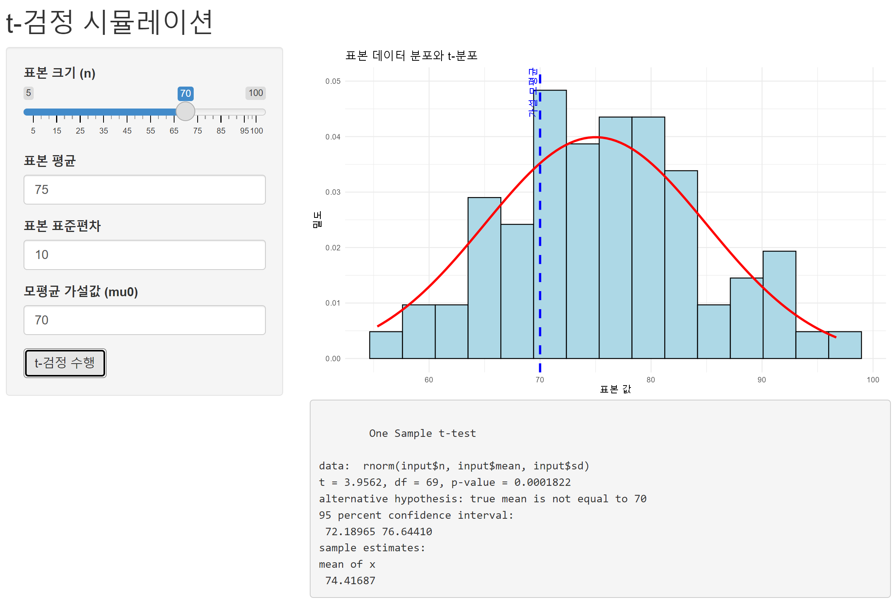
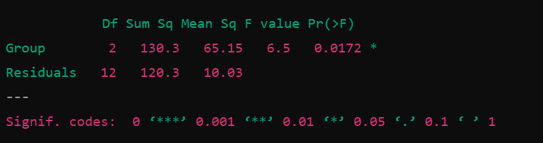

[Weekly content](https://changjunlee.com/teaching/grad_stat/weekly_2/)

<br>

## 8주차 학습목표

::: {.callout-note}
이번 주 학습을 마치면 다음을 할 수 있어야 합니다.

1. 확률을 단순한 공식이 아니라 **불확실한 데이터 생성과정(data-generating process)의 모델**로 설명한다.
2. 표본공간, 사건, 여사건, 합사건, 교사건, 조건부확률을 연구 사례에 적용한다.
3. **독립(independence)**과 **상호배타(mutual exclusivity)**를 구분한다.
4. 기저율(base rate)을 고려하여 민감도, 위양성률, 양성예측값을 구분한다.
5. 확률변수와 확률분포를 자료형과 연구질문에 맞게 연결한다.
6. R의 `d*`, `p*`, `q*`, `r*` 함수로 확률 계산, 분위수 탐색, 시뮬레이션을 수행한다.
7. 대수의 법칙과 중심극한정리를 시뮬레이션으로 확인하고 적용 조건을 설명한다.
8. 분포의 모양만 보고 모형을 선택하지 않고, **가정과 생성 메커니즘**을 점검한다.
9. ChatGPT와 같은 GenAI를 계산기보다 **가정 감사자와 시뮬레이션 reviewer**로 활용한다.
:::

### 오늘의 핵심 질문

> **관측된 데이터가 만들어졌다고 가정하는 확률적 과정은 무엇이며, 그 가정이 바뀌면 결론은 얼마나 달라질까?**

```{mermaid}
flowchart LR
    A["Research Question<br>무엇이 불확실한가?"] --> B["Random Experiment<br>단위와 가능한 결과"]
    B --> C["Assumptions<br>독립성·기저율·모수"]
    C --> D["Probability Model<br>확률변수와 분포"]
    D --> E["Theory or Simulation<br>계산과 반복 실험"]
    E --> F["Audit<br>가정·민감도·재현성"]
    F --> G["Claim<br>가능한 주장과 한계"]
```

::: {.callout-important}
확률분포는 데이터에 붙이는 예쁜 곡선이 아닙니다. **어떤 결과가 가능하고, 각 결과가 얼마나 자주 나타날 것이라고 가정하는지**를 압축한 연구모형입니다.
:::

------------------------------------------------------------------------

## 이번 주의 GenAI 활용 방식

이번 주에도 다음 순서를 유지합니다.

> **Attempt → Ask → Simulate → Audit → Explain**

| 단계 | 학생이 먼저 할 일 | GenAI에 맡길 수 있는 일 |
|---|---|---|
| **Attempt** | 실험 단위, 가능한 결과, 관심 사건, 가정을 직접 적는다. | 아직 사용하지 않는다. |
| **Ask** | 자신의 확률모형과 코드 초안을 제공한다. | 누락된 조건과 대안 모형을 질문하게 한다. |
| **Simulate** | 이론값을 예측한 뒤 R에서 반복 실험한다. | 최소 재현 코드의 오류 후보를 제안받는다. |
| **Audit** | 독립성, 기저율, 모수화, 분모, 시드를 점검한다. | reviewer처럼 가정 위반과 과도한 해석을 찾게 한다. |
| **Explain** | 이론값과 시뮬레이션 차이, 민감도, 주장 한계를 설명한다. | 문장의 조건부 표현과 논리 방향을 비판하게 한다. |

### “정답을 계산해 줘” 대신 모형을 감사받기

```text
나는 HCI 연구의 확률모형을 설계하고 있다.
한 메시지가 실제로 사람의 검토를 필요로 할 기저율은 8%이다.
자동 분류기의 민감도는 90%, 위양성률은 5%이다.

내가 알고 싶은 것은 “분류기가 flag한 메시지가 실제로 검토가 필요할 확률”이다.
1. 사건과 조건의 방향을 기호로 먼저 적어라.
2. 필요한 분모와 기저율을 확인하라.
3. 자연빈도 10,000건으로 계산 구조를 보여라.
4. 내가 흔히 혼동할 수 있는 역조건확률을 지적하라.
5. 최종 숫자를 주기 전에 내가 직접 계산할 중간값을 질문하라.
```

::: {.callout-warning title="연구자료와 개인정보를 입력하지 않기"}
실제 사용자 로그, 메시지 내용, IRB 자료, 개인식별자는 공개형 GenAI에 업로드하지 않습니다. 다음만으로도 충분히 검토받을 수 있습니다.

- 합성 또는 비식별 예시 자료
- 변수 정의와 관측단위
- 확률모형의 가정
- 집계된 빈도표
- 최소 재현 코드와 오류 메시지
:::

------------------------------------------------------------------------

## 준비

```{r}
#| label: setup
#| message: false
#| warning: false

library(tidyverse)

theme_set(theme_minimal(base_size = 12))
```

::: {.callout-tip}
패키지 설치는 Console에서 한 번 수행하고, 강의자료의 실행 청크에는 `library()`만 둡니다. 모든 시뮬레이션에는 `set.seed()`를 사용하여 결과를 재현할 수 있게 합니다.
:::

------------------------------------------------------------------------

# 1. 확률은 무엇을 모델링하는가?

## Random experiment, outcome, sample space, event

- **무작위 실험(random experiment):** 결과를 미리 확정할 수 없지만 가능한 결과와 절차를 정의할 수 있는 과정
- **결과(outcome):** 한 번의 실험에서 실제로 관측된 값
- **표본공간(sample space, $S$):** 가능한 모든 결과의 집합
- **사건(event, $A$):** 표본공간의 일부 결과를 묶은 집합

HCI 사례로 바꾸면 다음과 같습니다.

| 연구 상황 | 무작위 실험 | 가능한 결과 | 관심 사건 |
|---|---|---|---|
| 과업 성공 | 사용자가 한 과업을 수행 | 성공, 실패 | 성공 |
| 알림 반응 | 알림 후 10분 관찰 | 클릭, 무시 | 클릭 |
| 오류 로그 | 한 세션의 오류 수 기록 | 0, 1, 2, … | 오류 3회 이상 |
| 응답시간 | 한 시행의 완료시간 측정 | 0보다 큰 실수 | 60초 이내 완료 |

### 고전적 확률 공식의 적용 조건

유한한 표본공간의 모든 결과가 **동일하게 가능(equally likely)**할 때만 다음 공식을 그대로 쓸 수 있습니다.

$$
P(A)=\frac{|A|}{|S|}
$$

::: {.callout-warning}
현실의 사용자 행동은 대개 모든 결과가 동일하게 가능하지 않습니다. “경우의 수를 센다”보다 **각 결과에 어떤 확률을 부여할지**가 더 중요한 경우가 많습니다.
:::

## 두 개의 주사위로 사건 만들기

```{r}
two_dice <- crossing(
  die_1 = 1:6,
  die_2 = 1:6
) |>
  mutate(
    total = die_1 + die_2,
    event_a = total >= 9,
    event_b = die_1 %% 2 == 0
  )

two_dice
```

- $A$: 두 주사위 합이 9 이상
- $B$: 첫 번째 주사위가 짝수

```{r}
two_dice |>
  summarise(
    total_outcomes = n(),
    p_a = mean(event_a),
    p_b = mean(event_b),
    p_a_and_b = mean(event_a & event_b),
    p_a_or_b = mean(event_a | event_b),
    p_a_given_b = mean(event_a[event_b])
  )
```

### 확률의 기본 규칙

$$
0 \le P(A) \le 1, \qquad P(S)=1
$$

**여사건(complement)**

$$
P(A^c)=1-P(A)
$$

**덧셈 법칙(addition rule)**

$$
P(A\cup B)=P(A)+P(B)-P(A\cap B)
$$

**곱셈 법칙(multiplication rule)**

$$
P(A\cap B)=P(A)P(B\mid A)
$$

독립인 경우에만 다음처럼 단순해집니다.

$$
P(A\cap B)=P(A)P(B)
$$

## 독립과 상호배타는 다르다

::: {.callout-tip title="쉬운 비유: 배정 조건과 주사위 두 개"}
- **상호배타:** 한 참여자를 `voice` 또는 `text` 조건 하나에만 배정하면 두 배정 사건은 함께 일어날 수 없습니다.
- **독립:** 서로 독립적으로 던진 두 주사위에서 첫 번째 결과를 알아도 두 번째 주사위의 확률은 달라지지 않습니다.

**주의:** 상호배타와 독립은 반대말이 아니라 서로 다른 성질입니다. 두 사건의 확률이 모두 양수인데 상호배타라면 독립일 수 없습니다.
:::

| 개념 | 의미 | 핵심 식 |
|---|---|---|
| **상호배타** | 두 사건이 동시에 일어날 수 없음 | $P(A\cap B)=0$ |
| **독립** | 한 사건의 발생이 다른 사건의 확률을 바꾸지 않음 | $P(A\mid B)=P(A)$ |

확률이 0이 아닌 두 사건이 상호배타라면, 한 사건이 발생했을 때 다른 사건은 불가능해집니다. 따라서 두 사건은 독립이 아닙니다.

::: {.callout-question title="1분 예측"}
사용자가 `voice` 또는 `text` 인터페이스 중 하나만 배정받는 연구에서 “voice 조건”과 “text 조건”은 상호배타인가요? 독립인가요? 답을 말하기 전에 두 정의를 각각 적용해 보세요.
:::

------------------------------------------------------------------------

# 2. 조건부확률과 기저율

## 조건의 방향을 먼저 읽기

$$
P(A\mid B)=\frac{P(A\cap B)}{P(B)}
$$

- $P(\text{flag}\mid\text{실제 위험})$: 실제 위험한 항목 중 flag되는 비율, 즉 민감도
- $P(\text{실제 위험}\mid\text{flag})$: flag된 항목 중 실제 위험한 비율, 즉 양성예측값

두 확률은 일반적으로 같지 않습니다.

## HCI 사례: AI 콘텐츠 분류기의 flag를 믿어도 될까?

::: {.callout-note title="먼저 10,000건으로 자연빈도 생각하기"}
실제로 검토가 필요한 메시지가 8%라면 10,000건 중 **800건**입니다. 민감도 90%이므로 그중 **720건**을 flag합니다. 정상 9,200건 중 위양성률 5%에 해당하는 **460건**도 flag됩니다. 따라서 flag된 1,180건 중 실제 검토가 필요한 것은 720건, 즉 **약 61.0%**입니다.

| 실제 상태 | AI flag | AI 미flag | 합계 |
|---|---:|---:|---:|
| 검토 필요 | 720 | 80 | 800 |
| 정상 | 460 | 8,740 | 9,200 |

**해석 포인트:** $P(\text{flag}\mid\text{검토 필요})=0.90$과 $P(\text{검토 필요}\mid\text{flag})\approx0.610$은 방향이 다른 질문입니다. 정상 메시지가 압도적으로 많다는 **기저율**이 두 번째 확률을 좌우합니다.
:::

가정:

- 실제로 사람의 검토가 필요한 메시지: 8%
- 민감도: 90%
- 위양성률: 5%

확률보다 **자연빈도(natural frequencies)**로 먼저 계산해 봅시다.

```{r}
n_messages <- 10000
base_rate <- 0.08
sensitivity <- 0.90
false_positive_rate <- 0.05

bayes_table <- tibble(
  actual_state = c("needs_review", "does_not_need_review"),
  messages = c(
    n_messages * base_rate,
    n_messages * (1 - base_rate)
  ),
  flag_rate = c(sensitivity, false_positive_rate)
) |>
  mutate(
    flagged = messages * flag_rate,
    not_flagged = messages - flagged
  )

bayes_table
```

```{r}
true_flagged <- bayes_table |>
  filter(actual_state == "needs_review") |>
  pull(flagged)

all_flagged <- sum(bayes_table$flagged)

positive_predictive_value <- true_flagged / all_flagged
positive_predictive_value
```

민감도가 90%여도 flag의 정확도가 90%인 것은 아닙니다. 검토가 필요하지 않은 메시지가 훨씬 많기 때문에, 5%의 위양성도 전체 flag에서 큰 몫을 차지할 수 있습니다.

## Bayes’ theorem

$$
P(A\mid B)=\frac{P(B\mid A)P(A)}{P(B)}
$$

현재 사례에서는 다음과 같습니다.

$$
P(\text{위험}\mid\text{flag})
=
\frac{P(\text{flag}\mid\text{위험})P(\text{위험})}
{P(\text{flag})}
$$

### 시뮬레이션으로 확인하기

```{r}
set.seed(2026)

n_sim <- 100000
truth <- rbinom(n_sim, size = 1, prob = base_rate)

flag <- if_else(
  truth == 1,
  rbinom(n_sim, size = 1, prob = sensitivity),
  rbinom(n_sim, size = 1, prob = false_positive_rate)
)

mean(truth[flag == 1] == 1)
```

::: {.callout-tip title="GenAI checkpoint: 조건 방향 감사"}
AI에게 숫자만 확인시키지 말고 다음을 요구하세요.

```text
내 계산에서 P(flag | actual)과 P(actual | flag)를 혼동했는지 감사하라.
각 확률의 분모를 자연어와 빈도표로 적고,
기저율이 2%, 8%, 20%일 때 결론이 어떻게 바뀌는지 민감도 분석을 제안하라.
```
:::

### 기저율 민감도 분석

```{r}
base_rate_sensitivity <- tibble(
  base_rate = seq(0.01, 0.30, by = 0.01)
) |>
  mutate(
    ppv = sensitivity * base_rate /
      (
        sensitivity * base_rate +
          false_positive_rate * (1 - base_rate)
      )
  )

base_rate_sensitivity |>
  ggplot(aes(base_rate, ppv)) +
  geom_line(linewidth = 1) +
  scale_x_continuous(labels = scales::label_percent()) +
  scale_y_continuous(labels = scales::label_percent()) +
  labs(
    title = "기저율에 따라 달라지는 flag의 양성예측값",
    x = "실제 검토 필요 기저율",
    y = "P(실제 검토 필요 | flag)"
  )
```

------------------------------------------------------------------------

# 3. 시뮬레이션은 확률적 사고의 실험실이다

## 이론값과 Monte Carlo 추정값

::: {.callout-tip title="시뮬레이션은 가상 데이터를 생성하는 실험"}
과업별 성공확률이 0.9이고, 서로 독립인 과업 8개를 수행한다고 가정해 보겠습니다. **7개 이상 성공할 확률**은 `pbinom(6, size = 8, prob = 0.9, lower.tail = FALSE)`로 계산할 수 있으며 약 **81.3%**입니다. `rbinom(100000, 8, 0.9)`으로 가상의 사용자를 10만 명 생성한 뒤 `mean(x >= 7)`을 계산하면 비슷한 결과를 얻습니다. 실제 사용자 10만 명을 조사한 것은 아닙니다.
:::

AI 인터페이스가 한 과업을 성공할 확률이 0.9라고 가정합시다. 8개 과업 중 7개 이상 성공할 확률은 얼마일까요?

```{r}
theoretical_probability <- pbinom(
  q = 6,
  size = 8,
  prob = 0.9,
  lower.tail = FALSE
)

theoretical_probability
```

```{r}
set.seed(2026)

simulated_successes <- rbinom(
  n = 100000,
  size = 8,
  prob = 0.9
)

simulated_probability <- mean(simulated_successes >= 7)

c(
  theoretical = theoretical_probability,
  simulation = simulated_probability
)
```

시뮬레이션은 이론을 대체하기보다 다음에 유용합니다.

- 손으로 계산하기 어려운 복합 문제
- 분석 코드의 검산
- 가정 변화에 대한 민감도 분석
- 표집변동을 직관적으로 이해하기
- 통계적 방법의 장기적 성질 확인

::: {.callout-warning}
한 번의 시뮬레이션 결과는 정답이 아닙니다. 반복 횟수, 난수 시드, 모형의 가정을 함께 기록해야 합니다.
:::

------------------------------------------------------------------------

# 4. 확률변수와 분포

## 확률변수는 결과를 숫자로 연결하는 함수다

::: {.callout-note title="연구질문별 분포 선택: 무엇을 세거나 측정하나?"}
| 질문 | 첫 후보 분포 | 중요한 가정/주의점 |
|---|---|---|
| 버튼을 클릭했는가? | Bernoulli | 한 번의 이진 결과 |
| 10번 중 몇 번 클릭했는가? | Binomial | 시행 수 고정, 독립, 같은 성공확률 |
| 한 시간에 오류가 몇 건인가? | Poisson | 일정한 노출·발생률, 독립적 발생 등 |
| 과업 완료까지 몇 초인가? | Gamma / Lognormal | 양수·비대칭의 생성과정 점검 |
| 클릭확률 $p$ 자체가 얼마나 불확실한가? | Beta | $p$는 0~1의 **연속적인 확률** |

**Binomial과 Beta의 차이:** Binomial은 *확률 $p$가 주어졌을 때 성공 횟수*를, Beta는 *그 $p$ 자체의 불확실성*을 표현할 때 유용합니다.
:::

확률변수(random variable)는 무작위 실험의 결과를 수치로 표현합니다.

| HCI 결과 | 확률변수 | 유형 |
|---|---|---|
| 과업 성공 여부 | 성공 = 1, 실패 = 0 | 이산·이진 |
| 세션당 오류 수 | 0, 1, 2, … | 이산·계수 |
| 완료시간 | 0보다 큰 실수 | 연속·양수 |
| 클릭률 | 0과 1 사이 | 비율 또는 이항 결과의 요약 |
| 1–7 신뢰 점수 | 1, 2, …, 7 | 이산·순서형 |

### 베르누이와 이항분포를 구분하기

한 번의 성공/실패 시행:

$$
X\sim\text{Bernoulli}(p), \qquad
P(X=x)=p^x(1-p)^{1-x},\;x\in\{0,1\}
$$

동일한 성공확률을 가진 독립 시행을 $n$번 반복했을 때 성공 횟수:

$$
X\sim\text{Binomial}(n,p), \qquad
P(X=k)=\binom{n}{k}p^k(1-p)^{n-k}
$$

::: {.callout-important}
이항분포를 쓰려면 “성공/실패”라는 결과만으로 충분하지 않습니다. 고정된 시행 수, 시행 간 독립성, 일정한 성공확률이라는 가정도 필요합니다.
:::

## PMF, PDF, CDF

- **PMF (probability mass function):** 이산확률변수의 각 값에 확률을 부여
- **PDF (probability density function):** 연속확률변수의 밀도; 한 점의 높이 자체는 확률이 아님
- **CDF (cumulative distribution function):** $F(x)=P(X\le x)$

연속확률변수에서는 일반적으로 다음이 성립합니다.

$$
P(X=x)=0, \qquad
P(a\le X\le b)=\int_a^b f(x)\,dx
$$

------------------------------------------------------------------------

## R 분포 함수의 공통 문법: d, p, q, r

::: {.callout-tip title="정규분포 예시: 평균 50, 표준편차 10"}
- `dnorm(50, 50, 10)`: **50 지점의 밀도** (그 값이 나올 확률이 아님)
- `pnorm(60, 50, 10)`: **60 이하의 확률**, 약 84.1%
- `qnorm(0.975, 50, 10)`: **97.5백분위수**, 약 69.6
- `rnorm(100, 50, 10)`: **가상 관측값 100개 생성**

연속확률분포에서 확률은 한 점의 높이가 아니라 **구간 아래 면적**으로 구합니다.
:::

| 접두사 | 질문 | 이항분포 예 | 정규분포 예 |
|---|---|---|---|
| `d` | 특정 값의 질량 또는 밀도는? | `dbinom()` | `dnorm()` |
| `p` | 이 값 이하의 누적확률은? | `pbinom()` | `pnorm()` |
| `q` | 이 누적확률에 해당하는 분위수는? | `qbinom()` | `qnorm()` |
| `r` | 이 분포에서 무작위 값을 생성하면? | `rbinom()` | `rnorm()` |

```{r}
# 정확히 7번 성공할 확률
dbinom(7, size = 8, prob = 0.9)

# 7번 이하 성공할 누적확률
pbinom(7, size = 8, prob = 0.9)

# 누적확률 95%가 되는 성공 횟수
qbinom(0.95, size = 8, prob = 0.9)

# 같은 실험을 10회 시뮬레이션
set.seed(2026)
rbinom(10, size = 8, prob = 0.9)
```

```{r}
# 평균 50, 표준편차 10인 정규분포

dnorm(50, mean = 50, sd = 10)
pnorm(60, mean = 50, sd = 10)
qnorm(0.975, mean = 50, sd = 10)

set.seed(2026)
rnorm(5, mean = 50, sd = 10)
```

::: {.callout-question title="예측 후 실행"}
`pnorm(60, 50, 10)`과 `1 - pnorm(60, 50, 10)`은 각각 어떤 사건의 확률인가요? 코드를 실행하기 전에 자연어로 써 보세요.
:::

------------------------------------------------------------------------

# 5. 분포는 모양이 아니라 생성 가정으로 선택한다

| 분포 | 전형적인 결과 | 핵심 가정 또는 모수 | HCI 예시 | 주의할 점 |
|---|---|---|---|---|
| Bernoulli | 한 번의 0/1 결과 | 성공확률 $p$ | 한 과업의 성공 | 반복자료의 의존성 |
| Binomial | $n$번 중 성공 횟수 | 고정 $n$, 독립, 일정한 $p$ | 10개 알림 중 클릭 수 | 사용자마다 $p$가 다를 수 있음 |
| Poisson | 단위 노출당 사건 수 | 일정한 rate, 평균≈분산 | 시간당 오류 수 | 과산포면 negative binomial 고려 |
| Normal | 대칭적 연속값 | 평균 $\mu$, 표준편차 $\sigma$ | 합성 척도 점수의 근사 | 양수·비대칭 자료에 자동 적용 금지 |
| Lognormal / Gamma | 양수이고 오른쪽으로 긴 값 | 위치·shape·rate/scale | 완료시간, 체류시간 | rate와 scale 혼동 주의 |
| Exponential | 첫 사건까지의 대기시간 | 일정 rate, memoryless | 다음 오류까지 시간 | 위험률이 일정해야 함 |
| Beta | 0과 1 사이의 연속 모수 | shape $\alpha,\beta$ | 불확실한 성공확률 | 관측 성공횟수 자체는 이항모형이 자연스러움 |
| Student’s t | 표준화된 추정량 | 자유도 | 평균 추론의 기준분포 | 단순히 “작은 표본용 데이터 분포”가 아님 |
| $\chi^2$, F | 제곱합·분산비에서 유도 | 자유도 | 분산·ANOVA 기준분포 | 원자료 모양과 동일시하지 않기 |

## Poisson 가정 감사

세션당 오류 수에 Poisson 모형을 고려한다고 합시다.

```{r}
set.seed(2026)

error_counts <- rpois(500, lambda = 2.5)

c(
  mean = mean(error_counts),
  variance = var(error_counts)
)
```

실제 자료에서 분산이 평균보다 훨씬 크다면 사용자 간 이질성, 시간대 효과, 오류 군집화가 있을 수 있습니다. 이 경우 Poisson의 일정한 rate 가정이 맞지 않을 수 있습니다.

## 양수·비대칭 자료: 지수분포와 감마분포

```{r}
set.seed(2026)

waiting_time <- tibble(
  exponential = rexp(4000, rate = 1 / 30),
  gamma = rgamma(4000, shape = 4, rate = 4 / 30)
) |>
  pivot_longer(
    everything(),
    names_to = "distribution",
    values_to = "seconds"
  )

waiting_time |>
  ggplot(aes(seconds)) +
  geom_histogram(bins = 45) +
  facet_wrap(~distribution, scales = "free_y") +
  coord_cartesian(xlim = c(0, 120)) +
  labs(
    title = "평균이 비슷해도 생성과정은 다를 수 있다",
    x = "대기시간(초)",
    y = "빈도"
  )
```

지수분포는 첫 사건까지의 대기시간과 memoryless 가정을 나타냅니다. 감마분포는 여러 단계가 누적된 양의 대기시간을 더 유연하게 표현할 수 있습니다.

## Beta 분포의 올바른 해석

`Beta(2, 5)`의 2와 5는 분포 모양을 정하는 **shape parameters**입니다. 이를 곧바로 실제 “성공 2번, 실패 5번”이라고 단정하면 안 됩니다. Beta–Binomial 갱신에서는 관측 성공·실패 횟수가 각각 $\alpha$, $\beta$에 더해지지만, prior를 가상자료로 설명할 때는 기준 prior와 관례에 따라 $\alpha$, $\beta$ 또는 $\alpha-1$, $\beta-1$을 pseudo-count처럼 해석하기도 합니다. 따라서 어떤 관례를 사용했는지 명시해야 합니다.

```{r}
beta_shapes <- crossing(
  probability = seq(0.001, 0.999, length.out = 500),
  prior = c("Beta(1,1)", "Beta(2,2)", "Beta(2,5)", "Beta(8,2)")
) |>
  mutate(
    alpha = case_when(
      prior == "Beta(1,1)" ~ 1,
      prior == "Beta(2,2)" ~ 2,
      prior == "Beta(2,5)" ~ 2,
      TRUE ~ 8
    ),
    beta = case_when(
      prior == "Beta(1,1)" ~ 1,
      prior == "Beta(2,2)" ~ 2,
      prior == "Beta(2,5)" ~ 5,
      TRUE ~ 2
    ),
    density = dbeta(probability, alpha, beta)
  )

beta_shapes |>
  ggplot(aes(probability, density, linetype = prior)) +
  geom_line(linewidth = 0.9) +
  labs(
    title = "Beta 모수에 따라 달라지는 성공확률의 불확실성",
    x = "성공확률",
    y = "밀도",
    linetype = "분포"
  )
```

::: {.callout-tip title="GenAI checkpoint: 분포 선택 reviewer"}
```text
다음 변수에 후보 분포를 하나만 단정하지 말고 2–3개 제안하라.
각 후보마다 지지되는 데이터 생성 가정, 확인할 진단, 가정이 깨질 때 생기는 문제를 표로 비교하라.
변수: 모바일 과업완료시간, 사용자별 반복측정, 0초는 불가능, 오른쪽 꼬리가 길다.
단순히 히스토그램 모양이 비슷하다는 이유는 사용하지 말라.
```
:::

------------------------------------------------------------------------

# 6. 기대값과 분산

## 기대값은 장기적 평균이지 반드시 가능한 결과는 아니다

::: {.callout-tip title="같은 평균, 다른 사용자 경험"}
두 인터페이스의 평균 과업 완료시간이 똑같이 **30초**라고 해봅시다. A는 거의 모든 사람이 28~32초, B는 어떤 사용자는 5초이고 다른 사용자는 90초일 수 있습니다. 같은 평균만 보고 "경험이 같다"고 말할 수는 없습니다. **기대값은 중심, 분산은 흔들림**을 설명하기 때문입니다.
:::

공정한 주사위의 기대값은 다음과 같습니다.

$$
E(X)=\sum_x xP(X=x)=3.5
$$

그러나 한 번의 주사위에서 3.5가 나오지는 않습니다.

```{r}
die_outcomes <- 1:6
probabilities <- rep(1 / 6, 6)

expected_value <- sum(die_outcomes * probabilities)
variance <- sum((die_outcomes - expected_value)^2 * probabilities)

c(
  expected_value = expected_value,
  variance = variance,
  standard_deviation = sqrt(variance)
)
```

확률변수 $X$의 분산은 다음과 같습니다.

$$
\mathrm{Var}(X)=E\left[(X-E(X))^2\right]
$$

- 기대값: 반복했을 때 중심이 어디에 있는가?
- 분산: 결과가 그 중심 주위에서 얼마나 흔들리는가?

------------------------------------------------------------------------

# 7. 대수의 법칙: 반복하면 추정값은 안정된다

::: {.callout-note title="한 문장으로 설명하기"}
동전을 10번 던졌을 때 앞면이 7번 나올 수 있지만, 매우 많이 던지면 **누적 앞면 비율이 0.5에 가까워지는 경향**이 있습니다. 대수의 법칙은 표본평균이 **어디로 가까워지는가**에 대한 정리입니다. 다만 표본을 잘못 수집한 편향이 반복 횟수만 늘린다고 없어지지는 않습니다.
:::

대수의 법칙(Law of Large Numbers)은 시행 수가 늘어날수록 표본평균이나 표본비율이 기대값에 가까워지는 성질을 설명합니다.

```{r}
set.seed(2026)

coin_paths <- tibble(path = factor(1:12)) |>
  mutate(
    trajectory = map(
      path,
      function(path_id) {
        flips <- rbinom(2000, size = 1, prob = 0.5)
        tibble(
          n = seq_along(flips),
          running_proportion = cumsum(flips) / n
        )
      }
    )
  ) |>
  unnest(trajectory)

coin_paths |>
  ggplot(aes(n, running_proportion, group = path)) +
  geom_line(alpha = 0.55) +
  geom_hline(yintercept = 0.5, linetype = "dashed") +
  coord_cartesian(ylim = c(0.35, 0.65)) +
  labs(
    title = "같은 공정한 동전도 초기 경로는 크게 흔들린다",
    x = "누적 시행 수",
    y = "누적 앞면 비율"
  )
```

::: {.callout-important}
시행 수가 커지면 추정값의 변동이 줄어든다는 뜻이지, 표본이 크면 편향된 수집과 잘못된 측정이 자동으로 해결된다는 뜻은 아닙니다.
:::

------------------------------------------------------------------------

# 8. 중심극한정리와 표집분포

## 원자료의 분포와 표본평균의 분포는 다르다

::: {.callout-important title="가장 중요한 구별: 원자료 ≠ 표본평균의 표집분포"}
완료시간처럼 오른쪽 꼬리가 긴 원자료에서도, 독립적으로 크기 $n$의 표본을 반복 추출하여 **매번 평균**을 구하면 그 평균들의 분포가 적절한 조건 아래 정규분포에 가까워질 수 있습니다. **원자료가 정규분포로 바뀐다는 뜻은 아닙니다.**

- **대수의 법칙:** 표본평균은 어디에 가까워지나?
- **중심극한정리:** 반복 추출한 **표본평균들이 어떤 모양으로 분포하나?**
- **표준오차:** $SE(\bar X)=\sigma/\sqrt{n}$이므로 표본크기를 4배로 늘리면 표준오차는 절반이 됩니다(가정이 충족될 때).

`n = 30`이라고 언제나 정규근사가 충분한 것은 아닙니다. 독립성·꼬리·분산 등을 확인해야 합니다.
:::

중심극한정리(Central Limit Theorem)는 적절한 조건에서 표본크기가 커질수록 **표준화된 표본평균의 표집분포**가 정규분포에 가까워짐을 말합니다.

$$
\frac{\bar X-\mu}{\sigma/\sqrt{n}}
\xrightarrow{d}N(0,1)
$$

이 정리는 “원자료가 정규분포가 된다”는 뜻이 아닙니다.

```{r}
set.seed(2026)

clt_demo <- crossing(
  sample_size = c(2L, 10L, 40L, 100L),
  simulation = 1:4000
) |>
  mutate(
    sample_mean = map_dbl(
      sample_size,
      function(n_i) mean(rexp(n_i, rate = 1 / 45))
    ),
    sample_size = factor(
      sample_size,
      levels = c(2, 10, 40, 100),
      labels = c("n = 2", "n = 10", "n = 40", "n = 100")
    )
  )

clt_demo |>
  ggplot(aes(sample_mean)) +
  geom_histogram(aes(y = after_stat(density)), bins = 35) +
  geom_vline(xintercept = 45, linetype = "dashed") +
  facet_wrap(~sample_size, scales = "free_y") +
  labs(
    title = "오른쪽으로 치우친 모집단에서 뽑은 표본평균의 분포",
    x = "표본평균",
    y = "밀도"
  )
```

### 표준오차 확인

지수분포의 평균과 표준편차가 모두 45라면, 표본평균의 이론적 표준오차는 $45/\sqrt{n}$입니다.

```{r}
clt_demo |>
  mutate(sample_size_numeric = as.integer(str_extract(sample_size, "\\d+"))) |>
  summarise(
    empirical_mean = mean(sample_mean),
    empirical_se = sd(sample_mean),
    theoretical_se = 45 / sqrt(first(sample_size_numeric)),
    .by = sample_size
  )
```

### 중심극한정리 적용 전 점검

- 관측치가 독립이거나 의존성이 충분히 약한가?
- 모집단 분산이 유한한가?
- 극단적으로 두꺼운 꼬리나 희귀사건이 있는가?
- 반복측정·군집자료인데 행을 독립 표본처럼 취급하지 않았는가?
- 관심 통계량이 평균인가, 다른 비선형 통계량인가?

::: {.callout-warning}
“$n=30$이면 무조건 정규근사가 가능하다”는 보편 법칙은 없습니다. 필요한 표본크기는 원분포의 비대칭, 꼬리, 의존성, 관심 통계량에 따라 달라집니다.
:::

------------------------------------------------------------------------

# 9. 추론으로 이어지는 기준분포

::: {.callout-note title="셋 다 '관측값의 분포'라고 생각하지 않기"}
| 분포 | 무엇을 기준으로 판단하나? | 연결되는 분석 |
|---|---|---|
| **t** | 추정된 표준오차에 비해 평균 차이가 얼마나 큰가? | t 검정, 평균의 신뢰구간 |
| **카이제곱** | 빈도 차이나 분산 관련 통계량이 얼마나 큰가? | 독립성·적합도 검정 등 |
| **F** | 두 변동량의 비율이 얼마나 큰가? | ANOVA, 회귀모형의 F 검정 |

특히 t 분포는 모집단 표준편차를 모르고 표본에서 추정할 때의 추가 불확실성을 반영합니다. F 통계량은 ANOVA에서 **집단 간 평균제곱 / 집단 내 평균제곱**으로 이해할 수 있습니다.
:::

`t`, $\chi^2$, F 분포는 흔히 원자료를 직접 표현하기보다 **추정량과 검정통계량이 반복표집에서 어떻게 변하는지**를 나타내는 기준분포로 등장합니다.

## Student’s t distribution

모집단 표준편차를 모르고 표본표준편차로 표준오차를 추정하면 추가 불확실성이 생깁니다. t 분포는 이를 더 두꺼운 꼬리로 반영합니다. 자유도가 커질수록 표준정규분포에 가까워집니다.

```{r}
t_reference <- crossing(
  x = seq(-4, 4, length.out = 500),
  distribution = c("t: df = 3", "t: df = 10", "t: df = 30", "Normal")
) |>
  mutate(
    density = case_when(
      distribution == "t: df = 3" ~ dt(x, df = 3),
      distribution == "t: df = 10" ~ dt(x, df = 10),
      distribution == "t: df = 30" ~ dt(x, df = 30),
      TRUE ~ dnorm(x)
    )
  )

t_reference |>
  ggplot(aes(x, density, linetype = distribution)) +
  geom_line(linewidth = 0.9) +
  labs(
    title = "자유도가 증가할수록 t 분포는 정규분포에 가까워진다",
    x = "표준화된 값",
    y = "밀도",
    linetype = "기준분포"
  )
```

## $\chi^2$ and F distributions

- $\chi^2$ 분포: 독립 표준정규변수의 제곱합에서 나타나며 분산과 범주형 빈도 검정에 연결됩니다.
- F 분포: 독립적인 분산 추정량의 비율에서 나타나며 ANOVA와 회귀의 omnibus test에 연결됩니다.
- 두 분포 모두 자유도에 따라 모양이 달라지고 오른쪽으로 치우칩니다.

::: {.callout-important}
ANOVA에서 F 통계량을 사용한다는 사실은 “원자료가 F 분포를 따른다”거나 “ANOVA가 단순히 집단의 분산 차이를 검정한다”는 뜻이 아닙니다. F는 평균모형이 설명한 변동과 잔차변동을 비교하는 검정통계량의 기준분포입니다.
:::

------------------------------------------------------------------------

# 10. 상관은 의존성 전체를 요약하지 않는다

::: {.callout-tip title="Pearson 상관이 0이어도 관계가 있을 수 있다"}
$X$가 0을 중심으로 대칭적으로 분포하고 $Y=X^2$라면 두 변수에는 분명한 **U자형 비선형 관계**가 있습니다. 그러나 Pearson 상관계수는 0일 수 있습니다. 그래서 상관계수를 계산하기 전에 **산점도를 먼저 확인**하고, 상관 0을 곧바로 독립 또는 '관계 없음'으로 해석하지 않아야 합니다.
:::

Pearson 상관계수는 두 변수의 **선형 관계**를 요약합니다.

```{r}
set.seed(2026)

nonlinear_data <- tibble(
  x = runif(600, min = -2, max = 2),
  y = x^2 + rnorm(600, mean = 0, sd = 0.25)
)

nonlinear_data |>
  summarise(
    pearson = cor(x, y, method = "pearson"),
    spearman = cor(x, y, method = "spearman")
  )
```

```{r}
nonlinear_data |>
  ggplot(aes(x, y)) +
  geom_point(alpha = 0.35) +
  geom_smooth(method = "loess", se = FALSE, linewidth = 1) +
  labs(
    title = "상관이 0에 가까워도 강한 비선형 관계가 있을 수 있다",
    x = "x",
    y = "y"
  )
```

### 상관 해석의 최소 조건

- 산점도를 먼저 확인한다.
- 극단값과 범위 제한을 확인한다.
- Pearson은 선형관계, Spearman은 단조관계를 요약한다.
- 상관 0은 일반적인 독립을 의미하지 않는다.
- 상관은 인과관계를 뜻하지 않는다.
- 같은 참여자의 반복 관측을 모두 독립 점처럼 계산하면 상관이 왜곡될 수 있다.

------------------------------------------------------------------------

# 11. Probability Model Audit Lab

## 과제

::: {.callout-note title="실습의 목적: 숫자 하나보다 가정의 품질"}
예를 들어 '10개 과업의 성공 횟수'를 택했다면 (1) 과업별 독립·동일 성공확률을 먼저 가정하고, (2) `pbinom()`으로 이론값을 구하고, (3) `rbinom()`으로 재현 가능한 시뮬레이션을 수행하고, (4) 성공확률이나 독립성 가정을 바꾸어 결과가 얼마나 민감한지 비교합니다. 마지막으로 GenAI에 **답을 대신 구하도록 하기보다 가정과 해석의 약점**을 찾아달라고 요청합니다.
:::

다음 중 하나를 선택합니다.

1. AI 콘텐츠 분류기의 flag 정확도
2. 10개 과업 중 성공 횟수
3. 한 시간 동안 발생한 오류 수
4. 다음 사용자 행동까지의 대기시간
5. A/B 인터페이스의 클릭확률

### Round 1. Human first

GenAI 없이 먼저 작성합니다.

- 무작위 실험과 관측단위
- 가능한 결과와 관심 사건
- 확률변수와 값의 범위
- 후보 분포
- 핵심 모수
- 독립성·일정한 rate·기저율 등의 가정
- 계산하고 싶은 확률 또는 분위수

### Round 2. Theory and simulation

- `d*`, `p*`, `q*`, `r*` 중 필요한 함수를 선택합니다.
- 이론값을 계산합니다.
- 최소 10,000회 시뮬레이션으로 검산합니다.
- 시드를 기록합니다.
- 이론값과 시뮬레이션값의 차이를 설명합니다.

### Round 3. Assumption sensitivity

최소 하나의 핵심 가정을 바꿉니다.

- 기저율
- 성공확률
- 사건발생률
- 독립성
- 표본크기
- 분포의 꼬리 또는 비대칭

결론이 얼마나 달라지는지 표나 그래프로 제시합니다.

### Round 4. AI audit

```text
아래 확률모형과 R 코드를 reviewer처럼 감사하라.
1. 사건과 조건의 방향
2. 관측단위와 독립성
3. 선택한 분포의 생성 가정
4. d/p/q/r 함수의 의미
5. 시뮬레이션 반복 수와 seed
6. 민감도 분석에서 빠진 중요한 가정
7. 결과로 말할 수 없는 주장
완성 코드를 새로 쓰지 말고 우선 진단 질문을 제시하라.
```

## Probability Claim Card

| 항목 | 작성 내용 |
|---|---|
| **Question** | 어떤 불확실성을 수량화했는가? |
| **Unit** | 한 번의 실험 또는 관측은 무엇인가? |
| **Model** | 어떤 확률변수와 분포를 사용했는가? |
| **Assumptions** | 독립성, 기저율, 모수에 어떤 가정을 했는가? |
| **Evidence** | 이론 계산과 시뮬레이션은 얼마나 일치했는가? |
| **Sensitivity** | 핵심 가정이 바뀌면 결론은 어떻게 달라졌는가? |
| **Boundary** | 현재 모형으로 말할 수 없는 것은 무엇인가? |

## AI Collaboration Log

| 항목 | 기록 내용 |
|---|---|
| 목적 | 개념 설명, 코드 디버깅, 가정 감사 등 |
| 내가 먼저 한 시도 | AI 사용 전 정의·계산·예측 |
| 프롬프트 | 실제 입력한 핵심 요청 |
| AI 제안 | 제안 내용 요약 |
| 검증 | R로 확인한 계산과 출력 |
| 결정 | 채택·수정·기각과 이유 |
| 최종 변화 | 모형 또는 해석이 어떻게 달라졌는가? |

::: {.callout-important title="이번 주의 한 문장"}
**확률모형의 품질은 공식의 복잡성보다, 데이터가 생성되는 과정을 얼마나 정직하게 표현하고 가정을 얼마나 투명하게 검토했는지에 달려 있습니다.**
:::

<!-- > **Probability** is the branch of mathematics that deals with uncertainty. It quantifies the likelihood of an event occurring, and it is the foundation of many fields, including statistics, machine learning, finance, and more. Understanding probability allows us to make informed decisions in the presence of uncertainty. In this chapter, we will cover the basic concepts of probability, including the key rules and types of probability distributions. We will also learn how to simulate probabilistic events and visualize them in R. -->

<!-- ------------------------------------------------------------------------ -->

<!-- ## 1. Basic Probability Concepts -->

<!-- ### Definition of Probability -->

<!-- -   Event(사건) and Sample Space(표본 공간) -->

<!--     -   **Event**: 특정 실험에서 발생할 수 있는 결과(예를 들어, 동전을 던졌을 때 **앞면이 나오는 사건**) -->

<!--     -   **Sample Space** (S): 실험에서 가능한 모든 결과들의 집합(예를 들어, 동전을 던졌을 때 표본 공간은 S={앞면,뒷면}) -->

<!-- -   Probability(확률) -->

<!--     -   어떤 사건 A 가 일어날 확률 P(A)는 그 사건이 일어나는 경우의 수를 표본 공간의 가능한 경우의 수로 나눈 값 -->

<!--         -   P(A): Probability of event A occurring -->

<!--         -   \|A\|: Number of cases belonging to case A -->

<!--         -   \|S\|: Total number of cases in sample space S -->

<!-- $$  -->
<!-- P(A)=\frac{|A|}{|S|} -->
<!-- $$ -->

<!-- <br> -->

<!-- ### Basic properties of probability -->

<!-- -   A value between 0 and 1: For any event A, the probability of that event occurring is greater than or equal to 0 and less than or equal to 1. -->

<!--     $$ -->
<!--     0 \leq P(A) \leq 1 -->
<!--     $$ -->

<!-- -   The probability of the entire sample space is 1: the sum of the probabilities of all events in the sample space is 1. -->

<!--     $$ -->
<!--     P(S) = 1 -->
<!--     $$ -->

<!-- <br> -->

<!-- ### Example: Rolling a Die -->

<!-- When rolling a fair six-sided die, the probability of getting a 4 is: -->

<!-- $$ -->
<!-- P(D=4) = \frac{1}{6} -->
<!-- $$ -->

<!-- <br> -->

<!-- ### R Code Example -->

<!-- We can simulate rolling a die and estimate the probability of getting a 4 using R: -->

<!-- ```{r} -->
<!-- # Simulate rolling a fair six-sided die 10,000 times -->
<!-- set.seed(123) -->
<!-- rolls <- sample(1:6, size = 10000, replace = TRUE) -->

<!-- # Estimate the probability of rolling a 4 -->
<!-- prob_4 <- mean(rolls == 4) -->
<!-- cat("Estimated Probability of Rolling a 4:", prob_4) -->

<!-- ``` -->

<!-- <br> -->

<!-- ## 2. Probability Rules -->

<!-- ### Rule 1: Complement Rule -->

<!-- The **complement** of an event A, denoted as A^c^, is the event that A does not occur. The probability of the complement is: -->

<!-- $$ -->
<!-- P(A^c) = 1 - P(A) -->
<!-- $$ -->

<!-- <br> -->

<!-- ### Rule 2: Addition Rule -->

<!-- For two events ( A ) and ( B ), the addition rule is: -->

<!-- $$ -->
<!-- P(A \cup B) = P(A) + P(B) - P(A \cap B) -->
<!-- $$ -->

<!-- If ( A ) and ( B ) are mutually exclusive, the formula simplifies to: -->

<!-- $$ -->
<!-- P(A \cup B) = P(A) + P(B) -->
<!-- $$ -->

<!-- <br> -->

<!-- ### Rule 3: Multiplication Rule -->

<!-- For two independent events ( A ) and ( B ), the multiplication rule is: -->

<!-- $$ -->
<!-- P(A \cap B) = P(A) \times P(B) -->
<!-- $$ -->

<!-- For dependent events: -->

<!-- $$ -->
<!-- P(A \cap B) = P(A) \times P(B \mid A) -->
<!-- $$ -->

<!-- <br> -->

<!-- ## 3. Conditional Probability -->

<!-- **Conditional probability** is the probability of an event occurring given that another event has already occurred. It is denoted by $P(A \mid B)$, which reads "the probability of A given B". -->

<!-- $$ -->
<!-- P(A \mid B) = \frac{P(A \cap B)}{P(B)} -->
<!-- $$ -->

<!-- <br> -->

<!-- ### Example: Conditional Probability in Card Drawing -->

<!-- Consider a deck of 52 cards. Let A be the event that the card is a **king**, and B be the event that the card is **red**. The probability of drawing a red king given that a red card was drawn is: -->

<!-- $$ -->
<!-- P(King \mid Red) = \frac{P(King \cap Red)}{P(Red)}=\frac{\frac{2}{52}}{\frac{26}{52}}=\frac{1}{13} -->
<!-- $$ -->

<!-- <br> -->

<!-- ## 4. Discrete Probability Distributions -->

<!-- A **discrete probability distribution** deals with outcomes that can be counted (finite or countably infinite). Common discrete distributions include: -->

<!-- -   **Bernoulli Distribution**: Describes a single trial with two outcomes (success or failure). -->

<!-- -   **Binomial Distribution**: Describes the number of successes in a fixed number of independent Bernoulli trials. -->

<!-- -   **Poisson Distribution**: Describes the number of events occurring within a fixed interval. -->

<!-- <br> -->

<!-- ### Bernoulli Distribution -->

<!-- The Bernoulli distribution is a distribution where one trial has one of two outcomes (success or failure). -->

<!-- $$ -->
<!-- P(X = k) =  p^k (1 - p)^{n - k} -->
<!-- $$ -->

<!-- <br> -->

<!-- ### Binomial Distribution -->

<!-- The probability of observing ( k ) successes in ( n ) trials with success probability ( p ) is given by the **binomial distribution**: -->

<!-- $$ -->
<!-- P(X = k) = \binom{n}{k} p^k (1 - p)^{n - k} -->
<!-- $$ -->

<!-- <br> -->

<!-- ### Example: Binomial Distribution in R -->

<!-- The **binomial distribution** is used to model the probability of observing 'k' successes in 'n' trials where the probability of success in each trial is 'p'. -->

<!-- ```{r} -->
<!-- # Probability of getting exactly 3 heads in 5 coin flips with p = 0.5 -->
<!-- dbinom(x = 3, size = 5, prob = 0.5) -->

<!-- # Simulate 1000 trials of 5 coin flips each -->
<!-- set.seed(123) -->
<!-- binom_trials <- rbinom(1000, size = 5, prob = 0.5) -->
<!-- hist(binom_trials, breaks = 5, main = "Histogram of Binomial Distribution", xlab = "Number of Heads") -->

<!-- ``` -->

<!-- **`dbinom()`**: -->

<!-- -   이항 분포에서 특정 값의 **확률 질량 함수**(Probability Mass Function, PMF)를 계산 -->

<!-- -   **형식**: `dbinom(x, size, prob)` -->

<!--     -   `x`: 성공 횟수 (정수) -->

<!--     -   `size`: 시도 횟수 (정수) -->

<!--     -   `prob`: 성공 확률 (0과 1 사이) -->

<!-- -   **`rbinom()`**: -->

<!--     -   이항 분포를 따르는 **랜덤 표본**을 생성 -->

<!--     -   **형식**: `rbinom(n, size, prob)` -->

<!--         -   `n`: 생성할 표본의 개수 -->

<!--         -   `size`: 시도 횟수 (정수) -->

<!--         -   `prob`: 성공 확률 (0과 1 사이) -->

<!-- <Br> -->

<!-- ## 5. Continuous Probability Distributions -->

<!-- A **continuous probability distribution** deals with outcomes that can take any value within a given range (infinite). Common continuous distributions include: -->

<!-- -   **Normal Distribution**: The bell-shaped distribution that describes many natural phenomena. -->

<!-- -   **Exponential Distribution**: Describes the time between events in a Poisson process. -->

<!-- -   **Uniform Distribution**: Every outcome in a given range is equally likely. -->

<!-- <br> -->

<!-- ### Normal Distribution -->

<!-- The **probability density function** (PDF) of a normal distribution with mean ( $\mu$ ) and standard deviation ( $\sigma$ ) is given by: -->

<!-- $$ -->
<!-- f(x) = \frac{1}{\sigma \sqrt{2\pi}} e^{-\frac{(x - \mu)^2}{2\sigma^2}} -->
<!-- $$ -->

<!-- <br> -->

<!-- ### Example: Normal Distribution in R -->

<!-- The **normal distribution** is widely used in probability and statistics. It is symmetric and centered around the mean, with spread determined by the standard deviation. -->

<!-- ```{r} -->
<!-- # Plot a normal distribution with mean = 0 and sd = 1 -->
<!-- x <- seq(-4, 4, length.out = 1000) -->
<!-- y <- dnorm(x, mean = 0, sd = 1) -->
<!-- plot(x, y, type = "l",  -->
<!--      main = "Normal Distribution",  -->
<!--      xlab = "x", ylab = "Density") -->

<!-- ``` -->

<!-- <br> -->

<!-- ## 6. Law of Large Numbers -->

<!-- The **Law of Large Numbers** states that as the number of trials ( n ) increases, the empirical probability approaches the true probability ( P ). -->

<!-- $$ -->
<!-- \lim_{n \to \infty} \hat{P} = P -->
<!-- $$ -->

<!-- <br> -->

<!-- We will simulate flipping a fair coin 10,000 times and track how the empirical probability of heads converges to 0.5. -->

<!-- > 대수의 법칙은 반복된 실험의 횟수가 증가할수록, 실험의 **경험적 확률**(실제로 관측된 확률)이 **이론적 확률**에 점점 가까워진다는 것을 설명하는 중요한 개념 -->

<!-- ```{r} -->
<!-- set.seed(123) -->
<!-- flips <- rbinom(10000, size = 1, prob = 0.5) -->
<!-- empirical_prob <- cumsum(flips) / (1:10000) -->

<!-- # Plot the convergence of empirical probability to 0.5 -->
<!-- plot(empirical_prob, type = "l",  -->
<!--      col = "blue",  -->
<!--      ylim = c(0, 1), -->
<!--      main = "Law of Large Numbers", -->
<!--      xlab = "Number of Flips",  -->
<!--      ylab = "Empirical Probability") -->
<!-- abline(h = 0.5, col = "red", lty = 2) -->

<!-- ``` -->

<!-- -   `rbinom(10000, size = 1, prob = 0.5)`: 성공 확률이 0.5인 베르누이 시행을 10,000번 시뮬레이션. 각 시행은 동전을 한 번 던졌을 때 앞면(성공, 1) 또는 뒷면(실패, 0)이 나오는 결과. -->

<!-- -   `cumsum(flips) / (1:10000)`: 누적된 성공 횟수를 시행 횟수로 나누어 각 시점에서의 **경험적 확률**을 계산. -->

<!--     -   `cumsum(flips)`는 매 시점까지의 성공 횟수의 누적 합을 계산하며, 이를 각 시행의 횟수로 나누면 그 시점까지의 성공 확률을 얻을 수 있음. -->

<!-- <br> -->

<!-- ## 7. Random Variable -->

<!-- > A **random variable** is a key concept in probability theory. It is a function that maps the outcomes of a random experiment to numerical values, allowing for mathematical treatment of random phenomena. Random variables can be classified into two types: **Discrete Random Variables** and **Continuous Random Variables**. -->

<!-- <br> -->

<!-- ### 1. Definition of a Random Variable -->

<!-- A random variable is a function that assigns a numerical value to each outcome of a particular experiment. In other words, it translates events into numbers so that we can analyze probabilistic problems mathematically. -->

<!-- -   **Random Variable ( X )**: A variable that represents the outcome of an event in numerical form. -->
<!-- -   **Sample Space ( S )**: The set of all possible outcomes of a random experiment. -->

<!-- The random variable ( X ) maps the events in the sample space to numbers. For example, when rolling a die, the sample space is ( S = { 1, 2, 3, 4, 5, 6 } ), and the random variable ( X ) represents the numbers on the die. -->

<!-- <br> -->

<!-- ### 2. Discrete Random Variable -->

<!-- A **discrete random variable** takes on a countable number of distinct values. It can have either a finite or infinite number of possible values and is often used to represent counts or outcomes. -->

<!-- **Example**: Consider the experiment of tossing a coin twice. We can define the number of heads as the random variable ( X ). -->

<!-- -   Sample Space ( S = {{HH}, {HT}, {TH}, {TT}} ) -->
<!-- -   The random variable ( X ) represents the number of heads. -->

<!-- In this case, ( X ) can take the values 0, 1, or 2. -->

<!-- #### Probability Distribution of a Discrete Random Variable -->

<!-- A discrete random variable has a probability distribution that assigns probabilities to each of its possible values. The probability distribution of a discrete random variable ( X ) is given by: -->

<!-- $$ -->
<!-- P(X = x_i) = p_i -->
<!-- $$ -->

<!-- -   $X$: Discrete random variable -->

<!-- -   $x_i$: A specific value that $X$ can take -->

<!-- -   $P(X = x_i) = p_i$: The probability that $X$ takes the value $x_i$. -->

<!-- <br> -->

<!-- #### Example of Binomial Distribution -->

<!-- A common example of a discrete random variable is the **Binomial Distribution**. The binomial distribution represents the probability of having a certain number of successes in a series of independent trials where each trial has two possible outcomes (e.g., success/failure). -->

<!-- The probability mass function (PMF) of a binomial random variable is given by: -->

<!-- $$ -->
<!-- P(X = k) = \binom{n}{k} p^k (1 - p)^{n - k} -->
<!-- $$ -->

<!-- -   $n$: Number of trials -->

<!-- -   $k$: Number of successes -->

<!-- -   $p$: Probability of success -->

<!-- -   $(1 - p)$: Probability of failure -->

<!-- <br> -->

<!-- #### Example: Tossing a Coin 3 Times -->

<!-- Let’s consider tossing a fair coin 3 times. The number of heads, ( X ), is a binomial random variable. ( X ) can take the values 0, 1, 2, or 3, and we can calculate the probability for each outcome. -->

<!-- -   $P(X = 0) = \binom{3}{0} \cdot 0.5^0 \cdot 0.5^3 = 0.125$ -->

<!-- -   $P(X = 1) = \binom{3}{1} \cdot 0.5^1 \cdot 0.5^2 = 0.375$ -->

<!-- -   $P(X = 2) = \binom{3}{2} \cdot 0.5^2 \cdot 0.5^1 = 0.375$ -->

<!-- -   $P(X = 3) = \binom{3}{3} \cdot 0.5^3 \cdot 0.5^0 = 0.125$ -->

<!-- The probability distribution of the binomial random variable ( X ) is: -->

<!-- | X (Number of Heads) | P(X = x) (Probability) | -->
<!-- |---------------------|------------------------| -->
<!-- | 0                   | 0.125                  | -->
<!-- | 1                   | 0.375                  | -->
<!-- | 2                   | 0.375                  | -->
<!-- | 3                   | 0.125                  | -->

<!-- <br> -->

<!-- ### 3. Continuous Random Variable -->

<!-- A **continuous random variable** can take any value within a given range or interval. Continuous random variables are used to model outcomes that can take an infinite number of real values. -->

<!-- **Example**: Consider the height of people as a random variable. Since height can take an infinite number of real values, it is a continuous random variable. Continuous random variables are generally associated with probability over intervals rather than specific points. -->

<!-- <br> -->

<!-- #### Probability Density Function (PDF) of a Continuous Random Variable -->

<!-- Continuous random variables are described by a **Probability Density Function (PDF)**. The probability that a continuous random variable ( X ) lies within an interval (\[a, b\]) is found by integrating the PDF over that interval: -->

<!-- $$ -->
<!-- P(a \leq X \leq b) = \int_a^b f(x) \, dx -->
<!-- $$ -->

<!-- -   $f(x)$: The probability density function -->

<!-- Since the probability of a continuous random variable taking any exact value is 0, we calculate probabilities over intervals. -->

<!-- <br> -->

<!-- #### Example: Normal Distribution -->

<!-- The **Normal Distribution** is a common continuous distribution. It is defined by its mean ( $\mu$ ) and standard deviation ( $\sigma$ ), and its probability density function is: -->

<!-- $$ -->
<!-- f(x) = \frac{1}{\sigma \sqrt{2 \pi}} \exp\left(-\frac{(x - \mu)^2}{2 \sigma^2}\right) -->
<!-- $$ -->

<!-- In a normal distribution, probabilities for specific intervals are computed by integrating the PDF over those intervals. -->

<!-- **Example**: Let’s assume that the height of people follows a normal distribution with a mean of 170 cm and a standard deviation of 10 cm. We can calculate the probability that a person’s height is between 160 cm and 180 cm by integrating the normal distribution's PDF over that range. -->

<!-- <br> -->

<!-- ### 4. Expected Value -->

<!-- The **expected value** of a random variable is the weighted average of all possible values it can take, with the probabilities as weights. The expected value ( E(X) ) of a random variable ( X ) is defined as: -->

<!-- For a discrete random variable: -->

<!-- $$ -->
<!-- E(X) = \sum_i x_i P(X = x_i) -->
<!-- $$ -->

<!-- -   $x_i$ are the possible values of $X$ and $P(X = x_i)$ is the probability of each value. -->

<!-- For a continuous random variable: -->

<!-- $$ -->
<!-- E(X) = \int_{-\infty}^{\infty} x f(x) \, dx -->
<!-- $$ -->

<!-- Where $f(x)$ is the probability density function. -->

<!-- <br> -->

<!-- #### Example: Expected Value of a Die Roll -->

<!-- When rolling a fair die, the possible outcomes are 1 through 6. Since each outcome is equally likely, the expected value of the die roll is: -->

<!-- $$ -->
<!-- E(X) = \frac{1}{6} \times (1 + 2 + 3 + 4 + 5 + 6) = \frac{21}{6} = 3.5 -->
<!-- $$ -->

<!-- <br> -->

<!-- ### 5. Variance -->

<!-- **Variance** measures how much the values of a random variable differ from the expected value. The variance of a random variable $X$ is denoted as $\text{Var}(X)$ and is defined as: -->

<!-- $$ -->
<!-- \text{Var}(X) = E\left[(X - E(X))^2\right] -->
<!-- $$ -->

<!-- The square root of the variance is called the **standard deviation**, and it brings the unit of measurement back to the same scale as the original data. -->

<!-- ------------------------------------------------------------------------ -->

<!-- > Random variables are fundamental tools in probability theory for quantifying and analyzing random events. They can be discrete or continuous, depending on the nature of the outcomes. The expected value and variance of a random variable provide key insights into the behavior of the distribution. Random variables, together with their probability distributions, are used to model real-world phenomena mathematically. -->

<!-- <br> -->

<!-- ## 8. More Distributions & Probability Density Functions -->

<!-- ### 1. Binomial Distribution (이항분포) -->

<!-- > The binomial distribution is a distribution that calculates the probability of the number of successes $k$ when an experiment with a constant probability of success $p$ is repeated $n$ times. 일정한 성공 확률 $p$를 가진 실험을 $n$번 반복했을 때, 성공 횟수 $k$의 확률을 구하는 분포. -->

<!-- $$ -->
<!-- P(X = k) = \binom{n}{k} p^k (1 - p)^{n - k} -->
<!-- $$ -->

<!-- -   $n$: Number of trials -->

<!-- -   $k$: Number of successes -->

<!-- -   $p$: Probability of success -->

<!-- -   $1 - p$: Probability of failure -->

<!-- The binomial distribution is used in events such as coin flipping and gambling, and is used when each trial is independent and the probability of success is constant. For example, the probability of getting heads when flipping a coin 10 times. -->

<!-- **Example:** In coin flipping, the probability of success is p = 0.5, and it describes the distribution of the number of successes (the number of heads) when flipping 10 times. -->

<!-- ```{r} -->
<!-- # 이항분포 예시: 동전 던지기 -->
<!-- set.seed(123)  # 재현성을 위해 시드 설정 -->

<!-- n_trials <- 10 -->
<!-- p_success <- 0.5 -->
<!-- n_simulations <- 1000 -->

<!-- # 시뮬레이션: n_trials 번의 동전 던지기 -->
<!-- simulated_successes <- rbinom(n_simulations, size = n_trials, prob = p_success) -->

<!-- # 결과 시각화 -->
<!-- library(ggplot2) -->

<!-- df_binomial <- data.frame(Successes = simulated_successes) -->

<!-- # Plot histogram of the simulation results and overlay the binomial probability mass function (PMF) -->
<!-- ggplot(df_binomial, aes(x = Successes)) + -->
<!--   geom_histogram(aes(y = ..density..), fill = "steelblue", alpha = 0.7, binwidth = 1, boundary = -0.5) + -->
<!--   labs(title = "Binomial Distribution: Coin Flip Simulation", -->
<!--        x = "Number of Heads in 10 Flips", -->
<!--        y = "Density") + -->
<!--   theme_minimal() -->
<!-- ``` -->

<!-- **이항분포 시뮬레이션** -->

<!-- -   동전의 앞면이 나올 확률을 0.5로 설정한 후, 여러 번 던졌을 때의 결과를 시뮬레이션 -->

<!-- ```{r} -->
<!-- # 동전 던지기 시뮬레이션 -->
<!-- coin_flip_simulation <- function(n, p) { -->
<!--   rbinom(n, size = 1, prob = p) -->
<!-- } -->

<!-- # 동전 던지기 결과를 시각화하는 함수 -->
<!-- plot_coin_flip <- function(n, p) { -->
<!--   flips <- coin_flip_simulation(n, p) -->
<!--   df <- data.frame(Result = flips) -->

<!--   ggplot(df, aes(x = factor(Result))) + -->
<!--     geom_bar(fill = "steelblue") + -->
<!--     labs(title = paste("Coin Flip Simulation (n =", n, ", p =", p, ")"), -->
<!--          x = "Result (0 = Tails, 1 = Heads)", y = "Count") + -->
<!--     theme_minimal() -->
<!-- } -->

<!-- # 동전 던지기 결과 100번 시각화 -->
<!-- # n과 p를 바꿔가며 시뮬레이션 해보기. -->
<!-- plot_coin_flip(1000, 0.5) -->

<!-- ``` -->

<!-- <br> -->

<!-- ### 2. Uniform Distribution (균등분포) -->

<!-- > A uniform distribution is a distribution in which all events occur with the same probability. It is divided into discrete and continuous uniform distributions, and in the case of a discrete uniform distribution, it is defined by the following probability mass function. -->
<!-- > -->
<!-- > 균등분포는 모든 사건이 동일한 확률로 발생하는 분포. 이산형과 연속형 균등분포로 나뉘며, 이산형 균등분포의 경우는 다음과 같은 확률 질량 함수로 정의됨. -->

<!-- $$ -->
<!-- P(X = x) = \frac{1}{n} -->
<!-- $$ -->

<!-- -   $n$: Number of possible outcomes -->

<!-- It is used in experiments such as dice rolling, and is applied when the probability of each dice side appearing is the same. -->

<!-- **Example**: A dice has numbers from 1 to 6, and each number has an equal chance of $\frac{1}{6}$. -->

<!-- **균등분포 시뮬레이션** -->

<!-- 주사위의 각 면이 나올 확률이 동일한 경우의 시뮬레이션 구현 -->

<!-- ```{r} -->
<!-- # 주사위 던지기 시뮬레이션 -->
<!-- dice_roll_simulation <- function(n) { -->
<!--   sample(1:6, size = n, replace = TRUE) -->
<!-- } -->

<!-- # 주사위 던지기 결과를 시각화하는 함수 -->
<!-- plot_dice_roll <- function(n) { -->
<!--   rolls <- dice_roll_simulation(n) -->
<!--   df <- data.frame(Result = rolls) -->

<!--   ggplot(df, aes(x = factor(Result))) + -->
<!--     geom_bar(fill = "steelblue") + -->
<!--     labs(title = paste("Dice Roll Simulation (n =", n, ")"), -->
<!--          x = "Dice Face", y = "Count") + -->
<!--     theme_minimal() -->
<!-- } -->

<!-- # 주사위 던지기 결과 100번 시각화 -->
<!-- # n 을 늘려보면서 시도. -->
<!-- plot_dice_roll(100) -->

<!-- ``` -->

<!-- <br> -->

<!-- ### 3. Poisson Distribution (포아송분포) -->

<!-- > The Poisson distribution is used to model the number of times a specific event occurs within a unit of time or space. The probability mass function of the Poisson distribution is as follows. -->

<!-- $$ -->
<!-- P(X = k) = \frac{\lambda^k e^{-\lambda}}{k!} -->
<!-- $$ -->

<!-- -   $\lambda$: Event rate per unit time (average number of occurrences) -->

<!-- -   $k$: Number of events occuring -->

<!-- The Poisson distribution is used when events occur independently in time or space and have a constant occurrence rate. It is mainly applied to the number of calls to a telephone switching system, the number of emergency patients in a hospital, and the number of visitors to a website. -->

<!-- **Example**: In a system where an average of 4 customers arrive per hour, you can calculate the probability that 3 customers will arrive per hour. -->

<!-- **Simulation** -->

<!-- ```{r} -->

<!-- # 1. Poisson Distribution Simulation and Visualization -->
<!-- lambda <- 5  # Rate of events (mean number of events) -->
<!-- poisson_data <- rpois(1000, lambda = lambda) -->

<!-- # Create a data frame for Poisson distribution -->
<!-- df_poisson <- data.frame(Value = poisson_data) -->

<!-- # Plot Poisson distribution -->
<!-- ggplot(df_poisson, aes(x = Value)) + -->
<!--   geom_histogram(binwidth = 1, fill = "steelblue", alpha = 0.7) + -->
<!--   labs(title = "Poisson Distribution (lambda = 5)", x = "Number of Events", y = "Frequency") + -->
<!--   theme_minimal() -->

<!-- ``` -->

<!-- <br> -->

<!-- 1시간 동안 평균 4명의 고객이 도착하는 시스템에서, 1시간 동안 3명의 고객이 도착할 확률을 계산 -->

<!-- ```{r} -->
<!-- # 포아송분포 예시: 고객 도착 -->
<!-- lambda <- 4  # 평균 고객 도착 수 (1시간당) -->
<!-- k <- 3  # 관심 있는 고객 도착 수 -->

<!-- # 확률 계산 -->
<!-- prob_k_customers <- dpois(k, lambda) -->

<!-- # 출력 -->
<!-- prob_k_customers -->

<!-- ``` -->

<!-- <Br> -->

<!-- ### 4. Normal Distribution (정규분포) -->

<!-- > The normal distribution is the most widely used continuous probability distribution, and is defined by mean $\mu$ and standard deviation $\sigma$. Its **probability density** function is as follows: -->

<!-- $$ -->
<!-- f(x; \mu , \sigma ) = \frac{1}{\sigma \sqrt{2 \pi}} \exp \left( -\frac{(x - \mu)^2}{2 \sigma^2} \right) -->
<!-- $$ -->

<!-- -   $\mu$: mean -->

<!-- -   $\sigma$: standard deviation -->

<!-- Normal distribution appears in many natural phenomena and is symmetrical around the median. If the data is clustered around the mean, the normal distribution can be used to model the data. -->

<!-- **Example**: People's heights and test scores are generally normally distributed. For example, we can assume that people's heights are normally distributed with a mean of 170 cm and a standard deviation of 10 cm. -->

<!-- <br> -->

<!-- **정규분포 시뮬레이션** -->

<!-- ```{r} -->
<!-- # 정규분포 시뮬레이션 -->
<!-- normal_distribution_simulation <- function(n, mean, sd) { -->
<!--   rnorm(n, mean = mean, sd = sd) -->
<!-- } -->

<!-- # 정규분포 시각화 함수 -->
<!-- plot_normal_distribution <- function(n, mean, sd) { -->
<!--   data <- normal_distribution_simulation(n, mean, sd) -->
<!--   df <- data.frame(Value = data) -->

<!--   ggplot(df, aes(x = Value)) + -->
<!--     geom_histogram(aes(y = ..density..), bins = 30, fill = "steelblue", alpha = 0.7) + -->
<!--     geom_density(color = "red", size = 1) + -->
<!--     labs(title = paste("Normal Distribution (n =", n, ", mean =", mean, ", sd =", sd, ")"), -->
<!--          x = "Value", y = "Density") + -->
<!--     theme_minimal() -->
<!-- } -->

<!-- # 정규분포 시각화 -->
<!-- # n, mean, sd 를 변경하면서 시뮬레이션. -->
<!-- plot_normal_distribution(1000, 0, 1) -->

<!-- ``` -->

<!-- <br> -->

<!-- ### 5. Exponential Distribution (지수분포) -->

<!-- > The exponential distribution is used to model the time intervals over which events occur (사건이 발생하는 시간 간격 모델링), and its probability density function is: -->

<!-- $$ -->
<!-- f(x; \lambda) = \lambda e^{-\lambda x}, \quad x \geq 0 -->
<!-- $$ -->

<!-- -   $\lambda$: Incident rate (사건 발생률): 단위 시간 안에서 사건의 발생 횟수 -->

<!-- <br> -->

<!-- The exponential distribution is used to model the time intervals between occurrences of certain events (e.g., system failures, customer arrivals). This distribution is used when events occur independently and the average time interval is constant. -->

<!-- -   특정 사건(예: 시스템 고장, 고객 도착)이 발생하기까지의 시간 간격을 모델링하는 데 사용됨. 이 분포는 사건이 독립적으로 발생하고, 평균 시간 간격이 일정할 때 사용됨. -->

<!-- <br> -->

<!-- **Example**: If the mean time between failures for a system is 2 hours, we can assume that the time until the next failure follows an exponential distribution. -->

<!-- <br> -->

<!-- **Simulation** -->

<!-- ```{r} -->
<!-- # 3. Exponential Distribution Simulation and Visualization -->
<!-- rate_exp <- 1  # Rate parameter (1/mean) -->
<!-- exp_data <- rexp(1000, rate = rate_exp) -->

<!-- # Create a data frame for Exponential distribution -->
<!-- df_exp <- data.frame(Value = exp_data) -->

<!-- # Plot Exponential distribution -->
<!-- ggplot(df_exp, aes(x = Value)) + -->
<!--   geom_histogram(binwidth = 0.2, fill = "darkgreen", alpha = 0.7) + -->
<!--   labs(title = "Exponential Distribution (rate = 1)", x = "Value", y = "Frequency") + -->
<!--   theme_minimal() -->

<!-- ``` -->

<!-- <br> -->

<!-- > 한 시스템의 평균 고장 간격이 2시간일 때, 다음 고장이 발생할 때까지의 시간이 지수분포를 따른다고 가정하면 아래와 같은 분포. -->

<!-- ```{r} -->
<!-- # 지수분포 예시: 시스템 고장 간격 -->
<!-- set.seed(321)  # 재현성을 위해 시드 설정 -->

<!-- lambda <- 1 / 2  # 평균 고장 간격이 2시간이므로 rate는 1/2 -->
<!-- n_simulations <- 10000 -->

<!-- # 시뮬레이션: 고장 간격 시간 -->
<!-- failure_times <- rexp(n_simulations, rate = lambda) -->

<!-- # 결과 시각화 -->
<!-- df_exponential <- data.frame(FailureTime = failure_times) -->

<!-- ggplot(df_exponential, aes(x = FailureTime)) + -->
<!--   geom_histogram(aes(y = ..density..), bins = 50, fill = "steelblue", alpha = 0.7) + -->
<!--   geom_density(color = "red", size = 1) + -->
<!--   labs(title = "Exponential Distribution: System Failure Times", -->
<!--        x = "Time until Next Failure (hours)", -->
<!--        y = "Density") + -->
<!--   theme_minimal() -->

<!-- ``` -->

<!-- <br> -->

<!-- ### 6. Gamma Distribution (감마분포) -->

<!-- > The gamma distribution models waiting times (the time interval between occurrences of multiple exponentially distributed events), (대기 시간, 즉 여러 개의 지수분포 사건이 발생하는 시간 간격을 모델링) and has a probability density function of: -->

<!-- $$ -->
<!-- f(x; \alpha, \beta) = \frac{\beta^\alpha x^{\alpha - 1} e^{-\beta x}}{\Gamma(\alpha)}, \quad x \geq 0 -->
<!-- $$ -->

<!-- -   $\alpha$: shape parameter (형상모수)\ -->

<!-- -   $\beta$: scale parameter (척도모수)\ -->

<!-- -   $\Gamma(\alpha)$: Gamma function (감마 함수) -->

<!-- The gamma distribution is a generalization of the exponential distribution, modeling the waiting time until $\alpha$ independent events occur. It is applied to time to failure in physical systems, and price movements in financial data. -->

<!-- -   감마분포는 지수분포의 일반화된 형태로, $\alpha$번의 독립적인 사건이 발생할 때까지의 대기 시간을 모델링. 물리적 시스템에서 고장까지의 시간, 금융 데이터에서 주식의 가격 변동 등에 적용됨. -->
<!-- -   감마 분포의 `shape` (alpha)가1일 때, 감마 분포는 지수 분포가 됨. -->

<!-- <Br> -->

<!-- **Simulation** -->

<!-- ```{r} -->
<!-- # Gamma Distribution Simulation and Visualization -->
<!-- shape_gamma <- 2 -->
<!-- rate_gamma <- 1 -->
<!-- gamma_data <- rgamma(1000,  -->
<!--                      shape = shape_gamma,  -->
<!--                      rate = rate_gamma) -->

<!-- # Create a data frame for Gamma distribution -->
<!-- df_gamma <- data.frame(Value = gamma_data) -->

<!-- # Plot Gamma distribution -->
<!-- ggplot(df_gamma, aes(x = Value)) + -->
<!--   geom_histogram(binwidth = 0.5,  -->
<!--                  fill = "orange", alpha = 0.7) + -->
<!--   labs(title = "Gamma Distribution (shape = 2, rate = 1)",  -->
<!--        x = "Value", y = "Frequency") + -->
<!--   theme_minimal() -->
<!-- ``` -->

<!-- > **감마 분포**에서 `shape`와 `rate`는 각각 **형태**와 **비율**을 결정하는 중요한 매개변수. 이 두 매개변수는 감마 분포의 모양과 위치를 결정하는 역할. -->

<!-- 1\. **`shape` 매개변수 (shape_gamma = 2)** -->

<!-- -   감마 분포에서 `shape`는 **형태**를 결정하는 매개변수로, `shape`가 클수록 분포는 오른쪽으로 더 늘어나며, **꼬리**가 길어짐. 반대로 `shape`가 작을수록 분포는 더 왼쪽으로 몰리며, 첨도가 높아짐. -->

<!-- 2\. **`rate` 매개변수 (rate_gamma = 1)** -->

<!-- -   `rate`는 분포의 **비율**을 나타내며, 분포의 위치와 퍼짐 정도에 영향을 미침. `rate`는 종종 **scale**의 역수. `rate`가 커지면 분포는 왼쪽으로 이동하고, 작아지면 분포가 더 오른쪽으로 늘어남 -->

<!-- <br> -->

<!-- **Example**: The gamma distribution can be used to model the time until five major components in a system independently fail. -->

<!-- -   **예시**: 한 시스템에서 5개의 주요 부품이 독립적으로 고장날 때까지의 시간을 모델링할 때 감마분포를 사용할 수 있음. -->

<!-- ```{r} -->
<!-- # 감마분포 예시: 시스템 부품 고장 시간 -->
<!-- set.seed(654)  # 재현성을 위해 시드 설정 -->

<!-- alpha <- 5  # 형상 모수 -->
<!-- beta <- 1  # 척도 모수 (rate) -->

<!-- n_simulations <- 10000 -->

<!-- # 시뮬레이션: 부품 고장까지의 시간 -->
<!-- failure_times <- rgamma(n_simulations,  -->
<!--                         shape = alpha,  -->
<!--                         rate = beta) -->

<!-- # 결과 시각화 -->
<!-- df_gamma <- data.frame(FailureTime = failure_times) -->

<!-- ggplot(df_gamma, aes(x = FailureTime)) + -->
<!--   geom_histogram(aes(y = ..density..), -->
<!--                  bins = 50, fill = "steelblue",  -->
<!--                  alpha = 0.7) + -->
<!--   geom_density(color = "red", size = 1) + -->
<!--   labs(title = "Gamma Distribution: System Component Failure Times", -->
<!--        x = "Time until 5 Failures", -->
<!--        y = "Density") + -->
<!--   theme_minimal() -->

<!-- ``` -->

<!-- -   `alpha = 5`:시스템 부품이 고장나기까지 5번의 고장 이벤트를 기다리는 시간에 해당 -->

<!-- -   `beta = 1`: 사건(고장)이 **일정한 비율**로 발생하며, 1단위 시간당 평균 1번의 고장이 발생하는 것을 의미 -->

<!-- <br> -->

<!-- > 예를 들어, 어떤 시스템의 주요 부품 5개가 독립적으로 고장날 때까지의 시간을 모델링한다고 가정. 각 부품이 고장날 때까지의 평균 시간이 2시간이라면, 감마분포를 통해 5개의 부품이 고장날 때까지 걸리는 시간을 모델링. -->

<!-- -   α: 5개의 주요 부품이 모두 고장날 때까지의 이벤트 수. -->

<!-- -   β: 각 부품이 고장날 때까지 걸리는 시간의 역수. -->

<!-- -   예를 들어, 평균 2시간이므로 β=1/2. -->

<!-- **감마분포를 사용한 부품 고장 시간 시뮬레이션** -->

<!-- ```{r} -->
<!-- # 감마분포 예시: 시스템 부품 고장 시간 -->
<!-- set.seed(123)  # 재현성을 위해 시드 설정 -->

<!-- # 감마분포 파라미터 설정 -->
<!-- alpha <- 5  # 형상 모수: 5개의 부품이 고장날 때까지의 이벤트 수 -->
<!-- beta <- 1/2  # 척도 모수: 평균 고장 시간의 역수 (평균 2시간) -->

<!-- # 감마분포에서 10,000번의 시뮬레이션 수행 (각각의 시뮬레이션은 5개 부품의 고장 시간) -->
<!-- n_simulations <- 10000 -->
<!-- failure_times <- rgamma(n_simulations, shape = alpha, rate = beta) -->

<!-- # 결과 시각화 -->
<!-- library(ggplot2) -->
<!-- df_gamma <- data.frame(FailureTime = failure_times) -->

<!-- ggplot(df_gamma, aes(x = FailureTime)) + -->
<!--   geom_histogram(aes(y = ..density..),  -->
<!--                  bins = 50,  -->
<!--                  fill = "steelblue",  -->
<!--                  alpha = 0.7) + -->
<!--   geom_density(color = "red", size = 1) + -->
<!--   labs(title = "Gamma Distribution: System Component Failure Times", -->
<!--        x = "Time until 5 Components Fail (hours)", -->
<!--        y = "Density") + -->
<!--   theme_minimal() -->

<!-- # 고장 시간의 중앙값과 95% 신뢰구간 계산 -->
<!-- median_failure_time <- median(failure_times) -->
<!-- credible_interval_failure <- quantile(failure_times, c(0.025, 0.975)) -->

<!-- # 결과 출력 -->
<!-- cat("부품 5개 고장 시간의 중앙값:", median_failure_time, "\n") -->
<!-- cat("부품 5개 고장 시간 95% 신뢰구간:", credible_interval_failure, "\n") -->

<!-- ``` -->

<!-- <br> -->

<!-- ### 7. Beta Distribution (베타분포) -->

<!-- > The beta distribution is a continuous probability distribution between 0 and 1, defined by two parameters, $\alpha$ and $\beta$. The probability density function of the beta distribution is as follows. 베타분포는 0과 1 사이의 연속 확률 분포로, 두 모수 $\alpha$와 $\beta$에 의해 정의됨. 베타분포의 확률 밀도 함수는 다음과 같습니다. -->

<!-- $$ -->
<!-- f(x; \alpha, \beta) = \frac{x^{\alpha - 1} (1 - x)^{\beta - 1}}{B(\alpha, \beta)} -->
<!-- $$ -->

<!-- -   $B(\alpha, \beta)$ is Beta function. -->

<!-- $$ -->
<!-- B(\alpha, \beta)=\int_{0}^{1}{t^{\alpha -1}(1-t)^{\beta-1}}dt -->
<!-- $$ -->

<!-- -   $\alpha$, $\beta$: shape parameters (형상 모수) -->

<!-- The beta distribution is mainly used when there is prior knowledge about the probability of success. It is often used to model the uncertainty of probability in A/B testing. -->

<!-- > **베이지안 통계**에서, 베타 분포는 이항 확률 변수의 **사전 분포**로 자주 사용되는데, 베타 함수는 사전 분포와 사후 분포를 계산할 때 중요한 역할을 함. 예를 들어, 성공/실패 실험에서 성공 확률의 사전 신념을 베타 분포로 모델링한 후, 실험 결과를 통해 사후 확률을 업데이트하는 과정에서 베타 함수가 사용된다. -->

<!-- **Example**: When estimating the probability of success for two options in an A/B test, the beta distribution can be used to model uncertainty. -->

<!-- <br> -->

<!-- **Simulation** -->

<!-- ```{r} -->
<!-- # Beta Distribution Simulation and Visualization -->
<!-- shape1 <- 2 -->
<!-- shape2 <- 5 -->
<!-- beta_data <- rbeta(1000, shape1 = shape1, shape2 = shape2) -->

<!-- # Create a data frame for Beta distribution -->
<!-- df_beta <- data.frame(Value = beta_data) -->

<!-- # Plot Beta distribution -->
<!-- ggplot(df_beta, aes(x = Value)) + -->
<!--   geom_histogram(binwidth = 0.05,  -->
<!--                  fill = "purple",  -->
<!--                  alpha = 0.7) + -->
<!--   labs(title = "Beta Distribution (shape1 = 2, shape2 = 5)", x = "Value", y = "Frequency") + -->
<!--   theme_minimal() -->
<!-- ``` -->
<!-- <br> -->

<!-- A/B 테스트에서 두 가지 옵션에 대해 성공 확률을 추정할 때 베타분포를 사용하여 불확실성을 모델링 -->

<!-- ```{r} -->
<!-- # 베타분포 예시: A/B 테스트 성공 확률 -->
<!-- library(ggplot2) -->

<!-- alpha_prior <- 2 -->
<!-- beta_prior <- 5 -->

<!-- # 베타분포 샘플링 -->
<!-- n_simulations <- 10000 -->
<!-- beta_samples <- rbeta(n_simulations, shape1 = alpha_prior, shape2 = beta_prior) -->

<!-- # 결과 시각화 -->
<!-- df_beta <- data.frame(Probability = beta_samples) -->

<!-- ggplot(df_beta, aes(x = Probability)) + -->
<!--   geom_histogram(aes(y = ..density..), bins = 50, fill = "steelblue", alpha = 0.7) + -->
<!--   geom_density(color = "red", size = 1) + -->
<!--   labs(title = "Beta Distribution: A/B Test Success Probability", -->
<!--        x = "Probability of Success", -->
<!--        y = "Density") + -->
<!--   theme_minimal() -->

<!-- ``` -->

<!-- -   **A 또는 B의 성공 확률이 불확실할 때**, 그 확률을 **베타 분포**로 모델링한 것 -->

<!-- <!-- --> -->

<!-- -   베타 분포에서 10,000번 샘플링한 값들을 바탕으로, A 또는 B가 성공할 **확률 분포**를 시각적으로 보여주며, 성공 확률이 주로 어떤 값에 집중되는지 확인할 수 있음. -->

<!-- -   **성공 확률에 대한 불확실성**이 있지만, 이 분포를 보면 대체로 성공 확률이 약 **20%\~40%** 사이에 있을 가능성이 높다는 것을 알 수 있음. -->

<!-- -   `alpha_prior = 2`와 `beta_prior = 5`는 **A 또는 B 옵션의 성공 횟수와 실패 횟수**에 대한 사전 지식을 나타냄 -->

<!--     -   **`alpha_prior = 2`**: A 또는 B 옵션에서 **성공한 횟수**가 2번이라는 것을 의미하고, -->

<!--     -   **`beta_prior = 5`**: A 또는 B 옵션에서 **실패한 횟수**가 5번이라는 것을 의미함. -->

<!-- -   **베타 분포**는 **성공과 실패의 횟수**에 따라 변하는 확률을 나타내며, `alpha_prior = 2`와 `beta_prior = 5`는 성공 확률이 주로 작을 확률(2번 성공하고 5번 실패했으니까)이 높을 것이라는 신념을 반영. -->

<!-- <br> -->

<!-- ### 8. t-Distribution (t-분포) -->

<!-- > The t-distribution, also known as Student's t-distribution, is a continuous probability distribution that arises when estimating the mean of a normally distributed population with an unknown standard deviation, particularly when the sample size is small. It is similar to the normal distribution but has heavier tails, which means it is more prone to producing values far from its mean. The t-distribution's probability density function is given as follows. -->
<!-- > -->
<!-- > t-분포는 모집단의 표준편차가 알려지지 않았을 때, 특히 표본 크기가 작을 때 사용되는 연속 확률 분포. **표본 크기가 작은 경우**나 **모집단의 표준편차를 모를 때** 모집단 평균에 대한 추론을 할 때 사용. 정규분포와 비슷한 형태를 가지지만, 표본 크기가 작을 때 보다 넓은 꼬리를 가지는 것이 특징인데, 이는 작은 표본에서의 **불확실성**을 반영한 것. -->

<!-- $$ -->
<!-- f(x; \nu) = \frac{\Gamma\left(\frac{\nu+1}{2}\right)}{\sqrt{\nu\pi}\Gamma\left(\frac{\nu}{2}\right)}\left(1 + \frac{x^2}{\nu}\right)^{-\frac{\nu+1}{2}} -->
<!-- $$ -->

<!-- -   $\nu$: degrees of freedom (자유도) -->
<!-- -   $\Gamma$ is gamma function -->

<!-- As the degrees of freedom increase, the t-distribution approaches the standard normal distribution. The t-distribution is commonly used in hypothesis testing, particularly in t-tests where the sample size is small, and the population standard deviation is unknown. -->

<!-- -   **자유도**는 일반적으로 표본 크기에서 1을 뺀 값으로 정의됨 (n-1) -->

<!-- **Example**: The t-distribution is used in the one-sample t-test, two-sample t-test, and paired t-test to determine whether there is a significant difference between sample means and population means or between two sample means. -->

<!-- <br> -->

<!-- **Simulation** -->

<!-- ```{r} -->
<!-- # t-Distribution Simulation and Visualization -->
<!-- df <- 10  # degrees of freedom -->
<!-- t_data <- rt(1000, df = df) -->

<!-- # Create a data frame for t-distribution -->
<!-- df_t <- data.frame(Value = t_data) -->

<!-- # Plot t-distribution -->
<!-- ggplot(df_t, aes(x = Value)) + -->
<!--   geom_histogram(aes(y = ..density..), binwidth = 0.3, fill = "steelblue", alpha = 0.7) + -->
<!--   stat_function(fun = dt, args = list(df = df), color = "red", size = 1) + -->
<!--   labs(title = "t-Distribution (degrees of freedom = 10)", x = "Value", y = "Density") + -->
<!--   theme_minimal() -->
<!-- ``` -->

<!-- <br> -->

<!-- ```{r} -->
<!-- # t-분포와 정규분포 비교 -->
<!-- library(ggplot2) -->

<!-- # 자유도 설정 -->
<!-- df <- c(1, 5, 30)  # 자유도 1, 5, 30에 대한 t-분포 -->

<!-- # 데이터프레임 생성 -->
<!-- x <- seq(-4, 4, length.out = 100) -->
<!-- df_list <- lapply(df, function(d) dt(x, df = d)) -->
<!-- names(df_list) <- paste("df =", df) -->
<!-- df_data <- data.frame(x = rep(x, times = 3), density = unlist(df_list), group = factor(rep(df, each = 100))) -->

<!-- # 그래프 그리기 -->
<!-- ggplot(df_data, aes(x, density, color = group)) + -->
<!--   geom_line(size = 1) + -->
<!--   labs(title = "t-분포와 정규분포 비교", x = "값", y = "밀도") + -->
<!--   geom_line(aes(x, dnorm(x)), color = "black", linetype = "dashed") +  # 정규분포 추가 -->
<!--   theme_minimal() -->

<!-- ``` -->

<!-- -   **자유도**가 커질수록, t-분포는 점점 **정규분포**에 가까워지며, 그 차이는 주로 **꼬리 부분**에서 드러난다. -->

<!-- <br> -->

<!-- **Shiny t-검정 예시** -->

<!-- ```{r} -->
<!-- # Install necessary packages -->
<!-- library(shiny) -->
<!-- library(ggplot2) -->

<!-- # UI -->
<!-- ui <- fluidPage( -->
<!--   titlePanel("t-검정 시뮬레이션"), -->
<!--   sidebarLayout( -->
<!--     sidebarPanel( -->
<!--       sliderInput("n", "표본 크기 (n)", min = 5, max = 100, value = 20), -->
<!--       numericInput("mean", "표본 평균", value = 75), -->
<!--       numericInput("sd", "표본 표준편차", value = 10), -->
<!--       numericInput("mu0", "모평균 가설값 (mu0)", value = 70), -->
<!--       actionButton("run", "t-검정 수행") -->
<!--     ), -->
<!--     mainPanel( -->
<!--       plotOutput("distPlot"), -->
<!--       verbatimTextOutput("testResult") -->
<!--     ) -->
<!--   ) -->
<!-- ) -->

<!-- # Server -->
<!-- server <- function(input, output) { -->
<!--   observeEvent(input$run, { -->
<!--     output$distPlot <- renderPlot({ -->
<!--       # Generate random sample data -->
<!--       set.seed(123) -->
<!--       sample_data <- rnorm(input$n, input$mean, input$sd) -->

<!--       # Create a ggplot object with the histogram of sample data -->
<!--       ggplot(data = data.frame(x = sample_data), aes(x)) + -->
<!--         geom_histogram(aes(y = ..density..), bins = 15, fill = "lightblue", color = "black") + -->
<!--         stat_function(fun = dnorm, args = list(mean = input$mean, sd = input$sd), color = "red", size = 1.2) + -->
<!--         geom_vline(xintercept = input$mu0, linetype = "dashed", color = "blue", size = 1.2) + -->
<!--         labs(title = "표본 데이터 분포와 t-분포", x = "표본 값", y = "밀도") + -->
<!--         theme_minimal() + -->
<!--         annotate("text", x = input$mu0, y = 0.05, label = paste("가설 모평균 =", input$mu0), color = "blue", angle = 90, vjust = -0.5) -->
<!--     }) -->

<!--     output$testResult <- renderPrint({ -->
<!--       # Perform t-test -->
<!--       t_result <- t.test(rnorm(input$n, input$mean, input$sd), mu = input$mu0) -->
<!--       t_result -->
<!--     }) -->
<!--   }) -->
<!-- } -->

<!-- # Run the Shiny app -->
<!-- shinyApp(ui = ui, server = server) -->

<!-- ``` -->

<!-- <br> -->

<!--  -->

<!-- > 이 검정은 단일 표본 t-검정 (One Sample t-test)으로, 주어진 데이터가 **모평균** μ=70 과 다른지를 검정 -->

<!-- -   **t-값**: 3.2765 -->

<!--     -   표본 평균이 **70**에서 얼마나 벗어났는지, 표준 오차를 기준으로 몇 배 떨어져 있는지를 나타냄 -->

<!-- -   **자유도 (df)**: 24 -->

<!--     -   표본 크기 n = 25 에서 **1**을 뺀 값 -->

<!-- -   **p-값**: 0.00319 -->

<!--     -   귀무가설(모평균이 70이다)이 참일 때, 주어진 표본에서 관측된 t-값(또는 그보다 극단적인 값)이 나올 확률. -->

<!--     -   **p-값이 0.05보다 작으므로**, **귀무가설을 기각**. 즉, 이 데이터는 모평균이 70이라는 가설에 대해 유의미하게 다르다는 것을 의미. -->

<!-- -   **대립 가설**: 모평균은 70과 같지 않다 (two-tailed test) -->

<!--     -   **alternative hypothesis**는 "모평균이 70이 아니다"라는 가설. 이는 양측 검정 (two-tailed test). -->

<!-- -   **신뢰구간 (95 percent confidence interval)**: (72.22845, 79.81430) -->

<!--     -   이 검정에서 계산된 **95% 신뢰구간**은 **72.23**에서 **79.81** 사이입니다. 이는 모평균이 이 구간 내에 있을 것으로 **95% 신뢰**한다는 의미. 중요한 점은 **70**이 이 구간에 포함되지 않으므로, 모평균이 **70과 다르다**는 결론을 내릴 수 있음. -->

<!-- -   **표본 평균**: 76.02137 -->

<!-- <br> -->

<!-- #### Two-tail 검정이란? -->

<!-- > **Two-tailed 검정**(양측 검정)은 통계적 가설 검정에서 **대립가설**이 모수가 가설 값과 **다르다**는 것을 검증하는 방식. 즉, 모수가 **가설 값보다 크거나 작다**는 두 가지 가능성을 모두 고려하는 검정. -->

<!-- **Two-tailed 검정의 특징** -->

<!-- -   **대립가설 (**H1): "모수가 가설 값과 다르다"를 의미하며, 이는 **두 가지 방향**(작거나 크거나)을 모두 고려. -->

<!-- <!-- --> -->

<!-- -   **귀무가설 (H0)**: "모수가 가설 값과 같다"는 가설로, 일반적으로 검정하고자 하는 기본 가설. -->

<!-- <br> -->

<!-- **Two-tailed 검정의 예** -->

<!-- 예를 들어, 한 제품의 평균 무게가 **500g**인지를 검정한다고 가정할 때, two-tailed 검정에서는 **제품의 평균 무게가 500g보다 클 수도 있고, 작을 수도 있다는 두 가지 가능성**을 모두 고려합니다. -->

<!-- -   **귀무가설 (H0)**: 제품의 평균 무게는 500g이다. 즉, μ=500. -->

<!-- -   **대립가설 (H1)**: 제품의 평균 무게는 500g과 다르다. 즉, μ≠500. -->

<!-- <br> -->

<!-- **Two-tailed 검정의 핵심** -->

<!-- 1.  **검정 방향**: **두 방향** 모두에서 귀무가설이 기각될 수 있다. 즉, 모수가 가설 값보다 **작거나 크면** 귀무가설이 기각. -->

<!-- 2.  **임계값**: 임계값(critical value)은 **양쪽 꼬리 부분**에서 계산. 예를 들어, 유의수준 α=0.05에서 two-tailed 검정을 수행할 때, 각 꼬리에 **2.5%씩**(전체 5%)의 유의수준이 할당됨. -->

<!-- 3.  **p-값**: 검정에서 관찰된 t-값 또는 z-값의 **절대값**을 기준으로 p-값을 계산하며, 양쪽 꼬리의 확률을 더한 값이 **p-값**이 됨. -->

<!-- <br> -->

<!-- **그래프적 해석** -->

<!-- -   **Two-tailed 검정**에서는 **양쪽 꼬리**에 임계값을 할당. -->

<!-- -   예를 들어, 유의수준 α=0.05인 two-tailed 검정에서는 각 꼬리에 0.025씩 배분하여, t-값이 **임계값**을 넘어서는 경우 귀무가설을 기각. -->

<!-- <br> -->

<!-- **Two-tailed 검정 vs One-tailed 검정** -->

<!-- -   **Two-tailed 검정**: 모수가 가설 값과 다를 가능성을 양쪽(크거나 작거나)에서 모두 검정 -->

<!-- -   **One-tailed 검정**: 모수가 가설 값보다 크거나 작은 **한 방향**만을 검정. -->

<!--     -   **우측 검정**: $\mu > \mu_0$ -->

<!--     -   **좌측 검정**: $\mu < \mu_0$ -->

<!-- <br> -->

<!-- ### 9. Chi-Squared Distribution (카이제곱 분포) -->

<!-- > The chi-squared distribution is a continuous probability distribution that arises in statistics, particularly in hypothesis testing and confidence interval estimation for variance. It is the distribution of the sum of the squares of independent standard normal random variables. The probability density function of the chi-squared distribution is given by the following formula. -->
<!-- > -->
<!-- > 카이제곱 분포는 통계에서 주로 가설 검정과 분산에 대한 신뢰 구간 추정에 사용되는 연속 확률 분포. 카이제곱 분포는 독립적인 표준 정규 확률 변수들의 제곱합의 분포로 정의됨. -->

<!-- $$ -->
<!-- f(x; k) = \frac{x^{k/2 - 1} e^{-x/2}}{2^{k/2} \Gamma(k/2)} -->
<!-- $$ -->

<!-- -   $k$: degrees of freedom (자유도) -->

<!-- The chi-squared distribution is mainly used in chi-squared tests, such as the chi-squared goodness-of-fit test and chi-squared test of independence, where it helps assess the significance of observed frequencies. -->

<!-- **Example**: The chi-squared distribution is used in hypothesis testing to evaluate how well an observed distribution fits the expected distribution. -->

<!-- **Simulation** -->

<!-- ```{r} -->
<!-- # Chi-Squared Distribution Simulation and Visualization -->
<!-- df <- 5  # degrees of freedom -->
<!-- chi_squared_data <- rchisq(1000, df = df) -->

<!-- # Create a data frame for chi-squared distribution -->
<!-- df_chi_squared <- data.frame(Value = chi_squared_data) -->

<!-- # Plot chi-squared distribution -->
<!-- ggplot(df_chi_squared, aes(x = Value)) + -->
<!--   geom_histogram(aes(y = ..density..), binwidth = 0.5, fill = "orange", alpha = 0.7) + -->
<!--   stat_function(fun = dchisq, args = list(df = df), color = "red", size = 1) + -->
<!--   labs(title = "Chi-Squared Distribution (degrees of freedom = 5)", x = "Value", y = "Density") + -->
<!--   theme_minimal() -->
<!-- ``` -->

<!-- <br> -->

<!-- 카이제곱 검정은 주로 **카테고리형 데이터**의 분포가 기대되는 분포와 얼마나 다른지를 평가하는 데 사용. 두 가지 주요 유형의 카이제곱 검정은 적합도 검정(Goodness-of-Fit Test)과 독립성 검정(Test of Independence). -->

<!-- **적합도 검정 예시**: 주사위의 공정성 검정 -->

<!-- 주사위를 60번 굴렸을 때, 각각의 면(1\~6)이 나오는 횟수가 주사위가 공정한 경우와 차이가 있는지 검정해보자. 공정한 주사위는 각 면이 **동일한 확률**(1/6)로 나와야 함. -->

<!-- #### **1. 관측된 데이터(실험 데이터)**: -->

<!-- -   주사위를 60번 던져서 각각의 면이 나온 횟수: -->

<!--     -   1: 8번 -->

<!--     -   2: 10번 -->

<!--     -   3: 12번 -->

<!--     -   4: 9번 -->

<!--     -   5: 11번 -->

<!--     -   6: 10번 -->

<!-- #### **2. 기대되는 데이터**: -->

<!-- -   공정한 주사위라면 각 면은 60번 중 1/6 확률로 나와야 하므로: -->

<!--     -   각 면의 기대 횟수 = 60/6 = 10 -->

<!-- **R 코드: 카이제곱 적합도 검정** -->

<!-- ```{r} -->
<!-- # 관측된 데이터 (실제 주사위를 굴려 나온 결과) -->
<!-- observed <- c(8, 10, 12, 9, 11, 10) -->

<!-- # 기대값 (공정한 주사위에서 각 면이 나오는 횟수) -->
<!-- expected <- rep(10, 6)  # 각 면이 10번 나와야 함 -->

<!-- # 카이제곱 검정 수행 -->
<!-- chisq_test <- chisq.test(observed,  -->
<!--                          p = expected / sum(expected)) -->
<!-- print(chisq_test) -->

<!-- # 카이제곱 검정 결과 시각화 -->
<!-- library(ggplot2) -->

<!-- df <- data.frame( -->
<!--   Face = factor(1:6), -->
<!--   Observed = observed, -->
<!--   Expected = expected -->
<!-- ) -->

<!-- df -->

<!-- # 시각화 -->
<!-- ggplot(df, aes(x = Face)) + -->
<!--   geom_bar(aes(y = Observed, fill = "Observed"), stat = "identity", position = "dodge", width = 0.6) + -->
<!--   geom_bar(aes(y = Expected, fill = "Expected"), stat = "identity", position = "dodge", width = 0.6) + -->
<!--   labs(title = "Chi-Square Test: Observed vs Expected Frequencies", -->
<!--        x = "Dice Face", y = "Frequency") + -->
<!--   scale_fill_manual(values = c("Observed" = "steelblue", "Expected" = "orange")) + -->
<!--   theme_minimal() -->

<!-- ``` -->

<!-- -   **카이제곱 값(X-squared)**: 검정 통계량은 X-squared. 이 값은 관측된 값과 기대된 값의 차이. -->

<!-- -   **p-value**: 0.9 이상으로 매우 큼. **p-value가 0.05보다 크기 때문에** 귀무가설을 기각할 수 없고, 즉, 주사위가 **공정하다는 가설을 지지**할 수 있음. -->

<!-- <br> -->

<!-- **로지스틱 회귀 모델 적합도 평가** -->

<!-- > 고객이 상품을 구매할 확률을 예측하는 로지스틱 회귀 모델을 만들고, 모델의 예측이 실제 구매 여부와 얼마나 일치하는지 평가한다고 가정해 보자. -->

<!-- ```{r} -->
<!-- # 데이터 준비 -->
<!-- observed <- c(50, 30)  # 실제 구매 여부 (구매, 비구매) -->
<!-- expected <- c(45, 35)  # 모델이 예측한 구매 확률에 따른 기대값 -->

<!-- # 카이제곱 검정 수행 -->
<!-- chisq_test <- chisq.test(observed, p = expected / sum(expected)) -->
<!-- print(chisq_test) -->

<!-- # 시각화 -->
<!-- df <- data.frame( -->
<!--   Outcome = factor(c("Purchased", "Not Purchased")), -->
<!--   Observed = observed, -->
<!--   Expected = expected -->
<!-- ) -->

<!-- library(ggplot2) -->
<!-- ggplot(df, aes(x = Outcome)) + -->
<!--   geom_bar(aes(y = Observed, fill = "Observed"), stat = "identity", position = "dodge", width = 0.6) + -->
<!--   geom_bar(aes(y = Expected, fill = "Expected"), stat = "identity", position = "dodge", width = 0.6) + -->
<!--   labs(title = "Model Fit: Observed vs Expected", -->
<!--        x = "Outcome", y = "Frequency") + -->
<!--   scale_fill_manual(values = c("Observed" = "steelblue", "Expected" = "orange")) + -->
<!--   theme_minimal() -->

<!-- ``` -->

<!-- <br> -->

<!-- ### 10. F-Distribution (F-분포) -->

<!-- > The F-distribution is a continuous probability distribution that arises in the testing of whether two variances are equal. It is the ratio of two independent chi-squared distributions, each divided by their respective degrees of freedom. The F-distribution is often used in analysis of variance (ANOVA) and regression analysis. The probability density function of the F-distribution is given by the following formula. -->
<!-- > -->
<!-- > F-분포는 두 분산이 동일한지를 검정할 때 나타나는 연속 확률 분포. 이는 각각 자유도로 나눈 두 독립적인 카이제곱 분포의 비율로 정의됨. F-분포는 주로 분산 분석(ANOVA)와 회귀 분석에서 사용. -->

<!-- $$ -->
<!-- f(x; d_1, d_2) = \frac{\sqrt{\left(\frac{d_1 x}{d_1 x + d_2}\right)^{d_1} \left(\frac{d_2}{d_1 x + d_2}\right)^{d_2}}}{x \, B\left(\frac{d_1}{2}, \frac{d_2}{2}\right)} -->
<!-- $$ -->

<!-- -   $d_1$: degrees of freedom for the numerator (분자 자유도) -->
<!-- -   $d_2$: degrees of freedom for the denominator (분모 자유도) -->

<!-- The F-distribution is commonly used in ANOVA to compare the variances of multiple groups and in regression analysis to test the overall significance of the model. -->

<!-- <br> -->

<!-- **Example**: The F-distribution is used in ANOVA to test the null hypothesis that the means of several populations are equal. -->

<!-- **Simulation** -->

<!-- ```{r} -->
<!-- # F-Distribution Simulation and Visualization -->
<!-- d1 <- 5  # Degrees of freedom for the numerator -->
<!-- d2 <- 10  # Degrees of freedom for the denominator -->
<!-- f_data <- rf(1000, df1 = d1, df2 = d2) -->

<!-- # Create a data frame for F-distribution -->
<!-- df_f <- data.frame(Value = f_data) -->

<!-- # Plot F-distribution -->
<!-- ggplot(df_f, aes(x = Value)) + -->
<!--   geom_histogram(aes(y = ..density..),  -->
<!--                  binwidth = 0.2,  -->
<!--                  fill = "darkgreen",  -->
<!--                  alpha = 0.7) + -->
<!--   labs(title = "F-Distribution (d1 = 5, d2 = 10)", x = "Value", y = "Density") + -->
<!--   theme_minimal() -->
<!-- ``` -->

<!-- <br> -->

<!-- > **F-분포**는 두 모집단의 **분산비**를 비교할 때 자주 사용되며, 특히 **분산 분석(ANOVA)**나 **회귀 분석**에서 모델의 적합도를 평가할 때 중요한 역할을 함. F-분포는 두 개의 카이제곱 분포의 비율로 정의되며, 두 집단 간의 분산 차이가 통계적으로 유의미한지 판단하는 데 사용됨. -->

<!-- <br> -->

<!-- **F-분포의 응용: 분산 분석(ANOVA)** -->

<!-- F-분포는 **ANOVA의 검정 통계량**으로 활용. F-분포를 통해 각 그룹 간의 **분산 차이**가 통계적으로 유의미한지 평가할 수 있음. -->

<!-- <bR> -->

<!-- **예시: 세 가지 교육 방법에 따른 학생 성적 비교** -->

<!-- 학생들이 세 가지 다른 교육 방법(A, B, C)을 받았을 때, 각 교육 방법에 따라 학생들의 성적에 차이가 있는지 분산 분석(ANOVA)을 통해 확인해 보자. -->

<!-- <br> -->

<!-- **데이터**: -->

<!-- 세 가지 교육 방법을 적용한 학생들의 성적 데이터가 다음과 같을 때, -->

<!-- -   **A 그룹**: 85, 90, 88, 92, 87 -->

<!-- -   **B 그룹**: 78, 85, 82, 86, 80 -->

<!-- -   **C 그룹**: 90, 91, 94, 89, 92 -->

<!-- ```{r} -->
<!-- # 데이터 준비 -->
<!-- group_A <- c(85, 90, 88, 92, 87) -->
<!-- group_B <- c(78, 85, 82, 86, 80) -->
<!-- group_C <- c(90, 91, 94, 89, 92) -->

<!-- # 데이터 프레임으로 변환 -->
<!-- df <- data.frame( -->
<!--   Score = c(group_A, group_B, group_C), -->
<!--   Group = factor(rep(c("A", "B", "C"), each = 5)) -->
<!-- ) -->

<!-- # ANOVA 수행 -->
<!-- anova_model <- aov(Score ~ Group, data = df) -->
<!-- summary(anova_model) -->

<!-- # 시각화: 그룹별 점수 분포 -->
<!-- library(ggplot2) -->

<!-- ggplot(df, aes(x = Group, y = Score, fill = Group)) + -->
<!--   geom_boxplot(alpha = 0.7) + -->
<!--   labs(title = "ANOVA: Scores by Education Method", -->
<!--        x = "Education Method", y = "Score") + -->
<!--   theme_minimal() -->

<!-- ``` -->

<!-- -   `aov(Score ~ Group, data = df)` 함수는 ANOVA(분산 분석)를 수행하여 그룹 간 성적 차이가 통계적으로 유의한지를 평가. -->

<!-- -   `summary(anova_model)`은 ANOVA 결과를 출력. 여기서 **F-통계량**과 **p-value**를 확인. -->

<!-- -   F-분포는 다음 두 가지 분산을 비교하는 데 사용 -->

<!--     -   **집단 간 분산(처리 분산)**: 각 그룹의 평균이 전체 평균에서 얼마나 떨어져 있는지. -->

<!--     -   **집단 내 분산(오차 분산)**: 각 그룹 내부에서 데이터가 얼마나 퍼져 있는지. -->

<!--  -->

<!-- -   **F-값(F value)** 6.5: 그룹 간의 변동이 그룹 내의 변동에 비해 얼마나 큰지를 나타냄. -->

<!-- -   **p-value**: 0.0172로, 통계적으로 유의미한 차이가 있다는 것을 보여줌. -->

<!-- <br> -->

<!-- ### Shiny app for simulating distributions -->

<!-- ```{r} -->
<!-- # 필요한 패키지 불러오기 -->
<!-- library(shiny) -->
<!-- library(ggplot2) -->

<!-- # Distribution Simulation Functions -->
<!-- binomial_simulation <- function(n, size, prob) { -->
<!--   rbinom(n, size = size, prob = prob) -->
<!-- } -->

<!-- uniform_simulation <- function(n, min, max) { -->
<!--   runif(n, min = min, max = max) -->
<!-- } -->

<!-- poisson_simulation <- function(n, lambda) { -->
<!--   rpois(n, lambda = lambda) -->
<!-- } -->

<!-- normal_simulation <- function(n, mean, sd) { -->
<!--   rnorm(n, mean = mean, sd = sd) -->
<!-- } -->

<!-- exponential_simulation <- function(n, rate) { -->
<!--   rexp(n, rate = rate) -->
<!-- } -->

<!-- gamma_simulation <- function(n, shape, rate) { -->
<!--   rgamma(n, shape = shape, rate = rate) -->
<!-- } -->

<!-- beta_simulation <- function(n, shape1, shape2) { -->
<!--   rbeta(n, shape1 = shape1, shape2 = shape2) -->
<!-- } -->

<!-- t_simulation <- function(n, df) { -->
<!--   rt(n, df = df) -->
<!-- } -->

<!-- chi_squared_simulation <- function(n, df) { -->
<!--   rchisq(n, df = df) -->
<!-- } -->

<!-- f_simulation <- function(n, df1, df2) { -->
<!--   rf(n, df1 = df1, df2 = df2) -->
<!-- } -->

<!-- # Plot Function for Distributions -->
<!-- plot_simulation <- function(dist_type, n, ...) { -->
<!--   args <- list(...) -->
<!--   if (dist_type == "Binomial Distribution") { -->
<!--     data <- binomial_simulation(n, args$size, args$prob) -->
<!--     df <- data.frame(Value = data) -->

<!--     ggplot(df, aes(x = factor(Value))) + -->
<!--       geom_bar(fill = "steelblue") + -->
<!--       labs(title = paste("Binomial Distribution (n =", n, ", size =", args$size, ", prob =", args$prob, ")"), -->
<!--            x = "Number of Successes", y = "Count") + -->
<!--       theme_minimal() -->

<!--   } else if (dist_type == "Uniform Distribution") { -->
<!--     data <- uniform_simulation(n, args$min, args$max) -->
<!--     df <- data.frame(Value = data) -->

<!--     ggplot(df, aes(x = Value)) + -->
<!--       geom_histogram(bins = 30, fill = "steelblue", alpha = 0.7) + -->
<!--       labs(title = paste("Uniform Distribution (n =", n, ", min =", args$min, ", max =", args$max, ")"), -->
<!--            x = "Value", y = "Count") + -->
<!--       theme_minimal() -->

<!--   } else if (dist_type == "Poisson Distribution") { -->
<!--     data <- poisson_simulation(n, args$lambda) -->
<!--     df <- data.frame(Value = data) -->

<!--     ggplot(df, aes(x = Value)) + -->
<!--       geom_histogram(bins = 30, fill = "steelblue", alpha = 0.7) + -->
<!--       labs(title = paste("Poisson Distribution (n =", n, ", lambda =", args$lambda, ")"), -->
<!--            x = "Number of Events", y = "Count") + -->
<!--       theme_minimal() -->

<!--   } else if (dist_type == "Normal Distribution") { -->
<!--     data <- normal_simulation(n, args$mean, args$sd) -->
<!--     df <- data.frame(Value = data) -->

<!--     ggplot(df, aes(x = Value)) + -->
<!--       geom_histogram(aes(y = ..density..), bins = 30, fill = "steelblue", alpha = 0.7) + -->
<!--       geom_density(color = "red", size = 1) + -->
<!--       labs(title = paste("Normal Distribution (n =", n, ", mean =", args$mean, ", sd =", args$sd, ")"), -->
<!--            x = "Value", y = "Density") + -->
<!--       theme_minimal() -->

<!--   } else if (dist_type == "Exponential Distribution") { -->
<!--     data <- exponential_simulation(n, args$rate) -->
<!--     df <- data.frame(Value = data) -->

<!--     ggplot(df, aes(x = Value)) + -->
<!--       geom_histogram(aes(y = ..density..), bins = 30, fill = "steelblue", alpha = 0.7) + -->
<!--       geom_density(color = "red", size = 1) + -->
<!--       labs(title = paste("Exponential Distribution (n =", n, ", rate =", args$rate, ")"), -->
<!--            x = "Value", y = "Density") + -->
<!--       theme_minimal() -->

<!--   } else if (dist_type == "Gamma Distribution") { -->
<!--     data <- gamma_simulation(n, args$shape, args$rate) -->
<!--     df <- data.frame(Value = data) -->

<!--     ggplot(df, aes(x = Value)) + -->
<!--       geom_histogram(aes(y = ..density..), bins = 30, fill = "steelblue", alpha = 0.7) + -->
<!--       geom_density(color = "red", size = 1) + -->
<!--       labs(title = paste("Gamma Distribution (n =", n, ", shape =", args$shape, ", rate =", args$rate, ")"), -->
<!--            x = "Value", y = "Density") + -->
<!--       theme_minimal() -->

<!--   } else if (dist_type == "Beta Distribution") { -->
<!--     data <- beta_simulation(n, args$shape1, args$shape2) -->
<!--     df <- data.frame(Value = data) -->

<!--     ggplot(df, aes(x = Value)) + -->
<!--       geom_histogram(aes(y = ..density..), bins = 30, fill = "steelblue", alpha = 0.7) + -->
<!--       geom_density(color = "red", size = 1) + -->
<!--       labs(title = paste("Beta Distribution (n =", n, ", shape1 =", args$shape1, ", shape2 =", args$shape2, ")"), -->
<!--            x = "Value", y = "Density") + -->
<!--       theme_minimal() -->

<!--   } else if (dist_type == "t-Distribution") { -->
<!--     data <- t_simulation(n, args$df) -->
<!--     df <- data.frame(Value = data) -->

<!--     ggplot(df, aes(x = Value)) + -->
<!--       geom_histogram(aes(y = ..density..), bins = 30, fill = "steelblue", alpha = 0.7) + -->
<!--       geom_density(color = "red", size = 1) + -->
<!--       labs(title = paste("t-Distribution (n =", n, ", df =", args$df, ")"), -->
<!--            x = "Value", y = "Density") + -->
<!--       theme_minimal() -->

<!--   } else if (dist_type == "Chi-Squared Distribution") { -->
<!--     data <- chi_squared_simulation(n, args$df) -->
<!--     df <- data.frame(Value = data) -->

<!--     ggplot(df, aes(x = Value)) + -->
<!--       geom_histogram(aes(y = ..density..), bins = 30, fill = "steelblue", alpha = 0.7) + -->
<!--       geom_density(color = "red", size = 1) + -->
<!--       labs(title = paste("Chi-Squared Distribution (n =", n, ", df =", args$df, ")"), -->
<!--            x = "Value", y = "Density") + -->
<!--       theme_minimal() -->

<!--   } else if (dist_type == "F-Distribution") { -->
<!--     data <- f_simulation(n, args$df1, args$df2) -->
<!--     df <- data.frame(Value = data) -->

<!--     ggplot(df, aes(x = Value)) + -->
<!--       geom_histogram(aes(y = ..density..), bins = 30, fill = "steelblue", alpha = 0.7) + -->
<!--       geom_density(color = "red", size = 1) + -->
<!--       labs(title = paste("F-Distribution (n =", n, ", df1 =", args$df1, ", df2 =", args$df2, ")"), -->
<!--            x = "Value", y = "Density") + -->
<!--       theme_minimal() -->
<!--   } -->
<!-- } -->

<!-- # Shiny 앱 -->
<!-- ui <- fluidPage( -->
<!--   titlePanel("Probability Distribution Simulation"), -->
<!--   sidebarLayout( -->
<!--     sidebarPanel( -->
<!--       selectInput("dist", "Select Distribution:",  -->
<!--                   choices = c("Binomial Distribution", "Uniform Distribution",  -->
<!--                               "Normal Distribution", "Poisson Distribution",  -->
<!--                               "Beta Distribution", "Exponential Distribution",  -->
<!--                               "Gamma Distribution", "t-Distribution",  -->
<!--                               "Chi-Squared Distribution", "F-Distribution")), -->
<!--       sliderInput("n", "Number of Trials:", min = 10, max = 1000, value = 100), -->

<!--       # Conditional UI based on selected distribution -->
<!--       conditionalPanel( -->
<!--         condition = "input.dist == 'Binomial Distribution'", -->
<!--         sliderInput("size", "Number of Trials:", min = 1, max = 100, value = 10), -->
<!--         sliderInput("prob", "Probability of Success:", min = 0, max = 1, value = 0.5, step = 0.01) -->
<!--       ), -->
<!--       conditionalPanel( -->
<!--         condition = "input.dist == 'Uniform Distribution'", -->
<!--         sliderInput("min", "Minimum Value:", min = 0, max = 10, value = 0), -->
<!--         sliderInput("max", "Maximum Value:", min = 10, max = 20, value = 10) -->
<!--       ), -->
<!--       conditionalPanel( -->
<!--         condition = "input.dist == 'Normal Distribution'", -->
<!--         sliderInput("mean", "Mean:", min = -10, max = 10, value = 0), -->
<!--         sliderInput("sd", "Standard Deviation:", min = 0.1, max = 5, value = 1) -->
<!--       ), -->
<!--       conditionalPanel( -->
<!--         condition = "input.dist == 'Poisson Distribution'", -->
<!--         sliderInput("lambda", "Lambda:", min = 0.1, max = 10, value = 1) -->
<!--       ), -->
<!--       conditionalPanel( -->
<!--         condition = "input.dist == 'Beta Distribution'", -->
<!--         sliderInput("shape1", "Shape 1:", min = 0.1, max = 10, value = 2), -->
<!--         sliderInput("shape2", "Shape 2:", min = 0.1, max = 10, value = 5) -->
<!--       ), -->
<!--       conditionalPanel( -->
<!--         condition = "input.dist == 'Exponential Distribution'", -->
<!--         sliderInput("rate", "Rate:", min = 0.1, max = 5, value = 1) -->
<!--       ), -->
<!--       conditionalPanel( -->
<!--         condition = "input.dist == 'Gamma Distribution'", -->
<!--         sliderInput("shape", "Shape:", min = 0.1, max = 10, value = 2), -->
<!--         sliderInput("rate", "Rate:", min = 0.1, max = 5, value = 1) -->
<!--       ), -->
<!--       conditionalPanel( -->
<!--         condition = "input.dist == 't-Distribution'", -->
<!--         sliderInput("df", "Degrees of Freedom:", min = 1, max = 30, value = 10) -->
<!--       ), -->
<!--       conditionalPanel( -->
<!--         condition = "input.dist == 'Chi-Squared Distribution'", -->
<!--         sliderInput("df", "Degrees of Freedom:", min = 1, max = 30, value = 10) -->
<!--       ), -->
<!--       conditionalPanel( -->
<!--         condition = "input.dist == 'F-Distribution'", -->
<!--         sliderInput("df1", "Degrees of Freedom (Numerator):", min = 1, max = 30, value = 5), -->
<!--         sliderInput("df2", "Degrees of Freedom (Denominator):", min = 1, max = 30, value = 10) -->
<!--       ) -->
<!--     ), -->
<!--     mainPanel( -->
<!--       plotOutput("distPlot") -->
<!--     ) -->
<!--   ) -->
<!-- ) -->

<!-- server <- function(input, output) { -->
<!--   output$distPlot <- renderPlot({ -->
<!--     if (input$dist == "Binomial Distribution") { -->
<!--       plot_simulation(input$dist, input$n, size = input$size, prob = input$prob) -->
<!--     } else if (input$dist == "Uniform Distribution") { -->
<!--       plot_simulation(input$dist, input$n, min = input$min, max = input$max) -->
<!--     } else if (input$dist == "Normal Distribution") { -->
<!--       plot_simulation(input$dist, input$n, mean = input$mean, sd = input$sd) -->
<!--     } else if (input$dist == "Poisson Distribution") { -->
<!--       plot_simulation(input$dist, input$n, lambda = input$lambda) -->
<!--     } else if (input$dist == "Beta Distribution") { -->
<!--       plot_simulation(input$dist, input$n, shape1 = input$shape1, shape2 = input$shape2) -->
<!--     } else if (input$dist == "Exponential Distribution") { -->
<!--       plot_simulation(input$dist, input$n, rate = input$rate) -->
<!--     } else if (input$dist == "Gamma Distribution") { -->
<!--       plot_simulation(input$dist, input$n, shape = input$shape, rate = input$rate) -->
<!--     } else if (input$dist == "t-Distribution") { -->
<!--       plot_simulation(input$dist, input$n, df = input$df) -->
<!--     } else if (input$dist == "Chi-Squared Distribution") { -->
<!--       plot_simulation(input$dist, input$n, df = input$df) -->
<!--     } else if (input$dist == "F-Distribution") { -->
<!--       plot_simulation(input$dist, input$n, df1 = input$df1, df2 = input$df2) -->
<!--     } -->
<!--   }) -->
<!-- } -->

<!-- # Shiny 앱 실행 -->
<!-- # shinyApp(ui = ui, server = server) -->


<!-- ``` -->

<!-- <br> -->

<!-- ## 9. Central Limit Theorem (CLT) -->

<!-- ### Concept Overview -->

<!-- The **Central Limit Theorem** (CLT) is a fundamental theorem in statistics that explains the behavior of the sampling distribution of the sample mean. The theorem states that, regardless of the population distribution, the distribution of the sample mean will tend to follow a normal distribution as the sample size becomes large, provided that the samples are independent and identically distributed (i.i.d.). -->

<!-- > 샘플 사이즈가 커지면서 샘플들의 평균이 어떤 분포에서 추출되어도 결국 정규분포를 따른다는 것 -->

<!-- <br> -->

<!-- ### Formal Definition -->

<!-- Let $X_1, X_2, \dots, X_n$ be a sequence of i.i.d. random variables, each with mean $\mu$ and variance $\sigma^2$. The sample mean is defined as: -->

<!-- $$ -->
<!-- \bar{X}_n = \frac{1}{n} \sum_{i=1}^n X_i -->
<!-- $$ -->

<!-- The Central Limit Theorem states that as the sample size $n$ grows large, the distribution of the standardized sample mean approaches a standard normal distribution: -->

<!-- $$ -->
<!-- Z = \frac{\bar{X}_n - \mu}{\sigma / \sqrt{n}} \xrightarrow{d} N(0,1) \quad \text{as} \quad n \to \infty -->
<!-- $$ -->

<!-- This means that for large $n$, the distribution of the sample mean $\bar{X}_n$ is approximately normal with mean $\mu$ and variance $\frac{\sigma^2}{n}$, even if the original data are not normally distributed. -->

<!-- <br> -->

<!-- ### Why is CLT Important? -->

<!-- -   **Approximation**: The CLT allows us to approximate the distribution of the sample mean using a normal distribution, which simplifies statistical inference. -->

<!-- -   **Application**: It underpins many methods in hypothesis testing, confidence intervals, and regression analysis. -->

<!-- -   **Real-world Use**: The CLT holds for large sample sizes, making it practical for various data distributions encountered in real-world applications. -->

<!-- <br> -->

<!-- ### R Code to Practice CLT -->

<!-- We can simulate the Central Limit Theorem by drawing samples from a non-normal distribution, such as the uniform distribution, and computing the sample mean repeatedly. -->

<!-- ```{r} -->
<!-- # Set the sample size and number of simulations -->
<!-- n <- 30  # Sample size -->
<!-- sims <- 100  # Number of simulations -->

<!-- # Generate sample means from a uniform distribution -->
<!-- sample_means <- replicate(sims, mean(runif(n, min = 0, max = 1))) -->

<!-- # Plot the histogram of sample means -->
<!-- hist(sample_means, breaks = 50, probability = TRUE,  -->
<!--      main = "Distribution of Sample Means (CLT Example)", -->
<!--      xlab = "Sample Mean", col = "lightblue") -->

<!-- # Overlay the normal distribution for comparison -->
<!-- curve(dnorm(x, mean = mean(sample_means), sd = sd(sample_means)),  -->
<!--       col = "darkred", lwd = 2, add = TRUE) -->

<!-- # Add legend -->
<!-- legend("topright", legend = c("Sample Means", "Normal Curve"), -->
<!--        col = c("lightblue", "darkred"), lwd = 2) -->

<!-- ``` -->

<!-- <br> -->

<!-- ### Explanation of R Code -->

<!-- -   **Sample Size** (`n`): We choose a sample size of 30, which is generally considered large enough for the CLT to hold. -->

<!-- -   **Simulations** (`sims`): We generate 10,000 samples of size `n` from a uniform distribution to mimic repeated sampling. -->

<!-- -   **Histogram**: We plot a histogram of the sample means, which should look approximately normal. -->

<!-- -   **Normal Curve Overlay**: We overlay a normal distribution curve to compare the result with a theoretical normal distribution. -->

<!-- This simulation illustrates how the distribution of sample means converges to a normal distribution, even though the original data come from a uniform distribution. -->

<!-- -   Shiny app to explain CLT -->

<!-- ```{r} -->
<!-- # Install necessary packages if you don't have them -->
<!-- # install.packages("shiny") -->

<!-- library(shiny) -->

<!-- # Define UI for the app -->
<!-- ui <- fluidPage( -->
<!--     # Application title -->
<!--     titlePanel("Central Limit Theorem Demonstration"), -->

<!--     # Sidebar layout with input and output -->
<!--     sidebarLayout( -->
<!--         # Sidebar panel with a slider input for sample size -->
<!--         sidebarPanel( -->
<!--             sliderInput("sampleSize", -->
<!--                         "Sample Size (n):", -->
<!--                         min = 10, -->
<!--                         max = 1000, -->
<!--                         value = 30), -->
<!--             sliderInput("sims", -->
<!--                         "Number of Simulations:", -->
<!--                         min = 10, -->
<!--                         max = 10000, -->
<!--                         value = 5000) -->
<!--         ), -->

<!--         # Main panel to display plot -->
<!--         mainPanel( -->
<!--             plotOutput("distPlot") -->
<!--         ) -->
<!--     ) -->
<!-- ) -->

<!-- # Define server logic for the app -->
<!-- server <- function(input, output) { -->
<!--     output$distPlot <- renderPlot({ -->
<!--         # Set the sample size and number of simulations -->
<!--         n <- input$sampleSize -->
<!--         sims <- input$sims -->

<!--         # Generate sample means from a uniform distribution -->
<!--         sample_means <- replicate(sims, mean(runif(n, min = 0, max = 1))) -->

<!--         # Plot the histogram of sample means -->
<!--         hist(sample_means, breaks = 50, probability = TRUE,  -->
<!--              main = paste("Distribution of Sample Means (n =", n, ")"), -->
<!--              xlab = "Sample Mean", col = "lightblue") -->

<!--         # Overlay the normal distribution for comparison -->
<!--         curve(dnorm(x, mean = mean(sample_means), sd = sd(sample_means)),  -->
<!--               col = "darkred", lwd = 2, add = TRUE) -->

<!--         # Add legend -->
<!--         legend("topright", legend = c("Sample Means", "Normal Curve"), -->
<!--                col = c("lightblue", "darkred"), lwd = 2) -->
<!--     }) -->
<!-- } -->

<!-- # Run the application  -->
<!-- # shinyApp(ui = ui, server = server) -->

<!-- ``` -->

<!-- <br> -->

<!-- ## 10. Correlation -->

<!-- **Correlation** measures the strength and direction of a linear relationship between two variables. It is a statistical technique used to determine if there is a relationship between two continuous variables and how strongly those variables are related. -->

<!-- -   **Positive correlation**: If one variable increases when the other increases (e.g., height and weight), they have a **positive correlation**. -->

<!-- -   **Negative correlation**: If one variable increases while the other decreases (e.g., exercise and weight), they have a **negative correlation**. -->

<!-- -   **No correlation**: If changes in one variable do not result in systematic changes in the other, the variables have **no correlation**. -->

<!-- <br> -->

<!-- The correlation coefficient, often denoted as r, ranges between -1 and 1: -->

<!-- -   r=1 indicates a perfect positive correlation. -->

<!-- -   r=−1 indicates a perfect negative correlation. -->

<!-- -   r=0 indicates no linear relationship. -->

<!-- <br> -->

<!-- ### **Mathematical Definition of Correlation** -->

<!-- The most commonly used measure of correlation is **Pearson's correlation coefficient**, which is defined as: -->

<!-- $$ -->
<!-- r = \frac{\sum (x_i - \bar{x})(y_i - \bar{y})}{\sqrt{\sum (x_i - \bar{x})^2 \sum (y_i - \bar{y})^2}} -->
<!-- $$ -->


<!-- Where: -->

<!-- -   $x_i$ and $y_i$ are individual data points of variables X and Y, -->

<!-- -   $\bar{x}$ and $\bar{y}$ are the means of X and Y, -->

<!-- -   The numerator represents the **covariance** of X and Y, -->

<!-- -   The denominator normalizes the covariance by the standard deviations of X and Y. -->


<!-- <br> -->

<!-- ```{r} -->
<!-- # Generate some example data -->
<!-- set.seed(123) -->
<!-- x <- rnorm(100, mean = 50, sd = 10)  # Variable X (normally distributed) -->
<!-- y <- 2 * x + rnorm(100, mean = 0, sd = 5)  # Variable Y (linearly related to X) -->

<!-- # Calculate Pearson's correlation coefficient -->
<!-- correlation <- cor(x, y) -->
<!-- print(paste("Pearson's correlation coefficient:", round(correlation, 2))) -->

<!-- # Visualize the correlation -->
<!-- library(ggplot2) -->
<!-- df <- data.frame(x, y) -->

<!-- ggplot(df, aes(x = x, y = y)) + -->
<!--   geom_point(color = "blue", alpha = 0.6) +  # Scatter plot -->
<!--   geom_smooth(method = "lm", se = FALSE, color = "red") +  # Add linear regression line -->
<!--   labs(title = paste("Scatter Plot with Correlation:", round(correlation, 2)), -->
<!--        x = "X variable", y = "Y variable") + -->
<!--   theme_minimal() -->

<!-- ``` -->

<!-- <br> -->


<!-- ```{r} -->
<!-- library(shiny) -->
<!-- library(MASS)  # For generating correlated data -->
<!-- library(ggplot2) -->

<!-- # Define UI and server in one file -->
<!-- ui <- fluidPage( -->
<!--   titlePanel("Interactive Correlation Adjuster"), -->

<!--   sidebarLayout( -->
<!--     sidebarPanel( -->
<!--       sliderInput("correlation", -->
<!--                   "Adjust the Correlation:", -->
<!--                   min = -1, max = 1, value = 0, step = 0.01) -->
<!--     ), -->

<!--     mainPanel( -->
<!--       plotOutput("scatterPlot"), -->
<!--       textOutput("correlationValue") -->
<!--     ) -->
<!--   ) -->
<!-- ) -->

<!-- server <- function(input, output) { -->

<!--   # Reactive expression to generate correlated data based on slider input -->
<!--   data <- reactive({ -->
<!--     rho <- input$correlation -->
<!--     mu <- c(0, 0)  # Mean of the variables -->
<!--     Sigma <- matrix(c(1, rho, rho, 1), nrow = 2)  # Covariance matrix -->
<!--     mvrnorm(n = 500, mu = mu, Sigma = Sigma)  # Generate bivariate normal data -->
<!--   }) -->

<!--   # Render the scatter plot -->
<!--   output$scatterPlot <- renderPlot({ -->
<!--     df <- as.data.frame(data()) -->
<!--     colnames(df) <- c("x", "y") -->

<!--     ggplot(df, aes(x = x, y = y)) + -->
<!--       geom_point(color = "blue", alpha = 0.5) + -->
<!--       geom_smooth(method = "lm", se = FALSE, color = "red") + -->
<!--       labs(title = "Scatter Plot with Correlation", -->
<!--            x = "X", y = "Y") + -->
<!--       theme_minimal() -->
<!--   }) -->

<!--   # Display the correlation value -->
<!--   output$correlationValue <- renderText({ -->
<!--     paste("Correlation coefficient:", round(input$correlation, 2)) -->
<!--   }) -->
<!-- } -->

<!-- # Run the application  -->
<!-- # shinyApp(ui = ui, server = server) -->


<!-- ``` -->


