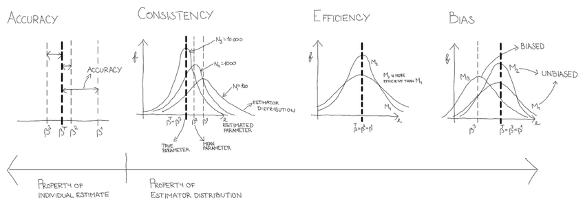
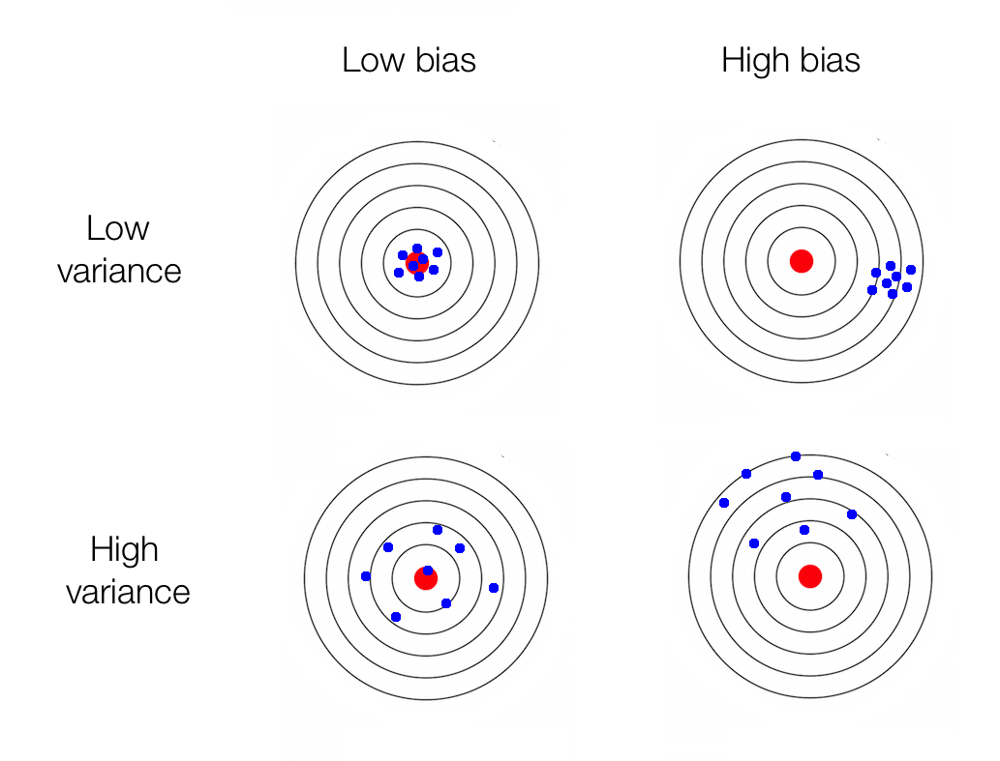
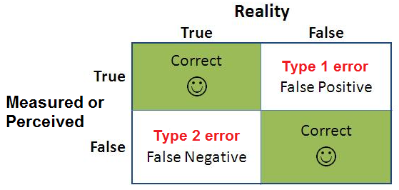
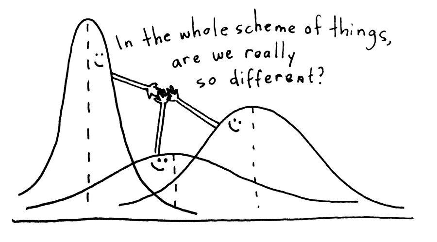

[Weekly content](https://changjunlee.com/teaching/grad_stat/weekly_2/)

<br>

## 9주차 학습목표

::: callout-note
이번 주 학습을 마치면 다음을 할 수 있어야 합니다.

1.  모집단, 표집틀, 표본, 모수, 통계량, **추정대상(estimand)**을 구분한다.
2.  점추정치, 표준오차, 신뢰구간, 효과크기, p-value가 서로 다른 질문에 답한다는 점을 설명한다.
3.  반복표집, bootstrap, permutation을 통해 표집불확실성을 이해한다.
4.  95% 신뢰구간과 p-value를 빈도주의 관점에서 정확하게 해석한다.
5.  통계적 유의성과 실질적 중요성을 구분하고 최소 관심 효과와 비교한다.
6.  제1종·제2종 오류, 검정력, 정밀도를 연구설계와 연결한다.
7.  ANOVA를 별개의 기술이 아니라 **선형모형과 대비(contrast)의 한 형태**로 이해한다.
8.  주효과, 상호작용, 집단 간·집단 내·혼합 설계를 구분한다.
9.  반복측정 자료에서 참여자 내 의존성을 반영하는 분석을 선택한다.
10. 빈도주의 신뢰구간과 베이지안 credible interval의 차이를 설명한다.
11. ChatGPT와 같은 GenAI를 유의성 판정기가 아니라 **추론과 주장 범위의 reviewer**로 활용한다.
:::

### 오늘의 핵심 질문

> **이 표본에서 무엇을 추정하고 있으며, 그 불확실성과 연구설계를 고려할 때 모집단에 대해 어디까지 말할 수 있을까?**

```{mermaid}
flowchart LR
    A["Research Question<br>무엇을 알고 싶은가?"] --> B["Population & Estimand<br>누구의 어떤 효과인가?"]
    B --> C["Design & Sample<br>표집·할당·측정"]
    C --> D["Estimate<br>효과의 크기와 방향"]
    D --> E["Uncertainty<br>SE·CI·sampling distribution"]
    E --> F["Audit<br>가정·다중성·민감도"]
    F --> G["Claim<br>가능한 일반화와 한계"]
```

::: callout-important
통계적 추론의 목적은 p-value를 0.05 아래로 만드는 것이 아닙니다. **관심 효과의 크기와 방향을 추정하고, 표본과 모형이 남기는 불확실성을 정직하게 표현하는 것**입니다.
:::

### 관측된 표본에 없는 것은 무엇인가?

제2차 세계대전의 손상된 전투기 사례는 추론의 출발점을 잘 보여 줍니다. 귀환한 전투기의 손상만 보면 날개와 꼬리에 장갑을 더하고 싶어집니다. 그러나 돌아오지 못한 전투기가 표본에서 빠져 있다는 점을 고려하면, 오히려 귀환기에서 손상이 적었던 핵심 부위가 치명적이었을 수 있습니다.

> 분석 전에 **누가 관측되었고, 누가 관측되지 않았으며, 어떤 과정이 표본을 만들었는지**를 먼저 질문합니다. 큰 표본도 선택 편향을 자동으로 해결하지 않습니다.

------------------------------------------------------------------------

## 이번 주의 GenAI 활용 방식

> **Attempt → Ask → Test → Audit → Explain**

| 단계 | 학생이 먼저 할 일 | GenAI에 맡길 수 있는 일 |
|------------------------|------------------------|------------------------|
| **Attempt** | 모집단, estimand, 설계, 예상 방향을 직접 정의한다. | 아직 사용하지 않는다. |
| **Ask** | 자신의 분석계획과 코드 초안을 제공한다. | 누락된 가정과 대안 분석을 질문하게 한다. |
| **Test** | R에서 추정치·CI·진단을 재현한다. | 출력값을 대신 만들어 달라고 하지 않는다. |
| **Audit** | 분석단위, 반복측정, 다중성, 실질적 기준을 점검한다. | reviewer처럼 과도한 결론을 찾게 한다. |
| **Explain** | 효과, 불확실성, 한계가 포함된 결과 문장을 작성한다. | p-value 중심 문장을 추정 중심 문장으로 비판하게 한다. |

### 추론을 부탁하는 대신 추론 구조를 검토받기

``` text
나는 같은 참여자가 text와 voice 인터페이스를 모두 경험한 HCI 연구를 분석한다.
관심 추정대상은 모집단의 평균적인 within-person 차이인
completion_time(voice) - completion_time(text)이다.

내 분석계획과 R 코드를 검토하라.
1. 관측단위와 독립적인 표집단위를 구분하라.
2. estimand와 계산한 통계량이 일치하는지 확인하라.
3. 신뢰구간, p-value, 효과크기가 각각 답하는 질문을 분리하라.
4. 최소 관심 효과가 ±3초일 때 실질적 해석을 비판하라.
5. 결과 문장에서 인과적·모집단적 과장을 찾아라.
6. 완성된 결론을 대신 쓰지 말고 먼저 진단 질문을 제시하라.
```

::: {.callout-warning title="GenAI에 연구자료를 직접 올리지 않기"}
IRB 자료, 사용자 식별자, 비공개 로그를 공개형 GenAI에 입력하지 않습니다. 비식별 합성자료, 변수 정의, 집계표, 모형식, 진단 출력만으로 분석 검토를 받습니다.
:::

------------------------------------------------------------------------

## 준비: 공통 HCI 반복측정 자료

```{r}
#| label: setup
#| message: false
#| warning: false

library(tidyverse)

theme_set(theme_minimal(base_size = 12))
```

### 연구 시나리오

-   96명의 참여자
-   참여자 간 요인: 디지털 경험 `novice`, `experienced`
-   참여자 내 요인: 인터페이스 `text`, `voice`
-   조건 순서는 균형화: `text_first`, `voice_first`
-   결과변수: 과업완료시간
-   한 행: 한 참여자의 한 인터페이스 시행

```{r}
#| label: create-paired-hci-data

set.seed(2026)

participants <- tibble(
  participant_id = sprintf("P%03d", 1:96),
  expertise = factor(
    rep(c("novice", "experienced"), each = 48),
    levels = c("novice", "experienced")
  ),
  sequence = factor(
    rep(
      rep(c("text_first", "voice_first"), each = 24),
      times = 2
    ),
    levels = c("text_first", "voice_first")
  ),
  participant_intercept = rnorm(96, mean = 0, sd = 6)
)

hci_trials <- participants |>
  crossing(
    interface = factor(
      c("text", "voice"),
      levels = c("text", "voice")
    )
  ) |>
  mutate(
    period = case_when(
      sequence == "text_first" & interface == "text" ~ 1L,
      sequence == "text_first" & interface == "voice" ~ 2L,
      sequence == "voice_first" & interface == "voice" ~ 1L,
      TRUE ~ 2L
    ),
    completion_time =
      58 + participant_intercept -
      4 * (expertise == "experienced") -
      6 * (interface == "voice") +
      4 * (expertise == "experienced" & interface == "voice") -
      2 * (period == 2L) +
      rnorm(n(), mean = 0, sd = 5),
    completion_time = round(completion_time, 1)
  ) |>
  select(
    participant_id,
    expertise,
    sequence,
    period,
    interface,
    completion_time
  )
```

```{r}
glimpse(hci_trials)
```

```{r}
hci_trials |>
  summarise(
    rows = n(),
    participants = n_distinct(participant_id),
    observations_per_participant = n() / n_distinct(participant_id)
  )
```

::: callout-important
192개 행은 192명의 독립 표본이 아닙니다. 96명이 각각 두 번 측정되었습니다. 반복측정 구조를 무시하면 표준오차와 p-value가 잘못될 수 있습니다.
:::

------------------------------------------------------------------------

# 1. 추론의 출발점: 모집단과 estimand

## 먼저 무엇을 추정하는지 한 문장으로 쓰기

이번 연구의 예시 estimand는 다음과 같습니다.

> **목표 모집단에서 동일한 사람이 voice와 text 인터페이스를 사용할 때 나타나는 평균 과업완료시간 차이,** $E(Y_{voice}-Y_{text})$.

다음은 모두 다른 estimand입니다.

-   voice와 text 조건의 **관측 행 평균 차이**
-   참여자별 차이의 **평균**
-   novice 집단의 평균 차이
-   experienced 집단의 평균 차이
-   중앙값 차이
-   60초 이내 완료확률 차이

분석법을 고르기 전에 estimand를 고릅니다.

## Population, sampling frame, sample

| 개념              | 이번 사례의 예                                |
|-------------------|-----------------------------------------------|
| Target population | 연구자가 일반화하고 싶은 인터페이스 사용자    |
| Sampling frame    | 실제 모집 공고가 도달한 학생·지역사회 패널 등 |
| Sample            | 분석에 포함된 96명                            |
| Parameter         | 모집단의 평균 within-person 차이              |
| Statistic         | 표본 96명의 평균 within-person 차이           |

::: callout-warning
무작위 할당은 조건 간 인과비교를 돕지만, 편의표집을 확률표집으로 바꾸지는 않습니다. **할당의 타당성**과 **모집단 일반화**는 서로 다른 문제입니다.
:::

## 좋은 추정량을 평가하는 여러 기준

| 기준 | 질문 | 주의점 |
|------------------------|------------------------|------------------------|
| **Bias** | 반복표집에서 평균적으로 참값을 맞히는가? | 무편향성만으로 좋은 추정량이 보장되지는 않음 |
| **Variance / precision** | 표본이 바뀔 때 얼마나 흔들리는가? | 정밀해도 체계적으로 틀릴 수 있음 |
| **Mean squared error** | bias와 variance를 함께 고려하면 어떤가? | 작은 bias를 허용해 큰 variance를 줄일 수도 있음 |
| **Consistency** | 표본크기가 커질수록 참값에 가까워지는가? | 큰 표본에서도 측정·선택 편향은 남을 수 있음 |
| **Robustness** | 극단값이나 모형 위반에 얼마나 민감한가? | 모든 상황에서 최적인 추정량은 없음 |

추정량은 “무편향인가?” 하나로 끝나지 않습니다. 연구목적과 손실, 자료의 구조에 맞춰 bias–variance–robustness를 함께 봅니다.

<br>



Source: <https://www.researchgate.net/figure/Regression-model-properties-Accuracy-consistency-efficiency-and-bias-of-estimator_fig1_350710941>

<bR>



Source: <http://www.gtmath.com/2018/04/parameter-estimation-part-1-reader.html>

------------------------------------------------------------------------

# 2. 추정 우선: effect first

## 참여자별 차이를 만들기

```{r}
paired_differences <- hci_trials |>
  select(participant_id, expertise, interface, completion_time) |>
  pivot_wider(
    names_from = interface,
    values_from = completion_time
  ) |>
  mutate(
    difference_voice_minus_text = voice - text
  )

paired_differences |>
  select(participant_id, expertise, text, voice, difference_voice_minus_text) |>
  slice_head(n = 8)
```

음수 차이는 voice 조건에서 시간이 더 짧았음을 의미합니다.

```{r}
paired_summary <- paired_differences |>
  summarise(
    n_participants = n(),
    estimate = mean(difference_voice_minus_text),
    sd_difference = sd(difference_voice_minus_text),
    standard_error = sd_difference / sqrt(n_participants)
  )

paired_summary
```

## 점추정치, 표준편차, 표준오차

-   **점추정치:** 표본에서 관측한 평균 효과
-   **차이점수의 표준편차:** 참여자별 효과가 얼마나 다른가?
-   **표준오차:** 같은 연구를 반복할 때 평균 효과 추정치가 얼마나 흔들리는가?

표준편차와 표준오차는 같은 것이 아닙니다.

## 반복표집으로 표준오차 보기

```{r}
set.seed(2026)

sampling_distribution <- tibble(simulation = 1:5000) |>
  mutate(
    estimate = map_dbl(
      simulation,
      function(sim_id) {
        mean(rnorm(96, mean = -4, sd = 7))
      }
    )
  )

sampling_distribution |>
  ggplot(aes(estimate)) +
  geom_histogram(bins = 40) +
  geom_vline(xintercept = -4, linetype = "dashed") +
  labs(
    title = "같은 크기의 연구를 반복했을 때 평균차이 추정치의 분포",
    x = "추정된 평균차이(초)",
    y = "반복 연구 수"
  )
```

표본마다 점추정치는 달라집니다. 신뢰구간과 p-value는 이 표집변동을 모형화한 결과입니다.

------------------------------------------------------------------------

# 3. 신뢰구간: 추정치가 얼마나 정밀한가?

모집단 표준편차를 모르는 평균 추론에서는 보통 t 임계값을 사용합니다.

$$
\bar d \pm t_{1-\alpha/2,\,n-1}\frac{s_d}{\sqrt n}
$$

```{r}
paired_ci <- paired_summary |>
  mutate(
    critical_t = qt(0.975, df = n_participants - 1),
    lower = estimate - critical_t * standard_error,
    upper = estimate + critical_t * standard_error
  )

paired_ci
```

```{r}
paired_test <- t.test(
  paired_differences$voice,
  paired_differences$text,
  paired = TRUE,
  conf.level = 0.95
)

paired_test
```

## 95% 신뢰구간의 정확한 해석

빈도주의 95% 신뢰구간은 다음 절차적 성질을 가집니다.

> 동일한 표집과 분석 절차를 매우 많이 반복하면, 그렇게 만든 구간의 약 95%가 참 모수를 포함한다.

한 번 계산된 구간에 대해 “모수가 이 안에 있을 확률이 95%”라고 말하는 것은 빈도주의의 직접적인 해석이 아닙니다.

### 실질적 중요성과 비교하기

이 연구에서 ±3초보다 작은 차이는 실무적으로 중요하지 않다고 사전에 정했다고 합시다.

```{r}
smallest_effect_of_interest <- 3

paired_ci |>
  transmute(
    estimate,
    lower,
    upper,
    practical_interpretation = case_when(
      upper < -smallest_effect_of_interest ~
        "voice가 실질적으로 의미 있게 더 빠를 가능성과 일치",
      lower > smallest_effect_of_interest ~
        "text가 실질적으로 의미 있게 더 빠를 가능성과 일치",
      lower >= -smallest_effect_of_interest &
        upper <= smallest_effect_of_interest ~
        "실질적으로 작은 차이와 일치",
      TRUE ~
        "중요한 효과와 작은 효과를 아직 구분하기 어려움"
    )
  )
```

::: callout-important
“통계적으로 유의함”과 “실질적으로 중요한 효과”는 같은 판단이 아닙니다. 신뢰구간을 0뿐 아니라 최소 관심 효과와 함께 비교하세요.
:::

## 표준화 효과크기

paired design의 간단한 표준화 효과크기 중 하나는 차이점수의 평균을 차이점수의 표준편차로 나눈 $d_z$입니다.

```{r}
effect_size_dz <- paired_differences |>
  summarise(
    d_z = mean(difference_voice_minus_text) /
      sd(difference_voice_minus_text)
  )

effect_size_dz
```

효과크기는 맥락 없는 “작음·중간·큼” 분류보다, 원래 단위의 효과와 함께 해석하는 편이 좋습니다.

-   비표준화 효과 (Unstandardized Effect): 원래 측정한 원래의 단위(초, 점수, kg, 원 등)를 그대로 사용하는 실제 차이값

-   표준화 효과 (Standardized Effect): 원래 단위의 차이를 데이터의 변동성(표준편차, SD)으로 나누어 단위를 없앤 상대적인 지표

------------------------------------------------------------------------

# 4. Bootstrap: 표집분포를 데이터에서 근사하기

paired design에서는 **참여자 단위**로 재표집해야 합니다. 시행 행을 따로 재표집하면 pairing이 깨집니다.

```{r}
set.seed(2026)

bootstrap_estimates <- tibble(bootstrap_id = 1:5000) |>
  mutate(
    estimate = map_dbl(
      bootstrap_id,
      function(bootstrap_id) {
        sampled_rows <- sample(
          seq_len(nrow(paired_differences)),
          replace = TRUE
        )

        mean(
          paired_differences$difference_voice_minus_text[sampled_rows]
        )
      }
    )
  )

bootstrap_estimates |>
  summarise(
    lower = quantile(estimate, 0.025),
    upper = quantile(estimate, 0.975)
  )
```

```{r}
bootstrap_estimates |>
  ggplot(aes(estimate)) +
  geom_histogram(bins = 40) +
  geom_vline(
    xintercept = mean(paired_differences$difference_voice_minus_text),
    linetype = "dashed"
  ) +
  labs(
    title = "참여자 단위 bootstrap 평균차이",
    x = "bootstrap 평균차이(초)",
    y = "빈도"
  )
```

::: callout-warning
Bootstrap은 관측 표본이 목표 모집단을 잘 대표한다는 문제까지 해결하지 않습니다. 편향된 표집, 잘못된 측정, 누락된 조건은 재표집으로 고쳐지지 않습니다.
:::

### 수식 기반 신뢰구간 vs 부트스트랩 신뢰구간 비교

| 구분 | 수식 기반 신뢰구간 (`qt` 사용) | 부트스트랩 신뢰구간 (`sample` 사용) |
|:-----------------------|:-----------------------|:-----------------------|
| **기본 가정** | 데이터가 **정규분포 및 t-분포**를 따른다고 가정 (**모수적**) | 특정 확률분포를 가정하지 않음 (**비모수적**) |
| **계산 방식** | $\text{Estimate} \pm t_{\text{critical}} \times \text{SE}$ 공식 이용 | 데이터를 복원추출(5,000회 등)하여 실제 분포를 형성 |
| **장점** | · 계산 속도가 매우 빠르고 간단함<br>· 표본이 정규성을 만족할 때 이론적으로 가장 정확함 | · 데이터 분포 형태(치우침, 이상치)에 영향을 받지 않음<br>· 복잡한 통계량에도 유연하게 적용 가능 |
| **단점** | · 표본 수가 적고 데이터가 심하게 치우쳐 있으면 오차 발생 | · 시드(seed)에 따라 결과가 미세하게 달라질 수 있음<br>· 컴퓨팅 자원 및 연산 시간이 더 소요됨 |
| **적용 시점** | 표본 크기가 충분하거나 정규성이 보장될 때 | 데이터가 비대칭(Skewed)이거나 이상치가 존재할 때 |

------------------------------------------------------------------------

# 5. 가설검정과 p-value

## 귀무모형 아래에서 관측 결과는 얼마나 극단적인가?

paired t-test의 귀무가설은 평균 차이가 0이라는 것입니다.

$$
H_0:\mu_d=0, \qquad H_1:\mu_d\ne 0
$$

검정통계량은 다음과 같습니다.

$$
t=\frac{\bar d-0}{s_d/\sqrt n}
$$

p-value는 다음을 의미합니다.

> 귀무가설과 모형 가정이 참일 때, 현재 관측값과 같거나 더 극단적인 검정통계량을 얻을 확률

p-value는 다음이 아닙니다.

-   귀무가설이 참일 확률
-   결과가 우연 때문에 발생했을 확률
-   효과가 중요한 확률
-   다음 연구에서 재현될 확률
-   데이터가 조작되었을 확률

```{r}
tibble(
  estimate = unname(paired_test$estimate),
  confidence_lower = paired_test$conf.int[1],
  confidence_upper = paired_test$conf.int[2],
  t_value = unname(paired_test$statistic),
  degrees_of_freedom = unname(paired_test$parameter),
  p_value = paired_test$p.value
)
```

```{r}
# 데이터 정의
df_res <- tibble(
  estimate = -3.371875,
  confidence_lower = -4.768464,
  confidence_upper = -1.975286,
  t_value = -4.793119,
  label = "Voice vs Text"
)

# 시각화 그래프
ggplot(df_res, aes(x = estimate, y = label)) +
  # 0 기준선 (귀무가설: 차이 없음)
  geom_vline(xintercept = 0, linetype = "dashed", color = "gray50", linewidth = 0.8) +
  # 최소 관심 효과 크기(SESOI) 범위 표시 ([-3, 3])
  annotate("rect", xmin = -3, xmax = 3, ymin = -Inf, ymax = Inf, alpha = 0.1, fill = "blue") +
  # 95% 신뢰구간 선
  geom_errorbarh(aes(xmin = confidence_lower, xmax = confidence_upper), height = 0.15, color = "#2B5C8F", linewidth = 1.2) +
  # 추정치(평균 차이) 점
  geom_point(size = 4, color = "#D95F02") +
  # 데이터 수치 텍스트 표시
  geom_text(aes(label = sprintf("Estimate: %.2f\n95%% CI: [%.2f, %.2f]", estimate, confidence_lower, confidence_upper)),
            vjust = -1.2, color = "#2B5C8F", size = 4.5, fontface = "bold") +
  # 축 및 레이블 설정
  scale_x_continuous(limits = c(-6, 4), breaks = seq(-6, 4, by = 1)) +
  labs(
    title = "Voice vs Text Mean Difference with 95% CI",
    subtitle = "Blue shaded area: Equivalent region (SESOI = [-3, 3])",
    x = "Mean Difference (Voice - Text)",
    y = ""
  ) +
  theme_minimal(base_size = 14) +
  theme(
    panel.grid.minor = element_blank(),
    axis.text.y = element_blank(),
    axis.ticks.y = element_blank(),
    plot.title = element_text(face = "bold", size = 16)
  )

```

## “기각하지 못함”은 “같음이 입증됨”이 아니다

p-value가 0.05보다 크면 다음처럼 말합니다.

> 현재 자료와 모형 아래에서 귀무가설을 기각할 충분한 증거를 얻지 못했다.

다음처럼 말하지 않습니다.

> 두 조건은 같다. 귀무가설이 참임이 증명되었다.

같음을 주장하려면 사전에 정의한 실질적 동등성 범위와 equivalence test 또는 충분히 좁은 신뢰구간이 필요합니다.

### 양측검정과 단측검정

-   양측검정은 효과가 어느 방향으로든 달라질 가능성을 평가합니다.
-   단측검정은 연구 전에 방향과 판단 규칙을 명시하고, 반대 방향의 효과가 나타났을 때도 같은 결정을 내릴 수 있는 경우에만 정당화해야 합니다.
-   데이터를 본 뒤 p-value를 줄이기 위해 단측검정으로 바꾸면 제1종 오류율이 통제되지 않습니다.

------------------------------------------------------------------------

## 비모수적 사고: paired sign-flip test

귀무가설 아래에서 차이점수의 부호가 교환 가능하다고 가정하면 부호를 무작위로 뒤집어 귀무분포를 만들 수 있습니다.

```{r}
set.seed(2026)

observed_difference <- mean(
  paired_differences$difference_voice_minus_text
)

sign_flip_null <- replicate(
  10000,
  {
    random_signs <- sample(
      c(-1, 1),
      size = nrow(paired_differences),
      replace = TRUE
    )

    mean(
      paired_differences$difference_voice_minus_text * random_signs
    )
  }
)

sign_flip_p_value <- mean(
  abs(sign_flip_null) >= abs(observed_difference)
)

sign_flip_p_value
```

```{r}
tibble(null_estimate = sign_flip_null) |>
  ggplot(aes(null_estimate)) +
  geom_histogram(bins = 40) +
  geom_vline(
    xintercept = c(-abs(observed_difference), abs(observed_difference)),
    linetype = "dashed"
  ) +
  labs(
    title = "평균차이가 0이라는 귀무모형 아래의 sign-flip 분포",
    x = "귀무모형의 평균차이",
    y = "빈도"
  )
```

::: callout-warning
Permutation 또는 sign-flip 검정도 가정이 없습니다는 뜻이 아닙니다. 교환가능성, 무작위화 절차, 반복측정 구조가 검정 방식과 일치해야 합니다.
:::

### 신뢰구간, 검정, 실질적 기준을 함께 읽기

| 질문                                 | 도구                               |
|------------------------------------|------------------------------------|
| 효과의 방향과 크기는?                | 점추정치                           |
| 정밀도는?                            | 표준오차와 신뢰구간                |
| 귀무모형과 얼마나 양립하기 어려운가? | p-value 또는 randomization p-value |
| 연구적으로 중요한가?                 | 최소 관심 효과와 원단위 해석       |
| 설계와 모형이 타당한가?              | 가정·민감도·진단                   |

------------------------------------------------------------------------

# 6. 제1종 오류, 제2종 오류, 검정력

| 현실       | 귀무가설 기각      | 귀무가설 기각하지 않음 |
|------------|--------------------|------------------------|
| $H_0$ 참   | 제1종 오류 가능    | 올바른 결정            |
| $H_0$ 거짓 | 검정력에 따른 탐지 | 제2종 오류 가능        |

-   제1종 오류 확률: $\alpha$
-   제2종 오류 확률: $\beta$
-   검정력: $1-\beta$

검정력은 효과크기, 변동성, 표본크기, 유의수준, 설계에 따라 달라집니다.

## paired design의 사전 검정력

```{r}
power_grid <- crossing(
  n_pairs = c(20, 40, 60, 80, 120),
  true_difference = c(2, 4, 6)
) |>
  mutate(
    power = map2_dbl(
      n_pairs,
      true_difference,
      function(n_i, difference_i) {
        power.t.test(
          n = n_i,
          delta = difference_i,
          sd = 7,
          sig.level = 0.05,
          type = "paired",
          alternative = "two.sided"
        )$power
      }
    )
  )

power_grid
```

```{r}
power_grid |>
  mutate(true_difference = factor(true_difference)) |>
  ggplot(aes(n_pairs, power, linetype = true_difference)) +
  geom_line(linewidth = 0.9) +
  geom_hline(yintercept = 0.8, linetype = "dashed") +
  scale_y_continuous(labels = scales::label_percent()) +
  labs(
    title = "가정한 실제 차이와 표본크기에 따른 검정력",
    x = "참여자 쌍 수",
    y = "검정력",
    linetype = "실제 평균차이(초)"
  )
```

::: callout-important
“검정력 80% 이상이면 신뢰할 수 있는 연구”라는 자동 판정은 적절하지 않습니다. 표본크기 계획은 다음을 명시해야 합니다.

-   최소 관심 효과
-   예상 변동성의 근거
-   설계와 반복측정 상관
-   이탈·결측 예상
-   다중 비교와 분석계획
-   원하는 정밀도
:::

## 검정력보다 직접적인 정밀도 계획

예상 차이점수 표준편차가 7초일 때, 95% 신뢰구간의 예상 반폭을 계산할 수 있습니다.

```{r}
precision_grid <- tibble(
  n_pairs = c(20, 40, 60, 80, 120)
) |>
  mutate(
    expected_margin_of_error =
      qt(0.975, df = n_pairs - 1) * 7 / sqrt(n_pairs)
  )

precision_grid
```

“최소 80% power”뿐 아니라 “효과를 ±1.5초 이내의 정밀도로 추정하고 싶다”는 목표도 표본설계의 근거가 될 수 있습니다.

::: {.callout-warning title="요인설계의 표본크기"}
2 × 2 설계를 단순히 “네 집단 ANOVA”로 놓고 관행적인 중간 효과크기를 넣는 것만으로는 충분하지 않습니다. primary estimand가 주효과인지 상호작용인지, 집단 간인지 반복측정인지, 셀 크기가 균형적인지에 따라 검정력이 달라집니다. 복잡한 HCI 설계에서는 예상 모수와 결측·군집 구조를 반영한 simulation-based planning이 더 투명할 수 있습니다.
:::

------------------------------------------------------------------------

# 7. 다중검정과 연구자 자유도

독립적인 귀무가설 검정을 20번 하고 각 검정에서 $\alpha=.05$를 쓰면, 적어도 한 번 제1종 오류가 날 확률은 다음과 같습니다.

```{r}
1 - (1 - 0.05)^20
```

### 대처 방법

-   주요 결과변수와 대비를 사전에 정한다.
-   탐색분석과 확증분석을 구분한다.
-   모든 시도와 제외 기준을 기록한다.
-   필요한 경우 Holm, false discovery rate 등의 보정을 사용한다.
-   한 개의 작은 p-value보다 효과크기, CI, 재현성과 함께 판단한다.

```{r}
example_p_values <- c(0.004, 0.018, 0.031, 0.061, 0.20)

tibble(
  raw_p = example_p_values,
  holm_p = p.adjust(example_p_values, method = "holm"),
  fdr_p = p.adjust(example_p_values, method = "BH")
)
```

::: {.callout-tip title="GenAI checkpoint: 분석 유연성 감사"}
``` text
내 분석계획에서 결과를 본 뒤 바꿀 수 있는 선택지를 찾아라.
결과변수, 제외 기준, 변환, 공변량, 하위집단, 검정 방향, 사후비교를 구분하고,
사전 명시할 항목과 탐색적으로 보고할 항목을 표로 제안하라.
```
:::

------------------------------------------------------------------------

# 8. ANOVA는 선형모형이다

## 2 × 2 HCI 실험

-   Factor 1: 인터페이스 `text`, `voice`
-   Factor 2: 설명 `none`, `rationale`
-   Outcome: 1–7 신뢰 합성점수
-   설계: 네 조건에 서로 다른 참여자를 배정한 집단 간 설계

```{r}
#| label: create-factorial-data
#| include: false

set.seed(2027)

factorial_hci <- crossing(
  interface = factor(
    c("text", "voice"),
    levels = c("text", "voice")
  ),
  explanation = factor(
    c("none", "rationale"),
    levels = c("none", "rationale")
  ),
  participant_in_cell = 1:30
) |>
  mutate(
    participant_id = sprintf(
      "%s_%s_%02d",
      as.character(interface),
      as.character(explanation),
      participant_in_cell
    ),
    trust =
      4.2 +
      0.25 * (interface == "voice") +
      0.35 * (explanation == "rationale") +
      0.65 * (interface == "voice" & explanation == "rationale") +
      rnorm(n(), mean = 0, sd = 0.65),
    trust = pmin(pmax(trust, 1), 7)
  )
```

## 시각화와 셀 요약

```{r}
cell_summary <- factorial_hci |>
  summarise(
    n = n(),
    mean_trust = mean(trust),
    se = sd(trust) / sqrt(n),
    critical_t = qt(0.975, df = n - 1),
    lower = mean_trust - critical_t * se,
    upper = mean_trust + critical_t * se,
    .by = c(interface, explanation)
  )

cell_summary
```

```{r}
cell_summary |>
  ggplot(
    aes(
      explanation,
      mean_trust,
      group = interface,
      linetype = interface
    )
  ) +
  geom_line(linewidth = 0.9) +
  geom_point(size = 2.5) +
  geom_errorbar(
    aes(ymin = lower, ymax = upper),
    width = 0.08
  ) +
  labs(
    title = "인터페이스와 설명 방식에 따른 평균 신뢰",
    x = "설명 방식",
    y = "평균 신뢰 점수",
    linetype = "인터페이스"
  )
```

평행하지 않은 선은 상호작용 가능성을 시각적으로 보여 주지만, 그래프만으로 검정이 끝나는 것은 아닙니다.

## 선형모형으로 적합하기

```{r}
factorial_model <- lm(
  trust ~ interface * explanation,
  data = factorial_hci
)

summary(factorial_model)
```

```{r}
anova(factorial_model)
```

```{r}
confint(factorial_model)
```

모형식은 다음을 의미합니다.

$$
Y_i=\beta_0+\beta_1\text{Interface}_i
+\beta_2\text{Explanation}_i
+\beta_3(\text{Interface}\times\text{Explanation})_i
+\epsilon_i
$$

-   $\beta_0$: 기준 조건의 평균
-   $\beta_1$: 기준 설명 조건에서의 인터페이스 차이
-   $\beta_2$: 기준 인터페이스에서의 설명 차이
-   $\beta_3$: 한 요인의 효과가 다른 요인 수준에 따라 얼마나 달라지는지

::: callout-important
상호작용이 포함된 모형에서 주효과 계수는 “다른 요인을 무시한 전체 효과”가 아니라, **기준 수준에서의 조건부 효과**로 해석됩니다. 코딩과 contrast가 해석을 결정합니다.
:::

## 예측된 셀 평균과 신뢰구간

```{r}
cell_grid <- crossing(
  interface = factor(
    c("text", "voice"),
    levels = levels(factorial_hci[["interface"]])
  ),
  explanation = factor(
    c("none", "rationale"),
    levels = levels(factorial_hci[["explanation"]])
  )
)

prediction_matrix <- predict(
  factorial_model,
  newdata = cell_grid,
  interval = "confidence"
)

model_cell_estimates <- bind_cols(
  cell_grid,
  as_tibble(prediction_matrix)
)

model_cell_estimates
```

ANOVA의 omnibus F-test가 유의하더라도 어떤 구체적 대비가 다른지는 별도의 estimand와 contrast로 확인해야 합니다.

## ANOVA가 비교하는 것은 “평균 구조”다

F 통계량은 모형이 설명한 변동과 잔차 변동의 비율을 사용하여 평균 구조를 평가합니다. “ANOVA는 집단 분산이 서로 다른지 검사한다”라고만 설명하면 오해가 생깁니다.

------------------------------------------------------------------------

## 모형 진단

```{r}
model_diagnostics <- tibble(
  fitted = fitted(factorial_model),
  residual = residuals(factorial_model),
  standardized_residual = rstandard(factorial_model)
)
```

```{r}
model_diagnostics |>
  ggplot(aes(fitted, residual)) +
  geom_point(alpha = 0.6) +
  geom_hline(yintercept = 0, linetype = "dashed") +
  labs(
    title = "Residuals versus fitted values",
    x = "적합값",
    y = "잔차"
  )
```

```{r}
model_diagnostics |>
  ggplot(aes(sample = standardized_residual)) +
  stat_qq() +
  stat_qq_line() +
  labs(
    title = "표준화 잔차의 Q–Q plot",
    x = "이론적 분위수",
    y = "관측 분위수"
  )
```

### 점검할 가정

-   독립성은 주로 그래프보다 **연구설계**에서 판단한다.
-   잔차의 평균구조와 함수형태가 적절한가?
-   집단별 분산이 크게 다른가?
-   영향력이 큰 관측치가 있는가?
-   잔차 정규성 가정은 원자료가 완벽한 정규분포여야 한다는 뜻이 아니다.
-   작은 척도·천장효과·순서형 결과라면 다른 모형이 더 적절할 수 있다.

------------------------------------------------------------------------

# 9. 집단 간, 집단 내, 혼합 설계

| 설계 | 참여자 경험 | 장점 | 주요 위험 |
|------------------|------------------|------------------|------------------|
| Between-subjects | 한 조건만 경험 | 이월효과가 적음 | 개인차, 더 많은 참여자 필요 |
| Within-subjects | 모든 조건 경험 | 참여자가 자신의 통제, 높은 정밀도 | 순서·학습·피로·이월효과 |
| Mixed factorial | 요인 일부는 between, 일부는 within | 복합 연구질문 | 해석과 공분산 구조가 복잡 |

## Within-subjects 설계에서 분석 전 할 일

-   조건 순서를 무작위화하거나 counterbalance한다.
-   period와 sequence를 저장한다.
-   washout이 필요한지 판단한다.
-   한 참여자 안의 관측이 의존함을 분석에 반영한다.
-   누락된 조건과 이탈을 기록한다.

### 반복측정 ANOVA와 혼합효과모형

반복측정 ANOVA는 균형잡힌 단순 설계에서 유용합니다. 혼합효과모형은 참여자별 차이, 불균형, 일부 결측, 더 복잡한 반복구조를 유연하게 표현할 수 있습니다.

아래 코드는 선택 실습입니다. `lme4`를 Console에서 설치한 뒤 실행합니다.

```{r}
#| eval: false
#| code-fold: true

library(lme4)

mixed_model <- lmer(
  completion_time ~
    interface * expertise +
    period +
    (1 + interface | participant_id),
  data = hci_trials,
  REML = FALSE
)

summary(mixed_model)
confint(mixed_model, method = "Wald")
```

-   `(1 | participant_id)`: 참여자별 기준 수준 차이
-   `(1 + interface | participant_id)`: 참여자별 기준 수준과 인터페이스 효과의 차이
-   `period`: 학습 또는 피로와 같은 순서 위치 효과

::: callout-warning
혼합효과모형은 반복측정을 자동으로 해결하는 마법이 아닙니다. random-effects 구조, 코딩, 수렴, singular fit, 잔차 구조를 연구설계와 자료가 지지하는지 확인해야 합니다.
:::

------------------------------------------------------------------------

# 10. 빈도주의와 베이지안 추론

## 같은 동전 자료에 답하는 서로 다른 질문

20번 던져 14번 앞면이 나왔다고 합시다.

### 빈도주의

-   모수 $p$는 고정되어 있지만 알려지지 않음
-   표집 절차를 반복했을 때의 성질로 불확실성을 표현

```{r}
frequentist_coin <- binom.test(
  x = 14,
  n = 20,
  p = 0.5,
  alternative = "two.sided"
)

frequentist_coin
```

### 베이지안

-   모수 $p$의 불확실성을 분포로 표현
-   prior와 likelihood를 결합해 posterior를 계산

대칭적인 `Beta(2, 2)` prior를 사용하면, 14번 성공과 6번 실패 이후 posterior는 `Beta(16, 8)`입니다.

```{r}
prior_alpha <- 2
prior_beta <- 2
heads <- 14
tails <- 6

posterior_alpha <- prior_alpha + heads
posterior_beta <- prior_beta + tails

bayesian_summary <- tibble(
  posterior_mean = posterior_alpha /
    (posterior_alpha + posterior_beta),
  credible_lower = qbeta(
    0.025,
    posterior_alpha,
    posterior_beta
  ),
  credible_upper = qbeta(
    0.975,
    posterior_alpha,
    posterior_beta
  ),
  probability_above_half = 1 - pbeta(
    0.5,
    posterior_alpha,
    posterior_beta
  )
)

bayesian_summary
```

```{r}
prior_posterior <- tibble(
  p = seq(0.001, 0.999, length.out = 500),
  prior = dbeta(p, prior_alpha, prior_beta),
  posterior = dbeta(p, posterior_alpha, posterior_beta)
) |>
  pivot_longer(
    c(prior, posterior),
    names_to = "distribution",
    values_to = "density"
  )

prior_posterior |>
  ggplot(aes(p, density, linetype = distribution)) +
  geom_line(linewidth = 1) +
  geom_vline(xintercept = 0.5, linetype = "dotted") +
  labs(
    title = "데이터를 관측한 뒤 좁아지고 이동한 posterior",
    x = "앞면 확률 p",
    y = "밀도",
    linetype = "분포"
  )
```

## Confidence interval과 credible interval

| 구간 | 직접적인 해석 |
|------------------------------------|------------------------------------|
| Frequentist confidence interval | 반복 절차에서 정해진 비율로 참 모수를 포함하는 구간 생성 절차 |
| Bayesian credible interval | 주어진 prior와 모형, 데이터 아래에서 모수가 해당 구간에 있을 posterior 확률 |

두 접근은 서로 다른 가정과 질문을 사용합니다. 어느 쪽이든 prior, likelihood, 표집, 모형의 적절성을 검토해야 합니다.

------------------------------------------------------------------------

# 11. 결과 보고는 추정치부터 시작한다

## 최소 보고 템플릿

> 96명의 참여자가 두 조건을 모두 경험한 counterbalanced within-subjects 연구에서, voice 조건의 완료시간은 text 조건보다 평균적으로 **\[추정치\]초** 달랐다. 평균 paired difference의 95% 신뢰구간은 **\[하한, 상한\]**이었고, paired t-test 결과는 $t(df)=[값], p=[값]$였다. 사전에 정한 최소 관심 효과는 ±3초였다. 결과는 **\[실질적 해석\]**과 일치하지만, **\[표집·측정·순서·일반화 한계\]**가 남아 있다.

### 포함할 것

-   참여자 수와 분석단위
-   설계와 조건 할당 방식
-   추정대상과 원단위 점추정치
-   95% CI 또는 posterior interval
-   p-value를 사용했다면 검정과 가정
-   효과크기를 사용했다면 정의
-   결측·제외·다중비교 처리
-   실질적 의미와 주장 한계

### 피할 문장

-   “p \< .05이므로 가설이 참이다.”
-   “p \> .05이므로 두 집단은 같다.”
-   “95% 확률로 참 평균이 이 신뢰구간에 있다.”
-   “통계적으로 유의하므로 효과가 크다.”
-   “상호작용이 유의하지 않으므로 두 효과는 동일하다.”

::: {.callout-tip title="GenAI checkpoint: 결과 문장 reviewer"}
``` text
아래 결과 문장을 수정하기 전에 문제점을 분류하라.
- p-value 오해
- 신뢰구간 오해
- 효과크기 누락
- 실질적 중요성 누락
- 인과적 비약
- 모집단 일반화 과장
- 반복측정 단위 누락
각 문제를 근거와 함께 지적한 뒤, 최소한의 수정 원칙만 제안하라.
```
:::

------------------------------------------------------------------------

# 12. 설계가 검정을 만든다: Lady Tasting Tea

고전적인 실험에서는 8잔 중 4잔은 우유를 먼저, 4잔은 차를 먼저 넣고, 참가자에게 우유를 먼저 넣은 4잔을 고르게 했습니다. 귀무가설 아래에서 가능한 선택은 $\binom{8}{4}=70$개이며, 4잔을 모두 정확히 고를 확률은 다음과 같습니다.

```{r}
1 / choose(8, 4)
```

핵심은 복잡한 공식보다 다음에 있습니다.

-   조건을 어떻게 무작위 배치했는가?
-   참가자에게 몇 잔이 각 조건인지 알려 주었는가?
-   어떤 결과를 “더 극단적”이라고 정의했는가?
-   분석은 실제 randomization 절차와 일치하는가?

> **통계분석은 연구설계 뒤에 붙이는 장식이 아니라, 연구설계가 만든 비교를 수량화하는 과정입니다.**

------------------------------------------------------------------------

# 13. Inference Audit Lab

## 선택 A: paired interface study

이번 주의 `hci_trials`를 사용하여 voice–text 평균차이를 분석합니다.

## 선택 B: 2 × 2 factorial study

이번 주의 `factorial_hci`를 사용하여 인터페이스, 설명, 상호작용을 분석합니다.

### Round 1. Analysis contract

-   목표 모집단
-   표집틀과 실제 표본
-   관측단위와 독립 표집단위
-   primary estimand
-   최소 관심 효과
-   제외·결측 기준
-   주요 분석과 민감도 분석

### Round 2. Estimation

-   원단위 점추정치
-   표준오차
-   95% 신뢰구간 또는 credible interval
-   효과크기
-   원자료 또는 적절한 요약 시각화

### Round 3. Test and model audit

-   귀무가설과 검정통계량
-   p-value 또는 randomization p-value
-   모형 가정과 진단
-   반복측정 또는 군집 구조
-   다중비교 여부

### Round 4. Practical interpretation

-   0과 비교한 통계적 해석
-   최소 관심 효과와 비교한 실질적 해석
-   설계가 허용하는 인과 주장
-   표집이 허용하는 모집단 일반화
-   대안 설명과 다음 연구

### Round 5. AI audit

``` text
아래 분석을 통계 reviewer처럼 감사하라.
1. estimand와 계산한 효과의 일치
2. 독립 분석단위와 반복측정 처리
3. 신뢰구간과 p-value의 해석
4. 최소 관심 효과와 효과크기
5. 다중비교와 분석 유연성
6. 모형 가정과 민감도 분석
7. 인과·모집단 일반화의 범위
8. 결과로 말할 수 없는 것
최종 결론을 대신 작성하지 말고 우선 수정 우선순위를 제시하라.
```

## Inference Claim Card

| 항목 | 작성 내용 |
|----|----|
| **Population** | 누구에게 일반화하려는가? |
| **Estimand** | 모집단의 어떤 효과를 추정하는가? |
| **Design** | 표집, 할당, 반복측정 구조는 무엇인가? |
| **Estimate** | 효과의 크기와 방향은 무엇인가? |
| **Uncertainty** | SE·CI·posterior interval은 무엇인가? |
| **Model check** | 가정과 진단은 어떤가? |
| **Practical meaning** | 최소 관심 효과와 비교하면 어떤가? |
| **Boundary** | 인과·일반화·동등성에 대해 말할 수 없는 것은 무엇인가? |

## AI Collaboration Log

| 항목              | 기록 내용                                    |
|-------------------|----------------------------------------------|
| 목적              | 추정, 코드 감사, 가정 점검, 문장 reviewer 등 |
| 내가 먼저 한 시도 | AI 사용 전 분석계획과 코드                   |
| 프롬프트          | 실제 입력한 핵심 요청                        |
| AI 제안           | 제안 내용 요약                               |
| 검증              | 직접 실행한 R 코드와 출력                    |
| 결정              | 채택·수정·기각과 이유                        |
| 최종 변화         | 추정·모형·문장이 어떻게 달라졌는가?          |

::: {.callout-important title="이번 주의 한 문장"}
**좋은 통계적 추론은 유의성 판정이 아니라, 명확한 estimand·타당한 설계·효과 추정·불확실성·가정·주장 한계를 하나의 논리로 연결합니다.**
:::

<!-- ## Statistical Inference -->

<!-- > **‘제 2차 세계대전의 손상된 전투기’ 사례** -->

<!-- > -->

<!-- > 당시 연합군은 전투기가 격추되는 것을 줄이기 위해 손상된 전투기들의 데이터를 분석했습니다. 대부분의 전투기는 날개와 꼬리에 총탄이 많이 맞은 상태로 돌아왔고, 연구팀은 이 부위에 장갑을 강화해야 한다고 생각했죠. 그런데 통계학자 아브라함 발드(Abraham Wald)는 발상을 뒤집었습니다. 살아 돌아온 전투기들은 총알을 맞아도 생존할 수 있었던 부위에 손상을 입었다는 점을 지적하며, **격추된 전투기들은 아마도 다른 부위가 손상되어 돌아오지 못했을 가능성이 크다고 했습니다.** 그래서 결론적으로 장갑은 덜 손상된 부위에 덧대어야 한다고 주장했죠. 이 분석은 전투기의 생존률을 크게 높였다고 알려져 있습니다. -->

<!-- -   **통계적 추론:** 표본(Sample) 데이터를 통해 모집단(Population)의 특성을 추정하고 이해하는 과정 -->

<!-- <br> -->

<!-- ### 1. Introduction to Statistical Inference -->

<!-- **Statistical Inference** is [the process of drawing conclusions about population parameters based on a sample from the population]{.underline}. There are two main branches of statistical inference: -->

<!-- -   **Estimation**: Involves estimating population parameters (e.g., the mean or variance) using sample data. -->

<!-- -   **Hypothesis Testing**: Involves testing assumptions (hypotheses) about population parameters. -->

<!-- In other words, (in Korean) -->

<!-- -   **Estimation (추정):** 표본 데이터를 사용하여 모집단의 특정 **모수(예: 평균, 분산 등)**를 **알아내고 추정**하는 데 목적이 있음. 주된 목표는 모집단의 실제 모수 값을 가능한 정확히 **근사**하는 것. 예를 들어, 모집단의 평균을 추정하기 위해 표본의 평균을 사용. -->

<!-- -   **Hypothesis Testing (가설 검정):** 모집단의 모수에 대한 특정한 **주장이 참인지 판단**하는 데 목적이 있음. 예를 들어, 모집단 평균이 특정 값(예: 50)인지 아닌지를 확인하고자 할 때, 귀무 가설과 대립 가설을 세워 이를 테스트. -->

<!-- The objective is to make reliable conclusions about a population, recognizing that sample data inherently contains some uncertainty. -->

<!-- <Br> -->

<!-- ### 2. Point Estimation -->

<!-- A **point estimate** provides a single value as an estimate of a population parameter. The most common point estimators are: -->

<!-- -   Sample Mean ($\hat{\mu}$): An estimate of the population mean ($\mu$). -->

<!-- -   Sample Variance ($\hat{\sigma}$): An estimate of the population variance ($\sigma^2$). -->

<!-- #### Equations: -->

<!-- -   The **sample mean** $\hat{\mu}$ is given by: -->

<!-- $$ -->

<!-- \mu = \frac{1}{n} \sum_{i=1}^n X_i -->

<!-- $$ -->

<!-- -   The **sample variance** $\hat{\sigma}$ is given by: -->

<!-- $$ -->

<!-- \hat{\sigma}^2 = \frac{1}{n-1} \sum_{i=1}^n (X_i - \hat{\mu})^2 -->

<!-- $$ -->

<!-- #### Properties of Good Estimators: -->

<!-- -   **Unbiasedness**: The expected value of the estimator is equal to the parameter it estimates. -->

<!-- -   **Consistency**: As the sample size increases, the estimator converges to the true parameter. -->

<!-- -   **Efficiency**: Among unbiased estimators, an efficient estimator has the smallest variance. -->

<!--  -->

<!-- Source: <https://www.researchgate.net/figure/Regression-model-properties-Accuracy-consistency-efficiency-and-bias-of-estimator_fig1_350710941> -->

<!-- <bR> -->

<!--  -->

<!-- Source: <http://www.gtmath.com/2018/04/parameter-estimation-part-1-reader.html> -->

<!-- <br> -->

<!-- #### R Code for Point Estimation: -->

<!-- ```{r} -->

<!-- # Generate random sample data -->

<!-- set.seed(123) -->

<!-- data <- rnorm(100, mean = 50, sd = 10) -->

<!-- # Calculate point estimates -->

<!-- sample_mean <- mean(data) -->

<!-- sample_variance <- var(data) -->

<!-- cat("Sample Mean:", sample_mean, "\n") -->

<!-- cat("Sample Variance:", sample_variance, "\n") -->

<!-- ``` -->

<!-- <br> -->

<!-- ### 3. Interval Estimation (Confidence Intervals) -->

<!-- A **confidence interval** provides a range of values that is likely to contain the population parameter with a specified level of confidence (e.g., 95%). -->

<!-- For the sample mean, a **95% confidence interval** can be calculated as: -->

<!-- $$ -->

<!-- CI = \hat{\mu} \pm z_{\alpha/2} \cdot \frac{\hat{\sigma}}{\sqrt{n}} -->

<!-- $$ -->

<!-- Where: -->

<!-- -   $\hat{\mu}$ is the sample mean, -->

<!-- -   $z_{\alpha/2}$ is the critical value (임계값) from the standard normal distribution (1.96 for 95% confidence), -->

<!--     -   $z_{\alpha/2}$​는 표준 정규 분포에서 특정 신뢰 수준(예: 95%, 99%)을 반영하는 값으로, 예를 들어, 95% 신뢰 구간을 구할 때는 $\alpha = 0.05$이며, $z_{0.025}$​는 약 1.96. -->

<!--     <!-- -->

--\>

<!--     -   신뢰 구간이 얼마나 넓어질지 결정하는 요소 -->

<!-- -   $\hat{\sigma}$ is the sample standard deviation, -->

<!-- -   $n$ is the sample size. -->

<!--     -   **표준 오차**는 표본 크기가 커질수록 작아지며, 이는 표본 평균이 모집단 평균에 더 근접함을 의미. -->

<!-- <bR> -->

<!-- #### R Code for Confidence Interval: -->

<!-- ```{r} -->

<!-- # Function to calculate a 95% confidence interval -->

<!-- confidence_interval <- function(data) { -->

<!--   n <- length(data) -->

<!--   mean <- mean(data) -->

<!--   sd <- sd(data) -->

<!--   error <- qnorm(0.975) * sd / sqrt(n) -->

<!--   lower_bound <- mean - error -->

<!--   upper_bound <- mean + error -->

<!--   return(c(lower_bound, upper_bound)) -->

<!-- } -->

<!-- # Generate sample data -->

<!-- set.seed(123) -->

<!-- data <- rnorm(100, mean = 50, sd = 10) -->

<!-- # Calculate the 95% confidence interval -->

<!-- ci <- confidence_interval(data) -->

<!-- cat("95% Confidence Interval:", ci, "\n") -->

<!-- ``` -->

<!-- <br> -->

<!-- ### 4. Hypothesis Testing -->

<!-- **Hypothesis Testing** involves testing an assumption (hypothesis) about a population parameter. The two types of hypotheses are: -->

<!-- -   **Null Hypothesis (H₀)**: The statement being tested, usually a statement of no effect or no difference. -->

<!-- -   **Alternative Hypothesis (H₁)**: The statement you want to test, indicating an effect or difference. -->

<!-- #### Steps in Hypothesis Testing: -->

<!-- 1.  State the null and alternative hypotheses. -->

<!-- 2.  Choose a significance level ($\alpha$, usually 0.05). -->

<!-- 3.  Compute a test statistic. -->

<!-- 4.  Determine the critical value or p-value. -->

<!-- 5.  Make a decision: reject or fail to reject the null hypothesis. -->

<!-- #### Test Statistic for a Mean: -->

<!-- For large samples (n \> 30), we use the z-statistic: -->

<!-- $$ -->

<!-- Z = \frac{\hat{\mu} - \mu_0}{\hat{\sigma} / \sqrt{n}} -->

<!-- $$ -->

<!-- Where: -->

<!-- -   $\hat{\mu}$ is the sample mean, -->

<!-- -   $\mu_0$ is the population mean under the null hypothesis, -->

<!-- -   $\hat{\sigma}$ is the sample standard deviation. -->

<!-- #### R Code for Hypothesis Testing (One-Sample t-test): -->

<!-- ```{r} -->

<!-- # Sample data -->

<!-- scores <- c(78, 82, 75, 80, 77, 73, 70, 74, 85, 79)  # Replace with your data -->

<!-- # Hypothesized population mean -->

<!-- mu_0 <- 75  # Hypothesized mean to test against -->

<!-- # Perform the one-sample t-test -->

<!-- t_test_result <- t.test(scores, mu = mu_0) -->

<!-- # View the result -->

<!-- print(t_test_result) -->

<!-- # Visualize the sample distribution with a histogram -->

<!-- hist(scores,  -->

<!--      main = "Sample Scores Distribution with Hypothesized Mean",  -->

<!--      xlab = "Scores",  -->

<!--      col = "skyblue",  -->

<!--      border = "white",  -->

<!--      breaks = 10) -->

<!-- # Add a line for the sample mean -->

<!-- abline(v = mean(scores), col = "blue", lwd = 2, lty = 2) -->

<!-- text(mean(scores), par("usr")[4], labels = "Sample Mean", pos = 3, col = "blue") -->

<!-- # Add a line for the hypothesized mean -->

<!-- abline(v = mu_0, col = "red", lwd = 2) -->

<!-- text(mu_0, par("usr")[4], labels = "Hypothesized Mean", pos = 3, col = "red") -->

<!-- # Add confidence interval lines -->

<!-- ci <- t_test_result$conf.int -->

<!-- abline(v = ci[1], col = "darkgreen", lwd = 2, lty = 3) -->

<!-- abline(v = ci[2], col = "darkgreen", lwd = 2, lty = 3) -->

<!-- text(ci[1], par("usr")[4], labels = "95% CI Lower", pos = 3, col = "darkgreen") -->

<!-- text(ci[2], par("usr")[4], labels = "95% CI Upper", pos = 3, col = "darkgreen") -->

<!-- ``` -->

<!-- <br> -->

<!-- ### 5. Types of Errors -->

<!-- In hypothesis testing, we can make two types of errors: -->

<!--  -->

<!-- -   **Type I Error**: Rejecting the null hypothesis when it is true (false positive). -->

<!-- -   **Type II Error**: Failing to reject the null hypothesis when it is false (false negative). -->

<!-- The **power** of a test is the probability of correctly rejecting a false null hypothesis (1 - probability of Type II error). -->

<!-- **검정력(Power of a Test)**은 **잘못된 귀무 가설을 정확하게 기각할 확률**. 즉, **귀무 가설이 실제로 틀렸을 때, 이를 제대로 알아채고 기각할 가능성**을 나타내는 지표. -->

<!-- -   검정력은 수식으로 **1 - 제2종 오류의 확률** -->

<!--     -   **제2종 오류**는 귀무 가설이 틀렸음에도 불구하고 이를 기각하지 못하는 실수 -->

<!--     -   따라서 **검정력**은 제2종 오류를 피하고, 잘못된 가설을 제대로 기각할 확률 -->

<!--     -   ML 성능 측정 지표의 Recall (Sensitivity 민감도, 또는 재현율)과 같음. -->

<!--         -   참인 값을 놓치지 않는 능력 -->

<!--         -   실제로 양성인 모든 데이터 중에서 모델이 양성이라고 정확히 예측한 비율 -->

<!-- <br> -->

<!-- #### R Code for Power Calculation: -->

<!-- > 한 연구자가 **특정 운동 프로그램**이 체력에 미치는 효과를 알아보기 위해 **운동 그룹**과 **대조 그룹(운동하지 않는 그룹)**을 비교하는 연구를 설계했다고 가정해보자. 연구자는 운동 프로그램의 효과가 중간 정도(효과 크기 d = 0.5)일 것으로 예상한다. 각 그룹에는 **100명씩**의 참여자가 포함되며, 연구자는 5% 유의 수준에서 검정을 수행하려고 한다. 연구자는 **검정력(power)**이 충분히 높아야만, 즉 잘못된 귀무 가설을 기각할 확률이 높아야만 연구 결과의 신뢰성을 높일 수 있기 때문에 검정력을 계산하게 된다. 검정력이 80% 이상일 때 보통 신뢰할 만한 연구라고 간주되기 때문이다. -->

<!-- ```{r} -->

<!-- # Calculate the power of a t-test -->

<!-- library(pwr) -->

<!-- # 효과 크기, 표본 크기, 유의 수준, 양측 검정을 설정하여 검정력 계산 -->

<!-- power_result <- pwr.t.test(d = 0.5,  -->

<!--                            n = 100,  -->

<!--                            sig.level = 0.05,  -->

<!--                            type = "two.sample") -->

<!-- # Output the power of the test -->

<!-- print(power_result) -->

<!-- ``` -->

<!-- -   **검정력 (power)**: 0.94, 즉 94%. 이 값은 연구자가 설정한 조건(효과 크기 0.5, 표본 크기 100명, 유의 수준 0.05)에서, **운동 프로그램이 실제로 효과가 있다면 이를 94% 확률로 감지할 수 있다**는 의미. -->

<!-- -   검정력이 80%를 훨씬 넘는 94%로 나타났기 때문에, 연구자는 이 연구 디자인이 충분히 강력하다고 결론 내릴 수 있음. 만약 효과가 존재한다면, 94%의 확률로 이를 올바르게 발견할 수 있기 때문. -->

<!-- <bR> -->

<!-- ## Frequentist vs. Bayesian -->

<!-- > 어느 날, 당신은 우산을 가져갈지 말지 고민하고 있습니다. 기상청은 “오늘 비가 올 확률이 30%”라고 알려주었다면, Frequentist와 Bayesian 의 접근 방식은 어떻게 달라질까? -->

<!-- > -->

<!-- > -   Frequentist는 이 30%를 **장기적인 빈도**로 해석한다. “만약 오늘과 비슷한 조건에서 **100번을 반복한다면**, 그중 30번은 비가 내릴 것이다.” 즉, Frequentist 입장에서는 오늘이 **정확히 비가 오는 날인지 아닌지는 모른 채** 비가 올 가능성을 반복적인 실험 결과로 이해하는 것이다. -->

<!-- > -->

<!-- > -   Bayesian은 이 30%를 **현재까지의 정보에 기반한 주관적인 확률**로 해석한다. “오늘 비가 올 확률이 30%”라는 정보를 현재까지의 모든 정보를 반영한 **최신의 신뢰도**로 보는 것이다. 즉, Bayesian 입장에서는 현재 조건에 대해 알고 있는 정보에 따라 **오늘 비가 올 가능성**을 30%로 설정하게 되고 새로운 정보가 들어오면(예: 오후에 구름이 더 많이 끼기 시작) **비 확률을 즉시 업데이트**한다. -->

<!-- 일상에서 대부분의 사람들은 Bayesian적인 사고 방식에 더 가깝게 행동한다. 우리는 보통 **새로운 정보를 받으면 기존 믿음이나 추정치를 업데이트**하면서 판단을 내리기 때문. Frequentist 접근은 **장기적인 반복 실험**을 전제로 하는데, 이는 일상생활에서는 어렵거나 의미가 없는 경우가 많다. 예를 들어 친구가 약속에 늦을 확률을 알기 위해 **친구가 여러 번 동일한 상황에서 약속을 지키거나 늦는 실험을 반복**할 수는 없기 때문. -->

<!-- <br> -->

<!-- ### 1. Introduction -->

<!-- In statistics, two major schools of thought exist: **Frequentist** and **Bayesian**. Each has its own interpretation of probability, methods of inference, and philosophy. Let’s explore the key differences, along with some intuitive examples and R code for both approaches. -->

<!-- <bR> -->

<!-- ### 2. Historical Background -->

<!-- #### Frequentist Approach -->

<!-- -   **Origins**: The frequentist approach is rooted in the early 20th century, developed by statisticians such as *Ronald A. Fisher*, *Jerzy Neyman*, and *Egon Pearson.* -->

<!-- -   **Philosophy**: Frequentists define probability as the **long-run frequency of events.** They believe that [**population parameters are fixed but unknown**]{.underline}, and they use data from random samples to infer these fixed parameters. -->

<!-- -   **Example:** If you flip a coin many times, the frequentist interpretation is that the probability of heads is the long-term proportion of heads after infinite flips. -->

<!-- <br> -->

<!-- #### Bayesian Approach -->

<!-- -   **Origins**: Bayesian statistics is named after *Rev. Thomas Bayes*, an 18th-century mathematician. However, it wasn’t until the 20th century that statisticians like *Harold Jeffreys* and *Leonard J. Savage* developed Bayesian ideas more thoroughly. -->

<!-- -   **Philosophy**: In Bayesian statistics, *probability represents **a degree of belief** or certainty about an event*. Bayesian inference updates this belief as new data becomes available, using **Bayes’ Theorem**. -->

<!-- -   **Example:** If you believe that the coin is biased based on previous information (e.g., 60% heads in past experiments), you incorporate that into your analysis and update your belief as new flips are observed. -->

<!-- -   확률은 수 많은 실험에 의한 빈도가 아니라 내가 어떤 사건이 일어날지에 대한 '믿음의 정도'로 표현. -->

<!-- <br> -->

<!-- ### 3. Philosophical Differences -->

<!-- #### Frequentist Philosophy -->

<!-- -   **Objective**: Population parameters (like the mean or variance) are fixed but unknown, and we use sampling to make inferences about these parameters. -->

<!-- -   **Probability**: The probability of an event is **the long-run frequency** with which the event occurs over repeated experiments. -->

<!-- -   **Hypothesis Testing**: Frequentists use **p-values** to test hypotheses and make decisions without explicitly incorporating prior knowledge. -->

<!-- -   For example, in hypothesis testing, you might ask: "Given this data, how likely is it to observe this result if the null hypothesis were true?" -->

<!-- <bR> -->

<!-- #### Bayesian Philosophy -->

<!-- -   **Subjective**: Bayesian statistics treats parameters as random variables with their own distributions, reflecting uncertainty or prior beliefs. -->

<!-- -   **Probability**: Probability represents a degree of belief in an event, which is updated as new data is observed. -->

<!-- -   **Bayes’ Theorem**: The cornerstone of Bayesian inference, Bayes’ Theorem allows us to update prior beliefs about a parameter in light of new evidence. -->

<!-- -   For example, you might ask: "Given this data, how should I update my belief about the true parameter?" -->

<!-- <Br> -->

<!-- ### 4. Bayes' Theorem -->

<!-- The key formula that defines Bayesian inference is **Bayes' Theorem**: $$ -->

<!-- P(\theta | X) = \frac{P(X | \theta) P(\theta)}{P(X)} -->

<!-- $$ Where: -->

<!-- -   $P(\theta | X)$ is the **posterior** probability of the parameter $\theta$ given data $X$, -->

<!-- -   $P(X | \theta)$ is the **likelihood**, the probability of observing the data given $\theta$, -->

<!-- -   $P(\theta)$ is the **prior** probability, representing our belief about $\theta$ before seeing the data, -->

<!-- -   $P(X)$ is the **marginal likelihood**, a normalizing constant that ensures the posterior is a valid probability distribution. -->

<!-- ### Example: -->

<!-- If you’re trying to estimate the probability of getting heads from a potentially biased coin, the Bayesian approach would combine your prior belief (say, you think the coin might be biased towards heads) with the actual results from a series of flips to calculate an updated belief (the posterior). -->

<!-- ```{r} -->

<!-- library(ggplot2) -->

<!-- # 1. Prior belief: we think the coin might be biased towards heads -->

<!-- # Setting an initial prior with Beta distribution: Beta(2, 2) - a slight bias towards heads -->

<!-- prior_a <- 2   # Prior heads count (pseudo-count) -->

<!-- prior_b <- 2   # Prior tails count (pseudo-count) -->

<!-- # 2. Observed data: results from flipping the coin -->

<!-- # Let's assume we flip the coin 20 times and get 14 heads and 6 tails -->

<!-- observed_heads <- 14 -->

<!-- observed_tails <- 6 -->

<!-- # 3. Update the prior with observed data to get the posterior -->

<!-- posterior_a <- prior_a + observed_heads -->

<!-- posterior_b <- prior_b + observed_tails -->

<!-- # 4. Plot the prior and posterior distributions to visualize belief updates -->

<!-- theta <- seq(0, 1, length.out = 100)  # Possible values of the probability of heads -->

<!-- # Calculate density for prior and posterior -->

<!-- prior_density <- dbeta(theta, prior_a, prior_b) -->

<!-- posterior_density <- dbeta(theta, posterior_a, posterior_b) -->

<!-- # Create a data frame for plotting -->

<!-- data <- data.frame( -->

<!--   theta = rep(theta, 2), -->

<!--   density = c(prior_density, posterior_density), -->

<!--   Distribution = rep(c("Prior", "Posterior"), each = length(theta)) -->

<!-- ) -->

<!-- head(data) -->

<!-- # Plot the prior and posterior -->

<!-- ggplot(data, aes(x = theta, y = density, color = Distribution, linetype = Distribution)) + -->

<!--   geom_line(size = 1.2) + -->

<!--   labs(title = "Bayesian Update for Probability of Heads", -->

<!--        x = "Probability of Heads (θ)", -->

<!--        y = "Density") + -->

<!--   theme_minimal() + -->

<!--   scale_color_manual(values = c("Prior" = "blue", "Posterior" = "red")) -->

<!-- ``` -->

<!-- -   **Prior 설정**: `Beta(2, 2)` 분포를 사전 확률로 설정하여 약간 앞면에 치우친 믿음을 반영. `prior_a`와 `prior_b`는 각각 사전 앞면과 뒷면의 "pseudo-count"로 설정. -->

<!-- -   **관찰 데이터**: 동전을 20번 던져 **14번 앞면**이 나오고 **6번 뒷면**이 나온 것을 반영. -->

<!-- -   **Posterior 업데이트**: 관찰 데이터를 반영해 사후 확률 분포를 업데이트. `posterior_a = prior_a + observed_heads`, `posterior_b = prior_b + observed_tails`로 계산. -->

<!-- <br> -->

<!-- ### 5. Intuitive Examples -->

<!-- #### Example 1: Coin Toss (Frequentist vs. Bayesian) -->

<!-- **Frequentist Approach:** -->

<!-- The frequentist approach to estimating the probability of heads (p) in a coin toss would involve collecting data (number of heads and tails) and estimating p using the **sample proportion**: -->

<!-- $$ -->

<!-- \hat{p} = \frac{\text{number of heads}}{\text{total flips}} -->

<!-- $$ Frequentists would not incorporate any prior beliefs and rely solely on the data at hand. -->

<!-- <bR> -->

<!-- **Bayesian Approach:** -->

<!-- Bayesians would start with a **prior distribution** for p, reflecting their belief about the probability of heads before observing any data. After flipping the coin several times, they would update this belief using Bayes' Theorem to obtain the **posterior distribution** for p. -->

<!-- #### R Code for Coin Toss (Frequentist vs. Bayesian) -->

<!-- ```{r} -->

<!-- # Frequentist Approach - Coin Toss -->

<!-- set.seed(123) -->

<!-- n <- 100  # Number of flips -->

<!-- p_true <- 0.6  # True probability of heads -->

<!-- flips <- rbinom(n, size = 1, prob = p_true) -->

<!-- freq_estimate <- mean(flips) -->

<!-- cat("Frequentist Estimate of p:", freq_estimate, "\n") -->

<!-- ``` -->

<!-- ```{r} -->

<!-- # Bayesian Approach - Coin Toss with Beta Prior -->

<!-- library(ggplot2) -->

<!-- # Prior: Beta(2, 2) - Reflects prior belief that p is likely around 0.5 -->

<!-- prior_alpha <- 2 -->

<!-- prior_beta <- 2 -->

<!-- # Posterior: Beta(alpha + heads, beta + tails) -->

<!-- heads <- sum(flips) -->

<!-- tails <- n - heads -->

<!-- posterior_alpha <- prior_alpha + heads -->

<!-- posterior_beta <- prior_beta + tails -->

<!-- # Visualize the Prior and Posterior Distributions -->

<!-- p_vals <- seq(0, 1, length.out = 100) -->

<!-- prior_dist <- dbeta(p_vals, prior_alpha, prior_beta) -->

<!-- posterior_dist <- dbeta(p_vals, posterior_alpha, posterior_beta) -->

<!-- df <- data.frame(p_vals, prior_dist, posterior_dist) -->

<!-- ggplot(df, aes(x = p_vals)) + -->

<!--   geom_line(aes(y = prior_dist, color = "Prior")) + -->

<!--   geom_line(aes(y = posterior_dist, color = "Posterior")) + -->

<!--   labs(title = "Prior and Posterior Distributions", -->

<!--        x = "Probability of Heads (p)", y = "Density") + -->

<!--   scale_color_manual(values = c("Prior" = "blue", "Posterior" = "red")) + -->

<!--   theme_minimal() -->

<!-- ``` -->

<!-- <br> -->

<!-- #### R Code for Bayesian estimation of regression -->

<!-- ```{r} -->

<!-- # Install and load the rstanarm package if not already installed -->

<!-- if(!require("rstanarm")) install.packages("rstanarm", dependencies=TRUE); library("rstanarm") -->

<!-- # Sample data: Suppose we have a dataset with predictor X and response Y -->

<!-- set.seed(123) -->

<!-- n <- 100 -->

<!-- X <- rnorm(n, mean = 5, sd = 2) -->

<!-- Y <- 3 + 1.5 * X + rnorm(n, sd = 1) -->

<!-- # Fit Bayesian linear regression -->

<!-- bayesian_model <- stan_glm(Y ~ X, data = data.frame(X, Y), -->

<!--                            prior = normal(0, 5),       -->

<!--                            # Prior for coefficients -->

<!--                            prior_intercept = normal(0, 10),   -->

<!--                            # Prior for intercept -->

<!--                            prior_aux = cauchy(0, 2),   -->

<!--                            # Prior for error term -->

<!--                            chains = 4, iter = 2000,  -->

<!--                            warmup = 500, seed = 123) -->

<!-- # Summary of the Bayesian regression -->

<!-- print(bayesian_model) -->

<!-- ``` -->

<!-- <br> -->

<!-- **조금 더 자세한 예제를 통한 학습** -->

<!-- ```{r} -->

<!-- set.seed(123) -->

<!-- # 1. 가상의 데이터 생성 -->

<!-- n <- 100  # 샘플 크기 -->

<!-- X <- rnorm(n, mean = 5, sd = 2) -->

<!-- true_intercept <- 3 -->

<!-- true_slope <- 1.5 -->

<!-- Y <- true_intercept + true_slope * X + rnorm(n, sd = 1) -->

<!-- # 2. 사전 분포 설정 (여기서는 단순히 정규 분포로 가정) -->

<!-- prior_mean_intercept <- 0 -->

<!-- prior_sd_intercept <- 10 -->

<!-- prior_mean_slope <- 0 -->

<!-- prior_sd_slope <- 10 -->

<!-- proposal_sd <- 0.1  # 제안 분포의 표준편차 -->

<!-- # 3. 초기값 설정 -->

<!-- n_iter <- 5000  # MCMC 반복 수 -->

<!-- intercept_samples <- numeric(n_iter) -->

<!-- slope_samples <- numeric(n_iter) -->

<!-- # 초기 추정치 설정 -->

<!-- current_intercept <- 0 -->

<!-- current_slope <- 0 -->

<!-- current_log_likelihood <- sum(dnorm(Y, mean = current_intercept + current_slope * X, sd = 1, log = TRUE)) -->

<!-- # 4. MCMC 과정 (Metropolis-Hastings 알고리즘 사용) -->

<!-- for (i in 1:n_iter) { -->

<!--   # 4.1. 새로운 제안값 생성 (정규 분포 제안 분포 사용) -->

<!--   proposed_intercept <- rnorm(1, mean = current_intercept, sd = proposal_sd) -->

<!--   proposed_slope <- rnorm(1, mean = current_slope, sd = proposal_sd) -->

<!--   # 4.2. 제안된 값에서의 우도 계산 -->

<!--   proposed_log_likelihood <- sum(dnorm(Y, mean = proposed_intercept + proposed_slope * X, sd = 1, log = TRUE)) -->

<!--   # 4.3. 사전 분포 확률 계산 (정규 분포 가정) -->

<!--   prior_current <- dnorm(current_intercept, prior_mean_intercept, prior_sd_intercept, log = TRUE) + -->

<!--     dnorm(current_slope, prior_mean_slope, prior_sd_slope, log = TRUE) -->

<!--   prior_proposed <- dnorm(proposed_intercept, prior_mean_intercept, prior_sd_intercept, log = TRUE) + -->

<!--     dnorm(proposed_slope, prior_mean_slope, prior_sd_slope, log = TRUE) -->

<!--   # 4.4. 사후 확률 비율 계산 (Metropolis-Hastings acceptance ratio) -->

<!--   log_acceptance_ratio <- (proposed_log_likelihood + prior_proposed) -  -->

<!--     (current_log_likelihood + prior_current) -->

<!--   # 4.5. 제안값을 수용할지 결정 -->

<!--   if (log(runif(1)) < log_acceptance_ratio) { -->

<!--     current_intercept <- proposed_intercept -->

<!--     current_slope <- proposed_slope -->

<!--     current_log_likelihood <- proposed_log_likelihood -->

<!--   } -->

<!--   # 4.6. 현재 값을 저장 -->

<!--   intercept_samples[i] <- current_intercept -->

<!--   slope_samples[i] <- current_slope -->

<!-- } -->

<!-- # 5. 결과 시각화 -->

<!-- par(mfrow = c(2, 2)) -->

<!-- plot(intercept_samples, type = "l", main = "Trace Plot: Intercept", xlab = "Iteration", ylab = "Intercept") -->

<!-- plot(slope_samples, type = "l", main = "Trace Plot: Slope", xlab = "Iteration", ylab = "Slope") -->

<!-- hist(intercept_samples, main = "Posterior Distribution: Intercept", xlab = "Intercept", breaks = 30, col = "skyblue") -->

<!-- hist(slope_samples, main = "Posterior Distribution: Slope", xlab = "Slope", breaks = 30, col = "skyblue") -->

<!-- # 기울기 파라미터가 0보다 클 확률 계산 -->

<!-- prob_slope_positive <- mean(slope_samples > 0) -->

<!-- cat("기울기 파라미터가 0보다 클 확률:", prob_slope_positive, "\n") -->

<!-- # 기울기의 95% 신뢰 구간 계산 -->

<!-- credible_interval_slope <- quantile(slope_samples, probs = c(0.025, 0.975)) -->

<!-- cat("기울기의 95% 신뢰 구간:", credible_interval_slope, "\n") -->

<!-- ``` -->

<!-- <br> -->

<!-- ### 6. Example 2: Hypothesis Testing (Frequentist vs. Bayesian) -->

<!-- #### Frequentist Hypothesis Testing -->

<!-- In frequentist hypothesis testing, we define a **null hypothesis** H0 (e.g., the population mean is zero) and use a test statistic to determine whether we reject H0 based on a significance level (e.g., $\alpha = 0.05$). -->

<!-- -   **왜 귀무 가설이 필요한가?** -->

<!--     Frequentist 접근의 기본 철학은 **데이터가 귀무 가설이 참이라는 가정하에서 얼마나 일어날 가능성이 있는지를 평가**하는 데 있다. 이 과정에서 **p-value**를 통해 관찰된 데이터가 귀무 가설 하에서 얼마나 극단적인지(혹은 드문지)를 확인하고, 이를 바탕으로 **귀무 가설을 기각할지 결정한다**. -->

<!-- <br> -->

<!-- #### Bayesian Hypothesis Testing -->

<!-- In Bayesian hypothesis testing, we compute the **posterior probability** of the hypotheses and compare them directly. Instead of a p-value, we might calculate the **Bayes Factor**, which quantifies the evidence in favor of one hypothesis over another. -->

<!-- <br> -->

<!-- #### R Code for Hypothesis Testing (Frequentist vs. Bayesian) -->

<!-- ```{r} -->

<!-- # Frequentist T-test -->

<!-- set.seed(123) -->

<!-- data <- rnorm(100, mean = 5, sd = 2) -->

<!-- t_test_result <- t.test(data, mu = 0) -->

<!-- print(t_test_result) -->

<!-- ``` -->

<!-- ```{r} -->

<!-- # Bayesian T-test using BayesFactor package -->

<!-- # install.packages("BayesFactor") -->

<!-- library(BayesFactor) -->

<!-- # Bayesian test -->

<!-- bf <- ttestBF(x = data, mu = 0) -->

<!-- print(bf) -->

<!-- ``` -->

<!-- [(베이즈 팩터 설명은 생략)]{.underline} -->

<!-- <br> -->

<!-- ### 7. Key Takeaways -->

<!-- -   **Frequentist** statistics is based on the idea of long-run frequencies, and parameters are treated as fixed. Estimations and hypothesis testing are based purely on observed data without incorporating prior beliefs. -->

<!-- -   **Bayesian** statistics incorporates prior knowledge and updates this belief using data. Parameters are treated as random variables with their own probability distributions. -->

<!-- -   **Frequentist tools** include p-values and confidence intervals, while **Bayesian tools** involve posterior distributions and Bayes Factors. -->

<!-- <br> -->

<!-- ------------------------------------------------------------------------ -->

<!-- ## ANOVA (Analysis of Variance) -->

<!--  -->

<!-- > **여러 집단 간의 평균 차이**를 분석하기 위한 통계적 기법. **두 개 이상의 집단**이 있을 때, 이 집단들의 **평균이 동일한지**를 검정하는 데 사용됨. ANOVA는 일반적으로 **F-검정**을 통해 수행되며, 집단 간의 분산과 집단 내의 분산을 비교하여 집단 평균의 차이가 통계적으로 유의미한지를 결정. -->

<!-- <br> -->

<!-- ### ANOVA의 기본 개념 -->

<!-- 1.  **귀무가설 (H0)**: 모든 집단의 **평균이 동일**. -->

<!-- $$ -->

<!-- H_0: \mu_1 = \mu_2 = \cdots = \mu_k -->

<!-- $$ -->

<!-- 2.  **대립가설 (H1)**: **적어도 하나의 집단**의 평균이 다르다. -->

<!-- <bR> -->

<!-- ### ANOVA의 원리 -->

<!-- ANOVA는 **총 변동**을 두 부분으로 나누어 분석. -->

<!-- 1.  **집단 간 변동 (Between-group variation)**: 각 집단의 평균이 전체 평균에서 얼마나 벗어나는지를 나타냄. 집단 간 변동이 크다면, 각 집단의 평균이 서로 다를 가능성이 높음. -->

<!-- 2.  **집단 내 변동 (Within-group variation)**: 같은 집단 내에서 개별 데이터가 집단 평균에서 얼마나 벗어나는지를 나타냄. 이는 데이터의 **무작위 오차**로 설명할 수 있음. -->

<!-- 예를 들어 세 집단 A, B, C가 있을 때, ANOVA 검정은 다음과 같은 경우에도 귀무 가설을 기각할 수 있음. -->

<!-- -   A, B는 비슷한데 C만 평균이 다른 경우 -->

<!-- -   A, C는 비슷한데 B만 평균이 다른 경우 -->

<!-- 즉, **모든 집단이 다르지 않고 하나만 다르더라도** ANOVA는 그 차이를 감지하고, 귀무 가설을 기각할 가능성이 있음. ANOVA는 단순히 "모두 같지 않다"는 사실만을 감지하는 것이므로, 특정 집단이 다르게 보일 경우에도 유의미한 차이가 있다고 판단할 수 있음. -->

<!-- <bR> -->

<!-- ### ANOVA의 F-통계량 -->

<!-- ANOVA에서는 **F-통계량**을 계산하여 집단 간 평균 차이가 우연히 발생했는지를 검정. F-통계량은 **집단 간 변동**과 **집단 내 변동**의 비율로 계산. -->

<!-- $$ -->

<!-- F = \frac{\text{Between-group variance}}{\text{Within-group variance}} -->

<!-- $$ -->

<!-- -   **집단 간 변동 (Between-group variance or Mean Square Between, MSB)**: 각 집단 평균이 전체 평균에서 벗어나는 정도. -->

<!-- $$ -->

<!-- \text{MSB} = \frac{\sum_{i=1}^{k} n_i (\bar{X}_i - \bar{X})^2}{k - 1} -->

<!-- $$ -->

<!-- where -->

<!-- -   $n_i$: 각 집단의 샘플 크기 -->

<!-- -   $\bar{X}_i$: 각 집단의 평균 -->

<!-- -   $\bar{X}$: 전체 평균 -->

<!-- -   **집단 내 변동 (Within-group variance or Mean Square Within, MSW)**: 각 집단 내에서 개별 데이터가 집단 평균에서 벗어나는 정도. -->

<!-- $$ -->

<!-- \text{MSW} = \frac{\sum_{i=1}^{k} \sum_{j=1}^{n_i} (X_{ij} - \bar{X}_i)^2}{N - k} -->

<!-- $$ -->

<!-- where -->

<!-- -   $X_{ij}$: i번째 집단의 j번째 관측값 -->

<!-- -   $N$: 전체 샘플 크기 -->

<!-- F-값이 **1보다 크면**, 집단 간 변동이 집단 내 변동보다 크다는 의미이며, 이는 집단 평균에 차이가 있을 가능성을 시사함. -->

<!-- <br> -->

<!-- ### ANOVA의 해석 -->

<!-- -   **F-통계량 값이 클수록**: 집단 간 차이가 크고, 이는 **유의미한 차이가 있을 가능성이 높다**는 것을 의미. 따라서 F-통계량이 충분히 큰 경우, 귀무 가설을 기각하고 "적어도 하나의 집단 평균이 다른 집단과 유의미하게 다르다"는 결론을 내릴 수 있음. -->

<!-- -   **F-통계량 값이 작을수록**: 집단 간 차이가 집단 내 차이에 비해 크지 않다는 것을 의미하며, 이는 **모든 집단 평균이 비슷할 가능성이 높다**는 것을 암시. 이 경우 귀무 가설을 기각할 근거가 부족하다고 볼 수 있음. -->

<!-- -   **p-값**: F-값에 대응하는 **p-값**이 유의수준(예: 0.05)보다 작으면, **귀무가설을 기각**하고 **집단 간에 평균 차이가 있다**고 결론지을 수 있음. -->

<!-- -   **귀무가설 기각**: 적어도 하나의 집단 평균이 다른 집단과 다르다는 것을 의미. -->

<!-- <br> -->

<!-- ### Example -->

<!-- -   세 개의 서로 다른 교육 방법이 학생들의 수학 성적에 미치는 영향을 분석하고자 한다고 가정. -->

<!-- -   각 교육 방법에 대해 10명의 학생 성적 데이터를 수집했고, 세 그룹 간의 평균 성적 차이를 분석하고자 함. -->

<!-- <bR> -->

<!-- #### R 코드 예시: -->

<!-- ```{r} -->

<!-- # 데이터 준비 -->

<!-- group_A <- c(85, 90, 88, 92, 85, 87, 89, 91, 84, 88) -->

<!-- group_B <- c(78, 82, 80, 75, 79, 81, 77, 83, 76, 80) -->

<!-- group_C <- c(88, 90, 92, 94, 91, 89, 87, 93, 90, 88) -->

<!-- # 전체 데이터프레임으로 결합 -->

<!-- data <- data.frame( -->

<!--   score = c(group_A, group_B, group_C), -->

<!--   group = factor(rep(c("A", "B", "C"), each = 10)) -->

<!-- ) -->

<!-- data -->

<!-- # 각 그룹의 평균 -->

<!-- mean_A <- mean(group_A) -->

<!-- mean_B <- mean(group_B) -->

<!-- mean_C <- mean(group_C) -->

<!-- # 전체 평균 -->

<!-- overall_mean <- mean(data$score) -->

<!-- # 1. 그룹 간 제곱합(SSB) 및 제곱 평균(MSB) -->

<!-- n_A <- length(group_A)  # 각 그룹의 표본 수 -->

<!-- n_B <- length(group_B) -->

<!-- n_C <- length(group_C) -->

<!-- SSB <- n_A * (mean_A - overall_mean)^2 +  -->

<!--   n_B * (mean_B - overall_mean)^2 +  -->

<!--   n_C * (mean_C - overall_mean)^2 -->

<!-- df_between <- 3 - 1  # 그룹 간 자유도 -->

<!-- MSB <- SSB / df_between -->

<!-- # 2. 그룹 내 제곱합(SSW) 및 제곱 평균(MSW) -->

<!-- SSW <- sum((group_A - mean_A)^2) + sum((group_B - mean_B)^2) + sum((group_C - mean_C)^2) -->

<!-- df_within <- length(data$score) - 3  # 그룹 내 자유도 -->

<!-- MSW <- SSW / df_within -->

<!-- # 3. F-통계량 계산 -->

<!-- F_statistic <- MSB / MSW -->

<!-- # 결과 출력 -->

<!-- cat("그룹 간 제곱합(SSB):", SSB, "\n") -->

<!-- cat("그룹 간 제곱 평균(MSB):", MSB, "\n") -->

<!-- cat("그룹 내 제곱합(SSW):", SSW, "\n") -->

<!-- cat("그룹 내 제곱 평균(MSW):", MSW, "\n") -->

<!-- cat("F-통계량:", F_statistic, "\n") -->

<!-- # ANOVA 검정 결과와 비교 -->

<!-- anova_result <- aov(score ~ group, data = data) -->

<!-- summary(anova_result) -->

<!-- # Boxplot으로 각 그룹의 성적 분포 시각화 -->

<!-- boxplot(score ~ group, data = data, -->

<!--         main = "Distribution of Scores by Education Method", -->

<!--         xlab = "Education Method Group", -->

<!--         ylab = "Score", -->

<!--         col = c("skyblue", "salmon", "lightgreen")) -->

<!-- # 평균선 추가 -->

<!-- means <- tapply(data$score, data$group, mean) -->

<!-- points(1:3, means, col = "red", pch = 18, cex = 1.5) -->

<!-- ``` -->

<!-- <bR> -->

<!-- ### ANOVA의 확장 -->

<!-- 1.  **일원 분산 분석 (One-way ANOVA)**: 위에서 설명한 것처럼 **하나의 요인**(그룹)에 대한 평균 차이를 분석. -->

<!-- 2.  **이원 분산 분석 (Two-way ANOVA)**: 두 가지 요인(예: 성별과 교육 방법)이 종속 변수에 미치는 영향을 분석. -->

<!-- 3.  **반복 측정 ANOVA**: 동일한 개체에 대해 여러 번 반복 측정한 데이터를 분석. -->

<!-- <br> -->

<!-- **Two-way ANOVA** -->

<!-- > **두 개의 독립 변수(factor)**가 종속 변수에 미치는 영향을 동시에 분석하는 방법. 예를 들어, 특정 교육 방법(교육 유형)과 성별이 학생 성적에 미치는 영향을 동시에 분석할 수 있음. Two-way ANOVA에서는 **각 요인의 주 효과(main effects)**와 **두 요인의 상호작용 효과(interaction effect)**를 분석할 수 있음. -->

<!-- ```{r} -->

<!-- # Step 1: 가상의 데이터 생성 -->

<!-- # 교육 방법(A, B)와 성별(Male, Female)이 학생 성적에 미치는 영향을 분석한다고 가정 -->

<!-- set.seed(123) -->

<!-- n <- 20  # 각 그룹당 샘플 수 -->

<!-- # 그룹별 데이터 생성 -->

<!-- group_A_male <- rnorm(n, mean = 80, sd = 5) -->

<!-- group_A_female <- rnorm(n, mean = 85, sd = 5) -->

<!-- group_B_male <- rnorm(n, mean = 75, sd = 5) -->

<!-- group_B_female <- rnorm(n, mean = 90, sd = 5) -->

<!-- # 데이터프레임으로 결합 -->

<!-- data <- data.frame( -->

<!--   score = c(group_A_male, group_A_female, group_B_male, group_B_female), -->

<!--   method = factor(rep(c("A", "A", "B", "B"), each = n)), -->

<!--   gender = factor(rep(c("Male", "Female", "Male", "Female"), each = n)) -->

<!-- ) -->

<!-- # Step 2: 데이터 확인 -->

<!-- head(data) -->

<!-- # Step 3: Two-way ANOVA 수행 -->

<!-- anova_result <- aov(score ~ method * gender, data = data) -->

<!-- # Step 4: 결과 요약 출력 -->

<!-- summary(anova_result) -->

<!-- # Step 5: 시각화 (상호작용 효과 플롯) -->

<!-- interaction.plot(data$method, data$gender, data$score, -->

<!--                  col = c("blue", "red"),  -->

<!--                  main = "Interaction Plot: Method and Gender", -->

<!--                  xlab = "Method", ylab = "Score", -->

<!--                  legend = TRUE) -->

<!-- ``` -->

<!-- -   method의 p-value가 유의 수준 0.05보다 크기 때문에, 이 요인은 종속 변수에 유의미한 영향을 미치지 않는다고 할 수 있음. -->

<!-- -   gender의 p-value가 매우 작으며(\<.001) 결과는 성별이 **종속 변수에 매우 유의미한 영향을 미친다는 것을 의미** -->

<!-- -   상호작용 효과의 p-value가 0.001보다 작기 때문에, **교육 방법과 성별 간에 유의미한 상호작용이 있음을 의미**. 이는 성별과 교육 방법이 결합될 때, 성과에 미치는 영향이 더 달라질 수 있다는 것 -->

<!-- **상호작용항이 있는 회귀분석과는 어떻게 다른걸까?** -->

<!-- -   **Two-way ANOVA**: **각 요인의 평균 차이를 검정**하고, **두 요인 간 상호작용이 유의미한지 여부**를 판단하는 데 중점. ANOVA는 주로 실험 데이터를 기반으로 집단 간 차이를 확인하기 위한 비교 도구로 사용. -->

<!-- -   **회귀분석:** 종속 변수와 독립 변수 간의 **수학적 관계를 모델링**하고, **예측 및 상호작용의 크기와 방향**을 분석하는 데 목적이 있음. 각 계수의 추정치를 바탕으로 회귀식을 구성하며, 이를 통해 새로운 데이터에 대한 예측도 가능. -->

<!-- <br> -->

<!-- ### ANOVA의 주요 응용 분야 -->

<!-- -   **실험 설계 분석**: 여러 실험 조건에서 평균 차이를 분석 -->

<!-- -   **임상 연구**: 여러 치료 방법 간의 효과를 비교 -->

<!-- -   **교육 연구**: 여러 교육 방식이 학업 성취도에 미치는 영향을 분석 -->

<!-- <br> -->

<!-- ### ANOVA의 한계 -->

<!-- -   **분산이 동일하다는 가정**: 모든 집단의 분산이 동일해야 한다는 가정이 있음. 만약 이 가정이 만족되지 않으면 **Welch's ANOVA**와 같은 다른 방법을 사용할 수 있음. -->

<!-- -   **정규성 가정**: 데이터가 정규분포를 따른다는 가정이 있지만, 데이터가 크면 이 가정이 완화될 수 있음. -->

<!-- <br> -->

<!-- **Tukey HSD 사후 검정**: -->

<!-- -   ANOVA 결과가 유의미하면, **Tukey HSD**를 사용하여 어떤 그룹 간 차이가 유의미한지 확인할 수 있음. -->

<!-- -   `TukeyHSD()`는 ANOVA 결과에서 **그룹 간의 평균 차이**가 유의미한지 여부를 분석. -->

<!-- ```{r} -->

<!-- # 패키지 로드 -->

<!-- library(multcompView) -->

<!-- library(ggplot2) -->

<!-- library(dplyr) -->

<!-- # 데이터 준비 -->

<!-- group_A <- c(85, 90, 88, 92, 85, 87, 89, 91, 84, 88) -->

<!-- group_B <- c(78, 82, 80, 75, 79, 81, 77, 83, 76, 80) -->

<!-- group_C <- c(88, 90, 92, 94, 91, 89, 87, 93, 90, 88) -->

<!-- # 전체 데이터프레임으로 결합 -->

<!-- data <- data.frame( -->

<!--   score = c(group_A, group_B, group_C), -->

<!--   group = factor(rep(c("A", "B", "C"), each = 10)) -->

<!-- ) -->

<!-- # ANOVA -->

<!-- anova_result <- aov(score ~ group, data = data) -->

<!-- # Tukey HSD 사후 검정 수행 -->

<!-- tukey_result <- TukeyHSD(anova_result) -->

<!-- # Tukey HSD 결과 확인 -->

<!-- tukey_result -->

<!-- # 집단 간 유의미한 차이를 표현하기 위한 그룹화 -->

<!-- tukey_cld <- multcompLetters4(anova_result, tukey_result) -->

<!-- # 평균 계산 및 Tukey HSD 결과 결합 -->

<!-- mean_data <- data %>% -->

<!--   group_by(group) %>% -->

<!--   summarise(mean = mean(score)) %>% -->

<!--   arrange(desc(mean)) -->

<!-- # Tukey HSD 결과를 시각적으로 표현하기 위한 레이블 추가 -->

<!-- mean_data$tukey_label <- tukey_cld$group$Letters -->

<!-- # 박스플롯에 Tukey HSD 결과 레이블 추가 -->

<!-- ggplot(data, aes(x = group, y = score, fill = group)) + -->

<!--   geom_boxplot(alpha = 0.5) + -->

<!--   geom_text(data = mean_data,  -->

<!--             aes(x = group, y = mean + 1, label = tukey_label),  -->

<!--             color = "red", size = 5) + -->

<!--   labs(title = "Tukey HSD 결과와 그룹 간 평균 차이", x = "그룹", y = "성적") + -->

<!--   theme_minimal() -->

<!-- ``` -->

<!-- -   **`multcompLetters4()`**: **`multcompView`** 패키지를 사용해 각 그룹 간 차이를 레이블로 표시. 이 레이블은 평균값 위에 표시되며, **A, B, C** 등으로 그룹 차이를 나타냄. -->

<!-- <bR> -->

<!-- ### ANOVA에서 t-분포 시각화 및 t-값, p-값 계산 -->

<!-- ```{r} -->

<!-- # 필요한 패키지 설치 및 로드 -->

<!-- library(shiny) -->

<!-- library(ggplot2) -->

<!-- library(gridExtra) -->

<!-- # Shiny UI -->

<!-- ui <- fluidPage( -->

<!--   titlePanel("ANOVA 및 t-검정 시각화"), -->

<!--   sidebarLayout( -->

<!--     sidebarPanel( -->

<!--       sliderInput("mean_A", "A 그룹 평균", min = 50, max = 100, value = 70), -->

<!--       sliderInput("sd_A", "A 그룹 표준편차", min = 1, max = 30, value = 10), -->

<!--       sliderInput("mean_B", "B 그룹 평균", min = 50, max = 100, value = 75), -->

<!--       sliderInput("sd_B", "B 그룹 표준편차", min = 1, max = 30, value = 10), -->

<!--       actionButton("run", "분석 수행") -->

<!--     ), -->

<!--     mainPanel( -->

<!--       plotOutput("distPlot"), -->

<!--       uiOutput("calculationDisplay"), # 수식과 계산 과정 출력 -->

<!--       verbatimTextOutput("finalResult") # 최종 결과 출력 -->

<!--     ) -->

<!--   ) -->

<!-- ) -->

<!-- # Shiny Server -->

<!-- server <- function(input, output) { -->

<!--   observeEvent(input$run, { -->

<!--     # 데이터 생성 -->

<!--     A_data <- rnorm(30, input$mean_A, input$sd_A)  # A 그룹 데이터 -->

<!--     B_data <- rnorm(30, input$mean_B, input$sd_B)  # B 그룹 데이터 -->

<!--     # 데이터를 하나의 데이터 프레임으로 결합 -->

<!--     data <- data.frame( -->

<!--       score = c(A_data, B_data), -->

<!--       group = factor(rep(c("A", "B"), each = 30)) -->

<!--     ) -->

<!--     # t-test 수행 (두 그룹 간 비교) -->

<!--     t_test_result <- t.test(A_data, B_data) -->

<!--     # t-검정에서 필요한 값 계산 -->

<!--     t_value <- t_test_result$statistic -->

<!--     df <- t_test_result$parameter -->

<!--     p_value <- t_test_result$p.value -->

<!--     # t-분포 그리기 위한 x 값 범위 설정 -->

<!--     x_vals <- seq(-4, 4, length.out = 1000) -->

<!--     # t-분포의 밀도 함수 값 계산 -->

<!--     t_dist <- dt(x_vals, df = df) -->

<!--     # t-분포 그래프 그리기 -->

<!--     if(t_value >= 0){ -->

<!-- t_dist_plot <- ggplot(data.frame(x = x_vals, y = t_dist), aes(x = x, y = y)) + -->

<!--       geom_line(color = "blue", size = 1) +  # t-분포 곡선 -->

<!--       geom_area(data = subset(data.frame(x = x_vals, y = t_dist), x >= t_value), aes(x = x, y = y), fill = "red", alpha = 0.5) +  # t-값 오른쪽 영역 -->

<!--       geom_area(data = subset(data.frame(x = x_vals, y = t_dist), x <= -t_value), aes(x = x, y = y), fill = "red", alpha = 0.5) +  # t-값 왼쪽 영역 -->

<!--       geom_vline(xintercept = c(-t_value, t_value), linetype = "dashed", color = "black") +  # t-값 위치 표시 (양쪽) -->

<!--       labs(title = "t-분포와 t-검정 결과", x = "t-값", y = "밀도") + -->

<!--       annotate("text", x = t_value + 0.2, y = 0.1, label = paste("t =", round(t_value, 2)), color = "black") +  # t-값 레이블 -->

<!--       annotate("text", x = -t_value - 0.2, y = 0.1, label = paste("t =", round(-t_value, 2)), color = "black") +  # t-값 레이블 -->

<!--       theme_minimal() -->

<!--     } else { -->

<!-- t_dist_plot <- ggplot(data.frame(x = x_vals, y = t_dist), aes(x = x, y = y)) + -->

<!--       geom_line(color = "blue", size = 1) +  # t-분포 곡선 -->

<!--       geom_area(data = subset(data.frame(x = x_vals, y = t_dist), x >= -t_value), aes(x = x, y = y), fill = "red", alpha = 0.5) +  # t-값 오른쪽 영역 -->

<!--       geom_area(data = subset(data.frame(x = x_vals, y = t_dist), x <= t_value), aes(x = x, y = y), fill = "red", alpha = 0.5) +  # t-값 왼쪽 영역 -->

<!--       geom_vline(xintercept = c(-t_value, t_value), linetype = "dashed", color = "black") +  # t-값 위치 표시 (양쪽) -->

<!--       labs(title = "t-분포와 t-검정 결과", x = "t-값", y = "밀도") + -->

<!--       annotate("text", x = t_value + 0.2, y = 0.1, label = paste("t =", round(t_value, 2)), color = "black") +  # t-값 레이블 -->

<!--       annotate("text", x = -t_value - 0.2, y = 0.1, label = paste("t =", round(-t_value, 2)), color = "black") +  # t-값 레이블 -->

<!--       theme_minimal() -->

<!--     } -->

<!--     # 수식과 계산 과정 출력 -->

<!--     output$calculationDisplay <- renderUI({ -->

<!--       withMathJax(HTML(paste( -->

<!--         "<h3>t-검정 계산 과정</h3>", -->

<!--         "<p>t-값 계산:</p>", -->

<!--         "\\[ t = \\frac{\\bar{X}_A - \\bar{X}_B}{\\sqrt{\\frac{s_A^2}{n_A} + \\frac{s_B^2}{n_B}}} \\]", -->

<!--         "<p>t-값: \\( t = ", round(t_value, 3), " \\)</p>", -->

<!--         "<p>자유도(df): \\( df = ", round(df, 0), " \\)</p>", -->

<!--         "<p>p-값 계산: \\( p = 2 \\times P(T > |t|) \\)</p>", -->

<!--         "<p>p-값: \\( p = ", round(p_value, 5), " \\)</p>" -->

<!--       ))) -->

<!--     }) -->

<!--     # 최종 결과 출력 (귀무가설 기각 여부) -->

<!--     output$finalResult <- renderText({ -->

<!--       if (p_value < 0.05) { -->

<!--         paste("t-값이", round(t_value, 3), "이고 p-값이", round(p_value, 5), -->

<!--               "이므로 귀무가설을 기각할 수 있습니다. 즉, A 그룹과 B 그룹 간의 평균 차이가 통계적으로 유의미합니다.") -->

<!--       } else { -->

<!--         paste("t-값이", round(t_value, 3), "이고 p-값이", round(p_value, 5), -->

<!--               "이므로 귀무가설을 기각할 수 없습니다. \n 즉, A 그룹과 B 그룹 간의 평균 차이가 통계적으로 유의미하지 않습니다.") -->

<!--       } -->

<!--     }) -->

<!--     # t-분포와 데이터 분포 시각화 -->

<!--     output$distPlot <- renderPlot({ -->

<!--       # 박스플롯과 t-분포 그래프 함께 그리기 -->

<!--       box_plot <- ggplot(data, aes(x = group, y = score, fill = group)) + -->

<!--         geom_boxplot(alpha = 0.5) + -->

<!--         labs(title = "A 그룹과 B 그룹의 성적 분포", x = "그룹", y = "성적") + -->

<!--         theme_minimal() -->

<!--       grid.arrange(box_plot, t_dist_plot, ncol = 1) -->

<!--     }) -->

<!--   }) -->

<!-- } -->

<!-- # Shiny 앱 실행 -->

<!-- # shinyApp(ui = ui, server = server) -->

<!-- ``` -->

<!-- <br> -->

<!-- ------------------------------------------------------------------------ -->

<!-- ## Experimental Design -->

<!-- Experimental design is the process of planning an experiment to ensure that the results can effectively address the research questions posed. A well-designed experiment allows researchers to isolate the effects of independent variables and control for confounding factors, leading to more valid conclusions. -->

<!-- #### **Key Components of Experimental Design**: -->

<!-- -   **Independent Variable (IV)**: The variable that is manipulated to observe its effect on the dependent variable. In a 2x2 design, there are two independent variables, each with two levels. -->

<!-- -   **Dependent Variable (DV)**: The outcome or response that is measured to determine the effect of the independent variables. -->

<!-- -   **Control Variables**: Factors that are kept constant to avoid influencing the results. -->

<!-- -   **Random Assignment**: The process of assigning participants to experimental conditions in a random manner to ensure that any differences between groups are due to the manipulation of the independent variable rather than pre-existing differences. -->

<!-- <br> -->

<!-- ### 2x2 Factorial Design -->

<!-- A **2x2 factorial design** is one of the simplest forms of experimental design where two independent variables, each with two levels, are manipulated simultaneously. This design allows researchers to examine: -->

<!-- -   The **main effects** of each independent variable on the dependent variable. -->

<!-- -   The **interaction effect** between the two independent variables, which explores whether the effect of one independent variable on the dependent variable depends on the level of the other independent variable. -->

<!-- <Br> -->

<!-- #### **2x2 Design Structure:** -->

<!-- -   **Factor 1**: The first independent variable (e.g., treatment type), which has two levels (e.g., placebo and drug). -->

<!-- -   **Factor 2**: The second independent variable (e.g., time of administration), which also has two levels (e.g., morning and evening). -->

<!-- This creates four possible experimental conditions: -->

<!-- 1.  Treatment A in the morning. -->

<!-- 2.  Treatment A in the evening. -->

<!-- 3.  Treatment B in the morning. -->

<!-- 4.  Treatment B in the evening. -->

<!-- <br> -->

<!-- > Imagine a study examining the effects of **caffeine** (factor 1: with or without caffeine) and **time of day** (factor 2: morning or evening) on **reaction time** (the dependent variable). This 2x2 design will allow the researcher to investigate: -->

<!-- -   The **main effect** of caffeine (Does caffeine improve reaction time?). -->

<!-- -   The **main effect** of time of day (Is reaction time better in the morning than in the evening?). -->

<!-- -   The **interaction effect** (Is the effect of caffeine different in the morning compared to the evening?). -->

<!-- <br> -->

<!-- **2x2 실험 연구의 표본 크기 계산** -->

<!-- ```{r} -->

<!-- # 패키지 설치 및 로드 -->

<!-- if(!require("pwr")) install.packages("pwr", dependencies = TRUE) -->

<!-- library(pwr) -->

<!-- # 효과 크기 (Effect Size) -->

<!-- # 일반적으로 Cohen의 기준을 사용합니다. 예를 들어, 중간 크기의 효과 크기 = 0.25 -->

<!-- effect_size <- 0.25  # 필요에 따라 변경 -->

<!-- # 유의 수준 (Significance Level) -->

<!-- alpha <- 0.05  # 일반적으로 0.05 사용 -->

<!-- # 검정력 (Power) -->

<!-- power <- 0.8  # 일반적으로 0.8 또는 0.9 사용 -->

<!-- # 2x2 실험에 필요한 표본 크기 계산 -->

<!-- sample_size <- pwr.anova.test(k = 4,         -->

<!--                               # 총 4개 그룹 (2x2 디자인) -->

<!--                               f = effect_size,  -->

<!--                               sig.level = alpha,  -->

<!--                               power = power) -->

<!-- # 결과 출력 -->

<!-- cat("각 그룹당 필요한 표본 크기:", ceiling(sample_size$n), "\n") -->

<!-- ``` -->

<!-- -   **효과 크기 설정 (effect_size)**: Cohen의 기준에 따라 작은 효과 크기(0.1), 중간 효과 크기(0.25), 큰 효과 크기(0.4)를 선택할 수 있음. 예제에서는 중간 정도의 효과 크기인 0.25로 설정. -->

<!-- -   **유의 수준 (alpha)**: 일반적으로 0.05로 설정하여, 5%의 유의 수준에서 검정을 수행 -->

<!-- -   **검정력 (power)**: 0.8로 설정하여, 실제 효과가 있는 경우 이를 80%의 확률로 감지할 수 있도록 함. -->

<!-- -   **`pwr.anova.test` 함수 사용**: 2x2 디자인이므로 총 4개 그룹에 대해 표본 크기를 계산. -->

<!-- <br> -->

<!-- ### Main Effects and Interaction Effects -->

<!-- #### **Main Effects** -->

<!-- > The **main effect** of an independent variable is the effect that it has on the dependent variable, averaging across the levels of the other independent variable. -->

<!-- -   **Main effect of IV1 (Caffeine)**: This effect examines whether, overall, participants who received caffeine had faster reaction times than those who did not, regardless of the time of day. -->

<!-- -   **Main effect of IV2 (Time of Day)**: This effect looks at whether participants had faster reaction times in the morning than in the evening, regardless of whether they received caffeine. -->

<!-- <br> -->

<!-- #### **Interaction Effects** -->

<!-- > An **interaction effect** occurs when the effect of one independent variable on the dependent variable changes depending on the level of the other independent variable. In a 2x2 factorial design, the interaction effect tests whether the impact of one factor depends on the presence or absence of the other factor. -->

<!-- -   **Example**: The interaction between caffeine and time of day might show that caffeine only improves reaction time in the evening, not in the morning. This would suggest that the effect of caffeine depends on the time of day. -->

<!-- <br> -->

<!-- #### **Graphical Representation** -->

<!-- > A useful way to interpret interaction effects is through graphical representation. In a **line plot**, the presence of an interaction is typically indicated when the lines representing different levels of one factor are not parallel. If the lines are parallel, there is no interaction. -->

<!-- <bR> -->

<!-- ### Between-Subjects vs. Within-Subjects Designs -->

<!--  -->

<!-- #### **Between-Subjects Design** -->

<!-- In a **between-subjects design**, different participants are assigned to different experimental conditions. This means that each participant experiences only one condition of the experiment. -->

<!-- -   **Advantages**: -->

<!--     -   **No carryover effects**, as participants are only exposed to one condition. -->

<!--     -   Less participant fatigue since they experience fewer conditions. -->

<!-- -   **Disadvantages**: -->

<!--     -   More participants are required to maintain statistical power. -->

<!--     -   Greater potential for individual differences to influence the results. -->

<!-- <br> -->

<!-- #### **Within-Subjects Design** -->

<!-- In a **within-subjects design**, the same participants experience all the experimental conditions. This means that participants act as their own control, which reduces the influence of individual differences. -->

<!-- -   **Advantages**: -->

<!--     -   Requires fewer participants, as each participant experiences all conditions. -->

<!--     -   Greater statistical power due to reduced variability between conditions. -->

<!-- -   **Disadvantages**: -->

<!--     -   Potential for **carryover effects**, where the experience of one condition influences responses in subsequent conditions. -->

<!--     -   Participant fatigue can occur if the experiment is too long or demanding. -->

<!-- <br> -->

<!-- #### **Carryover effect(이월 효과)** -->

<!-- > **실험 연구에서 이전 조건이 이후 조건에 영향을 미치는 현상**. 주로 반복 측정 디자인(repeated measures design)이나 교차 실험(crossover study)에서 나타나며, **두 개 이상의 조건을 순서대로 경험하는 실험**에서 문제가 됨. -->

<!-- -   예를 들어, 피험자가 새로운 학습 방법(A)과 기존 학습 방법(B)을 순서대로 경험하는 연구를 가정, -->

<!--     -   피험자가 먼저 학습 방법 A를 경험한 후 학습 방법 B를 경험하면, 학습 방법 A에서 배운 내용이나 방식이 학습 방법 B를 평가할 때 영향을 줄 수 있음. -->

<!--     -   이렇게 되면 학습 방법 B의 순수한 효과를 평가하기 어려워지는데, 이는 **학습 방법 A에서의 경험이 학습 방법 B로 이월되었기 때문**. -->

<!-- <bR> -->

<!-- **Carryover Effect의 종류** -->

<!-- 1.  **학습 효과(Learning Effect)**: 초기 조건에서의 경험이 이후 조건에서 성과를 향상시키는 경우. 피험자가 실험 절차에 익숙해지거나 기술이 향상되어 이후 조건에서 더 좋은 성과를 낼 수 있음. -->

<!-- 2.  **피로 효과(Fatigue Effect)**: 초기 조건에서의 경험으로 인해 피로가 누적되어 이후 조건에서 성과가 저하되는 경우. -->

<!-- 3.  **잉여 효과(Residual Effect)**: 특정 조건의 효과가 사라지지 않고 이후 조건에 남아 있는 경우. 예를 들어, 약물 실험에서 특정 약물의 효과가 충분히 사라지지 않은 상태에서 다른 약물을 투여하면 잔여 효과가 새로운 약물의 효과에 영향을 줄 수 있음. -->

<!-- **Carryover Effect를 줄이는 방법** -->

<!-- 1.  **워시오프 기간(washout period)** 설정: 이전 조건의 효과가 사라질 시간을 확보하기 위해 두 조건 사이에 충분한 시간 간격을 둠. -->

<!-- 2.  **조건의 순서를 무작위화(randomization)**: 조건을 다양한 순서로 제공하여 특정 순서에 의해 발생할 수 있는 carryover effect를 최소화. 예를 들어, 절반의 참가자는 A를 먼저 경험하고, 나머지 절반은 B를 먼저 경험하도록 하는 것. -->

<!-- 3.  교차 디자인(crossover design)에서의 통계적 보정: 실험 후 분석 단계에서 carryover effect를 고려하여 결과를 보정할 수 있음. -->

<!-- <br> -->

<!-- $$ -->

<!-- Y_{ij} = \beta_0 + \beta_1 \cdot \text{Condition}_{ij} + \beta_2 \cdot \text{Period}_{ij} + u_i + \epsilon_{ij} -->

<!-- $$ -->

<!-- where -->

<!-- -   $Y_{ij}$: 참가자 $i$가 $j$번째 기간에 수행한 결과 (outcome). -->

<!-- -   $\text{Condition}_{ij}$: 조건 변수로, 각 기간에 A 또는 B 조건이 적용된 경우를 나타냅니다 (범주형 변수). -->

<!-- -   $\text{Period}_{ij}$: 순서 변수로, 첫 번째와 두 번째 기간에 대한 변동성을 나타냅니다 (예: 1 또는 2). -->

<!-- -   $\beta_0$: 전체 평균(intercept), 즉 절편. -->

<!-- -   $\beta_1$: **조건 효과(Condition effect)**로, A와 B 조건의 차이를 나타냄 -->

<!--     -   조건(A 또는 B)에 따라 결과에 미치는 영향의 크기 -->

<!-- -   $\beta_2$: **순서 효과(Period effect)**로, 첫 번째 기간과 두 번째 기간에 따른 효과 차이 -->

<!-- -   $u_i$: **참가자별 임의 효과(random effect)**로, 참가자 $i$의 개인적 편차를 나타내며, 이는 참가자 간의 차이를 반영 -->

<!--     -   $u_i$는 **임의 효과**로, $u_i \sim N(0, \sigma_u^2)$ 의 정규 분포를 따른다고 가정 -->

<!--     -   **임의 효과의 분산** $\sigma_u^2$: $u_i$가 개체마다 얼마나 다른지를 설명하는 분산. (우리가 추정하려고 하는 것은 임의 효과의 분산) -->

<!-- -   $\epsilon_{ij}$: **오차항(residual)**으로, 참가자 $i$가 $j$번째 기간에 겪는 랜덤 오차, 독립적으로 정규 분포를 따름. -->

<!-- ```{r} -->

<!-- # 가상의 데이터 생성 -->

<!-- library(lme4) -->

<!-- data <- data.frame( -->

<!--   participant = rep(1:10, each = 2),      # 참가자 ID -->

<!--   period = rep(1:2, times = 10),          # 각 조건의 순서 (1: 첫 번째 조건, 2: 두 번째 조건) -->

<!--   condition = rep(c("A", "B"), each = 1, times = 10),  # 조건 (A와 B) -->

<!--   outcome = rnorm(20)                     # 결과 변수 (Y) -->

<!-- ) -->

<!-- head(data) -->

<!-- # Carryover effect 고려한 선형 혼합 모델 -->

<!-- model <- lmer(outcome ~ condition + period + (1 | participant),  -->

<!--               data = data) -->

<!-- summary(model) -->

<!-- ``` -->

<!-- <br> -->

<!-- **임의 효과 (Random Effects)** -->

<!-- -   **참가자(Intercept)**: -->

<!--     -   **분산 (Variance)**: 0.3736 \| **표준 편차 (Std.Dev.)**: 0.6112 -->

<!--     -   참가자들 간의 절편에 약간의 차이가 있음을 보임. 즉, 참가자 개별의 고유 차이(절편 차이)가 결과 변수에 일부 영향을 미친다는 뜻. -->

<!-- -   **잔차 (Residual)**: -->

<!--     -   **분산 (Variance)**: 0.2865 \| **표준 편차 (Std.Dev.)**: 0.5352 -->

<!--     -   **해석**: 잔차의 분산이 참가자 간 절편 분산과 비슷하므로, 모델에서 설명하지 못한 변동성도 여전히 일부 존재한다는 것. -->

<!-- <br> -->

<!-- **고정 효과 (Fixed Effects)** -->

<!-- -   **(Intercept)**: 절편의 추정값은 -0.28329이며, 이는 `condition = A`와 `period = 1`에서의 예상 outcome 값. 그러나 t 값이 -1.103으로 유의미하지 않으므로, 절편의 값이 통계적으로 의미가 있다고 보기 어려움. -->

<!-- -   **conditionB**: `condition = B`일 때 `condition = A` 대비 outcome에 미치는 효과. 효과 추정치가 0.01578로 매우 작고, t 값도 0.066으로 유의미하지 않으므로, `condition`이 outcome에 미치는 효과는 통계적으로 유의하지 않은 것으로 보임. -->

<!-- <br> -->

<!-- ### Mixed Factorial Design -->

<!-- > A **mixed factorial design** combines elements of both between-subjects and within-subjects designs. In this design, one factor is manipulated **between participants** and another is manipulated **within participants**. -->

<!-- -   **Example**: In a study on memory, one group of participants might be exposed to a list of words presented either **audibly** or **visually** (between-subjects factor), while all participants are tested both **immediately** after presentation and **one week later** (within-subjects factor). -->

<!-- <br> -->

<!-- -   **데이터 준비 및 구조화** -->

<!--     -   **집단 간 요인**: `presentation_mode`로 명명된 요인으로, "audible"과 "visual" 그룹으로 나뉨. -->

<!--     -   **집단 내 요인**: `test_time`로 명명된 요인으로, 두 수준(“immediate”와 “one-week later”)을 가짐. -->

<!--     -   **종속 변수**: 기억력 테스트 점수(`memory_score`)를 종속 변수로 사용. -->

<!-- <br> -->

<!-- -   **2x2 혼합 요인 설계**: 집단 간 요인(between-subjects factor)과 집단 내 요인(within-subjects factor)에 따라 같은 집단이 어떻게 배치되는지를 표시 -->

<!--     | **제시 방식 (집단 간 요인)** | **즉시 테스트 (집집단 내 요인)** | **1주 후 테스트 (집단 내 요인)** | -->

<!--     |------------------------|------------------------|------------------------| -->

<!--     | **audible (청각적 제시)** | 조건 1 (Group 1) | 조건 2 (Group 1) | -->

<!--     | **visual (시각적 제시)** | 조건 3 (Group 2) | 조건 4 (Group 2) | -->

<!--     -   **Group 1**: 청각적 제시를 받은 참가자들은 조건 1(즉시 테스트)과 조건 2(1주 후 테스트)를 모두 경험. 이 참가자들은 두 시점에서 반복 측정을 받는 **같은 집단**. -->

<!--     -   **Group 2**: 시각적 제시를 받은 참가자들은 조건 3(즉시 테스트)과 조건 4(1주 후 테스트)를 모두 경험. 이 참가자들 역시 두 시점에서 반복 측정을 받는 **같은 집단**. -->

<!-- <br> -->

<!-- -   **혼합 요인 설계를 반영한 분석 방법 선택** -->

<!--     -   **반복 측정 ANOVA**: 두 요인의 주효과와 상호작용 효과를 검정하는 데 적합. -->

<!--     -   **혼합 효과 모델(mixed-effects model)**: 참가자 간의 고유한 차이를 임의 효과로 포함하여 더 유연하게 분석할 수 있으며, 특히 데이터에 결측치가 있는 경우 더 효과적. -->

<!-- <br> -->

<!-- #### A. **반복 측정 ANOVA** -->

<!-- -   **귀무 가설** (우리가 기각하고자 하는) -->

<!--     -   **presentation_mode**: 제시 방식에 따른 기억 점수 차이가 없다. -->

<!--     -   **test_time**: 테스트 시점에 따른 기억 점수 차이가 없다. -->

<!--     -   **상호작용 효과**: 제시 방식과 테스트 시점이 결합될 때 기억 점수에 추가적인 차이를 유발하지 않는다. -->

<!-- ```{r} -->

<!-- # 데이터 준비 예시 -->

<!-- data <- data.frame( -->

<!--   participant = factor(rep(1:30, each = 2 * 2)),   -->

<!--   # 30명의 참가자, 각 참가자가 4번 측정 -->

<!--   presentation_mode = factor(rep(c("audible", "visual"), each = 60)),   -->

<!--   # 집단 간 요인 (audible vs. visual) -->

<!--   test_time = factor(rep(c("immediate", "one-week"), times = 30)),      -->

<!--   # 집단 내 요인 (immediate vs. one-week) -->

<!--   memory_score = rnorm(120, mean = 50, sd = 10)  # 가상의 기억 점수 -->

<!-- ) -->

<!-- head(data) -->

<!-- # 반복 측정 ANOVA 수행 -->

<!-- anova_result <- aov(memory_score ~ presentation_mode * test_time + Error(participant / test_time), data = data) -->

<!-- # Error 함수 -->

<!-- # participant: 각 참가자를 고유하게 구별하기 위한 식별자로, 참가자마다 독립적인 고유 편차를 허용. -->

<!-- # participant / test_time: 각 참가자가 두 시점에서 반복 측정되므로, participant 내에서 test_time에 따른 오차를 별도로 계산하도록 설정. 이는 각 참가자 내에서 테스트 시점에 따른 변동을 조정하는 역할. -->

<!-- summary(anova_result) -->

<!-- ``` -->

<!-- <br> -->

<!-- #### **Error: participant** -->

<!-- -   `presentation_mode` (청각 vs. 시각 제시) -->

<!-- -   **Df (자유도)**: 1 (두 그룹 간의 비교이므로 자유도는 1) -->

<!-- -   `presentation_mode`의 p-value는 0.00568로, 유의 수준 0.01보다 작다. 이는 제시 방식(청각 또는 시각)이 **기억 점수에 유의미한 영향을 미친다는 것을 의미**. -->

<!-- -   **F 값**이 8.972로 높게 나타났으므로, `presentation_mode` 요인에서 두 그룹 간의 차이가 유의미함을 나타냄. -->

<!-- <br> -->

<!-- #### **Error: participant:test_time** -->

<!-- -   `test_time` (즉시 테스트 vs. 1주 후 테스트) 및 `presentation_mode:test_time` 상호작용 효과 -->

<!-- -   **`test_time`**: `test_time`의 p-value가 0.300로 유의 수준 0.05보다 크므로, **즉시 테스트와 1주 후 테스트 간의 기억 성과 차이는 통계적으로 유의미하지 않다**고 해석할 수 있음. -->

<!-- -   **`presentation_mode:test_time` 상호작용**: 상호작용 효과의 p-value가 0.955로 매우 높아, **제시 방식(presentation_mode)과 테스트 시점(test_time) 간에 유의미한 상호작용 효과는 존재하지 않는다고 볼 수 있음.** -->

<!-- <br> -->

<!-- #### B. **혼합 효과 모델 (Mixed-Effects Model)** -->

<!-- ```{r} -->

<!-- # 패키지 설치 및 로드 -->

<!-- if(!require("lme4")) install.packages("lme4", dependencies = TRUE) -->

<!-- library(lme4) -->

<!-- # 혼합 효과 모델 수행 -->

<!-- mixed_model <- lmer(memory_score ~ presentation_mode * test_time + (1 | participant), data = data) -->

<!-- summary(mixed_model) -->

<!-- ``` -->

<!-- <br> -->

<!-- `presentation_mode`와 `test_time`의 주효과와 상호작용 효과를 추정할 수 있으며, `participant`를 임의 효과로 추가하여 각 참가자의 고유한 차이를 모델에 반영 (random effect). 이를 통해 참가자 간 차이를 보정하고, 요인 효과에 집중할 수 있음. -->

<!-- <br> -->

<!-- -   **주효과** -->

<!--     -   `presentation_mode`의 주효과: 제시 방식이 기억 점수에 유의미한 영향을 미치는지 확인. -->

<!--     -   `test_time`의 주효과: 테스트 시점에 따라 기억 점수에 유의미한 차이가 있는지 확인. -->

<!-- -   **상호작용 효과**: `presentation_mode:test_time` 상호작용 효과는 제시 방식에 따라 테스트 시점의 효과가 달라지는지를 나타냄. 상호작용이 유의미하다면, 특정 제시 방식에서 시간이 지남에 따라 기억 성과가 달라지는 경향이 나타날 수 있음. -->

<!-- <br> -->

<!-- ### 언제 어떤 방법을 사용할까? -->

<!-- -   **반복 측정 ANOVA**: 데이터가 균형 잡히고 결측치가 없을 때 적합. -->

<!-- -   **혼합 효과 모델**: 참가자 간의 고유한 차이를 반영하고, 결측치가 있거나 데이터가 불균형한 경우에도 유연하게 적용할 수 있음. [또한 effect size 와 방향에 관심이 있다면 혼합 효과 모형!]{.underline} -->

<!-- <br> -->

<!-- ## 마치며 -->

<!-- ANOVA와 관련된 흥미로운 일화 -->

<!-- ANOVA를 창시한 로널드 피셔(Ronald A. Fisher)와 그의 동료의 이야기 (From his book "The Design of Experiments") -->

<!-- #### "차 티백을 넣을까, 우유를 먼저 넣을까?" -->

<!-- 피셔와 동료들은 어느 날 차를 마시며, 우유를 먼저 넣느냐, 차를 먼저 붓느냐에 따라 맛이 달라질까?라는 질문을 두고 논쟁을 벌였습니다. 그러던 중 머리어 레이디팅이 **자신이 어떤 순서로 차를 만들었는지를 정확히 맞힐 수 있다**고 주장했습니다. 피셔는 이를 기회로 삼아, 실제로 레이디팅이 티의 순서를 감별할 수 있는지 검증하기 위해 작은 실험을 고안했습니다. (쓸데 없이 진지..) -->

<!-- ### 실험 설계: 무작위 대조 실험(Randomized Controlled Experiment) -->

<!-- 피셔는 **실험을 통해 레이디팅의 감별 능력이 실제로 우연을 넘어서는지를 확인하기 위해, 매우 체계적으로 실험을 설계**했습니다. -->

<!-- 1.  **실험 목표**: 레이디팅이 단순히 우연히 맞히는 것이 아니라, 실제로 차와 우유의 순서를 구별할 수 있는지를 확인. -->

<!-- 2.  **처치 조건 설정** -->

<!--     -   피셔는 차를 준비하는 방법을 두 가지로 나누었음. -->

<!--         -   **우유 먼저 넣은 차** (처치 조건 1) -->

<!--         -   **차를 먼저 넣은 차** (처치 조건 2) -->

<!-- 3.  **무작위로 제시** -->

<!--     -   피셔는 총 8잔의 차를 준비하였으며, 이 중 절반인 4잔은 **우유를 먼저 넣고**, 나머지 4잔은 **차를 먼저 부은** 차로 준비. -->

<!--     -   이 차 8잔의 순서를 **무작위로 배치**하여 레이디팅에게 제시했습니다. 이는 **무작위 대조 실험**의 일종으로, 순서가 예측되지 않도록 하여 **실험의 타당성을 확보**하려는 시도. -->

<!-- 4.  **레이디팅의 시음과 답변** -->

<!--     -   레이디팅 박사는 각 차를 시음하고, 각 잔이 **우유를 먼저 넣었는지, 차를 먼저 넣었는지**를 구별해야 했음. -->

<!--     -   그녀는 시음 후 각 잔의 차를 "우유 먼저" 또는 "차 먼저"로 분류. -->

<!-- 5.  **검증 기준** -->

<!--     -   피셔는 **통계적 유의미성을 검정**하기 위해, 레이디팅이 우연히 맞힐 확률과 실제로 맞힐 확률을 비교할 수 있도록 설정. [**(여기가 핵심!)**]{.underline} -->

<!--     -   만약 레이디팅이 8잔 중 절반 이상을 정확히 구분할 경우, 이는 우연을 넘어서는 결과로 판단하고, 그녀의 주장이 검증된다고 해석할 수 있는 설정이었음. -->

<!-- ### 실험 결과와 통계적 해석 -->

<!-- 실험 결과, 레이디팅은 상당히 정확하게 **우유와 차의 순서를 구별**해냈고, 이는 피셔에게 **데이터 변동성에 따른 귀무 가설 검정의 중요성**을 시사했습니다. 이 실험은 피셔가 ANOVA와 같은 **통계적 검정 방법**을 개발하는 데 중요한 영감을 제공했으며, 실험 설계와 통계학에서 **유의성 검정**의 초석이 되었습니다. -->

<!-- #### **The End!** -->
